Project Path: 安部葉月ポートフォリオ

Source Tree:

```txt
安部葉月ポートフォリオ
├── css
│   ├── color.css
│   ├── mobile
│   │   └── main.css
│   └── pc
│       ├── main.css
│       └── scene.css
├── editor
│   ├── animation_editor2.html
│   ├── panel_editor.html
│   ├── title_layout_editor.html
│   └── アニメーションエディター.html
├── img
│   ├── band.svg
│   ├── button_diary.webp
│   ├── button_hello.webp
│   ├── button_works.webp
│   ├── cloud.webp
│   ├── coffee.webp
│   ├── games
│   │   ├── game1.webp
│   │   └── game2.webp
│   ├── illusts
│   │   ├── A2_部活16.webp
│   │   ├── c108サクカカラー.webp
│   │   ├── thumb
│   │   │   ├── A2_部活16.webp
│   │   │   ├── c108サクカカラー.webp
│   │   │   ├── カービィ.webp
│   │   │   ├── タイトル絵.webp
│   │   │   ├── ビラ1.webp
│   │   │   ├── ポスター_A2.webp
│   │   │   ├── マンチニール４.webp
│   │   │   ├── 安部菜々03.webp
│   │   │   ├── 日比さん３.webp
│   │   │   ├── 部活10.webp
│   │   │   ├── 部活11.webp
│   │   │   ├── 部活13-3.webp
│   │   │   ├── 部活18.webp
│   │   │   ├── 部活19.webp
│   │   │   ├── 部活2.webp
│   │   │   ├── 部活20.webp
│   │   │   ├── 部活4-2.webp
│   │   │   └── 部活6.webp
│   │   ├── カービィ.webp
│   │   ├── タイトル絵.webp
│   │   ├── ビラ1.webp
│   │   ├── ポスター_A2.webp
│   │   ├── マンチニール４.webp
│   │   ├── 安部菜々03.webp
│   │   ├── 日比さん３.webp
│   │   ├── 部活10.webp
│   │   ├── 部活11.webp
│   │   ├── 部活13-3.webp
│   │   ├── 部活18.webp
│   │   ├── 部活19.webp
│   │   ├── 部活2.webp
│   │   ├── 部活20.webp
│   │   ├── 部活4-2.webp
│   │   └── 部活6.webp
│   └── title
│       ├── author.webp
│       ├── positions.json
│       ├── イ1.webp
│       ├── イ2.webp
│       ├── ギ1.webp
│       ├── ギ2.webp
│       ├── ギ3.webp
│       ├── ス1.webp
│       ├── ス2.webp
│       ├── ツ1.webp
│       ├── ヤ1.webp
│       ├── ヤ2.webp
│       ├── ラ1.webp
│       ├── ラ2.webp
│       ├── リ1.webp
│       ├── リ2.webp
│       ├── ー1.webp
│       └── ー2.webp
├── index.html
├── js
│   ├── animation.js
│   ├── animation_dom.js
│   ├── main.js
│   ├── scenechange.js
│   ├── scenes
│   │   ├── diary.js
│   │   ├── games.js
│   │   ├── games_card.js
│   │   ├── hello.js
│   │   ├── illusts.js
│   │   ├── illusts_card.js
│   │   ├── illusts_panel.js
│   │   ├── musics.js
│   │   ├── title.js
│   │   └── works.js
│   ├── spintext.js
│   └── webgpu
│       ├── webgpu_bgframe.js
│       ├── webgpu_button.js
│       ├── webgpu_common.js
│       ├── webgpu_edge.js
│       ├── webgpu_games.js
│       ├── webgpu_hello.js
│       ├── webgpu_logo.js
│       ├── webgpu_noise.js
│       └── webgpu_noiseobject.js
├── json
│   ├── animation_logo.json
│   ├── animation_title_hello.json
│   ├── animation_title_works.json
│   ├── games.json
│   └── illusts.json
└── readme.md

```

`css\color.css`:

```css
:root
{
    --white:#FFFFFF;

    --brown:#563631;
        --brown_pale:#d9b8a8;

    --blue:#00cfff;
    --blue_pale:#acefff;

    --pink:#ff21ac;
    --pink_pale:#ffa7f3;

    --red:#ff294b;
    --red_pale:#ffa7b5;

    --green:#0eff00;
    --green_pale:#adffa7;

    --orange:#ffb200;
    --orange_pale:#ffe3a4;
}
```
`css\pc\main.css`:

```css
@import "./scene.css";
@import "../color.css";

/* ----------------------------------------------------------------------------
htmlの初期設定
---------------------------------------------------------------------------- */
html
{
    
    width:100%;
    height:100%;
    overflow:hidden;
}

body
{
    margin:0;
    width:100%;
    height:100%;
    overflow:hidden;
}


/* ----------------------------------------------------------------------------
シーンの初期設定
---------------------------------------------------------------------------- */
.scene
{
    display:none;

}

.scene.is-active
{
    display:flex;
}


/* ----------------------------------------------------------------------------
背景
---------------------------------------------------------------------------- */

#background
{
    position:fixed;

    width:100%;
    height:100%;

    background-color:var(--blue);

    z-index:-100;
}

#noise
{
    
    width:100%;
    height:100%;
    z-index:-99;
}

#cinemascope_top
{
    position:fixed;
    display:flex;
    overflow:hidden;
    
    z-index:100;
    margin:0;
    padding:0;
    top:0;
    width:100%;
    height:30px;

    background-image: url("../../img/band.svg");
    background-repeat: repeat-x;
    background-size: 40px 30px;

}
#cinemascope_bottom
{
    position:fixed;
    display:flex;
    overflow:hidden;
    
    z-index:100;
    margin:0;
    padding:0;
    bottom:0;
    width:100%;
    height:30px;
    transform:rotate(180deg);
    
    background-image: url("../../img/band.svg");
    background-repeat: repeat-x;
    background-size: 40px 30px;
}
```
`css\pc\scene.css`:

```css
/* ----------------------------------------------------------------------------
タイトル
---------------------------------------------------------------------------- */
#bgframe
{
    position:fixed;


    width:100%;
    height:100%;
    z-index:-90;
}

#title_cloud
{
    position:fixed;
    bottom:0;
    left:0;
    right:0;
    margin:0 auto;
    height:90vh;
    width:auto;
    z-index:-95;
}

#logo
{
    position:fixed;

    top: 3vh;
    left: 0;
    right: 0;
    margin: 0 auto;
    width: min(80vw, 1000px, calc(var(--logo-h) * 1.53));

    max-height: calc(100vh - 3vh - var(--logo-bottom, 0px) - 2vh);  /* ボタンの手前まで */
    object-fit: contain;
    height: auto;
}

.titlebutton_area
{
    /* 位置 */
    position:fixed;
    bottom:10%;
    align-items: center;
    width: 100%;

    /* 配列 */
    display:flex;
    flex-direction:row;
    gap:20px;

    flex-wrap: wrap;
    justify-content: center;
    max-width: 100%;
}

.titlebutton
{
    width: 300px;
    aspect-ratio: 860 / 190;

    /* ボタンの見た目を切る */
    appearance: none;
    -webkit-appearance: none;
    border: none;
    outline: none;
    background-color: transparent;
    background-position: center;
    background-size: cover;
    background-repeat: no-repeat;
    filter: opacity(0);

    overflow: visible;
    position: relative;     /* 中の canvas をこのボタン基準で置くため */
    --pad: 32;              /* 縁取りの余白(ボタン画像のピクセル単位) */
    --img-w: 860;           /* ボタン画像の幅 */
    --img-h: 190;           /* ボタン画像の高さ */

    --stripe: 30px;     /* 帯の周期 */
    --progress: 1;
}

.titlebutton_canvas
{
    position: absolute;
    pointer-events: none;   /* クリックやホバーはボタン本体で受ける */

    /* ボタンより、四方に --pad ぶん大きくする */
    left:   calc(var(--pad) / var(--img-w) * -100%);
    top:    calc(var(--pad) / var(--img-h) * -100%);
    width:  calc((var(--img-w) + var(--pad) * 2) / var(--img-w) * 100%);
    height: calc((var(--img-h) + var(--pad) * 2) / var(--img-h) * 100%);

    
    mask-image: repeating-linear-gradient(
        45deg,                                                   /* 斜めの角度 */
        black 0,
        black calc(var(--stripe) * var(--progress)),             /* 見える帯 */
        transparent calc(var(--stripe) * var(--progress)),
        transparent var(--stripe)                                /* 隠れる帯 */
    );

}


/* ----------------------------------------------------------------------------
自己紹介
---------------------------------------------------------------------------- */
#hello_bg
{
    position: fixed;
    inset: 0;
    width: 100%;
    height: 100%;
    z-index: -90;
    background-color: var(--brown_pale);
}

#hello_backbutton
{
    position: fixed;
    top: 12vh;
    left: calc(50% - 36vh - 220px);
    width: 240px;
    aspect-ratio: 353 / 310;

    appearance: none;
    -webkit-appearance: none;
    border: none;
    outline: none;
    background-color: transparent;
    padding: 0;
    overflow: visible;
    
    --pad: 32;
    --img-w: 353;
    --img-h: 310;

    z-index: 10;
}

.hello_backbutton_canvas
{
    position: absolute;
    pointer-events: none;

    left:   calc(var(--pad) / var(--img-w) * -100%);
    top:    calc(var(--pad) / var(--img-h) * -100%);
    width:  calc((var(--img-w) + var(--pad) * 2) / var(--img-w) * 100%);
    height: calc((var(--img-h) + var(--pad) * 2) / var(--img-h) * 100%);
}

#hello_paper
{
    position: fixed;
    top: 12vh;
    left: 50%;
    height: 100vh;                 /* 画面の高さ分あるので、下が12vhぶんはみ出る */
    aspect-ratio: 611 / 858;
    transform: translateX(-50%) rotate(-2deg);
}

#hello_paper_canvas
{
    position: absolute;
    inset: 0;
    width: 100%;
    height: 100%;
}

#hello_content
{
    position: relative;
    padding: 8% 10%;
    box-sizing: border-box;
    font-family: "Zen Old Mincho", serif;
}

#hello_name
{
    display: flex;
    align-items: center;
    gap: 16px;
    font-size: 2.4rem;
    color: var(--brown);
}

#hello_name button
{
    top: 0;            /* 共通ルールの top: 30px を打ち消す */
    width: 44px;
    aspect-ratio: 1 / 1;
    border-radius: 50%;
    border: 2px solid var(--brown);
    background-color: transparent;
}

#hello_content h1
{
    font-size: 1.3rem;
    margin: 0 0 12px;
    color: var(--brown);
}


/* テスト用　戻るボタン下げ */
button:not(.titlebutton):not(#hello_backbutton):not(.game_item):not(#game_card_close):not(#illust_card_close)
{
    position: relative;
    top: 30px;
}


/* ----------------------------------------------------------------------------
作品
---------------------------------------------------------------------------- */


/* ----------------------------------------------------------------------------
回転文字(games / illusts / musics 共通)
---------------------------------------------------------------------------- */
#spin_text
{
    position:fixed;
    left:50%;
    top:50%;
    translate:-50% -50%;
    width:150vw;
    height:150vw;
    overflow:visible;

    z-index:101;
    pointer-events:none;
    fill:var(--pink);

    opacity:0;
    transition:opacity 0.4s;
    animation:spin_text 40s linear infinite;
}

#spin_text.is-active
{
    opacity:1;
}

.spin_big
{
    font-family:"Anton", sans-serif;
    font-size:80px;
}

.spin_small
{
    font-family:sans-serif;
    font-size:6px;
}

@keyframes spin_text
{
    to { rotate:360deg; }
}

/* ----------------------------------------------------------------------------
ゲーム
---------------------------------------------------------------------------- */
#games_track
{
    --u:100vh;                /* JSON の 1.0 にあたる長さ */
    position:fixed;
    inset:0;
    will-change:transform;
    pointer-events:none;
}

.game_item
{
    position:absolute;
    left:calc(var(--x) * var(--u));
    top:calc(var(--y) * var(--u));
    height:calc(var(--h) * var(--u));
    width:calc(var(--h) * var(--u) * var(--aspect));

    pointer-events:auto;
    appearance:none;
    padding:0;
    border:none;
    background:transparent;
    cursor:pointer;
}

.game_item canvas
{
    position:absolute;
    pointer-events:none;

    /* ボタンより、四方に --pad ぶん大きくする */
    left:   calc(var(--pad) / var(--img-w) * -100%);
    top:    calc(var(--pad) / var(--img-h) * -100%);
    width:  calc((var(--img-w) + var(--pad) * 2) / var(--img-w) * 100%);
    height: calc((var(--img-h) + var(--pad) * 2) / var(--img-h) * 100%);
}

#game_card
{
    position:fixed;
    inset:0;
    z-index:50;             /* シネスコ(100)より下 */
    display:flex;
    align-items:center;
    justify-content:center;
    background:rgba(86, 54, 49, 0.6);
}

#game_card[hidden]
{
    display:none;
}

#game_card_body
{
    width:min(560px, 80vw);
    padding:32px;
    background:var(--white);
    color:var(--brown);
}


/* ----------------------------------------------------------------------------
絵
---------------------------------------------------------------------------- */
#illusts_track
{
    position:fixed;
    inset:0;
    z-index:0;
    pointer-events:none;      /* 操作を通すのは、コマの上だけ */
    will-change:transform;
}

#illusts_svg
{
    position:absolute;
    left:50%;
    top:30px;                 /* シネスコの帯の下から始める */
    width:min(400px, 100vw);  /* 縦長の質感を保つため、最大 400px */
    translate:-50% 0;
    overflow:visible;         /* 縁取りがはみ出しても切らない */
    pointer-events:none;
}

.illusts_hit
{
    fill:transparent;
    pointer-events:fill;
    cursor:pointer;
}

.illusts_edge
{
    display:none;
    fill:none;
    stroke-linejoin:round;
    pointer-events:none;
}

.illusts_edge.on
{
    display:inline;
}

.edge_brown
{
    stroke:var(--brown);
    stroke-width:8px;
    vector-effect:non-scaling-stroke;
}

.edge_white
{
    stroke:var(--white);
    stroke-width:4px;
    vector-effect:non-scaling-stroke;
}

/* 絵の詳細表示 */
#illust_card
{
    position:fixed;
    inset:0;
    z-index:50;             /* シネスコ(100)より下 */
    display:flex;
    flex-direction:column;
    align-items:center;
    justify-content:center;
    gap:18px;
    padding:60px 20px;      /* シネスコの帯にかからない余白 */
    box-sizing:border-box;
    background:rgba(86, 54, 49, 0.88);
}

#illust_card[hidden]
{
    display:none;
}

#illust_card_img
{
    /* 高さに収まる最大の大きさ。サムネから原寸に替わっても、大きさは変わらない */
    width:min(100%, calc((100vh - 220px) * var(--ar, 1)));
    aspect-ratio:var(--ar, 1);
    height:auto;
    object-fit:contain;
}

#illust_card_text
{
    width:min(640px, 100%);
    color:var(--white);
    text-align:center;
}

#illust_card_date
{
    margin:0 0 6px;
    font-size:14px;
    letter-spacing:0.15em;
    color:var(--brown_pale);
}

#illust_card_comment
{
    margin:0;
    font-size:16px;
    line-height:1.7;
    white-space:pre-wrap;   /* コメントの改行を、そのまま出す */
}

#illust_card_close
{
    position:absolute;
    top:44px;
    right:20px;
    padding:6px 14px;
    border:none;
    background:var(--white);
    color:var(--brown);
    cursor:pointer;
}


/* ----------------------------------------------------------------------------
音楽
---------------------------------------------------------------------------- */


/* ----------------------------------------------------------------------------
日記
---------------------------------------------------------------------------- */
```
`editor\animation_editor2.html`:

```html
<!DOCTYPE html>
<html lang="ja">
<head>
<meta charset="utf-8">
<meta name="viewport" content="width=device-width, initial-scale=1, viewport-fit=cover">
<title>アニメーションエディター2</title>
<style>
:root{--bg:#fff;--fg:#222;--mut:#888;--line:#d8d8d8;--pan:#f3f3f3;--acc:#e0338f;color-scheme:light;box-sizing:border-box;padding-top:env(safe-area-inset-top,0px);padding-bottom:env(safe-area-inset-bottom,0px)}
@media(prefers-color-scheme:dark){:root:not([data-theme="light"]){--bg:#1c1c1e;--fg:#eee;--mut:#999;--line:#3a3a3c;--pan:#2a2a2c;color-scheme:dark}}
:root[data-theme="dark"]{--bg:#1c1c1e;--fg:#eee;--mut:#999;--line:#3a3a3c;--pan:#2a2a2c;color-scheme:dark}
html{scroll-padding-top:env(safe-area-inset-top,0px)}
body{margin:0 auto;max-width:900px;padding:12px;background:var(--bg);color:var(--fg);font:13px/1.6 system-ui,"Hiragino Sans","Yu Gothic",sans-serif}
section{background:var(--pan);border:1px solid var(--line);border-radius:8px;padding:8px 10px;margin-bottom:10px}
input,select,button,textarea{font:inherit;color:inherit;background:var(--bg);border:1px solid var(--line);border-radius:5px;padding:3px 6px}
input[type=number]{width:70px}button{cursor:pointer}
#mcw{position:relative;display:inline-block}
#mcp{position:absolute;top:30px;left:0;z-index:5;background:var(--pan);border:1px solid var(--line);border-radius:8px;padding:8px;box-shadow:0 4px 14px #0004}
#mcc{width:160px;height:160px;max-width:none;border-radius:0;background:none;touch-action:none;cursor:crosshair}
.bar{display:flex;flex-wrap:wrap;align-items:center;gap:6px}
canvas{display:block;width:100%;max-width:840px;border-radius:6px;background:repeating-conic-gradient(#8883 0 25%,#0000 0 50%) 0 0/16px 16px}
#sc{flex:1;min-width:120px;padding:0}
.row{display:flex;align-items:center;gap:6px;margin:3px 0}.row b{width:58px;font-weight:500;color:var(--mut)}
.lane{position:relative;flex:1;height:24px;margin:0 8px;background:var(--bg);border:1px solid var(--line);border-radius:4px}
.head{position:absolute;top:0;bottom:0;width:1px;background:var(--acc);pointer-events:none}
.key{position:absolute;top:5px;width:12px;height:12px;margin-left:-6px;background:var(--mut);transform:rotate(45deg);border-radius:2px;cursor:ew-resize;touch-action:none}
.key.on{background:var(--acc)}
textarea{width:100%;height:240px;box-sizing:border-box;font:12px/1.4 ui-monospace,monospace}
small{color:var(--mut)}
</style>
</head>
<body>
<section><div class="bar">
 クリップ <select id="cs"></select> 名前 <input id="nm" size="10">
 <button id="bn">新規</button><button id="bd">複製</button><button id="bx">削除</button>
</div><div class="bar" style="margin-top:6px">
 長さ(秒) <input id="du" type="number" step="0.1" min="0.05"> コマ落ちfps(0=なめらか) <input id="fp" type="number" step="1" min="0"> <label><input id="lp" type="checkbox"> ループ</label>
</div><div class="bar" style="margin-top:6px">
 ブラインド 枚数 <input id="bc" type="number" step="1" min="1"> 角度 <input id="ba" type="number" step="5"> <small>(0=横縞 90=縦縞 45=斜め)</small>
 単色化 色 <span id="mcw"><button id="mcb" type="button" style="width:40px;height:24px"></button><div id="mcp" hidden><canvas id="mcc" width="160" height="160"></canvas><br><input id="mch" size="9" spellcheck="false"></div></span>
</div><div class="bar" style="margin-top:6px">
 ランダム移動(±の幅) 更新fps <input id="jf" type="number" step="1" min="0"> ox <input id="jx" type="number" step="0.5"> oy <input id="jy" type="number" step="0.5"> rotAnim <input id="jr" type="number" step="0.1"> scale <input id="js" type="number" step="0.01">
</div></section>

<section>
 <canvas id="cv" width="840" height="360"></canvas>
 <div class="bar" style="margin-top:6px"><button id="pl">⏯</button><input id="sc" type="range" min="0" max="1" step="0.001" value="0"><span id="tl">0.00</span><label>画像 <input id="im" type="file" accept="image/*"></label> <label>表示倍率 <input id="zm" type="number" step="0.05" min="0.05" value="0.25"></label></div>
</section>

<section><div id="lanes"></div><div id="kp" style="margin-top:6px"></div></section>

<section>
 <div class="bar" style="margin-bottom:6px"><b>JSON</b><button id="cp">コピー</button><button id="ld">この内容を読み込む</button><small id="ms"></small></div>
 <textarea id="jt" spellcheck="false"></textarea>
</section>

<script>
const $=id=>document.getElementById(id);
// blind: 1=全部見える 0=全部隠れる / mono: 0=元の色 1=単色
const PROPS=['ox','oy','scale','rotAnim','alpha','blind','mono'],DEF={ox:0,oy:0,scale:1,rotAnim:0,alpha:1,blind:1,mono:0};
const clamp=(x,a,b)=>Math.min(b,Math.max(a,x)),rd=x=>Math.round(x*1000)/1000;
const EASE={linear:k=>k,step:k=>k<1?0:1,easeInCubic:k=>k**3,easeOutCubic:k=>1-(1-k)**3,
 easeInOutCubic:k=>k<.5?4*k**3:1-(-2*k+2)**3/2,
 easeInBack:k=>2.70158*k**3-1.70158*k*k,
 easeOutBack:k=>1+2.70158*(k-1)**3+1.70158*(k-1)**2,
 easeOutBounce:k=>{const n=7.5625,d=2.75;if(k<1/d)return n*k*k;if(k<2/d)return n*(k-=1.5/d)*k+.75;if(k<2.5/d)return n*(k-=2.25/d)*k+.9375;return n*(k-=2.625/d)*k+.984375}};

// クリップの足りない設定を補う
const fill=c=>{c.blindCount=Math.max(1,+c.blindCount||8);c.blindAngle=c.blindAngle!=null&&c.blindAngle!==''&&isFinite(+c.blindAngle)?+c.blindAngle:({h:0,v:90})[c.blindDir]??45;delete c.blindDir;c.monoColor=c.monoColor||'#ffb200';c.tracks??={};c.jitter??={};return c};
let data={clips:{
 intro:{duration:.7,loop:false,fps:0,tracks:{scale:[{t:0,v:0,ease:'easeOutBack'},{t:.7,v:1}],alpha:[{t:0,v:0},{t:.15,v:1}]}},
 idle:{duration:1,loop:true,fps:8,jitter:{fps:8,ox:2,oy:2,rotAnim:0.5},tracks:{oy:[{t:0,v:0,ease:'easeInOutCubic'},{t:.5,v:-6,ease:'easeInOutCubic'},{t:1,v:0}],rotAnim:[{t:0,v:-1},{t:.5,v:1},{t:1,v:-1}]}},
 flash:{duration:.6,loop:false,fps:12,blindCount:8,blindAngle:45,monoColor:'#ffb200',tracks:{blind:[{t:0,v:0,ease:'easeOutCubic'},{t:.5,v:1}],mono:[{t:0,v:1},{t:.3,v:1},{t:.6,v:0}]}}}};
Object.values(data.clips).forEach(fill);
let cur='intro',sel=null,t=0,playing=true,img=null,last=performance.now();
const C=()=>data.clips[cur];

// 値の計算(キーは時刻順に並べ替えてから使う)
function ev(keys,tm,def){
 if(!keys||!keys.length)return def;
 const k=[...keys].sort((a,b)=>a.t-b.t);
 if(tm<=k[0].t)return k[0].v;
 const L=k[k.length-1];if(tm>=L.t)return L.v;
 let i=0;while(k[i+1].t<=tm)i++;
 const a=k[i],b=k[i+1];
 return a.v+(b.v-a.v)*EASE[a.ease||'linear']((tm-a.t)/(b.t-a.t));
}

// ---- 画面の組み立て ----
const JM={jf:'fps',jx:'ox',jy:'oy',jr:'rotAnim',js:'scale'};
function refresh(){
 const c=C();
 $('cs').innerHTML=Object.keys(data.clips).map(n=>`<option${n===cur?' selected':''}>${n}</option>`).join('');
 $('nm').value=cur;$('du').value=c.duration;$('fp').value=c.fps;$('lp').checked=c.loop;
 $('bc').value=c.blindCount;$('ba').value=c.blindAngle;setPicker(c.monoColor);
 for(const [id,p] of Object.entries(JM))$(id).value=(c.jitter||{})[p]||0;
 $('sc').max=c.duration;
 lanes();panel();json();
}
function lanes(){
 const c=C(),box=$('lanes');box.innerHTML='';
 for(const p of PROPS){
  const row=document.createElement('div');row.className='row';row.innerHTML=`<b>${p}</b>`;
  const lane=document.createElement('div');lane.className='lane';
  const head=document.createElement('div');head.className='head';lane.append(head);
  const at=e=>{const r=lane.getBoundingClientRect();return Math.round(clamp((e.clientX-r.left)/r.width,0,1)*c.duration*100)/100};
  (c.tracks[p]||[]).forEach(k=>{
   const m=document.createElement('div');m.className='key'+(sel&&sel.k===k?' on':'');
   m.style.left=k.t/c.duration*100+'%';
   m.onpointerdown=e=>{
    e.stopPropagation();sel={p,k};m.setPointerCapture(e.pointerId);
    document.querySelectorAll('.key.on').forEach(x=>x.classList.remove('on'));m.classList.add('on');panel();
    m.onpointermove=ev2=>{k.t=at(ev2);m.style.left=k.t/c.duration*100+'%';panel();json()};
    m.onpointerup=()=>{m.onpointermove=m.onpointerup=null;c.tracks[p].sort((a,b)=>a.t-b.t);refresh()};
   };
   lane.append(m);
  });
  lane.onpointerdown=e=>{if(e.target===lane){playing=false;t=at(e)}};   // クリックで時刻へ移動
  lane.ondblclick=e=>{                                                  // ダブルクリックでキー追加
   const tt=at(e),arr=c.tracks[p]??=[],k={t:tt,v:rd(ev(arr,tt,DEF[p])),ease:'linear'};
   arr.push(k);arr.sort((a,b)=>a.t-b.t);sel={p,k};refresh();
  };
  row.append(lane);box.append(row);
 }
}
function panel(){
 const el=$('kp');
 if(!sel){el.innerHTML='<small>ひし形をクリックで選択・ドラッグで時刻移動 / レーンをダブルクリックでキー追加 / レーンをクリックで時刻移動</small>';return}
 const {p,k}=sel,step=(p==='blind'||p==='mono')?0.05:(p==='scale'||p==='alpha'?0.05:1);
 el.innerHTML=`<b>${p}</b> 時刻 <input id="kt" type="number" step="0.01" value="${k.t}"> 値 <input id="kv" type="number" step="${step}" value="${k.v}"> 次のキーまでの曲線 <select id="ke">${Object.keys(EASE).map(n=>`<option${n===(k.ease||'linear')?' selected':''}>${n}</option>`).join('')}</select> <button id="kd">削除</button>`;
 $('kt').onchange=e=>{k.t=Math.max(0,+e.target.value||0);C().tracks[p].sort((a,b)=>a.t-b.t);refresh()};
 $('kv').onchange=e=>{k.v=+e.target.value||0;json()};
 $('ke').onchange=e=>{k.ease=e.target.value;json()};
 $('kd').onclick=delKey;
}
function delKey(){if(!sel)return;const a=C().tracks[sel.p];a.splice(a.indexOf(sel.k),1);sel=null;refresh()}
addEventListener('keydown',e=>{if(e.key==='Delete'&&!/INPUT|SELECT|TEXTAREA/.test(e.target.tagName))delKey()});

// ---- JSON ----
function out(){
 const o={};
 for(const [n,c] of Object.entries(data.clips)){
  const tr={},used=p=>c.tracks[p]&&c.tracks[p].length;
  for(const p of PROPS)if(used(p))
   tr[p]=[...c.tracks[p]].sort((a,b)=>a.t-b.t).map(k=>k.ease&&k.ease!=='linear'?{t:k.t,v:k.v,ease:k.ease}:{t:k.t,v:k.v});
  o[n]={duration:c.duration,loop:c.loop,fps:c.fps};
  if(used('blind')){o[n].blindCount=c.blindCount;o[n].blindAngle=c.blindAngle}   // ブラインドを使うときだけ出力
  if(used('mono'))o[n].monoColor=c.monoColor;                                  // 単色化を使うときだけ出力
  o[n].tracks=tr;
  const j=c.jitter||{},JP=['ox','oy','rotAnim','scale'];
  if(JP.some(p=>j[p]))o[n].jitter={fps:j.fps||0,...Object.fromEntries(JP.filter(p=>j[p]).map(p=>[p,j[p]]))};
 }
 return o;
}
function json(){$('jt').value=JSON.stringify(out(),null,1).replace(/\n\s+(\{"t")/g,' $1')}
$('ld').onclick=()=>{
 try{
  const o=JSON.parse($('jt').value),cl={};
  for(const [n,c] of Object.entries(o))cl[n]=fill({duration:+c.duration||1,loop:!!c.loop,fps:+c.fps||0,blindCount:c.blindCount,blindAngle:c.blindAngle,blindDir:c.blindDir,monoColor:c.monoColor,jitter:c.jitter||{},tracks:Object.fromEntries(Object.entries(c.tracks||{}).map(([p,a])=>[p,a.map(k=>({t:+k.t,v:+k.v,ease:k.ease||'linear'}))]))});
  if(!Object.keys(cl).length)throw 0;
  data.clips=cl;cur=Object.keys(cl)[0];sel=null;t=0;refresh();$('ms').textContent='読み込みました';
 }catch(e){$('ms').textContent='JSONを読み込めませんでした'}
};
$('cp').onclick=async()=>{
 try{await navigator.clipboard.writeText($('jt').value);$('ms').textContent='コピーしました'}
 catch(e){$('jt').select();$('ms').textContent='選択しました。Ctrl+C でコピーしてください'}
};

// ---- クリップの操作 ----
$('cs').onchange=e=>{cur=e.target.value;sel=null;t=0;playing=true;refresh()};
$('nm').onchange=e=>{
 const n=e.target.value.trim();if(!n||data.clips[n]){e.target.value=cur;return}
 data.clips=Object.fromEntries(Object.entries(data.clips).map(([k,v])=>[k===cur?n:k,v]));cur=n;refresh();
};
const uniq=b=>{let i=1;while(data.clips[b+i])i++;return b+i};
$('bn').onclick=()=>{const n=uniq('clip');data.clips[n]=fill({duration:1,loop:false,fps:0});cur=n;sel=null;t=0;refresh()};
$('bd').onclick=()=>{const n=uniq(cur+'_');data.clips[n]=structuredClone(C());cur=n;sel=null;refresh()};
$('bx').onclick=()=>{if(Object.keys(data.clips).length<2)return;delete data.clips[cur];cur=Object.keys(data.clips)[0];sel=null;t=0;refresh()};
$('du').onchange=e=>{C().duration=Math.max(.05,+e.target.value||1);refresh()};
$('fp').onchange=e=>{C().fps=Math.max(0,+e.target.value||0);json()};
$('lp').onchange=e=>{C().loop=e.target.checked;json()};
$('bc').onchange=e=>{C().blindCount=Math.max(1,Math.round(+e.target.value)||8);e.target.value=C().blindCount;json()};
$('ba').onchange=e=>{C().blindAngle=+e.target.value||0;e.target.value=C().blindAngle;json()};

// ---- 単色化の色: 色相環と三角形(クリスタ風) ----
// 三角形は色相に合わせて回る。頂点は 純色 / 白 / 黒
const pc=$('mcc'),pg=pc.getContext('2d'),N=160,CX=80,R=76,RI=58,RT=54;
let ph=0,ps=1,pv=1,pm=null;   // 色相・彩度・明度(0〜1)
function hsv2rgb(h,s,v){const f=n=>{const k=(n+h*6)%6;return v-v*s*Math.max(0,Math.min(k,4-k,1))};return [f(5),f(3),f(1)].map(x=>Math.round(x*255))}
function rgb2hsv(r,g,b){r/=255;g/=255;b/=255;const mx=Math.max(r,g,b),mn=Math.min(r,g,b),d=mx-mn;let h=0;if(d){if(mx===r)h=((g-b)/d+6)%6;else if(mx===g)h=(b-r)/d+2;else h=(r-g)/d+4;h/=6}return [h,mx?d/mx:0,mx]}
const hex=(r,g,b)=>'#'+[r,g,b].map(x=>x.toString(16).padStart(2,'0')).join('');
const tri=()=>[0,4.18879,2.0944].map(a=>[CX+RT*Math.cos(a),CX+RT*Math.sin(a)]);   // [純色(右),白(左上),黒(左下)] 常に右向き
function weights(p,[A,B,K]){   // 三角形の中での、各頂点の重み
 const den=(B[1]-K[1])*(A[0]-K[0])+(K[0]-B[0])*(A[1]-K[1]);
 const a=((B[1]-K[1])*(p[0]-K[0])+(K[0]-B[0])*(p[1]-K[1]))/den;
 const b=((K[1]-A[1])*(p[0]-K[0])+(A[0]-K[0])*(p[1]-K[1]))/den;
 return [a,b,1-a-b];
}
function paintPicker(){
 const id=pg.createImageData(N,N),d=id.data,T=tri(),H=hsv2rgb(ph,1,1);
 for(let y=0;y<N;y++)for(let x=0;x<N;x++){
  const px=x+.5,py=y+.5,dx=px-CX,dy=py-CX,r=Math.hypot(dx,dy);let c=null;
  if(r<=R&&r>=RI)c=hsv2rgb(((Math.atan2(dy,dx)/(2*Math.PI))+1)%1,1,1);
  else{const [a,b,k]=weights([px,py],T);if(a>=0&&b>=0&&k>=0)c=[0,1,2].map(i=>Math.round(H[i]*a+255*b))}
  if(c){const o=(y*N+x)*4;d[o]=c[0];d[o+1]=c[1];d[o+2]=c[2];d[o+3]=255}
 }
 pg.putImageData(id,0,0);
 const a=ph*2*Math.PI,rm=(R+RI)/2,wa=ps*pv,wb=(1-ps)*pv,wk=1-pv;
 const mk=(x,y)=>{pg.beginPath();pg.arc(x,y,6,0,7);pg.lineWidth=3;pg.strokeStyle='#fff';pg.stroke();pg.lineWidth=1;pg.strokeStyle='#000';pg.stroke()};
 mk(CX+rm*Math.cos(a),CX+rm*Math.sin(a));
 mk(wa*T[0][0]+wb*T[1][0]+wk*T[2][0],wa*T[0][1]+wb*T[1][1]+wk*T[2][1]);
}
function pickerApply(){const h=hex(...hsv2rgb(ph,ps,pv));C().monoColor=h;$('mcb').style.background=h;$('mch').value=h;paintPicker();json()}
function setPicker(h){   // クリップを切り替えたとき・JSONを読み込んだときに呼ぶ
 const m=/^#?([0-9a-f]{6})$/i.exec(h);if(!m)return;
 const n=parseInt(m[1],16);[ph,ps,pv]=rgb2hsv(n>>16,n>>8&255,n&255);
 $('mcb').style.background='#'+m[1];$('mch').value='#'+m[1];paintPicker();
}
function pickerMove(e){
 const r=pc.getBoundingClientRect(),p=[(e.clientX-r.left)*N/r.width,(e.clientY-r.top)*N/r.height];
 if(pm==='ring')ph=((Math.atan2(p[1]-CX,p[0]-CX)/(2*Math.PI))+1)%1;
 else{   // 三角形の外に出たら、いちばん近い内側に寄せる
  let [a,b,k]=weights(p,tri());a=Math.max(0,a);b=Math.max(0,b);k=Math.max(0,k);
  const s=a+b+k;a/=s;b/=s;pv=a+b;ps=pv>1e-6?a/pv:ps;
 }
 pickerApply();
}
pc.onpointerdown=e=>{const r=pc.getBoundingClientRect();pm=Math.hypot((e.clientX-r.left)*N/r.width-CX,(e.clientY-r.top)*N/r.height-CX)>=RI?'ring':'tri';pc.setPointerCapture(e.pointerId);pickerMove(e)};
pc.onpointermove=e=>{if(pm)pickerMove(e)};
pc.onpointerup=()=>{pm=null};
$('mch').onchange=e=>{const m=/^#?([0-9a-f]{6})$/i.exec(e.target.value);if(m){C().monoColor='#'+m[1].toLowerCase();setPicker(C().monoColor);json()}};
$('mcb').onclick=()=>{$('mcp').hidden=!$('mcp').hidden};
addEventListener('pointerdown',e=>{if(!e.target.closest('#mcw'))$('mcp').hidden=true});
for(const [id,p] of Object.entries(JM))$(id).onchange=e=>{(C().jitter??={})[p]=+e.target.value||0;json()};

// ---- プレビュー ----
$('pl').onclick=()=>{const c=C();if(!playing&&t>=c.duration&&!c.loop)t=0;playing=!playing};
$('sc').oninput=e=>{playing=false;t=+e.target.value};
$('im').onchange=e=>{
 const f=e.target.files[0];if(!f)return;
 const r=new FileReader();r.onload=()=>{const i=new Image();i.onload=()=>{img=i};i.src=r.result};r.readAsDataURL(f);
};
const cx=$('cv').getContext('2d');
// 単色化とブラインドは、いったん別のcanvasに絵を描いてから掛ける
const oc=document.createElement('canvas'),og=oc.getContext('2d');
// 乱数(コマ番号と項目名から決まるので、スクラブしても同じ結果になる)
function hash(f,p){let h=Math.imul(f+1,374761393)^Math.imul([...p].reduce((a,c)=>a*31+c.charCodeAt(0)|0,7),668265263);h=Math.imul(h^(h>>>13),1274126177);return((h^(h>>>16))>>>0)/4294967296}
function draw(){
 const c=C(),tq=c.fps>0?Math.floor(t*c.fps+1e-6)/c.fps:t,v={};
 for(const p of PROPS)v[p]=ev(c.tracks[p],tq,DEF[p]);
 const j=c.jitter||{};   // ランダム移動: j.fps ごとに、±幅の範囲でずらす
 if(j.fps>0){const f=Math.floor(t*j.fps+1e-6);for(const p of ['ox','oy','rotAnim','scale'])if(j[p])v[p]+=(hash(f,p)*2-1)*j[p]}
 const BW=688,W=img?BW*(+$('zm').value||.25):BW,H=img?W*img.height/img.width:152,k=BW/860;   // ox/oy は 幅860pxのボタン画像での px
 const M=12,OW=Math.ceil(W+M*2),OH=Math.ceil(H+M*2);
 if(oc.width!==OW||oc.height!==OH){oc.width=OW;oc.height=OH}
 // 1. 絵を描く
 og.clearRect(0,0,OW,OH);og.save();og.translate(OW/2,OH/2);
 if(img)og.drawImage(img,-W/2,-H/2,W,H);
 else{og.fillStyle='#ff7ab8';og.strokeStyle='#563631';og.lineWidth=8;og.beginPath();og.roundRect(-W/2,-H/2,W,H,28);og.fill();og.stroke();
  og.fillStyle='#fff';og.font='bold 56px system-ui';og.textAlign='center';og.textBaseline='middle';og.fillText('BUTTON',0,4)}
 og.restore();
 // 2. 単色化: 描いた部分だけを、指定色に寄せる
 const mono=clamp(v.mono,0,1);
 if(mono>0){og.globalCompositeOperation='source-atop';og.globalAlpha=mono;og.fillStyle=c.monoColor;og.fillRect(0,0,OW,OH);og.globalAlpha=1;og.globalCompositeOperation='source-over'}
 // 3. ブラインド: 各すだれが、blind の割合だけ開く
 const b=clamp(v.blind,0,1);
 if(b<1){
  const n=c.blindCount,a=c.blindAngle*Math.PI/180,D=Math.hypot(OW,OH);
  const L=Math.abs((W+8)*Math.sin(a))+Math.abs((H+8)*Math.cos(a)),pitch=L/n;   // すだれが並ぶ方向の長さ
  og.globalCompositeOperation='destination-in';og.fillStyle='#000';
  og.save();og.translate(OW/2,OH/2);og.rotate(a);og.beginPath();
  for(let i=0;i<n;i++)og.rect(-D,-L/2+i*pitch,2*D,b*pitch);
  og.fill();og.restore();og.globalCompositeOperation='source-over';
 }
 // 4. 位置・回転・拡大・透明度を掛けて表示
 cx.clearRect(0,0,840,360);cx.save();
 cx.translate(420+v.ox*k,180+v.oy*k);cx.rotate(v.rotAnim*Math.PI/180);cx.scale(v.scale,v.scale);cx.globalAlpha=clamp(v.alpha,0,1);
 cx.drawImage(oc,-OW/2,-OH/2);
 cx.restore();
 $('sc').value=t;$('tl').textContent=t.toFixed(2)+' / '+c.duration;$('pl').textContent=playing?'⏸':'▶';
 const x=clamp(t/c.duration,0,1)*100+'%';document.querySelectorAll('.head').forEach(h=>h.style.left=x);
}
function tick(now){
 requestAnimationFrame(tick);
 const c=C(),dt=Math.min((now-last)/1000,.1);last=now;
 if(playing){t+=dt;if(t>=c.duration){if(c.loop)t%=c.duration;else{t=c.duration;playing=false}}}
 draw();
}
refresh();requestAnimationFrame(tick);
</script>
</body>
</html>

```
`editor\panel_editor.html`:

```html
<!DOCTYPE html>
<html lang="ja">
<head>
<meta charset="utf-8">
<title>コマ割りエディター</title>
<style>
    body { margin:0; display:flex; height:100vh; font:14px sans-serif; background:#222; color:#eee; }
    #side { width:280px; padding:12px; box-sizing:border-box; overflow:auto; background:#333; }
    #side h3 { margin:14px 0 4px; font-size:13px; color:#fa9; }
    #side > * { margin-top:3px; }
    button { padding:4px 8px; }
    button.on { background:#fa9; }
    #main { flex:1; overflow:auto; display:flex; justify-content:center; padding:20px; }
    svg { width:400px; flex:none; background:#445; touch-action:none; user-select:none; }
    #warn { color:#f88; white-space:pre-wrap; }
</style>
</head>
<body>
<div id="side">
    <h3>ファイル</h3>
    <button id="save">JSONを保存</button>
    <input type="file" id="load" accept=".json">
    <label>画像をまとめて読み込む <input type="file" id="imgs" accept="image/*" multiple></label>

    <h3>全体</h3>
    <label>高さ <input type="number" id="height" step="0.1" min="1" style="width:70px"> (幅 = 1)</label>
    <label>隙間 <input type="number" id="gap" step="0.005" min="0" value="0.02" style="width:70px"></label>
    <label><input type="checkbox" id="showOrig" checked> 元の形と点を表示(点のドラッグに必要)</label>

    <h3>コマ</h3>
    <button id="split">分割(辺の上を2回クリック)</button>
    <div id="info"></div>
    <label>画像 <input type="file" id="img" accept="image/*"></label>
    <button id="clearImg">画像を外す</button>
    <label>作成日 <input type="date" id="date"></label>
    <label>一言コメント<br><textarea id="comment" rows="3" style="width:100%;box-sizing:border-box"></textarea></label>
    <label>ズーム <input type="number" id="zoom" step="0.05" min="1" style="width:70px"></label>
    <label><input type="checkbox" id="back"> 戻るボタンにする</label>

    <h3>操作</h3>
    <div>点: ドラッグ(Alt で細かく)<br>選択中のコマ: ドラッグで見せたい位置、ホイールでズーム<br>Ctrl+Z: 元に戻す / Esc: 分割をやめる</div>

    <h3>警告</h3>
    <div id="warn"></div>
</div>
<div id="main"><svg id="svg"></svg></div>

<script>
// ============================================================================
// 幾何計算(座標は、ページの幅 = 1.0 とした単位。x は右、y は下)
// ============================================================================
function PanelPoints(data, panel) { return panel.points.map(i => data.points[i]); }

function SignedArea(pts) {
    let a = 0;
    for (let i = 0; i < pts.length; i++) {
        const [x1, y1] = pts[i];
        const [x2, y2] = pts[(i + 1) % pts.length];
        a += x1 * y2 - x2 * y1;
    }
    return a / 2;
}

function IsConvex(pts) {
    let sign = 0;
    for (let i = 0; i < pts.length; i++) {
        const [ax, ay] = pts[i];
        const [bx, by] = pts[(i + 1) % pts.length];
        const [cx, cy] = pts[(i + 2) % pts.length];
        const cross = (bx - ax) * (cy - by) - (by - ay) * (cx - bx);
        if (Math.abs(cross) < 1e-9) continue;
        const s = Math.sign(cross);
        if (sign === 0) sign = s;
        else if (s !== sign) return false;
    }
    return true;
}

function Bounds(pts) {
    const xs = pts.map(p => p[0]);
    const ys = pts.map(p => p[1]);
    return { x0: Math.min(...xs), y0: Math.min(...ys), x1: Math.max(...xs), y1: Math.max(...ys) };
}

// 各辺を gap の半分だけ内側へずらし、隣り合う辺の交点を新しい頂点にする
function ShrinkPolygon(pts, gap) {
    const n = pts.length;
    const h = gap / 2;
    const side = SignedArea(pts) > 0 ? 1 : -1;

    const lines = [];
    for (let i = 0; i < n; i++) {
        const [x1, y1] = pts[i];
        const [x2, y2] = pts[(i + 1) % n];
        const len = Math.hypot(x2 - x1, y2 - y1) || 1;
        const dx = (x2 - x1) / len;
        const dy = (y2 - y1) / len;
        lines.push({ px: x1 - dy * side * h, py: y1 + dx * side * h, dx, dy });
    }

    const out = [];
    for (let i = 0; i < n; i++) {
        const a = lines[(i + n - 1) % n];
        const b = lines[i];
        const cross = a.dx * b.dy - a.dy * b.dx;

        let x, y;
        if (Math.abs(cross) < 1e-9) {
            x = b.px; y = b.py;
        } else {
            const t = ((b.px - a.px) * b.dy - (b.py - a.py) * b.dx) / cross;
            x = a.px + a.dx * t;
            y = a.py + a.dy * t;
        }

        const [ox, oy] = pts[i];
        const dist = Math.hypot(x - ox, y - oy);
        const limit = h * 4;
        if (dist > limit) {
            x = ox + (x - ox) * limit / dist;
            y = oy + (y - oy) * limit / dist;
        }
        out.push([x, y]);
    }
    return out;
}

// コマの中に、絵を「枠を埋める」大きさで置いた位置を返す
function FitImage(box, imgW, imgH, focus = [0.5, 0.5], zoom = 1) {
    const bw = box.x1 - box.x0;
    const bh = box.y1 - box.y0;
    const scale = Math.max(bw / imgW, bh / imgH) * zoom;
    const w = imgW * scale;
    const h = imgH * scale;

    let x = (box.x0 + box.x1) / 2 - focus[0] * w;
    let y = (box.y0 + box.y1) / 2 - focus[1] * h;
    x = Math.min(Math.max(x, box.x1 - w), box.x0);
    y = Math.min(Math.max(y, box.y1 - h), box.y0);
    return { x, y, w, h };
}

function PointsAttr(pts) { return pts.map(p => `${p[0]},${p[1]}`).join(' '); }

function Validate(data) {
    const warnings = [];
    for (const panel of data.panels) {
        const pts = PanelPoints(data, panel);
        if (pts.some(p => !p)) { warnings.push(`${panel.id}: 存在しない点を使っています`); continue; }
        if (pts.length < 3) { warnings.push(`${panel.id}: 点が3つ未満です`); continue; }
        if (Math.abs(SignedArea(pts)) < 1e-6) warnings.push(`${panel.id}: つぶれています`);
        else if (!IsConvex(pts)) warnings.push(`${panel.id}: へこんだ形です`);
    }
    return warnings;
}

// ============================================================================
// エディター
// ============================================================================
const $ = (id) => document.getElementById(id);
const svg = $('svg');
const WPX = 400;                                   // 表示する幅(px)
const Clamp = (v, a, b) => Math.min(Math.max(v, a), b);
const Snap = (v, e) => e.altKey ? v : Math.round(v / 0.005) * 0.005;

let data = { height: 3, points: [[0, 0], [1, 0], [1, 3], [0, 3]], panels: [{ id: 'p1', points: [0, 1, 2, 3] }] };
let selected = null;        // 選択中のコマの id
let splitMode = false;
let picks = [];             // 分割で選んだ2か所
let history = [];
let drag = null;
const localUrls = {};       // 画像のパス → ブラウザ内の URL
const imgCache = {};

const panelOf = (id) => data.panels.find(p => p.id === id);
const gapValue = () => +$('gap').value || 0;

// ---------------------------------------------------------------- 元に戻す
function Push() { history.push(JSON.stringify(data)); if (history.length > 100) history.shift(); }
function Undo() { if (history.length) { data = JSON.parse(history.pop()); Render(); } }

// ---------------------------------------------------------------- 画像
function GetImg(path) {
    if (!imgCache[path]) {
        const el = new Image();
        const c = imgCache[path] = { el, ok: false, w: 1, h: 1 };
        el.onload = () => { c.ok = true; c.w = el.naturalWidth; c.h = el.naturalHeight; Render(); };
        el.src = localUrls[path] ?? path;
    }
    return imgCache[path];
}

// ---------------------------------------------------------------- 描画
function Render() {
    const gap = gapValue();
    const r = 6 / WPX;
    const edit = $('showOrig').checked;
    let defs = '', body = '', over = '';

    data.panels.forEach((p, i) => {
        const pts = PanelPoints(data, p);
        if (pts.length < 3 || pts.some(q => !q)) return;
        const inner = ShrinkPolygon(pts, gap);
        const box = Bounds(inner);
        const shape = PointsAttr(inner);
        defs += `<clipPath id="c${i}"><polygon points="${shape}"/></clipPath>`;

        if (p.back) {
            body += `<polygon points="${shape}" fill="#ff21ac"/>`;
            body += `<text x="${(box.x0 + box.x1) / 2}" y="${(box.y0 + box.y1) / 2}" font-size="0.06" fill="#fff" text-anchor="middle" dominant-baseline="middle">戻る</text>`;
        } else if (p.img) {
            const im = GetImg(p.img);
            if (im.ok) {
                const f = FitImage(box, im.w, im.h, p.focus ?? [0.5, 0.5], p.zoom ?? 1);
                body += `<image href="${im.el.src}" x="${f.x}" y="${f.y}" width="${f.w}" height="${f.h}" preserveAspectRatio="none" clip-path="url(#c${i})"/>`;
            } else {
                body += `<polygon points="${shape}" fill="#777"/>`;
            }
        } else {
            body += `<polygon points="${shape}" fill="#aab"/>`;
        }

        const sel = p.id === selected;
        body += `<polygon points="${shape}" fill="none" stroke="${sel ? '#fa0' : '#fff'}" stroke-width="${sel ? 3 : 1}" vector-effect="non-scaling-stroke"/>`;

        // クリックの当たり判定(元の形)
        const outline = edit ? 'stroke="#0ff" stroke-dasharray="4" vector-effect="non-scaling-stroke"' : '';
        over += `<polygon data-panel="${i}" points="${PointsAttr(pts)}" fill="transparent" ${outline}/>`;
    });

    if (edit) {
        data.points.forEach((q, i) => {
            over += `<circle data-point="${i}" cx="${q[0]}" cy="${q[1]}" r="${r}" fill="#0ff" stroke="#000" vector-effect="non-scaling-stroke"/>`;
        });
    }
    for (const pk of picks) over += `<circle cx="${pk.pos[0]}" cy="${pk.pos[1]}" r="${r * 1.3}" fill="#f0f" pointer-events="none"/>`;

    svg.setAttribute('viewBox', `0 0 1 ${data.height}`);
    svg.style.height = `${data.height * WPX}px`;
    svg.innerHTML = `<defs>${defs}</defs>${body}${over}`;
    UpdateSide();
}

function UpdateSide() {
    const p = selected && panelOf(selected);
    $('info').textContent = p ? `選択中: ${p.id}` : 'コマを選んでください';
    $('zoom').value = p?.zoom ?? 1;
    $('back').checked = !!p?.back;
    $('date').disabled = $('comment').disabled = !p || !!p.back;
    $('date').value = p?.date ?? '';
    if (document.activeElement !== $('comment')) $('comment').value = p?.comment ?? '';
    $('height').value = data.height;
    $('split').classList.toggle('on', splitMode);
    $('warn').textContent = Validate(data).join('\n');
}

// ---------------------------------------------------------------- 分割
function InsertOnEdge(u, v, pos) {
    const id = data.points.push(pos) - 1;
    for (const q of data.panels) {         // 辺を共有する全部のコマに、同じ点を入れる
        const L = q.points;
        for (let i = 0; i < L.length; i++) {
            const a = L[i], b = L[(i + 1) % L.length];
            if ((a === u && b === v) || (a === v && b === u)) { L.splice(i + 1, 0, id); break; }
        }
    }
    return id;
}

function NewId() {
    let n = data.panels.length + 1;
    while (panelOf('p' + n)) n++;
    return 'p' + n;
}

function PickSplit(m) {
    const p = panelOf(selected);
    if (!p) return;
    const L = p.points;
    let best = null;

    for (const idx of L) {                  // 点の近く(8px 以内)なら、その点
        const q = data.points[idx];
        const d = Math.hypot(q[0] - m[0], q[1] - m[1]);
        if (d < 8 / WPX && (!best || d < best.d)) best = { d, type: 'vertex', idx, pos: q };
    }
    if (!best) {                            // 違えば、いちばん近い辺の上
        for (let k = 0; k < L.length; k++) {
            const a = data.points[L[k]], b = data.points[L[(k + 1) % L.length]];
            const abx = b[0] - a[0], aby = b[1] - a[1];
            const t = Clamp(((m[0] - a[0]) * abx + (m[1] - a[1]) * aby) / (abx * abx + aby * aby), 0, 1);
            const pos = [a[0] + abx * t, a[1] + aby * t];
            const d = Math.hypot(pos[0] - m[0], pos[1] - m[1]);
            if (!best || d < best.d) best = { d, type: 'edge', a: L[k], b: L[(k + 1) % L.length], pos };
        }
    }

    picks.push(best);
    if (picks.length === 2) { DoSplit(); picks = []; splitMode = false; }
    Render();
}

function DoSplit() {
    const backup = JSON.stringify(data);
    const p = panelOf(selected);
    const ids = picks.map(pk => pk.type === 'vertex' ? pk.idx : InsertOnEdge(pk.a, pk.b, pk.pos));
    const L = p.points, n = L.length;
    const ia = L.indexOf(ids[0]), ib = L.indexOf(ids[1]);

    const Arc = (from, to) => {
        const out = [L[from]];
        for (let i = from; i !== to;) { i = (i + 1) % n; out.push(L[i]); }
        return out;
    };

    if (ia < 0 || ib < 0 || ia === ib) { data = JSON.parse(backup); alert('別の辺(または別の点)を選んでください'); return; }
    const A = Arc(ia, ib), B = Arc(ib, ia);
    if (A.length < 3 || B.length < 3) { data = JSON.parse(backup); alert('別の辺(または別の点)を選んでください'); return; }

    history.push(backup);
    p.points = A;
    data.panels.push({ id: NewId(), points: B });
}

// ---------------------------------------------------------------- マウス操作
function ToLocal(e) {
    const r = svg.getBoundingClientRect();
    return [(e.clientX - r.left) / r.width, (e.clientY - r.top) / r.width];
}

svg.addEventListener('pointerdown', (e) => {
    const m = ToLocal(e);
    if (splitMode && selected) { PickSplit(m); return; }

    const t = e.target;
    if (t.dataset.point !== undefined) {
        Push();
        drag = { kind: 'point', idx: +t.dataset.point };
        svg.setPointerCapture(e.pointerId);
    } else if (t.dataset.panel !== undefined) {
        const p = data.panels[+t.dataset.panel];
        const was = selected === p.id;
        selected = p.id;
        if (was && p.img && !p.back) {
            Push();
            drag = { kind: 'focus', p, last: m };
            svg.setPointerCapture(e.pointerId);
        }
        Render();
    }
});

svg.addEventListener('pointermove', (e) => {
    if (!drag) return;
    const m = ToLocal(e);

    if (drag.kind === 'point') {
        data.points[drag.idx] = [Clamp(Snap(m[0], e), 0, 1), Clamp(Snap(m[1], e), 0, data.height)];
    } else {
        // 画像を動かした向きと逆に、見せたい位置をずらす
        const p = drag.p, im = GetImg(p.img);
        const box = Bounds(ShrinkPolygon(PanelPoints(data, p), gapValue()));
        const fc = p.focus ?? [0.5, 0.5];
        const f = FitImage(box, im.w, im.h, fc, p.zoom ?? 1);
        p.focus = [Clamp(fc[0] - (m[0] - drag.last[0]) / f.w, 0, 1), Clamp(fc[1] - (m[1] - drag.last[1]) / f.h, 0, 1)];
        drag.last = m;
    }
    Render();
});

svg.addEventListener('pointerup', () => { drag = null; });

svg.addEventListener('wheel', (e) => {
    const t = e.target;
    if (t.dataset.panel === undefined) return;
    const p = data.panels[+t.dataset.panel];
    if (p.id !== selected || !p.img) return;
    e.preventDefault();
    p.zoom = Math.max(1, +((p.zoom ?? 1) * (e.deltaY < 0 ? 1.05 : 1 / 1.05)).toFixed(3));
    Render();
}, { passive: false });

addEventListener('keydown', (e) => {
    if ((e.ctrlKey || e.metaKey) && e.key === 'z' && !(e.target instanceof HTMLInputElement) && !(e.target instanceof HTMLTextAreaElement)) { e.preventDefault(); Undo(); }
    if (e.key === 'Escape') { splitMode = false; picks = []; Render(); }
});

// ---------------------------------------------------------------- サイドバー
$('split').onclick = () => {
    if (!selected) { alert('先にコマを選んでください'); return; }
    splitMode = !splitMode;
    picks = [];
    Render();
};

$('img').onchange = (e) => {
    const f = e.target.files[0], p = selected && panelOf(selected);
    if (!f || !p) return;
    Push();
    const path = `./img/illusts/${f.name}`;      // 画像は、このパスに置いておく
    localUrls[path] = URL.createObjectURL(f);
    delete imgCache[path];
    p.img = path; p.focus = [0.5, 0.5]; p.zoom = 1; delete p.back;
    e.target.value = '';
    Render();
};

// 保存済みの JSON を開いたあと、画像をまとめて読み込んでプレビューに出す
$('imgs').onchange = (e) => {
    for (const f of e.target.files) localUrls[`./img/illusts/${f.name}`] = URL.createObjectURL(f);
    for (const k of Object.keys(imgCache)) delete imgCache[k];
    e.target.value = '';
    Render();
};

$('clearImg').onclick = () => {
    const p = selected && panelOf(selected);
    if (!p) return;
    Push();
    delete p.img; delete p.focus; delete p.zoom;
    Render();
};

$('date').onchange = () => {
    const p = selected && panelOf(selected);
    if (!p) return;
    Push();
    if ($('date').value) p.date = $('date').value; else delete p.date;
    Render();
};

// コメントは、入力中に描き直さない。元に戻す用の記録は、入力を始めた時に1回だけ
let noteStarted = false;
$('comment').onfocus = () => { noteStarted = false; };
$('comment').oninput = () => {
    const p = selected && panelOf(selected);
    if (!p) return;
    if (!noteStarted) { Push(); noteStarted = true; }
    if ($('comment').value) p.comment = $('comment').value; else delete p.comment;
};

$('zoom').onchange = () => {
    const p = selected && panelOf(selected);
    if (!p) return;
    p.zoom = Math.max(1, +$('zoom').value || 1);
    Render();
};

$('back').onchange = (e) => {
    const p = selected && panelOf(selected);
    if (!p) return;
    Push();
    for (const q of data.panels) delete q.back;     // 戻るボタンは1つだけ
    if (e.target.checked) p.back = true;
    Render();
};

$('height').onchange = () => {
    const h = Math.max(1, +$('height').value || data.height);
    Push();
    for (const q of data.points) if (Math.abs(q[1] - data.height) < 1e-6) q[1] = h;   // 下端の点を一緒に動かす
    data.height = h;
    Render();
};

$('gap').oninput = Render;
$('showOrig').onchange = Render;

// ---------------------------------------------------------------- 保存と読み込み
$('save').onclick = () => {
    const round = (v) => Math.round(v * 10000) / 10000;
    const out = {
        height: data.height,
        gap: gapValue(),
        points: data.points.map(q => q.map(round)),
        panels: data.panels.map(p => {
            const o = { id: p.id, points: p.points };
            if (p.back) o.back = true;
            if (p.img) o.img = p.img;
            if (p.date) o.date = p.date;
            if (p.comment) o.comment = p.comment;
            if (p.img) { o.focus = (p.focus ?? [0.5, 0.5]).map(round); o.zoom = p.zoom ?? 1; }
            return o;
        }),
    };
    const a = document.createElement('a');
    a.href = URL.createObjectURL(new Blob([JSON.stringify(out, null, 4)], { type: 'application/json' }));
    a.download = 'illusts.json';
    a.click();
};

$('load').onchange = async (e) => {
    const f = e.target.files[0];
    if (!f) return;
    try {
        const loaded = JSON.parse(await f.text());
        if (!loaded.points || !loaded.panels) throw new Error('形式が違います');
        data = loaded;
        data.height = data.height ?? 3;
        if (data.gap !== undefined) $('gap').value = data.gap;
        delete data.gap;
        selected = null; splitMode = false; picks = []; history = [];
        Render();
    } catch (err) {
        alert('読み込み失敗: ' + err.message);
    }
    e.target.value = '';
};

Render();
</script>
</body>
</html>

```
`editor\title_layout_editor.html`:

```html
<!doctype html>
<html lang="ja">
<head>
<meta charset="utf-8">
<meta name="viewport" content="width=device-width, initial-scale=1">
<title>タイトル配置ツール</title>
<style>
:root{--bg:#ece7e3;--pn:#fff;--fg:#33262a;--bd:#d6cdc8;--ac:#d9437a;--stage:#fff}
@media (prefers-color-scheme:dark){:root{--bg:#1d1719;--pn:#2a2124;--fg:#eee4e4;--bd:#4a3d41;--ac:#ff6fa3}}
*{box-sizing:border-box}
html,body{height:100%;margin:0}
body{font:14px/1.5 "Hiragino Sans","Yu Gothic",Meiryo,sans-serif;background:var(--bg);color:var(--fg);display:flex;flex-direction:column}
header{display:flex;gap:10px;align-items:center;flex-wrap:wrap;padding:8px 12px;background:var(--pn);border-bottom:1px solid var(--bd)}
button,select,input{font:inherit;color:inherit}
button,select{background:var(--bg);border:1px solid var(--bd);border-radius:6px;padding:4px 10px;cursor:pointer}
button:hover{border-color:var(--ac)}
label{display:flex;gap:4px;align-items:center}
main{flex:1;display:flex;min-height:0}
#area{flex:1;overflow:auto;padding:16px;display:flex}
#wrap{margin:auto;flex:none;position:relative}
#stage{position:absolute;left:0;top:0;width:1920px;height:1080px;transform-origin:0 0;background:var(--stage);box-shadow:0 0 0 1px var(--bd);overflow:hidden;touch-action:none}
#stage.checker{background:conic-gradient(#ccc 25%,#fff 0 50%,#ccc 0 75%,#fff 0) 0 0/40px 40px}
#stage img{position:absolute;cursor:move;user-select:none;-webkit-user-drag:none}
#stage.guides img.sel{outline:3px solid var(--ac);outline-offset:0}
#stage.guides .cross{display:block}
.cross{display:none;position:absolute;pointer-events:none;background:rgba(217,67,122,.45)}
#vx{left:960px;top:0;width:2px;height:100%}
#vy{top:540px;left:0;height:2px;width:100%}
aside{width:290px;flex:none;background:var(--pn);border-left:1px solid var(--bd);display:flex;flex-direction:column;min-height:0}
#layers{flex:1;overflow:auto;list-style:none;margin:0;padding:6px}
#layers li{display:flex;align-items:center;gap:6px;padding:3px 6px;border-radius:6px;cursor:pointer}
#layers li.sel{background:var(--bg);outline:1px solid var(--ac)}
#layers img{width:34px;height:26px;object-fit:contain;background:#fff;border-radius:3px}
#layers span{flex:1;overflow:hidden;text-overflow:ellipsis;white-space:nowrap}
#layers button{padding:0 6px}
.sec{padding:8px 10px;border-top:1px solid var(--bd)}
.sec input[type=number]{width:72px;background:var(--bg);border:1px solid var(--bd);border-radius:6px;padding:2px 6px}
textarea{width:100%;height:110px;font:12px/1.4 monospace;background:var(--bg);border:1px solid var(--bd);border-radius:6px;color:inherit}
#handle{position:absolute;display:none;border-radius:50%;background:var(--ac);border:2px solid #fff;cursor:grab;z-index:99999;touch-action:none}
#empty{position:absolute;inset:0;display:grid;place-items:center;color:#888;font-size:18px;text-align:center;pointer-events:none}
</style>
</head>
<body>
<header>
  <button id="load">素材を読み込む</button>
  <input id="files" type="file" accept="image/*,.json" multiple hidden>
  <label>背景
    <select id="bg"><option value="#ffffff">白</option><option value="#222222">黒</option><option value="#8fb4d9">青</option><option value="checker">市松</option></select>
  </label>
  <label><input id="guides" type="checkbox" checked>枠と中央線を表示</label>
  <label><input id="snap" type="checkbox">中央にスナップ</label>
  <span id="hint">PNG(複数)と positions.json をまとめて選択 / ドロップ。矢印キーで移動(Shiftで10px)、[ ] で回転、赤い丸のドラッグでも回転(Shiftで15°刻み)</span>
</header>
<main>
  <div id="area"><div id="wrap"><div id="stage" class="guides"><div class="cross" id="vx"></div><div class="cross" id="vy"></div></div><div id="empty">ここに素材をドロップ</div></div></div>
  <aside>
    <ul id="layers"></ul>
    <div class="sec">
      <label>x <input id="px" type="number"></label> <label>y <input id="py" type="number"></label>
      <div style="margin-top:6px"><label>回転 <input id="pr" type="number" step="1"> °</label> <button id="r0">0°</button></div>
      <div style="margin-top:6px"><button id="up">前面へ</button> <button id="down">背面へ</button></div>
    </div>
    <div class="sec">
      <textarea id="out" readonly></textarea>
      <div style="margin-top:6px"><button id="copy">コピー</button> <button id="save">positions.json を保存</button></div>
    </div>
  </aside>
</main>
<script>
const W = 1920, H = 1080;
const $ = s => document.querySelector(s);
const stage = $('#stage'), wrap = $('#wrap'), area = $('#area');
let parts = [];      // 配列の後ろほど前面
let sel = null;
let scale = 1;

// ---- 表示倍率をウィンドウに合わせる
function fit() {
  scale = Math.min((area.clientWidth - 32) / W, (area.clientHeight - 32) / H);
  stage.style.transform = `scale(${scale})`;
  wrap.style.width = W * scale + 'px';
  wrap.style.height = H * scale + 'px';
}
addEventListener('resize', () => { fit(); placeHandle(); }); fit();

// ---- 読み込み
$('#load').onclick = () => $('#files').click();
$('#files').onchange = e => load([...e.target.files]);
// ウィンドウのどこにドロップしても受け取る(外すとブラウザがファイルを開いてしまう)
addEventListener('dragover', e => { e.preventDefault(); area.style.outline = '3px dashed var(--ac)'; });
addEventListener('dragleave', e => { if (!e.relatedTarget) area.style.outline = ''; });
addEventListener('drop', e => {
  e.preventDefault(); area.style.outline = '';
  const files = [...e.dataTransfer.files];
  if (!files.length) { $('#hint').textContent = 'ファイルを受け取れませんでした。「素材を読み込む」から選んでください'; return; }
  load(files);
});

async function load(files) {
  try { await loadInner(files); } catch (err) { alert('読み込みに失敗しました: ' + err.message); }
}
async function loadInner(files) {
  let json = null;
  for (const f of files.filter(f => f.name.endsWith('.json'))) {
    try { json = JSON.parse(await f.text()); } catch { alert('JSONを読み込めませんでした'); }
  }
  const imgs = files.filter(f => f.type.startsWith('image/') || /\.(png|webp|jpe?g|gif)$/i.test(f.name)).sort((a, b) => a.name.localeCompare(b.name));
  parts.forEach(p => p.el.remove());
  parts = [];
  let i = 0;
  for (const f of imgs) {
    const el = new Image();
    el.src = URL.createObjectURL(f);
    await el.decode();
    const saved = json && (json.parts || json)[f.name];
    parts.push({
      name: f.name, el, w: el.naturalWidth, h: el.naturalHeight,
      x: saved ? saved.x : 40 + (i % 6) * 300,
      y: saved ? saved.y : 40 + Math.floor(i / 6) * 260,
      z: saved && saved.z != null ? saved.z : i,
      rotate: saved && saved.rotate ? saved.rotate : 0,
    });
    i++;
  }
  parts.sort((a, b) => a.z - b.z);
  parts.forEach(p => { stage.appendChild(p.el); bind(p); });
  $('#empty').style.display = parts.length ? 'none' : '';
  $('#hint').textContent = `${parts.length}枚の画像を読み込みました` + (json ? '(位置を復元)' : '(位置ファイルなし:仮の格子状に並べました)');
  sel = null;
  refresh();
}

// ---- ドラッグ
function bind(p) {
  p.el.addEventListener('pointerdown', e => {
    select(p);
    p.el.setPointerCapture(e.pointerId);
    const sx = e.clientX, sy = e.clientY, ox = p.x, oy = p.y;
    const move = ev => {
      p.x = Math.round(ox + (ev.clientX - sx) / scale);
      p.y = Math.round(oy + (ev.clientY - sy) / scale);
      if ($('#snap').checked) {
        const cx = p.x + p.w / 2, cy = p.y + p.h / 2;
        if (Math.abs(cx - W / 2) < 12) p.x = Math.round(W / 2 - p.w / 2);
        if (Math.abs(cy - H / 2) < 12) p.y = Math.round(H / 2 - p.h / 2);
      }
      refresh();
    };
    const up = () => { p.el.removeEventListener('pointermove', move); p.el.removeEventListener('pointerup', up); };
    p.el.addEventListener('pointermove', move);
    p.el.addEventListener('pointerup', up);
  });
}

function select(p) { sel = p; refresh(); }

// ---- 反映
function refresh() {
  parts.forEach((p, i) => {
    p.z = i;
    Object.assign(p.el.style, { left: p.x + 'px', top: p.y + 'px', zIndex: i, rotate: p.rotate + 'deg' });
    p.el.classList.toggle('sel', p === sel);
  });
  const ul = $('#layers'); ul.innerHTML = '';
  [...parts].reverse().forEach(p => {
    const li = document.createElement('li');
    li.className = p === sel ? 'sel' : '';
    li.innerHTML = `<span>${p.name}</span>`;
    li.onclick = () => select(p);
    ul.appendChild(li);
  });
  $('#px').value = sel ? sel.x : ''; $('#py').value = sel ? sel.y : ''; $('#pr').value = sel ? sel.rotate : '';
  placeHandle();
  const data = { canvas: [W, H], parts: {} };
  parts.forEach(p => data.parts[p.name] = { x: p.x, y: p.y, w: p.w, h: p.h, z: p.z, rotate: p.rotate });
  $('#out').value = JSON.stringify(data, null, 2);
}

// ---- 操作
$('#px').oninput = e => { if (sel) { sel.x = +e.target.value; refresh(); } };
$('#py').oninput = e => { if (sel) { sel.y = +e.target.value; refresh(); } };
$('#pr').oninput = e => { if (sel) { sel.rotate = +e.target.value; refresh(); } };
$('#r0').onclick = () => { if (sel) { sel.rotate = 0; refresh(); } };

// ---- 回転ハンドル
const handle = document.createElement('div'); handle.id = 'handle'; stage.appendChild(handle);
function placeHandle() {
  if (!sel || !$('#guides').checked) { handle.style.display = 'none'; return; }
  const cx = sel.x + sel.w / 2, cy = sel.y + sel.h / 2, a = sel.rotate * Math.PI / 180;
  const r = Math.hypot(sel.w, sel.h) / 2 + 40 / scale, s = 26 / scale;
  Object.assign(handle.style, { display: 'block', width: s + 'px', height: s + 'px',
    left: cx + Math.sin(a) * r - s / 2 + 'px', top: cy - Math.cos(a) * r - s / 2 + 'px' });
}
handle.addEventListener('pointerdown', e => {
  if (!sel) return;
  const p = sel;
  handle.setPointerCapture(e.pointerId);
  const move = ev => {
    const b = stage.getBoundingClientRect();
    const mx = (ev.clientX - b.left) / scale, my = (ev.clientY - b.top) / scale;
    let deg = Math.atan2(mx - (p.x + p.w / 2), -(my - (p.y + p.h / 2))) * 180 / Math.PI;
    if (ev.shiftKey) deg = Math.round(deg / 15) * 15;
    p.rotate = Math.round(deg * 10) / 10;
    refresh();
  };
  const up = () => { handle.removeEventListener('pointermove', move); handle.removeEventListener('pointerup', up); };
  handle.addEventListener('pointermove', move);
  handle.addEventListener('pointerup', up);
});

function moveZ(d) {
  if (!sel) return;
  const i = parts.indexOf(sel), j = i + d;
  if (j < 0 || j >= parts.length) return;
  [parts[i], parts[j]] = [parts[j], parts[i]];
  refresh();
}
$('#up').onclick = () => moveZ(1);
$('#down').onclick = () => moveZ(-1);
addEventListener('keydown', e => {
  if (!sel || e.target.tagName === 'INPUT') return;
  const s = e.shiftKey ? 10 : 1;
  if (e.key === '[' || e.key === ']') { sel.rotate += (e.key === ']' ? 1 : -1) * s; refresh(); return; }
  const d = { ArrowLeft: [-s, 0], ArrowRight: [s, 0], ArrowUp: [0, -s], ArrowDown: [0, s] }[e.key];
  if (!d) return;
  e.preventDefault(); sel.x += d[0]; sel.y += d[1]; refresh();
});
$('#bg').onchange = e => {
  const v = e.target.value;
  stage.classList.toggle('checker', v === 'checker');
  stage.style.background = v === 'checker' ? '' : v;
};
$('#guides').onchange = e => { stage.classList.toggle('guides', e.target.checked); placeHandle(); };
$('#copy').onclick = async () => { await navigator.clipboard.writeText($('#out').value); $('#copy').textContent = 'コピーしました'; setTimeout(() => $('#copy').textContent = 'コピー', 1200); };
$('#save').onclick = () => {
  const a = document.createElement('a');
  a.href = URL.createObjectURL(new Blob([$('#out').value], { type: 'application/json' }));
  a.download = 'positions.json'; a.click();
};
</script>
</body>
</html>

```
`editor\アニメーションエディター.html`:

```html
<!DOCTYPE html>
<html lang="ja">
<head>
<meta charset="utf-8">
<meta name="viewport" content="width=device-width, initial-scale=1, viewport-fit=cover">
<title>アニメーションエディター</title>
<style>
:root{--bg:#fff;--fg:#222;--mut:#888;--line:#d8d8d8;--pan:#f3f3f3;--acc:#e0338f;color-scheme:light;box-sizing:border-box;padding-top:env(safe-area-inset-top,0px);padding-bottom:env(safe-area-inset-bottom,0px)}
@media(prefers-color-scheme:dark){:root:not([data-theme="light"]){--bg:#1c1c1e;--fg:#eee;--mut:#999;--line:#3a3a3c;--pan:#2a2a2c;color-scheme:dark}}
:root[data-theme="dark"]{--bg:#1c1c1e;--fg:#eee;--mut:#999;--line:#3a3a3c;--pan:#2a2a2c;color-scheme:dark}
html{scroll-padding-top:env(safe-area-inset-top,0px)}
body{margin:0 auto;max-width:900px;padding:12px;background:var(--bg);color:var(--fg);font:13px/1.6 system-ui,"Hiragino Sans","Yu Gothic",sans-serif}
section{background:var(--pan);border:1px solid var(--line);border-radius:8px;padding:8px 10px;margin-bottom:10px}
input,select,button,textarea{font:inherit;color:inherit;background:var(--bg);border:1px solid var(--line);border-radius:5px;padding:3px 6px}
input[type=number]{width:70px}button{cursor:pointer}
.bar{display:flex;flex-wrap:wrap;align-items:center;gap:6px}
canvas{display:block;width:100%;max-width:840px;border-radius:6px;background:repeating-conic-gradient(#8883 0 25%,#0000 0 50%) 0 0/16px 16px}
#sc{flex:1;min-width:120px;padding:0}
.row{display:flex;align-items:center;gap:6px;margin:3px 0}.row b{width:58px;font-weight:500;color:var(--mut)}
.lane{position:relative;flex:1;height:24px;margin:0 8px;background:var(--bg);border:1px solid var(--line);border-radius:4px}
.head{position:absolute;top:0;bottom:0;width:1px;background:var(--acc);pointer-events:none}
.key{position:absolute;top:5px;width:12px;height:12px;margin-left:-6px;background:var(--mut);transform:rotate(45deg);border-radius:2px;cursor:ew-resize;touch-action:none}
.key.on{background:var(--acc)}
textarea{width:100%;height:240px;box-sizing:border-box;font:12px/1.4 ui-monospace,monospace}
small{color:var(--mut)}
</style>
</head>
<body>
<section><div class="bar">
 クリップ <select id="cs"></select> 名前 <input id="nm" size="10">
 <button id="bn">新規</button><button id="bd">複製</button><button id="bx">削除</button>
</div><div class="bar" style="margin-top:6px">
 長さ(秒) <input id="du" type="number" step="0.1" min="0.05"> コマ落ちfps(0=なめらか) <input id="fp" type="number" step="1" min="0"> <label><input id="lp" type="checkbox"> ループ</label>
</div><div class="bar" style="margin-top:6px">
 ランダム移動(±の幅) 更新fps <input id="jf" type="number" step="1" min="0"> ox <input id="jx" type="number" step="0.5"> oy <input id="jy" type="number" step="0.5"> rotAnim <input id="jr" type="number" step="0.1"> scale <input id="js" type="number" step="0.01">
</div></section>

<section>
 <canvas id="cv" width="840" height="360"></canvas>
 <div class="bar" style="margin-top:6px"><button id="pl">⏯</button><input id="sc" type="range" min="0" max="1" step="0.001" value="0"><span id="tl">0.00</span><label>画像 <input id="im" type="file" accept="image/*"></label> <label>表示倍率 <input id="zm" type="number" step="0.05" min="0.05" value="0.25"></label></div>
</section>

<section><div id="lanes"></div><div id="kp" style="margin-top:6px"></div></section>

<section>
 <div class="bar" style="margin-bottom:6px"><b>JSON</b><button id="cp">コピー</button><button id="ld">この内容を読み込む</button><small id="ms"></small></div>
 <textarea id="jt" spellcheck="false"></textarea>
</section>

<script>
const $=id=>document.getElementById(id);
const PROPS=['ox','oy','scale','rotAnim','alpha'],DEF={ox:0,oy:0,scale:1,rotAnim:0,alpha:1};
const clamp=(x,a,b)=>Math.min(b,Math.max(a,x)),rd=x=>Math.round(x*1000)/1000;
const EASE={linear:k=>k,step:k=>k<1?0:1,easeInCubic:k=>k**3,easeOutCubic:k=>1-(1-k)**3,
 easeInOutCubic:k=>k<.5?4*k**3:1-(-2*k+2)**3/2,
 easeInBack:k=>2.70158*k**3-1.70158*k*k,
 easeOutBack:k=>1+2.70158*(k-1)**3+1.70158*(k-1)**2,
 easeOutBounce:k=>{const n=7.5625,d=2.75;if(k<1/d)return n*k*k;if(k<2/d)return n*(k-=1.5/d)*k+.75;if(k<2.5/d)return n*(k-=2.25/d)*k+.9375;return n*(k-=2.625/d)*k+.984375}};

let data={clips:{
 intro:{duration:.7,loop:false,fps:0,tracks:{scale:[{t:0,v:0,ease:'easeOutBack'},{t:.7,v:1}],alpha:[{t:0,v:0},{t:.15,v:1}]}},
 idle:{duration:1,loop:true,fps:8,jitter:{fps:8,ox:2,oy:2,rotAnim:0.5},tracks:{oy:[{t:0,v:0,ease:'easeInOutCubic'},{t:.5,v:-6,ease:'easeInOutCubic'},{t:1,v:0}],rotAnim:[{t:0,v:-1},{t:.5,v:1},{t:1,v:-1}]}}}};
let cur='intro',sel=null,t=0,playing=true,img=null,last=performance.now();
const C=()=>data.clips[cur];

// 値の計算(キーは時刻順に並べ替えてから使う)
function ev(keys,tm,def){
 if(!keys||!keys.length)return def;
 const k=[...keys].sort((a,b)=>a.t-b.t);
 if(tm<=k[0].t)return k[0].v;
 const L=k[k.length-1];if(tm>=L.t)return L.v;
 let i=0;while(k[i+1].t<=tm)i++;
 const a=k[i],b=k[i+1];
 return a.v+(b.v-a.v)*EASE[a.ease||'linear']((tm-a.t)/(b.t-a.t));
}

// ---- 画面の組み立て ----
function refresh(){
 const c=C();
 $('cs').innerHTML=Object.keys(data.clips).map(n=>`<option${n===cur?' selected':''}>${n}</option>`).join('');
 $('nm').value=cur;$('du').value=c.duration;$('fp').value=c.fps;$('lp').checked=c.loop;for(const [id,p] of Object.entries(JM))$(id).value=(c.jitter||{})[p]||0;$('sc').max=c.duration;
 lanes();panel();json();
}
function lanes(){
 const c=C(),box=$('lanes');box.innerHTML='';
 for(const p of PROPS){
  const row=document.createElement('div');row.className='row';row.innerHTML=`<b>${p}</b>`;
  const lane=document.createElement('div');lane.className='lane';
  const head=document.createElement('div');head.className='head';lane.append(head);
  const at=e=>{const r=lane.getBoundingClientRect();return Math.round(clamp((e.clientX-r.left)/r.width,0,1)*c.duration*100)/100};
  (c.tracks[p]||[]).forEach(k=>{
   const m=document.createElement('div');m.className='key'+(sel&&sel.k===k?' on':'');
   m.style.left=k.t/c.duration*100+'%';
   m.onpointerdown=e=>{
    e.stopPropagation();sel={p,k};m.setPointerCapture(e.pointerId);
    document.querySelectorAll('.key.on').forEach(x=>x.classList.remove('on'));m.classList.add('on');panel();
    m.onpointermove=ev2=>{k.t=at(ev2);m.style.left=k.t/c.duration*100+'%';panel();json()};
    m.onpointerup=()=>{m.onpointermove=m.onpointerup=null;c.tracks[p].sort((a,b)=>a.t-b.t);refresh()};
   };
   lane.append(m);
  });
  lane.onpointerdown=e=>{if(e.target===lane){playing=false;t=at(e)}};   // クリックで時刻へ移動
  lane.ondblclick=e=>{                                                  // ダブルクリックでキー追加
   const tt=at(e),arr=c.tracks[p]??=[],k={t:tt,v:rd(ev(arr,tt,DEF[p])),ease:'linear'};
   arr.push(k);arr.sort((a,b)=>a.t-b.t);sel={p,k};refresh();
  };
  row.append(lane);box.append(row);
 }
}
function panel(){
 const el=$('kp');
 if(!sel){el.innerHTML='<small>ひし形をクリックで選択・ドラッグで時刻移動 / レーンをダブルクリックでキー追加 / レーンをクリックで時刻移動</small>';return}
 const {p,k}=sel;
 el.innerHTML=`<b>${p}</b> 時刻 <input id="kt" type="number" step="0.01" value="${k.t}"> 値 <input id="kv" type="number" step="0.05" value="${k.v}"> 次のキーまでの曲線 <select id="ke">${Object.keys(EASE).map(n=>`<option${n===(k.ease||'linear')?' selected':''}>${n}</option>`).join('')}</select> <button id="kd">削除</button>`;
 $('kt').onchange=e=>{k.t=Math.max(0,+e.target.value||0);C().tracks[p].sort((a,b)=>a.t-b.t);refresh()};
 $('kv').onchange=e=>{k.v=+e.target.value||0;json()};
 $('ke').onchange=e=>{k.ease=e.target.value;json()};
 $('kd').onclick=delKey;
}
function delKey(){if(!sel)return;const a=C().tracks[sel.p];a.splice(a.indexOf(sel.k),1);sel=null;refresh()}
addEventListener('keydown',e=>{if(e.key==='Delete'&&!/INPUT|SELECT|TEXTAREA/.test(e.target.tagName))delKey()});

// ---- JSON ----
function out(){
 const o={};
 for(const [n,c] of Object.entries(data.clips)){
  const tr={};
  for(const p of PROPS)if(c.tracks[p]&&c.tracks[p].length)
   tr[p]=[...c.tracks[p]].sort((a,b)=>a.t-b.t).map(k=>k.ease&&k.ease!=='linear'?{t:k.t,v:k.v,ease:k.ease}:{t:k.t,v:k.v});
  o[n]={duration:c.duration,loop:c.loop,fps:c.fps,tracks:tr};
  const j=c.jitter||{},JP=['ox','oy','rotAnim','scale'];
  if(JP.some(p=>j[p]))o[n].jitter={fps:j.fps||0,...Object.fromEntries(JP.filter(p=>j[p]).map(p=>[p,j[p]]))};
 }
 return o;
}
function json(){$('jt').value=JSON.stringify(out(),null,1).replace(/\n\s+(\{"t")/g,' $1')}
$('ld').onclick=()=>{
 try{
  const o=JSON.parse($('jt').value),cl={};
  for(const [n,c] of Object.entries(o))cl[n]={duration:+c.duration||1,loop:!!c.loop,fps:+c.fps||0,jitter:c.jitter||{},tracks:Object.fromEntries(Object.entries(c.tracks||{}).map(([p,a])=>[p,a.map(k=>({t:+k.t,v:+k.v,ease:k.ease||'linear'}))]))};
  if(!Object.keys(cl).length)throw 0;
  data.clips=cl;cur=Object.keys(cl)[0];sel=null;t=0;refresh();$('ms').textContent='読み込みました';
 }catch(e){$('ms').textContent='JSONを読み込めませんでした'}
};
$('cp').onclick=async()=>{
 try{await navigator.clipboard.writeText($('jt').value);$('ms').textContent='コピーしました'}
 catch(e){$('jt').select();$('ms').textContent='選択しました。Ctrl+C でコピーしてください'}
};

// ---- クリップの操作 ----
$('cs').onchange=e=>{cur=e.target.value;sel=null;t=0;playing=true;refresh()};
$('nm').onchange=e=>{
 const n=e.target.value.trim();if(!n||data.clips[n]){e.target.value=cur;return}
 data.clips=Object.fromEntries(Object.entries(data.clips).map(([k,v])=>[k===cur?n:k,v]));cur=n;refresh();
};
const uniq=b=>{let i=1;while(data.clips[b+i])i++;return b+i};
$('bn').onclick=()=>{const n=uniq('clip');data.clips[n]={duration:1,loop:false,fps:0,tracks:{}};cur=n;sel=null;t=0;refresh()};
$('bd').onclick=()=>{const n=uniq(cur+'_');data.clips[n]=structuredClone(C());cur=n;sel=null;refresh()};
$('bx').onclick=()=>{if(Object.keys(data.clips).length<2)return;delete data.clips[cur];cur=Object.keys(data.clips)[0];sel=null;t=0;refresh()};
$('du').onchange=e=>{C().duration=Math.max(.05,+e.target.value||1);refresh()};
$('fp').onchange=e=>{C().fps=Math.max(0,+e.target.value||0);json()};
$('lp').onchange=e=>{C().loop=e.target.checked;json()};
const JM={jf:'fps',jx:'ox',jy:'oy',jr:'rotAnim',js:'scale'};
for(const [id,p] of Object.entries(JM))$(id).onchange=e=>{(C().jitter??={})[p]=+e.target.value||0;json()};

// ---- プレビュー ----
$('pl').onclick=()=>{const c=C();if(!playing&&t>=c.duration&&!c.loop)t=0;playing=!playing};
$('sc').oninput=e=>{playing=false;t=+e.target.value};
$('im').onchange=e=>{
 const f=e.target.files[0];if(!f)return;
 const r=new FileReader();r.onload=()=>{const i=new Image();i.onload=()=>{img=i};i.src=r.result};r.readAsDataURL(f);
};
const cx=$('cv').getContext('2d');
// 乱数(コマ番号と項目名から決まるので、スクラブしても同じ結果になる)
function hash(f,p){let h=Math.imul(f+1,374761393)^Math.imul([...p].reduce((a,c)=>a*31+c.charCodeAt(0)|0,7),668265263);h=Math.imul(h^(h>>>13),1274126177);return((h^(h>>>16))>>>0)/4294967296}
function draw(){
 const c=C(),tq=c.fps>0?Math.floor(t*c.fps+1e-6)/c.fps:t,v={};
 for(const p of PROPS)v[p]=ev(c.tracks[p],tq,DEF[p]);
 const j=c.jitter||{};   // ランダム移動: j.fps ごとに、±幅の範囲でずらす
 if(j.fps>0){const f=Math.floor(t*j.fps+1e-6);for(const p of ['ox','oy','rotAnim','scale'])if(j[p])v[p]+=(hash(f,p)*2-1)*j[p]}
 const BW=688,W=img?BW*(+$('zm').value||.25):BW,H=img?W*img.height/img.width:152,k=BW/860;   // ox/oy は 幅860pxのボタン画像での px
 cx.clearRect(0,0,840,360);cx.save();
 cx.translate(420+v.ox*k,180+v.oy*k);cx.rotate(v.rotAnim*Math.PI/180);cx.scale(v.scale,v.scale);cx.globalAlpha=clamp(v.alpha,0,1);
 if(img)cx.drawImage(img,-W/2,-H/2,W,H);
 else{cx.fillStyle='#ff7ab8';cx.strokeStyle='#563631';cx.lineWidth=8;cx.beginPath();cx.roundRect(-W/2,-H/2,W,H,28);cx.fill();cx.stroke();
  cx.fillStyle='#fff';cx.font='bold 56px system-ui';cx.textAlign='center';cx.textBaseline='middle';cx.fillText('BUTTON',0,4)}
 cx.restore();
 $('sc').value=t;$('tl').textContent=t.toFixed(2)+' / '+c.duration;$('pl').textContent=playing?'⏸':'▶';
 const x=clamp(t/c.duration,0,1)*100+'%';document.querySelectorAll('.head').forEach(h=>h.style.left=x);
}
function tick(now){
 requestAnimationFrame(tick);
 const c=C(),dt=Math.min((now-last)/1000,.1);last=now;
 if(playing){t+=dt;if(t>=c.duration){if(c.loop)t%=c.duration;else{t=c.duration;playing=false}}}
 draw();
}
refresh();requestAnimationFrame(tick);
</script>
</body>
</html>

```
`img\band.svg`:

```svg
<svg xmlns="http://www.w3.org/2000/svg" width="40" height="30" viewBox="0 0 40 30">
  <polygon points="0,0 40,0 40,20 20,30 0,20 0,0" fill="#563631" stroke-width="0" />
</svg>
```
`img\title\positions.json`:

```json
{
  "canvas": [
    1920,
    1080
  ],
  "parts": {
    "ー1.webp": {
      "x": 945,
      "y": 381,
      "w": 270,
      "h": 110,
      "z": 0,
      "rotate": 0
    },
    "ー2.webp": {
      "x": 1324,
      "y": 645,
      "w": 178,
      "h": 136,
      "z": 1,
      "rotate": -8.8
    },
    "イ1.webp": {
      "x": 829,
      "y": 361,
      "w": 58,
      "h": 165,
      "z": 2,
      "rotate": 0
    },
    "イ2.webp": {
      "x": 737,
      "y": 254,
      "w": 245,
      "h": 196,
      "z": 3,
      "rotate": 0
    },
    "ギ1.webp": {
      "x": 449,
      "y": 534,
      "w": 254,
      "h": 265,
      "z": 4,
      "rotate": -7.8
    },
    "ギ2.webp": {
      "x": 458,
      "y": 564,
      "w": 199,
      "h": 78,
      "z": 5,
      "rotate": -7
    },
    "ギ3.webp": {
      "x": 618,
      "y": 525,
      "w": 86,
      "h": 64,
      "z": 6,
      "rotate": 0
    },
    "ス1.webp": {
      "x": 602,
      "y": 400,
      "w": 119,
      "h": 108,
      "z": 7,
      "rotate": 0
    },
    "ス2.webp": {
      "x": 473,
      "y": 284,
      "w": 206,
      "h": 224,
      "z": 8,
      "rotate": 0
    },
    "ツ1.webp": {
      "x": 1219,
      "y": 331,
      "w": 256,
      "h": 228,
      "z": 9,
      "rotate": 14.8
    },
    "ヤ1.webp": {
      "x": 679,
      "y": 685,
      "w": 203,
      "h": 109,
      "z": 10,
      "rotate": 17
    },
    "ヤ2.webp": {
      "x": 712,
      "y": 666,
      "w": 88,
      "h": 187,
      "z": 11,
      "rotate": 16.6
    },
    "ラ1.webp": {
      "x": 893,
      "y": 565,
      "w": 157,
      "h": 52,
      "z": 12,
      "rotate": 0
    },
    "ラ2.webp": {
      "x": 865,
      "y": 630,
      "w": 225,
      "h": 195,
      "z": 13,
      "rotate": 0
    },
    "リ1.webp": {
      "x": 1115,
      "y": 603,
      "w": 67,
      "h": 114,
      "z": 14,
      "rotate": -11.1
    },
    "リ2.webp": {
      "x": 1177,
      "y": 580,
      "w": 124,
      "h": 256,
      "z": 15,
      "rotate": -9.9
    },
    "author.webp": {
      "x": 819,
      "y": 866,
      "w": 318,
      "h": 56,
      "z": 16,
      "rotate": 0
    }
  }
}
```
`index.html`:

```html
<!DOCTYPE html>
<html lang="ja">
    <head>
        <meta charset="utf-8">
        <meta name="viewport" content="width=device-width, initial-scale=1">
        <title>安部葉月の城</title>

        <!-- フォントのインクルード -->
        <link rel="preconnect" href="https://fonts.googleapis.com">
        <link rel="preconnect" href="https://fonts.gstatic.com" crossorigin>
        <link href="https://fonts.googleapis.com/css2?family=Anton&display=swap" rel="stylesheet">

        <!-- cssのインクルード -->
        <link rel="stylesheet" href="./css/mobile/main.css" media="(max-width: 767px)">
        <link rel="stylesheet" href="./css/pc/main.css" media="(min-width: 768px)">

    </head>
    <body>


        <!-- 背景 -->
        <div id="background">
            <canvas id="noise"></canvas>
        </div>
        <div id="cinemascope_top"></div>
        <div id="cinemascope_bottom"></div>
        

        <!---------------------------------------------------------------------
         タイトル
         --------------------------------------------------------------------->
        <div class="scene" id="title">
            
            <canvas id="bgframe"></canvas>
            

            <div class="titlebutton_area">
                <button class="titlebutton" id="button_hello" data-scene="hello">
                    <canvas class="titlebutton_canvas"></canvas>
                </button>
                <button class="titlebutton" id="button_works" data-scene="works">
                    <canvas class="titlebutton_canvas"></canvas>
                </button>
                <button class="titlebutton" id="button_diary" data-scene="diary">
                    <canvas class="titlebutton_canvas"></canvas>
                </button>
                <svg width="0" height="0">
                    <filter id="flash_orange">
                        <feFlood flood-color="#ffb200" result="c"/>
                        <feComposite in="c" in2="SourceAlpha" operator="in"/>
                    </filter>
                </svg>
            </div>
            
            <canvas id="logo"></canvas>
        </div>
        
        <!---------------------------------------------------------------------
         自己紹介
         --------------------------------------------------------------------->
        <div class="scene" id="hello">

            <canvas id="hello_bg"></canvas>
            <button id="hello_backbutton" data-scene="title">
                <canvas class="hello_backbutton_canvas"></canvas>
            </button>
        
            <div id="hello_paper">
                <canvas id="hello_paper_canvas"></canvas>
                <div id="hello_content">
                    <div id="hello_name">
                        安部葉月
                        <button id="twitter"></button>
                        <button id="discord"></button>
                        <button id="pixiv"></button>
                    </div>
                    <br>
                    <div>
                        <h1>ゲームとか映像とかをいろいろつくっています</h1>
                        <h1>よろしくおねがいします！</h1>
                    </div>
                </div>
            </div>
        </div>
        
        <!---------------------------------------------------------------------
         作品
         --------------------------------------------------------------------->
        <div class="scene" id="works">
            
            <canvas id="bggrid"></canvas>
            作品目次です<br>
            <button id="works_back" data-scene="title">戻る</button>
            <button id="works_game" data-scene="games">ゲーム</button>
            <button id="works_illust" data-scene="illusts">イラスト</button>
            <button id="works_music" data-scene="musics">音楽</button>
        </div>

        <!---------------------------------------------------------------------
         回転テキスト
         --------------------------------------------------------------------->
        <svg id="spin_text" viewBox="-350 -350 700 700" aria-hidden="true">
            <defs>
                <path id="spin_path_big" d="M -200,0 a 200,200 0 1,1 400,0 a 200,200 0 1,1 -400,0"/>
                <path id="spin_path_small" d="M -190,0 a 190,190 0 1,1 380,0 a 190,190 0 1,1 -380,0"/>
            </defs>
            <text class="spin_big">
                <textPath id="spin_big_text" href="#spin_path_big" textLength="1256" lengthAdjust="spacing"></textPath>
            </text>
            <text class="spin_small">
                <textPath href="#spin_path_small" textLength="1194" lengthAdjust="spacing">REPLACE THIS SMALL TEXT WITH YOUR OWN SENTENCE.</textPath>
            </text>
        </svg>
         
        <!---------------------------------------------------------------------
         ゲーム
         --------------------------------------------------------------------->
        <div class="scene" id="games">
            <button data-scene="works">戻る</button>

            <div id="games_track"></div>
            <div id="game_card" hidden>
                <div id="game_card_body">
                    <h2 id="game_card_title"></h2>
                    <p id="game_card_text"></p>
                    <a id="game_card_link" target="_blank" rel="noopener">遊ぶ</a>
                    <button id="game_card_close">閉じる</button>
                </div>
            </div>
        </div>

        
        <!---------------------------------------------------------------------
         イラスト
         --------------------------------------------------------------------->
        <div class="scene" id="illusts">
            <button data-scene="works">戻る</button>
            <div id="illusts_track">
                <svg id="illusts_svg"></svg>
            </div>
            <div id="illust_card" hidden>
                
                <div id="illust_card_text">
                    <p id="illust_card_date"></p>
                    <p id="illust_card_comment"></p>
                </div>
                <button id="illust_card_close">閉じる</button>
            </div>
        </div>
            
        
        <!---------------------------------------------------------------------
         音楽
         --------------------------------------------------------------------->
        <div class="scene" id="musics">
            音楽です<br>
            <button data-scene="works">戻る</button>
        </div>


        <!---------------------------------------------------------------------
         日記
         --------------------------------------------------------------------->
        <div class="scene" id="diary">
            日記です<br>
            <button data-scene="title">戻る</button>
        </div>


        <!-- javascriptの読み込み -->
        <script type="module" src="./js/main.js"></script>
        <script type="module" src="./js/scenes/title.js"></script>
        <script type="module" src="./js/scenechange.js"></script>
        <script type="module" src="./js/webgpu/webgpu_noiseobject.js"></script>
        <script type="module" src="./js/webgpu/webgpu_bgframe.js"></script>
        <script type="module" src="./js/webgpu/webgpu_logo.js"></script>
        <script type="module" src="./js/webgpu/webgpu_button.js"></script>
        <script type="module" src="./js/webgpu/webgpu_hello.js"></script>
    </body>
</html>
```
`js\animation.js`:

```js
// アニメーションクリップの再生計算
// エディターで作った JSON のクリップと時刻 t から、item の値を書き換える


function EaseLinear(k)
{
    return k;
}
export function EaseStep(k)
{
    if (k < 1) return 0;
    return 1;
}
export function EaseInCubic(k)
{
    return k ** 3;
}
export function EaseOutCubic(k)
{
    return 1 - (1 - k) ** 3;
}
export function EaseInOutCubic(k)
{
    if (k < 0.5) return 4 * k ** 3;
    return 1 - (-2 * k + 2) ** 3 / 2;
}
export function EaseInBack(k)
{
    return 2.70158 * k ** 3 - 1.70158 * k * k;
}
export function EaseOutBack(k)
{
    return 1 + 2.70158 * (k - 1) ** 3 + 1.70158 * (k - 1) ** 2;
}
export function EaseOutBounce(k)
{
        const n = 7.5625, d = 2.75;
        if (k < 1 / d) return n * k * k;
        if (k < 2 / d) return n * (k -= 1.5 / d) * k + 0.75;
        if (k < 2.5 / d) return n * (k -= 2.25 / d) * k + 0.9375;
        return n * (k -= 2.625 / d) * k + 0.984375;
}

const EASE = {
    linear: EaseLinear,
    step: EaseStep,
    easeInCubic: EaseInCubic,
    easeOutCubic: EaseOutCubic,
    easeInOutCubic: EaseInOutCubic,
    easeInBack: EaseInBack,
    easeOutBack: EaseOutBack,
    easeOutBounce: EaseOutBounce,
};

export function Ease(name, k) {
    const f = EASE[name];
    if (!f) throw new Error(`イージング名が違います: ${name}`);
    return f(k);
}

// トラックを持たない項目の値
const DEFAULT = { ox: 0, oy: 0, scale: 1, rotAnim: 0, alpha: 1, blind: 1, mono: 0 };

// ----------------------------------------------------------------------------
// キー配列(時刻順)から、時刻 t の値を求める
// ----------------------------------------------------------------------------
function EvalTrack(keys, t, def) {
    if (!keys || keys.length === 0) return def;
    if (t <= keys[0].t) return keys[0].v;
    const last = keys[keys.length - 1];
    if (t >= last.t) return last.v;
    let i = 0;
    while (keys[i + 1].t <= t) i++;
    const a = keys[i], b = keys[i + 1];
    const k = (t - a.t) / (b.t - a.t);
    return a.v + (b.v - a.v) * EASE[a.ease || 'linear'](k);
}

// ----------------------------------------------------------------------------
// clip の t 秒目の状態を item に書き込む
// ----------------------------------------------------------------------------
export function ApplyClip(item, clip, t) {
    if (clip.loop) t %= clip.duration;
    else t = Math.min(t, clip.duration);
    if (clip.fps > 0) t = Math.floor(t * clip.fps + 1e-6) / clip.fps;

    let changed = false;
    for (const p in DEFAULT) {
        const v = EvalTrack(clip.tracks[p], t, DEFAULT[p]);
        if (item[p] !== v) { item[p] = v; changed = true; }
    }
    return changed;
}
```
`js\animation_dom.js`:

```js
import * as Animation from './animation.js';

let dom_count = 0;
export const clips = await (await fetch('./json/animation_title_hello.json')).json();
export const clips_works = await (await fetch('./json/animation_title_works.json')).json();

// ----------------------------------------------------------------------------
// element : 動かすHTML要素
// base    : CSSで元から付いている変形。pre = 先頭の変形、rotate = 元の回転(deg)
// ----------------------------------------------------------------------------
export function CreateDom(element, base = {})
{
    // 単色化に使うSVGフィルタを、要素ごとに1つ作る
    const ns = "http://www.w3.org/2000/svg";
    const svg = document.createElementNS(ns, "svg");
    svg.setAttribute("width", "0");
    svg.setAttribute("height", "0");
    svg.style.position = "absolute";

    const filter = document.createElementNS(ns, "filter");
    filter.id = `dom_mono_${dom_count++}`;
    filter.setAttribute("color-interpolation-filters", "sRGB");

    const matrix = document.createElementNS(ns, "feColorMatrix");
    matrix.setAttribute("type", "matrix");

    filter.append(matrix);
    svg.append(filter);
    document.body.append(svg);

    return {
        element: element,
        pre: base.pre ?? "",
        rotate: base.rotate ?? 0,
        item: {},
        filter: filter,
        matrix: matrix,
    };
}

// ----------------------------------------------------------------------------
// dom.item の値を、要素の見た目に反映する
// ----------------------------------------------------------------------------
function ApplyDom(dom, clip)
{
    const e = dom.element;
    const v = dom.item;

    e.style.transform = `translate(${v.ox}px, ${v.oy}px) ${dom.pre} rotate(${dom.rotate + v.rotAnim}deg) scale(${v.scale})`;
    e.style.opacity = v.alpha;

    // ブラインド(縁取りcanvasがある要素は、canvasの方にマスクを掛ける)
    const cv = getComputedStyle(e).getPropertyValue("--pad").trim() ? e.querySelector(":scope > canvas") : null;
    const m = cv ?? e;

    if (v.blind >= 1)
    {
        m.style.maskImage = "";
    }
    else
    {
        const n = clip.blindCount ?? 8;
        const angle = clip.blindAngle ?? 45;
        const a = angle * Math.PI / 180;
        const length = Math.abs(m.offsetWidth * Math.sin(a)) + Math.abs(m.offsetHeight * Math.cos(a));
        const pitch = length / n;
        const open = Math.max(v.blind, 0) * pitch;

        if (m === e) e.style.maskClip = "no-clip";   // 要素の外にはみ出した部分も切らない
        m.style.maskImage = `repeating-linear-gradient(${angle + 180}deg, #000 0px, #000 ${open}px, transparent ${open}px, transparent ${pitch}px)`;
    }

    // 単色化
    if (v.mono > 0)
    {
        const m = Math.min(v.mono, 1);
        const n = parseInt((clip.monoColor ?? "#ffb200").slice(1), 16);
        const r = (n >> 16) / 255;
        const g = ((n >> 8) & 255) / 255;
        const b = (n & 255) / 255;

        dom.matrix.setAttribute("values",
            `${1 - m} 0 0 0 ${m * r}  0 ${1 - m} 0 0 ${m * g}  0 0 ${1 - m} 0 ${m * b}  0 0 0 1 0`);
        e.style.filter = `url(#${dom.filter.id})`;
    }
    else
    {
        e.style.filter = "none";
    }
}

// ----------------------------------------------------------------------------
// 同じクリップを、doms の全部に再生する。終わったら ondone を呼ぶ
// ----------------------------------------------------------------------------
export function PlayClip(doms, clip, start_time, ondone)
{
    function Tick(now)
    {
        const time = (now - start_time) / 1000.0;

        for (const dom of doms)
        {
            Animation.ApplyClip(dom.item, clip, time);
            ApplyDom(dom, clip);
        }

        if (time < clip.duration) requestAnimationFrame(Tick);
        else if (ondone) ondone();
    }

    Tick(start_time);   // 最初の1フレームは、描画される前に反映する
}

// ----------------------------------------------------------------------------
// 要素に付けた値を消して、CSSの元の状態に戻す
// ----------------------------------------------------------------------------
export function ResetDom(dom)
{
    const e = dom.element;
    e.style.transform = "";
    e.style.opacity = "";
    e.style.maskImage = "";
    e.style.maskClip = "";
    e.style.filter = "";

    const cv = e.querySelector(":scope > canvas");
    if (cv) cv.style.maskImage = "";
}
```
`js\main.js`:

```js


const scene_title = document.querySelector("#title");

// 関数宣言
async function InitPage()
{
    // シーンのアクティブ化
    scene_title.classList.add("is-active");

    // もどるボタンにイベントを挿入
    const backbuttons = document.getElementsByClassName("back-title");
    for (let i = 0; i < backbuttons.length; i++)
    {

        backbuttons[i].addEventListener("click", BackTitle);
    }

}


// 初期化
{

    InitPage();
}

```
`js\scenechange.js`:

```js
import * as Title from './scenes/title.js';
import * as Hello from './scenes/hello.js';
import * as Works from './scenes/works.js';
import * as Games from './scenes/games.js';
import * as Illusts from './scenes/illusts.js';
import * as Musics from './scenes/musics.js';
import * as Diary from './scenes/diary.js';
import { SetNoise } from './webgpu/webgpu_noiseobject.js';

let current_scene = "title";

const scenes =
{
    title: { enter: Title.EnterTitle, exit: Title.ExitTitle, done: Title.GetEndDone, noise: "title" },
    hello: { enter: Hello.EnterHello, exit: Hello.ExitHello, done: Hello.GetEndDone },
    works: { enter: Works.EnterWorks, exit: Works.ExitWorks, done: Works.GetEndDone },
    games: { enter: Games.EnterGames, exit: Games.ExitGames, done: Games.GetEndDone },
    illusts: { enter: Illusts.EnterIllusts, exit: Illusts.ExitIllusts, done: Illusts.GetEndDone, noise: "illusts" },
    musics: { enter: Musics.EnterMusics, exit: Musics.ExitMusics, done: Musics.GetEndDone },
    diary: { enter: Diary.EnterDiary, exit: Diary.ExitDiary, done: Diary.GetEndDone },
}

let next_scene = "";
let exit_scene = "";

function CheckExit()
{
    if (scenes[exit_scene].done())
    {
        document.getElementById(exit_scene).classList.remove('is-active');
        if (!scenes[current_scene].noise) SetNoise(null);
    }
    else
    {
        requestAnimationFrame(CheckExit);
    }
}

// ----------------------------------------------------------------------------
// シーン遷移の処理付け
// ----------------------------------------------------------------------------


function OnSceneButtonClick(event) {
    const id = event.currentTarget.dataset.scene;

    exit_scene = current_scene;
    next_scene = id;
    current_scene = id;

    scenes[exit_scene].exit(next_scene);
    document.getElementById(next_scene).classList.add('is-active');
    if (scenes[next_scene].noise) SetNoise(scenes[next_scene].noise);
    scenes[next_scene].enter();

    CheckExit();
}

const buttons = document.querySelectorAll('[data-scene]');
for (let i = 0; i < buttons.length; i++) {
    buttons[i].addEventListener('click', OnSceneButtonClick);
}
```
`js\scenes\diary.js`:

```js

let start_time;
let end_time;

let enddone = false;


// ----------------------------------------------------------------------------
// イントロ処理
// ----------------------------------------------------------------------------
export function EnterDiary()
{
    enddone = false;
    start_time = performance.now();

    
}


// ----------------------------------------------------------------------------
// 退場処理
// ----------------------------------------------------------------------------
export function ExitDiary()
{
    end_time = performance.now();

    // 仮
    enddone = true;
}

export function GetEndDone()
{
    return enddone;
}
```
`js\scenes\games.js`:

```js
import { SetSpin } from '../spintext.js';
import { StartGames, StopGames } from '../webgpu/webgpu_games.js';
import { CloseCard } from './games_card.js';

let start_time;
let end_time;

let enddone = false;

// ----------------------------------------------------------------------------
// ブラインド(帯状のマスク + 単色化)
// 立ち絵が画面の右端にいるうちは単色ブラインドで、右 1/5 に来るまでに解除される
// ----------------------------------------------------------------------------
const BLIND_START = 0.8;                // 画面の幅に対する位置。これより右はブラインド
const BLIND_MIN = 0.3;                  // 右端での帯の開き具合(0: 全部閉じて見えない、1: 全部開く)
const BLIND_COUNT = 8;                  // 帯の数
const BLIND_ANGLE = 45;                 // 帯の角度
const BLIND_COLOR = [1.0, 0.129, 0.675]; // 単色の色(--pink)

let items = [];             // 立ち絵ごとの { element, canvas, filter, matrix, last }
let filter_count = 0;
let frame = 0;
let active = false;

// 立ち絵1枚ぶんの、単色化用の SVG フィルターを作る
function CreateBlind(element)
{
    const ns = "http://www.w3.org/2000/svg";
    const svg = document.createElementNS(ns, "svg");
    svg.setAttribute("width", "0");
    svg.setAttribute("height", "0");
    svg.style.position = "absolute";

    const filter = document.createElementNS(ns, "filter");
    filter.id = `games_mono_${filter_count++}`;
    filter.setAttribute("color-interpolation-filters", "sRGB");

    const matrix = document.createElementNS(ns, "feColorMatrix");
    matrix.setAttribute("type", "matrix");

    filter.append(matrix);
    svg.append(filter);
    document.body.append(svg);

    return { element, canvas: element.querySelector("canvas"), filter, matrix, last: -1 };
}

// t: ブラインドの強さ(0: なし、1: 右端)
function SetBlind(item, t)
{
    const canvas = item.canvas;

    if (t === 0)
    {
        canvas.style.maskImage = "";
        item.element.style.filter = "";
        return;
    }

    // 帯のマスク(縁取り用の余白があるので、canvas に掛ける)
    const open = BLIND_MIN + (1 - BLIND_MIN) * (1 - t);
    const a = BLIND_ANGLE * Math.PI / 180;
    const length = Math.abs(canvas.offsetWidth * Math.sin(a)) + Math.abs(canvas.offsetHeight * Math.cos(a));
    const pitch = length / BLIND_COUNT;
    const opened = open * pitch;
    canvas.style.maskImage = `repeating-linear-gradient(${BLIND_ANGLE + 180}deg, #000 0px, #000 ${opened}px, transparent ${opened}px, transparent ${pitch}px)`;

    // 単色化
    const [r, g, b] = BLIND_COLOR;
    item.matrix.setAttribute("values",
        `${1 - t} 0 0 0 ${t * r}  0 ${1 - t} 0 0 ${t * g}  0 0 ${1 - t} 0 ${t * b}  0 0 0 1 0`);
    item.element.style.filter = `url(#${item.filter.id})`;
}

function Tick()
{
    const W = window.innerWidth;

    for (const item of items)
    {
        // 画面上の位置からブラインドの強さを決める
        const rect = item.element.getBoundingClientRect();
        const center = rect.left + rect.width / 2;
        const t = Math.min(Math.max((center / W - BLIND_START) / (1 - BLIND_START), 0), 1);

        const key = Math.round(t * 50);     // 細かい変化では更新しない
        if (key === item.last) continue;
        item.last = key;

        SetBlind(item, key / 50);
    }

    frame = requestAnimationFrame(Tick);
}

// ----------------------------------------------------------------------------
// イントロ処理
// ----------------------------------------------------------------------------
export async function EnterGames()
{
    enddone = false;
    start_time = performance.now();

    SetSpin("GAMES", 5);

    active = true;
    await StartGames();     // 立ち絵の読み込みを待つ
    if (!active) return;

    if (items.length === 0) items = [...document.querySelectorAll(".game_item")].map(CreateBlind);
    for (const item of items) item.last = -1;   // 戻ってきたとき、反映し直す
    frame = requestAnimationFrame(Tick);
}


// ----------------------------------------------------------------------------
// 退場処理
// ----------------------------------------------------------------------------
export function ExitGames()
{
    end_time = performance.now();
    
    CloseCard();
    SetSpin();
    StopGames();

    active = false;
    cancelAnimationFrame(frame);

    // 仮
    enddone = true;
}

export function GetEndDone()
{
    return enddone;
}
```
`js\scenes\games_card.js`:

```js
// ゲーム詳細カード
const card = document.querySelector('#game_card');
const title = document.querySelector('#game_card_title');
const text = document.querySelector('#game_card_text');
const link = document.querySelector('#game_card_link');
const close = document.querySelector('#game_card_close');

// data: games.json の1件分
export function OpenCard(data)
{
    title.textContent = data.title ?? '';
    text.textContent = data.text ?? '';
    link.hidden = !data.url;
    if (data.url) link.href = data.url;
    card.hidden = false;
}

export function CloseCard()
{
    card.hidden = true;
}

export function IsCardOpen()
{
    return !card.hidden;
}

// 閉じる操作:ボタン、カードの外側、Esc
close.addEventListener('click', CloseCard);
card.addEventListener('click', (e) => { if (e.target === card) CloseCard(); });
window.addEventListener('keydown', (e) => { if (e.key === 'Escape') CloseCard(); });
```
`js\scenes\hello.js`:

```js
import * as Animation from '../animation.js'
import { clips, CreateDom, PlayClip } from '../animation_dom.js'

let start_time;
let end_time;

let enddone =
{
    paper: false,
    coffee: false,
    background: false,
}

const paperarea = document.querySelector("#hello_paper");
const coffeearea = document.querySelector("#hello_backbutton");
const backgroundarea = document.querySelector("#hello_bg");

const dom_paper = CreateDom(paperarea, { pre: "translateX(-50%)", rotate: -2 });
const dom_coffee = CreateDom(coffeearea);
const dom_background = CreateDom(backgroundarea);

const exit_hello =
{
    time: 0.42,
}


// ----------------------------------------------------------------------------
// イントロ処理
// ----------------------------------------------------------------------------
export function EnterHello()
{
    enddone.paper = false;
    enddone.coffee = false;
    enddone.background = false;

    start_time = performance.now();

    PlayClip([dom_paper], clips.hello_paper, start_time);
    PlayClip([dom_coffee], clips.hello_coffee, start_time);
    PlayClip([dom_background], clips.hello_bg, start_time);
}


// ----------------------------------------------------------------------------
// 退場処理
// ----------------------------------------------------------------------------
export function ExitHello()
{
    end_time = performance.now();

    requestAnimationFrame(Exit_TickPaper);
    requestAnimationFrame(Exit_TickCoffee);
    requestAnimationFrame(Exit_TickBackground);
}

function Exit_TickPaper(now)
{
    const time = (now - end_time) / 1000.0;
    const k = Math.min(time / exit_hello.time, 1.0);
    const progress = Animation.EaseOutCubic(k);

    paperarea.style.opacity = 1.0 - progress;

    if (k < 1.0) requestAnimationFrame(Exit_TickPaper);
    else enddone.paper = true;
}

function Exit_TickCoffee(now)
{
    const time = (now - end_time) / 1000.0;
    const k = Math.min(time / exit_hello.time, 1.0);
    const progress = Animation.EaseOutCubic(k);

    coffeearea.style.opacity = 1.0 - progress;

    if (k < 1.0) requestAnimationFrame(Exit_TickCoffee);
    else enddone.coffee = true;
}

function Exit_TickBackground(now)
{
    const time = (now - end_time) / 1000.0;
    const k = Math.min(time / exit_hello.time, 1.0);
    const progress = Animation.EaseOutCubic(k);

    backgroundarea.style.opacity = 1.0 - progress;

    if (k < 1.0) requestAnimationFrame(Exit_TickBackground);
    else enddone.background = true;
}


export function GetEndDone()
{
    return enddone.paper && enddone.coffee && enddone.background;
}
```
`js\scenes\illusts.js`:

```js
import { SetSpin } from '../spintext.js';
import { PanelPoints, ShrinkPolygon, Bounds, FitImage, PointsAttr } from './illusts_panel.js';
import { OpenIllustCard, CloseIllustCard, IsIllustCardOpen, ThumbPath } from './illusts_card.js';

const NS = 'http://www.w3.org/2000/svg';
const MAX_WIDTH = 400;      // ページの最大幅(px)
const BAR = 30;             // シネスコの帯の高さ(px)
const FOLLOW = 0.12;        // スクロールの追従の速さ(大きいほど速い)

const track = document.querySelector('#illusts_track');
const svg = document.querySelector('#illusts_svg');

let start_time;
let end_time;

let enddone = false;

let page_height = 0;        // ページの高さ(幅 = 1.0)
let scroll = 0, target = 0;
let frame = 0, running = false;

// ----------------------------------------------------------------------------
// コマ割りの組み立て(json/illusts.json は、コマ割りエディターで作る)
// ----------------------------------------------------------------------------
function El(name, attrs, parent)
{
    const e = document.createElementNS(NS, name);
    for (const [key, value] of Object.entries(attrs)) e.setAttribute(key, value);
    if (parent) parent.append(e);
    return e;
}

async function GetImageSize(url)
{
    const img = new Image();
    img.src = url;
    await img.decode();
    return { w: img.naturalWidth, h: img.naturalHeight };
}

function ClearEdges()
{
    for (const e of svg.querySelectorAll('.illusts_edge.on')) e.classList.remove('on');
}

// ratio: 絵の 幅÷高さ
function OnPanelClick(panel, ratio)
{
    if (IsIllustCardOpen()) return;
    if (panel.back)
    {
        window.dispatchEvent(new CustomEvent('changescene', { detail: 'works' }));
        return;
    }
    if (!panel.img) return;     // 絵のないコマは、何も開かない
    ClearEdges();
    OpenIllustCard(panel, ratio);
}

async function Build()
{
    try
    {
        const data = await (await fetch('./json/illusts.json')).json();
        const gap = data.gap ?? 0.02;
        page_height = data.height;

        svg.setAttribute('viewBox', `0 0 1 ${data.height}`);
        svg.style.aspectRatio = `1 / ${data.height}`;

        const defs = El('defs', {}, svg);
        const art = El('g', {}, svg);       // 絵
        const edges = El('g', {}, svg);     // ホバーの縁取り(絵より手前)
        const hits = El('g', {}, svg);      // 当たり判定(いちばん手前)

        const jobs = data.panels.map(async (panel, i) =>
        {
            const inner = ShrinkPolygon(PanelPoints(data, panel), gap);
            const shape = PointsAttr(inner);
            const box = Bounds(inner);
            const slot = El('g', {}, art);  // 描く順番を保つため、先に場所だけ取る
            const src = panel.img ? ThumbPath(panel.img) : null;   // 一覧に使う絵は、原寸と同名のサムネ
            let ratio = 1;                          // 絵の 幅÷高さ(読み込み後に決まる)

            // 縁取り
            const edge = El('g', { class: 'illusts_edge' }, edges);
            El('polygon', { points: shape, class: 'edge_brown' }, edge);
            El('polygon', { points: shape, class: 'edge_white' }, edge);

            // 当たり判定
            const hit = El('polygon', { points: shape, class: 'illusts_hit' }, hits);
            hit.addEventListener('mouseenter', () => edge.classList.add('on'));
            hit.addEventListener('mouseleave', () => edge.classList.remove('on'));
            hit.addEventListener('click', () => OnPanelClick(panel, ratio));

            // 中身
            if (panel.back)
            {
                El('polygon', { points: shape, fill: '#ff21ac' }, slot);
                const label = El('text', {
                    x: (box.x0 + box.x1) / 2, y: (box.y0 + box.y1) / 2,
                    'font-size': 0.08, fill: '#fff', 'font-family': 'Anton, sans-serif',
                    'text-anchor': 'middle', 'dominant-baseline': 'middle',
                }, slot);
                label.textContent = 'BACK';
            }
            else if (src)
            {
                try
                {
                    const size = await GetImageSize(src);
                    ratio = size.w / size.h;
                    const f = FitImage(box, size.w, size.h, panel.focus, panel.zoom);
                    const clip = El('clipPath', { id: `illusts_clip_${i}` }, defs);
                    El('polygon', { points: shape }, clip);
                    El('image', {
                        href: src, x: f.x, y: f.y, width: f.w, height: f.h,
                        preserveAspectRatio: 'none', 'clip-path': `url(#illusts_clip_${i})`,
                    }, slot);
                }
                catch (e)
                {
                    console.error(`illusts: ${src} の読み込み失敗`, e);
                    El('polygon', { points: shape, fill: '#777' }, slot);
                }
            }
            else
            {
                El('polygon', { points: shape, fill: '#aab' }, slot);
            }
        });
        await Promise.all(jobs);
    }
    catch (e)
    {
        console.error('illusts: 読み込み失敗', e);
    }
}
const ready = Build();

// ----------------------------------------------------------------------------
// 縦スクロール
// ----------------------------------------------------------------------------
function ScrollMax()
{
    const w = Math.min(MAX_WIDTH, window.innerWidth);
    return Math.max(0, page_height * w + BAR * 2 - window.innerHeight);
}

function OnWheel(e)
{
    if (IsIllustCardOpen()) return;     // 詳細表示中は、後ろをスクロールさせない
    target = Math.min(Math.max(target + e.deltaY, 0), ScrollMax());
}

function Tick()
{
    scroll += (target - scroll) * FOLLOW;
    track.style.transform = `translate3d(0, ${-scroll}px, 0)`;
    frame = requestAnimationFrame(Tick);
}

// ----------------------------------------------------------------------------
// イントロ処理
// ----------------------------------------------------------------------------
export async function EnterIllusts()
{
    enddone = false;
    start_time = performance.now();

    SetSpin("ILLUSTS", 4);

    running = true;
    await ready;
    if (!running) return;

    scroll = target = 0;
    track.style.transform = '';
    window.addEventListener('wheel', OnWheel);
    frame = requestAnimationFrame(Tick);
}


// ----------------------------------------------------------------------------
// 退場処理
// ----------------------------------------------------------------------------
export function ExitIllusts()
{
    end_time = performance.now();

    SetSpin();

    running = false;
    cancelAnimationFrame(frame);
    window.removeEventListener('wheel', OnWheel);
    ClearEdges();
    CloseIllustCard();

    // 仮
    enddone = true;
}

export function GetEndDone()
{
    return enddone;
}
```
`js\scenes\illusts_card.js`:

```js
// イラスト詳細表示
const card = document.querySelector('#illust_card');
const img = document.querySelector('#illust_card_img');
const date = document.querySelector('#illust_card_date');
const comment = document.querySelector('#illust_card_comment');
const close = document.querySelector('#illust_card_close');

let token = 0;      // 開くたびに増やす番号。閉じたあとに届いた画像を捨てるために使う

// サムネは、原寸と同じ名前で thumbs フォルダに置く
//   ./img/illusts/a.png → ./img/illusts/thumbs/a.png
const THUMB_DIR = 'thumb';
export function ThumbPath(img)
{
    return img.replace(/[^/]+$/, (name) => `${THUMB_DIR}/${name}`);
}

// data: illusts.json の1コマ分 / ratio: 絵の 幅÷高さ(開いた瞬間に大きさを決めるため)
export function OpenIllustCard(data, ratio = 1)
{
    const my = ++token;

    img.style.setProperty('--ar', ratio);
    img.alt = data.comment ?? '';

    // 先にサムネを出す(一覧で読み込み済みなので、通信は増えない)
    if (data.img) img.src = ThumbPath(data.img);
    else img.removeAttribute('src');

    // 原寸は、ここで初めて読む。読み終わったら差し替える
    if (data.img)
    {
        const full = new Image();
        full.src = data.img;
        full.decode().then(() => { if (my === token) img.src = data.img; }).catch(() => {});
    }

    date.textContent = (data.date ?? '').replaceAll('-', '.');
    date.hidden = !data.date;
    comment.textContent = data.comment ?? '';
    comment.hidden = !data.comment;

    card.hidden = false;
}

export function CloseIllustCard()
{
    token++;
    card.hidden = true;
    img.removeAttribute('src');     // 大きい画像のメモリを手放す
}

export function IsIllustCardOpen()
{
    return !card.hidden;
}

// 閉じる操作:ボタン、カードの外側、Esc
close.addEventListener('click', CloseIllustCard);
card.addEventListener('click', (e) => { if (e.target === card) CloseIllustCard(); });
window.addEventListener('keydown', (e) => { if (e.key === 'Escape') CloseIllustCard(); });
```
`js\scenes\illusts_panel.js`:

```js
// コマ割りの幾何計算(エディターとサイトで共有する。DOM には触らない)
// 座標は、ページの幅 W = 1.0 とした単位。x は右、y は下

// コマの点の番号の並びから、座標の並びを作る
export function PanelPoints(data, panel)
{
    return panel.points.map(i => data.points[i]);
}

// 符号付き面積(0 に近いと、つぶれたコマ)
export function SignedArea(pts)
{
    let a = 0;
    for (let i = 0; i < pts.length; i++)
    {
        const [x1, y1] = pts[i];
        const [x2, y2] = pts[(i + 1) % pts.length];
        a += x1 * y2 - x2 * y1;
    }
    return a / 2;
}

// へこんでいない形かどうか
export function IsConvex(pts)
{
    let sign = 0;
    for (let i = 0; i < pts.length; i++)
    {
        const [ax, ay] = pts[i];
        const [bx, by] = pts[(i + 1) % pts.length];
        const [cx, cy] = pts[(i + 2) % pts.length];
        const cross = (bx - ax) * (cy - by) - (by - ay) * (cx - bx);
        if (Math.abs(cross) < 1e-9) continue;
        const s = Math.sign(cross);
        if (sign === 0) sign = s;
        else if (s !== sign) return false;
    }
    return true;
}

// 外接する四角形
export function Bounds(pts)
{
    const xs = pts.map(p => p[0]);
    const ys = pts.map(p => p[1]);
    return { x0: Math.min(...xs), y0: Math.min(...ys), x1: Math.max(...xs), y1: Math.max(...ys) };
}

// 各辺を gap の半分だけ内側へずらして、隣り合う辺の交点を新しい頂点にする
// 隣のコマも同じだけ縮むので、隙間の幅が全体で gap になる
export function ShrinkPolygon(pts, gap)
{
    const n = pts.length;
    const h = gap / 2;
    const side = SignedArea(pts) > 0 ? 1 : -1;   // 内側が、進行方向の左か右か

    // 各辺を内側へ h ずらした直線(通る点 p、向き d、内向きの法線 n)
    const lines = [];
    for (let i = 0; i < n; i++)
    {
        const [x1, y1] = pts[i];
        const [x2, y2] = pts[(i + 1) % n];
        const len = Math.hypot(x2 - x1, y2 - y1) || 1;
        const dx = (x2 - x1) / len;
        const dy = (y2 - y1) / len;
        const nx = -dy * side;
        const ny = dx * side;
        lines.push({ px: x1 + nx * h, py: y1 + ny * h, dx, dy });
    }

    const out = [];
    for (let i = 0; i < n; i++)
    {
        const a = lines[(i + n - 1) % n];   // 頂点 i に入ってくる辺
        const b = lines[i];                 // 頂点 i から出ていく辺
        const cross = a.dx * b.dy - a.dy * b.dx;

        let x, y;
        if (Math.abs(cross) < 1e-9)
        {
            x = b.px;                       // 平行なら、ずらした辺の始点
            y = b.py;
        }
        else
        {
            const t = ((b.px - a.px) * b.dy - (b.py - a.py) * b.dx) / cross;
            x = a.px + a.dx * t;
            y = a.py + a.dy * t;
        }

        // 鋭角で頂点が遠くへ飛ばないように、元の頂点からの距離を抑える
        const [ox, oy] = pts[i];
        const dist = Math.hypot(x - ox, y - oy);
        const limit = h * 4;
        if (dist > limit)
        {
            x = ox + (x - ox) * limit / dist;
            y = oy + (y - oy) * limit / dist;
        }

        out.push([x, y]);
    }
    return out;
}

// コマの中に、絵を「枠を埋める」大きさで置いた位置を返す
//   box   : Bounds の結果(縮めた後の形で測る)
//   focus : 絵の中で見せたい位置(0〜1)。枠の中心に来るように置く
//   zoom  : 枠を埋める大きさから、さらに拡大する倍率(1 以上)
export function FitImage(box, imgW, imgH, focus = [0.5, 0.5], zoom = 1)
{
    const bw = box.x1 - box.x0;
    const bh = box.y1 - box.y0;
    const scale = Math.max(bw / imgW, bh / imgH) * zoom;
    const w = imgW * scale;
    const h = imgH * scale;

    let x = (box.x0 + box.x1) / 2 - focus[0] * w;
    let y = (box.y0 + box.y1) / 2 - focus[1] * h;
    x = Math.min(Math.max(x, box.x1 - w), box.x0);   // 枠からはみ出さない範囲に収める
    y = Math.min(Math.max(y, box.y1 - h), box.y0);
    return { x, y, w, h };
}

// SVG の points 属性の文字列にする
export function PointsAttr(pts)
{
    return pts.map(p => `${p[0]},${p[1]}`).join(' ');
}

// データの点検。問題があれば、メッセージの配列で返す
export function Validate(data)
{
    const warnings = [];
    for (const panel of data.panels)
    {
        const pts = PanelPoints(data, panel);
        if (pts.some(p => !p)) { warnings.push(`${panel.id}: 存在しない点を使っています`); continue; }
        if (pts.length < 3) { warnings.push(`${panel.id}: 点が3つ未満です`); continue; }
        if (Math.abs(SignedArea(pts)) < 1e-6) warnings.push(`${panel.id}: つぶれています`);
        else if (!IsConvex(pts)) warnings.push(`${panel.id}: へこんだ形です`);
    }
    return warnings;
}
```
`js\scenes\musics.js`:

```js
import { SetSpin } from '../spintext.js';


let start_time;
let end_time;

let enddone = false;

// ----------------------------------------------------------------------------
// イントロ処理
// ----------------------------------------------------------------------------
export function EnterMusics()
{
    enddone = false;
    start_time = performance.now();

    SetSpin("MUSICS", 4);
}


// ----------------------------------------------------------------------------
// 退場処理
// ----------------------------------------------------------------------------
export function ExitMusics()
{
    end_time = performance.now();

    SetSpin();

    // 仮
    enddone = true;
}

export function GetEndDone()
{
    return enddone;
}
```
`js\scenes\title.js`:

```js
import { ChangeBGFrame } from '../webgpu/webgpu_bgframe.js';
import * as Animation from '../animation.js'
import { clips, clips_works, CreateDom, PlayClip, ResetDom } from '../animation_dom.js';
import { PlayLogo } from '../webgpu/webgpu_logo.js';

let start_time;
let end_time;

let enddone =
{
    button: false,
    logo: false,
    frame: false,
    background: false,
}

const logoarea = document.querySelector("#logo");
const cloudarea = document.querySelector("#title_cloud");
const button_hello = document.querySelector("#button_hello");
const button_works = document.querySelector("#button_works");
const button_diary = document.querySelector("#button_diary");

const logoshrink = 
{
    start: 1.25,
    end: 1.0,
    starttime: 0.6,
    time: 0.5
}

const bgframe_edge =
{
    start:
    {
        px: 120,
        interval: 1000,
        amount: 0.0,
    },
    end:
    {
        px: 3,
        interval:250,
        amount: 1.0,
    },
    color: [0.67, 0.93, 1.0, 1], 
    time: 1.0
}

const enter_button =
{
    interval: 0.06,
    color: [1.0, 0.7, 0.0, 1.0],
    time: 0.42,
}

const dom_logo = CreateDom(logoarea);
const dom_buttons = [button_hello, button_works, button_diary].map(b => CreateDom(b));
const dom_bgframe = CreateDom(document.querySelector("#bgframe"));
const dom_cloud = CreateDom(cloudarea);


// ----------------------------------------------------------------------------
// イントロ処理
// ----------------------------------------------------------------------------
export function EnterTitle()
{
    enddone.button = false;
    enddone.logo = false;
    enddone.frame = false;
    enddone.background = false;
    
    ResetDom(dom_logo);
    ResetDom(dom_cloud);
    ResetDom(dom_bgframe);
    dom_buttons.forEach(ResetDom);

    logoarea.style.opacity = 1.0;
    cloudarea.style.opacity = 1.0;
    cloudarea.style.transform = "";
    start_time = performance.now();

    requestAnimationFrame(Enter_TickLogo)
    requestAnimationFrame(Enter_TickFrame);
    requestAnimationFrame(Enter_TickButton);

    PlayLogo();
}

function Enter_TickLogo(now)
{
    const time = (now - start_time) / 1000.0;
    let k = (time - logoshrink.starttime) / logoshrink.time;
    if (k < 0.0) k = 0.0;
    const progress = Animation.EaseInOutCubic(k);

    const logoscale = progress * (logoshrink.end - logoshrink.start) + logoshrink.start;

    logoarea.style.transform = `scale(${logoscale})`
    if ( k < 1.0) requestAnimationFrame(Enter_TickLogo);
}
function Enter_TickFrame(now)
{
    const time = (now - start_time) / 1000.0;
    const k = time / bgframe_edge.time;
    const progress = Animation.EaseOutCubic(k);

    const px = progress * (bgframe_edge.end.px - bgframe_edge.start.px) + bgframe_edge.start.px;
    const interval = progress * (bgframe_edge.end.interval - bgframe_edge.start.interval) + bgframe_edge.start.interval;
    const amount = progress * (bgframe_edge.end.amount - bgframe_edge.start.amount) + bgframe_edge.start.amount;

    ChangeBGFrame(bgframe_edge.color, px, amount, interval);
    if ( k < 1.0) requestAnimationFrame(Enter_TickFrame);
}

function Enter_TickButton(now)
{
    const time = (now - start_time) / 1000.0;
    const n = Math.floor(time / enter_button.interval);

    const k = time / enter_button.time;

    if (n % 2 === 0)
    {
        button_hello.style.filter = "url(#flash_orange)";
        button_works.style.filter = "url(#flash_orange)";
        button_diary.style.filter = "url(#flash_orange)";

    }
    else
    {
        button_hello.style.filter = "opacity(0)";
        button_works.style.filter = "opacity(0)";
        button_diary.style.filter = "opacity(0)";
    }

    if ( k < 1.0) requestAnimationFrame(Enter_TickButton);
    else
    {
        button_hello.style.filter = "none";
        button_works.style.filter = "none";
        button_diary.style.filter = "none";
    }
}

EnterTitle();


// ----------------------------------------------------------------------------
// 退場処理
// ----------------------------------------------------------------------------
export function ExitTitle(next)
{
    end_time = performance.now();
    const c = (next === "works") ? clips_works : clips;

    PlayClip([dom_logo], c.title_logo, end_time, () => { enddone.logo = true; });
    PlayClip(dom_buttons, c.title_buttons, end_time, () => { enddone.button = true; });
    PlayClip([dom_bgframe, dom_cloud], c.title_bg, end_time, () =>
    {
        enddone.frame = true;
        enddone.background = true;
    });
}

export function GetEndDone()
{
    return enddone.button && enddone.logo && enddone.frame && enddone.background;
}
```
`js\scenes\works.js`:

```js
import { clips_works, CreateDom, PlayClip } from '../animation_dom.js'

const dom_back = CreateDom(document.querySelector("#works_back"));
const dom_game = CreateDom(document.querySelector("#works_game"));
const dom_illust = CreateDom(document.querySelector("#works_illust"));
const dom_music = CreateDom(document.querySelector("#works_music"));
const dom_bg = CreateDom(document.querySelector("#bggrid"));

let start_time;
let end_time;

let enddone = false;

// ----------------------------------------------------------------------------
// イントロ処理
// ----------------------------------------------------------------------------
export function EnterWorks()
{
    enddone = false;
    start_time = performance.now();

    PlayClip([dom_back], clips_works.works_back, start_time);
    PlayClip([dom_game], clips_works.works_game, start_time);
    PlayClip([dom_illust], clips_works.works_illust, start_time);
    PlayClip([dom_music], clips_works.works_music, start_time);
    PlayClip([dom_bg], clips_works.works_bg, start_time);
}


// ----------------------------------------------------------------------------
// 退場処理
// ----------------------------------------------------------------------------
export function ExitWorks()
{
    
    end_time = performance.now();

    // 仮
    enddone = true;
}

export function GetEndDone()
{
    return enddone;
}
```
`js\spintext.js`:

```js
// 回転文字。games / illusts / musics で共通に使う
const spin_svg = document.querySelector('#spin_text');
const spin_text = document.querySelector('#spin_big_text');

// word を渡すと回転文字を表示、渡さないと消す
export function SetSpin(word, repeat)
{
    if (!word)
    {
        spin_svg.classList.remove('is-active');
        return;
    }
    spin_text.textContent = (word + '\u00A0').repeat(repeat);
    spin_svg.classList.add('is-active');
}
```
`js\webgpu\webgpu_bgframe.js`:

```js
// タイトルのボタンを、縁取りつきで canvas に描く
import { device, format, SetupCanvas,} from './webgpu_common.js';


// ----------------------------------------------------------------------------
// 初期化
// ----------------------------------------------------------------------------
let frame_interval = 170;
let frame_offset = [0, 0];
let brown = { px: 8, color: [0.34, 0.22, 0.20, 1], amount: 1 };


const canvas = document.querySelector('#bgframe');
const context = SetupCanvas(canvas);

const module = device.createShaderModule({ code: /* wgsl */`
    struct Uniform
    {
        color : vec4f,
        size : vec2f, pixel : f32, amount : f32,
        interval : f32, offset : vec2f
    };
    @group(0) @binding(0) var<uniform> o : Uniform;
    struct VSOut { @builtin(position) pos : vec4f, @location(0) uv : vec2f };

    @vertex fn vs(@builtin(vertex_index) i : u32) -> VSOut {
        var p = array<vec2f, 3>(vec2f(-1,-1), vec2f(3,-1), vec2f(-1,3));   // 画面全体を覆う三角形
        var v : VSOut;
        v.pos = vec4f(p[i], 0.0, 1.0);
        v.uv = vec2f(p[i].x * 0.5 + 0.5, 0.5 - p[i].y * 0.5);
        return v;
    }

    @fragment fn fs(in : VSOut) -> @location(0) vec4f {
        var p = (in.uv - vec2f(0.5)) * o.size + o.offset;
        p = abs(p - o.interval * round(p / o.interval));
        let a =
            (1.0 - smoothstep(o.pixel * 0.5 - 0.005, o.pixel * 0.5 + 0.005, min(p.x, p.y))) *
            clamp(o.pixel * 2.0, 0.0, 1.0);
        return o.color * o.amount * a;
    }
`});

const one = { srcFactor: 'one', dstFactor: 'one-minus-src-alpha' };
const pipeline = device.createRenderPipeline({
    layout: 'auto',
    vertex:   { module, entryPoint: 'vs' },
    fragment: { module, entryPoint: 'fs', targets: [{ format, blend: { color: one, alpha: one } }] },
});

const buffer = device.createBuffer(
    { size: 48, usage: GPUBufferUsage.UNIFORM | GPUBufferUsage.COPY_DST });
const bindGroup = device.createBindGroup({
    layout: pipeline.getBindGroupLayout(0),
    entries: [
        { binding: 0, resource: { buffer } },
    ],
});


// ----------------------------------------------------------------------------
// 描画
// ----------------------------------------------------------------------------
function Render() {
    const enc = device.createCommandEncoder();

    const pass = enc.beginRenderPass({ colorAttachments: [{
            view: context.getCurrentTexture().createView(),
            clearValue: [0, 0, 0, 0], loadOp: 'clear', storeOp: 'store',
        }]});
        pass.setPipeline(pipeline);

        device.queue.writeBuffer(buffer, 0, new Float32Array([
            ...brown.color,
            canvas.clientWidth, canvas.clientHeight,
            brown.px, brown.amount, frame_interval, 0,
            ...frame_offset,
        ]));
        pass.setBindGroup(0, bindGroup);
        pass.draw(3);
        pass.end();

    device.queue.submit([enc.finish()]);
}

function ResizeCheck()
{
    canvas.width = canvas.clientWidth;
    canvas.height = canvas.clientHeight;
    Render();
}

addEventListener('resize', ResizeCheck);


// ----------------------------------------------------------------------------
// 値の変更
// ----------------------------------------------------------------------------
export function ChangeBGFrame(color, pixel, amount, interval, offset = [0, 0])
{
    const notchanged =
        brown.px === pixel &&
        frame_offset[0] === offset[0] &&
        frame_offset[1] === offset[1] &&
        brown.amount === amount &&
        frame_interval === interval &&
        brown.color.every((v, i) => v === color[i]);
    if (notchanged) return;

    brown.px = pixel;
    brown.amount = amount;
    brown.color = color;
    frame_interval = interval;
    frame_offset = offset;

    Render();
}
```
`js\webgpu\webgpu_button.js`:

```js
// タイトルのボタンを、縁取りつきで canvas に描く
import { device, format, SetupCanvas, LoadSprite, DrawSprites } from './webgpu_common.js';
import { SetEdge } from './webgpu_edge.js';

// ボタン画像のサイズと余白(title.css の --img-w / --img-h / --pad と同じ値にする)
const IMG_W = 860, IMG_H = 190, PAD = 32;
const W = IMG_W + PAD * 2;
const H = IMG_H + PAD * 2;

// 縁取りの設定
const white = { px: 18, color: [1.0, 1.0, 1.0, 1], amount: 1 };
const brown = { px: 2, color: [0.34, 0.22, 0.20, 1], amount: 1 };

// button の中の canvas に、url の画像を縁取りつきで描く
async function SetupButton(button, url) {
    const canvas = button.querySelector('canvas');
    const context = SetupCanvas(canvas, W, H);

    const sprite = await LoadSprite(url);
    const item = {
        x: PAD, y: PAD, w: IMG_W, h: IMG_H,
        rotate: 0, ox: 0, oy: 0, scale: 1, rotAnim: 0, alpha: 1,
        ...sprite,
    };

    // 縁取りなしの絵を置くテクスチャ
    const sceneTexture = device.createTexture({
        size: [W, H], format,
        usage: GPUTextureUsage.RENDER_ATTACHMENT | GPUTextureUsage.TEXTURE_BINDING,
    });
    const whiteTexture = device.createTexture({
        size: [W, H], format,
        usage: GPUTextureUsage.RENDER_ATTACHMENT | GPUTextureUsage.TEXTURE_BINDING,
    });

    let edge = 0;   // 縁の濃さ。0: 縁なし、1: 縁あり

    function Render() {
        const enc = device.createCommandEncoder();
        DrawSprites(enc, [item], sceneTexture);
        SetEdge(enc, white.color, white.px, edge, sceneTexture, whiteTexture);
        SetEdge(enc, brown.color, brown.px, edge, whiteTexture, context.getCurrentTexture());
        device.queue.submit([enc.finish()]);
    }

    button.addEventListener('mouseenter', () => { edge = 1; Render(); });
    button.addEventListener('mouseleave', () => { edge = 0; Render(); });

    Render();
}

SetupButton(document.querySelector('#button_hello'), './img/button_hello.webp');
SetupButton(document.querySelector('#button_works'), './img/button_works.webp');
SetupButton(document.querySelector('#button_diary'), './img/button_diary.webp');
```
`js\webgpu\webgpu_common.js`:

```js
// デバイスの取得と、canvasの初期設定だけを担当する
export const format = navigator.gpu.getPreferredCanvasFormat();

const adapter = await navigator.gpu?.requestAdapter();
export const device = await adapter?.requestDevice();
if (!device) throw new Error('WebGPU対応ブラウザが必要です');

export function SetupCanvas(canvas, width, height) {
    const context = canvas.getContext('webgpu');
    canvas.width = width ?? canvas.clientWidth;
    canvas.height = height ?? canvas.clientHeight;
    context.configure({ device, format, alphaMode: 'premultiplied' });
    return context;
}

// ----------------------------------------------------------------------------
// 画像(スプライト)の読み込みと、テクスチャへの描画を担当する
// ----------------------------------------------------------------------------
const sampler = device.createSampler({ magFilter: 'linear', minFilter: 'linear' });
const one = { srcFactor: 'one', dstFactor: 'one-minus-src-alpha' };

const spriteModule = device.createShaderModule({ code: /* wgsl */`
    struct U { canvas : vec2f, center : vec2f, size : vec2f, rot : f32, alpha : f32 };
    @group(0) @binding(0) var<uniform> u : U;
    @group(0) @binding(1) var tex : texture_2d<f32>;
    @group(0) @binding(2) var samp : sampler;
    struct VSOut { @builtin(position) pos : vec4f, @location(0) uv : vec2f };

    @vertex fn vs(@builtin(vertex_index) i : u32) -> VSOut {
        var c = array<vec2f, 6>(
            vec2f(-1,-1), vec2f(1,-1), vec2f(-1,1),
            vec2f(-1,1), vec2f(1,-1), vec2f(1,1)
        );
        let k = c[i];
        let l = k * u.size * 0.5;
        let cs = cos(u.rot); let sn = sin(u.rot);
        let p = u.center + vec2f(l.x*cs - l.y*sn, l.x*sn + l.y*cs);   // 中心を軸に回転
        var o : VSOut;
        o.pos = vec4f(p.x / u.canvas.x * 2.0 - 1.0, 1.0 - p.y / u.canvas.y * 2.0, 0.0, 1.0);
        o.uv = k * 0.5 + 0.5;
        return o;
    }
    @fragment fn fs(in : VSOut) -> @location(0) vec4f {
        return textureSampleLevel(tex, samp, in.uv, 0.0) * u.alpha;
    }
`});

const spritePipeline = device.createRenderPipeline({
    layout: 'auto',
    vertex:   { module: spriteModule, entryPoint: 'vs' },
    fragment: { module: spriteModule, entryPoint: 'fs', targets: [{ format, blend: { color: one, alpha: one } }] },
});

// 画像1枚分のテクスチャ・uniform・bindGroup
export async function LoadSprite(url) {
    const bmp = await createImageBitmap(await (await fetch(url)).blob());
    const texture = device.createTexture({
        size: [bmp.width, bmp.height], format: 'rgba8unorm',
        usage: GPUTextureUsage.TEXTURE_BINDING | GPUTextureUsage.COPY_DST | GPUTextureUsage.RENDER_ATTACHMENT,
    });
    device.queue.copyExternalImageToTexture(
        { source: bmp }, { texture, premultipliedAlpha: true }, [bmp.width, bmp.height]);
    const buffer = device.createBuffer({ size: 32, usage: GPUBufferUsage.UNIFORM | GPUBufferUsage.COPY_DST });
    const bindGroup = device.createBindGroup({
        layout: spritePipeline.getBindGroupLayout(0),
        entries: [
            { binding: 0, resource: { buffer } },
            { binding: 1, resource: texture.createView() },
            { binding: 2, resource: sampler },
        ],
    });
    return { buffer, bindGroup };
}

// ----------------------------------------------------------------------------
// items の画像を、target テクスチャに描く
//   items  : 各要素が { x, y, w, h, rotate, ox, oy, scale, rotAnim, buffer, bindGroup } を持つ配列
//            (描く順番に並べておく)
//   target : 描き込み先のテクスチャ
// ----------------------------------------------------------------------------
export function DrawSprites(enc, items, target) {
    const W = target.width, H = target.height;
    const pass = enc.beginRenderPass({ colorAttachments: [{
        view: target.createView(),
        clearValue: [0, 0, 0, 0], loadOp: 'clear', storeOp: 'store',
    }]});
    pass.setPipeline(spritePipeline);
    for (const it of items) {
        device.queue.writeBuffer(it.buffer, 0, new Float32Array([
            W, H,
            it.x + it.w / 2 + it.ox, it.y + it.h / 2 + it.oy,
            it.w * it.scale, it.h * it.scale,
            ((it.rotate || 0) + it.rotAnim) * Math.PI / 180, it.alpha ?? 1,
        ]));
        pass.setBindGroup(0, it.bindGroup);
        pass.draw(6);
    }
    pass.end();
}
```
`js\webgpu\webgpu_edge.js`:

```js
// 縁取り処理を担当する
// edge(enc, 色, 大きさ, 濃さ, 元テクスチャ, 出力先テクスチャ, ずらし) を呼ぶと、
// 元テクスチャの絵に縁取りをつけて、出力先に描く
import { device, format } from './webgpu_common.js';

const sampler = device.createSampler({ magFilter: 'linear', minFilter: 'linear' });
const one = { srcFactor: 'one', dstFactor: 'one-minus-src-alpha' };

const module = device.createShaderModule({ code: /* wgsl */`
    struct O { texel : vec2f, r : f32, amount : f32, color : vec4f, offset : vec2f, _p : vec2f };
    @group(0) @binding(0) var<uniform> o : O;
    @group(0) @binding(1) var scene : texture_2d<f32>;
    @group(0) @binding(2) var samp : sampler;
    struct VSOut { @builtin(position) pos : vec4f, @location(0) uv : vec2f };

    @vertex fn vs(@builtin(vertex_index) i : u32) -> VSOut {
        var p = array<vec2f, 3>(vec2f(-1,-1), vec2f(3,-1), vec2f(-1,3));   // 画面全体を覆う三角形
        var v : VSOut;
        v.pos = vec4f(p[i], 0.0, 1.0);
        v.uv = vec2f(p[i].x * 0.5 + 0.5, 0.5 - p[i].y * 0.5);
        return v;
    }
    fn a_at(uv : vec2f) -> f32 {
        if (any(uv < vec2f(0.0)) || any(uv > vec2f(1.0))) { return 0.0; }
        return textureSampleLevel(scene, samp, uv, 0.0).a;
    }
    // 絵を r だけ太らせたシルエット
    fn dilated(uv : vec2f) -> f32 {
        var e = a_at(uv);
        for (var ring = 0; ring < 2; ring++) {            // 内側と外側の2周で隙間を埋める
            let rad = o.r * (1.0 - 0.5 * f32(ring));
            for (var i = 0; i < 16; i++) {
                let t = f32(i) * 0.392699 + f32(ring) * 0.19635;
                e = max(e, a_at(uv + vec2f(cos(t), sin(t)) * rad * o.texel));
            }
        }
        return e;
    }
    @fragment fn fs(in : VSOut) -> @location(0) vec4f {
        let c = textureSampleLevel(scene, samp, in.uv, 0.0);
        var s = dilated(in.uv);                                       // 縁取り
        if (o.offset.x != 0.0 || o.offset.y != 0.0) {
            s = max(s, dilated(in.uv - o.offset * o.texel));            // ずらした影
        }
        s = s * o.amount;
        // 絵の後ろに色を敷く(premultiplied)
        return vec4f(c.rgb + o.color.rgb * s * (1.0 - c.a), c.a + s * (1.0 - c.a));
    }
`});

const pipeline = device.createRenderPipeline({
    layout: 'auto',
    vertex:   { module, entryPoint: 'vs' },
    fragment: { module, entryPoint: 'fs', targets: [{ format, blend: { color: one, alpha: one } }] },
});

// 元テクスチャごとの uniform と bindGroup(最初に使ったとき1回だけ作って使い回す)
const cache = new WeakMap();
function getStage(src) {
    let stage = cache.get(src);
    if (!stage) {
        const buffer = device.createBuffer({ size: 48, usage: GPUBufferUsage.UNIFORM | GPUBufferUsage.COPY_DST });
        const bindGroup = device.createBindGroup({
            layout: pipeline.getBindGroupLayout(0),
            entries: [
                { binding: 0, resource: { buffer } },
                { binding: 1, resource: src.createView() },
                { binding: 2, resource: sampler },
            ],
        });
        stage = { buffer, bindGroup };
        cache.set(src, stage);
    }
    return stage;
}

// ----------------------------------------------------------------------------
// 縁取り
//   enc    : commandEncoder
//   color  : [r, g, b, a]  縁の色(0〜1)
//   px     : 縁の大きさ(ピクセル)
//   amount : 濃さ(0〜1)
//   src    : 元のテクスチャ(縁取りなしの絵)
//   dst    : 出力先のテクスチャ(キャンバスなら context.getCurrentTexture())
//   offset : [x, y] 縁をずらす量(影にしたいとき)。省略すると [0, 0]
// ----------------------------------------------------------------------------
export function SetEdge(enc, color, px, amount, src, dst, offset = [0, 0]) {
    const stage = getStage(src);
    device.queue.writeBuffer(stage.buffer, 0, new Float32Array([
        1 / src.width, 1 / src.height, px, amount, ...color, ...offset, 0, 0,
    ]));
    const pass = enc.beginRenderPass({ colorAttachments: [{
        view: dst.createView(), clearValue: [0, 0, 0, 0], loadOp: 'clear', storeOp: 'store',
    }]});
    pass.setPipeline(pipeline);
    pass.setBindGroup(0, stage.bindGroup);
    pass.draw(3);
    pass.end();
}
```
`js\webgpu\webgpu_games.js`:

```js
// ゲーム一覧の立ち絵を、1枚ずつ小さな canvas に描き、全体を横スクロールする
import { device, format, SetupCanvas, LoadSprite, DrawSprites } from './webgpu_common.js';
import { SetEdge } from './webgpu_edge.js';
import { OpenCard, IsCardOpen } from '../scenes/games_card.js';

const PAD = 32;         // 縁取り用の余白(画像のピクセル)
const MARGIN = 0.1;     // 最後の立ち絵の右の余白(画面の高さ = 1.0)
const FOLLOW = 0.12;    // スクロールの追従の速さ(大きいほど速い)

// 縁取りの設定(PAD より小さい合計にする)
const white = { px: 18, color: [1.0, 1.0, 1.0, 1] };
const brown = { px: 2, color: [0.34, 0.22, 0.20, 1] };

const track = document.querySelector('#games_track');

let extent = 0;         // 一番右の立ち絵の右端(画面の高さ = 1.0)
let scroll = 0, target = 0;
let frame = 0, running = false;

// 画像のピクセルサイズを取る(読み込みはブラウザにキャッシュされる)
async function GetImageSize(url) {
    const img = new Image();
    img.src = url;
    await img.decode();
    return { imgW: img.naturalWidth, imgH: img.naturalHeight };
}

// 立ち絵1枚ぶんの button と canvas を作る
async function SetupItem(data) {
    const sprite = await LoadSprite(data.img);
    const { imgW, imgH } = await GetImageSize(data.img);
    const aspect = imgW / imgH;
    const W = imgW + PAD * 2;
    const H = imgH + PAD * 2;

    const button = document.createElement('button');
    button.className = 'game_item';
    const vars = {
        '--x': data.x, '--y': data.y, '--h': data.h, '--aspect': aspect,
        '--pad': PAD, '--img-w': imgW, '--img-h': imgH,
    };
    for (const [key, value] of Object.entries(vars)) button.style.setProperty(key, value);

    const canvas = document.createElement('canvas');
    button.append(canvas);
    track.append(button);

    const context = SetupCanvas(canvas, W, H);

    // 縁取りなしの絵を、1回だけ描いておく
    const textureUsage = GPUTextureUsage.RENDER_ATTACHMENT | GPUTextureUsage.TEXTURE_BINDING;
    const sceneTexture = device.createTexture({ size: [W, H], format, usage: textureUsage });
    const whiteTexture = device.createTexture({ size: [W, H], format, usage: textureUsage });
    const item = {
        x: PAD, y: PAD, w: imgW, h: imgH,
        rotate: 0, ox: 0, oy: 0, scale: 1, rotAnim: 0, alpha: 1,
        ...sprite,
    };
    const first = device.createCommandEncoder();
    DrawSprites(first, [item], sceneTexture);
    device.queue.submit([first.finish()]);

    // edge: 縁の濃さ(0: なし、1: あり)
    function Render(edge) {
        const enc = device.createCommandEncoder();
        SetEdge(enc, white.color, white.px, edge, sceneTexture, whiteTexture);
        SetEdge(enc, brown.color, brown.px, edge, whiteTexture, context.getCurrentTexture());
        device.queue.submit([enc.finish()]);
    }

    button.addEventListener('mouseenter', () => Render(1));
    button.addEventListener('mouseleave', () => Render(0));
    button.addEventListener('click', () => OpenCard(data));
    Render(0);

    extent = Math.max(extent, data.x + data.h * aspect);
}

async function Load() {
    try {
        const list = await (await fetch('./json/games.json')).json();
        for (const data of list) await SetupItem(data);
    } catch (e) {
        console.error('games: 読み込み失敗', e);
    }
}
const ready = Load();

function OnWheel(e) {
    if (IsCardOpen()) return;
    const max = Math.max(0, (extent + MARGIN) * window.innerHeight - window.innerWidth);
    target = Math.min(Math.max(target + e.deltaY + e.deltaX, 0), max);
}

function Tick() {
    scroll += (target - scroll) * FOLLOW;
    track.style.transform = `translate3d(${-scroll}px, 0, 0)`;
    frame = requestAnimationFrame(Tick);
}

// 立ち絵の読み込みが終わってから、スクロールを始める
export async function StartGames() {
    running = true;
    await ready;
    if (!running) return;

    scroll = target = 0;
    window.addEventListener('wheel', OnWheel);
    frame = requestAnimationFrame(Tick);
}

export function StopGames() {
    running = false;
    cancelAnimationFrame(frame);
    window.removeEventListener('wheel', OnWheel);
}
```
`js\webgpu\webgpu_hello.js`:

```js
import { device, format, SetupCanvas, LoadSprite, DrawSprites } from './webgpu_common.js';
import { SetEdge } from './webgpu_edge.js';

const IMG_W = 353, IMG_H = 310, PAD = 32;
const W = IMG_W + PAD * 2;
const H = IMG_H + PAD * 2;

const white = { px: 18, color: [1.0, 1.0, 1.0, 1], amount: 1 };
const brown = { px: 8, color: [0.34, 0.22, 0.20, 1], amount: 1 };

async function SetupBackButton(button, url) {
    const canvas = button.querySelector('canvas');
    const context = SetupCanvas(canvas, W, H);

    const sprite = await LoadSprite(url);
    const item = {
        x: PAD, y: PAD, w: IMG_W, h: IMG_H,
        rotate: 0, ox: 0, oy: 0, scale: 1, rotAnim: 0, alpha: 1,
        ...sprite,
    };

    const sceneTexture = device.createTexture({
        size: [W, H], format,
        usage: GPUTextureUsage.RENDER_ATTACHMENT | GPUTextureUsage.TEXTURE_BINDING,
    });
    const whiteTexture = device.createTexture({
        size: [W, H], format,
        usage: GPUTextureUsage.RENDER_ATTACHMENT | GPUTextureUsage.TEXTURE_BINDING,
    });

    let edge = 0;

    function Render() {
        const enc = device.createCommandEncoder();
        DrawSprites(enc, [item], sceneTexture);
        SetEdge(enc, white.color, white.px, edge, sceneTexture, whiteTexture);
        SetEdge(enc, brown.color, brown.px, edge, whiteTexture, context.getCurrentTexture());
        device.queue.submit([enc.finish()]);
    }

    button.addEventListener('mouseenter', () => { edge = 1; Render(); });
    button.addEventListener('mouseleave', () => { edge = 0; Render(); });

    Render();
}

SetupBackButton(document.querySelector('#hello_backbutton'), './img/coffee.webp');

// ----------------------------------------------------------------------------
// 自己紹介の白エリア
// ----------------------------------------------------------------------------
const PAPER_W = 595, PAPER_H = 842, PAPER_PAD = 8;   // A4（72dpi）
const PW = PAPER_W + PAPER_PAD * 2;   // 611
const PH = PAPER_H + PAPER_PAD * 2;   // 858

async function SetupPaper(canvas) {
    const context = SetupCanvas(canvas, PW, PH);

    // 白い1ピクセルの画像を作る
    const c = new OffscreenCanvas(1, 1);
    const g = c.getContext('2d');
    g.fillStyle = '#ffffff';
    g.fillRect(0, 0, 1, 1);
    const url = URL.createObjectURL(await c.convertToBlob());

    const sprite = await LoadSprite(url);
    const item = {
        x: PAPER_PAD, y: PAPER_PAD, w: PAPER_W, h: PAPER_H,
        rotate: 0, ox: 0, oy: 0, scale: 1, rotAnim: 0, alpha: 1,
        ...sprite,
    };

    const sceneTexture = device.createTexture({
        size: [PW, PH], format,
        usage: GPUTextureUsage.RENDER_ATTACHMENT | GPUTextureUsage.TEXTURE_BINDING,
    });

    const enc = device.createCommandEncoder();
    DrawSprites(enc, [item], sceneTexture);
    SetEdge(enc, brown.color, 4, 1, sceneTexture, context.getCurrentTexture());
    device.queue.submit([enc.finish()]);
}

SetupPaper(document.querySelector('#hello_paper_canvas'));
```
`js\webgpu\webgpu_logo.js`:

```js
import { device, format, SetupCanvas, LoadSprite, DrawSprites } from './webgpu_common.js';
import { SetEdge } from './webgpu_edge.js';
import { ApplyClip } from '../animation.js';

const BASE = './img/title/';   // 画像と positions.json の場所(HTMLからの相対パス)

const canvas = document.querySelector('#logo');
const { parts } = await (await fetch(BASE + 'positions.json')).json();
const clips = await (await fetch('./json/animation_logo.json')).json();

// ----------------------------------------------------------------------------
// 設定
// ----------------------------------------------------------------------------
// 白い縁取り + 右下の白い影(offset = 右, 下)
const white = { px: 8, offset: [12, 12], color: [1, 1, 1, 1], amount: 1 };
// その外側の茶色の縁取り
const brown = { px: 4, offset: [0, 0], color: [0.34, 0.22, 0.20, 1], amount: 1 };

// 縁取りと影で外側に広がる分の余白(白8 + 影12 + 茶6 = 26px 以上)
const PAD = 100;

let minX = Infinity, minY = Infinity, maxX = -Infinity, maxY = -Infinity;
for (const p of Object.values(parts)) {
    const cx = p.x + p.w / 2, cy = p.y + p.h / 2, a = (p.rotate || 0) * Math.PI / 180;
    const hw = (Math.abs(p.w * Math.cos(a)) + Math.abs(p.h * Math.sin(a))) / 2;
    const hh = (Math.abs(p.w * Math.sin(a)) + Math.abs(p.h * Math.cos(a))) / 2;
    minX = Math.min(minX, cx - hw); maxX = Math.max(maxX, cx + hw);
    minY = Math.min(minY, cy - hh); maxY = Math.max(maxY, cy + hh);
}
minX = Math.floor(minX - PAD); minY = Math.floor(minY - PAD);
const W = Math.ceil(maxX + PAD) - minX;
const H = Math.ceil(maxY + PAD) - minY;

const context = SetupCanvas(canvas, W, H);
canvas.style.aspectRatio = `${W} / ${H}`;

// 各パーツの座標を、左上が原点になるようずらす
for (const p of Object.values(parts)) { p.x -= minX; p.y -= minY; }

// 元絵
const sceneTexture = device.createTexture({
    size: [W, H], format,
    usage: GPUTextureUsage.RENDER_ATTACHMENT | GPUTextureUsage.TEXTURE_BINDING,
});

// 縁取り後
const whiteTexture = device.createTexture({
    size: [W, H], format,
    usage: GPUTextureUsage.RENDER_ATTACHMENT | GPUTextureUsage.TEXTURE_BINDING,
});


// ----------------------------------------------------------------------------
// 描画
// ----------------------------------------------------------------------------
function render(items) {
    const enc = device.createCommandEncoder();

    DrawSprites(enc, items, sceneTexture);

    SetEdge(enc, white.color, white.px, white.amount, sceneTexture, whiteTexture, white.offset);
    SetEdge(enc, brown.color, brown.px, brown.amount, whiteTexture, context.getCurrentTexture(), brown.offset);

    device.queue.submit([enc.finish()]);
}

// positions.json から配置(parts はすでに座標をずらした後のもの)
const items = await Promise.all(Object.entries(parts).map(async ([name, p]) =>
    ({ ...p, ...await LoadSprite(BASE + name),
       name, ox: 0, oy: 0, scale: 1, rotAnim: 0, alpha: 1 })));
items.sort((a, b) => a.z - b.z);

// ----------------------------------------------------------------------------
// 描画の更新処理
// ----------------------------------------------------------------------------
const endTime = Math.max(...Object.values(clips).map(c => c.duration));
let startTime = 0, running = false;

export function PlayLogo() {
    startTime = performance.now();
    if (!running) { running = true; requestAnimationFrame(frame); }
}

function frame(now) {
    const t = (now - startTime) / 1000;
    let dirty = true;                       // 最初の1回は必ず描く
    for (const it of items) {
        const clip = clips[it.name];
        if (clip && ApplyClip(it, clip, t)) dirty = true;
    }
    if (dirty) render(items);
    if (t < endTime) requestAnimationFrame(frame);
    else running = false;                   // 終わったら完全に止める
}
PlayLogo();

// ----------------------------------------------------------------------------
// ロゴの高さを、ボタンの手前までに制限するための測定(CSSの --logo-bottom に渡す)
// ----------------------------------------------------------------------------
const buttons = document.querySelector('.titlebutton_area');
function fitLogo() {
    document.documentElement.style.setProperty(
        '--logo-bottom', innerHeight - buttons.getBoundingClientRect().top + 'px');
}
new ResizeObserver(fitLogo).observe(buttons);
addEventListener('resize', fitLogo);
fitLogo();

```
`js\webgpu\webgpu_noise.js`:

```js
// ノイズの描き方だけを担当する。色と時間は、使う側から渡す
import { device, format } from './webgpu_common.js';

const vertices = new Float32Array([
    -1.0,  1.0,   // 0: 左上
    -1.0, -1.0,   // 1: 左下
     1.0, -1.0,   // 2: 右下
     1.0,  1.0,   // 3: 右上
]);
const indices = new Uint16Array([0, 1, 2, 0, 2, 3]);

const vertex_buffer = device.createBuffer({
    size: vertices.byteLength,
    usage: GPUBufferUsage.VERTEX | GPUBufferUsage.COPY_DST,
});
device.queue.writeBuffer(vertex_buffer, 0, vertices);

const index_buffer = device.createBuffer({
    size: indices.byteLength,
    usage: GPUBufferUsage.INDEX | GPUBufferUsage.COPY_DST,
});
device.queue.writeBuffer(index_buffer, 0, indices);

const module = device.createShaderModule({
    code: /* wgsl */ `

    struct Uniforms
    {
        tint : vec3f,
        time : f32,
        scale : vec2f,
        threshold : f32,
    };
    @group(0) @binding(0) var<uniform> u_data : Uniforms;

    struct VSOut {
        @builtin(position) position : vec4f,
        @location(0) uv : vec2f,
    };

    @vertex fn vs(
        @location(0) position : vec2f
    ) -> VSOut {
        var out : VSOut;
        out.position = vec4f(position, 0.0, 1.0);
        out.uv = position;
        return out;
    }

    fn pre_hash3(p : vec3f) -> f32 {
        var q = fract(p * vec3f(123.34, 456.21, 789.53));
        q += dot(q, q.yzx + 45.32);
        return fract((q.x + q.y) * q.z);
    }

    fn hash3(p : vec3f) -> vec3f {
        let a = pre_hash3(p);
        let b = pre_hash3(p + vec3f(37.0, 91.0, 17.0));
        let c = pre_hash3(p + vec3f(71.0, 13.0, 53.0));
        return vec3f(a, b, c) * 2.0 - 1.0;
    }

    fn noise3(p : vec3f) -> f32 {
        let i = floor(p);
        let f = fract(p);

        let g000 = hash3(i + vec3f(0.0, 0.0, 0.0));
        let g100 = hash3(i + vec3f(1.0, 0.0, 0.0));
        let g010 = hash3(i + vec3f(0.0, 1.0, 0.0));
        let g110 = hash3(i + vec3f(1.0, 1.0, 0.0));
        let g001 = hash3(i + vec3f(0.0, 0.0, 1.0));
        let g101 = hash3(i + vec3f(1.0, 0.0, 1.0));
        let g011 = hash3(i + vec3f(0.0, 1.0, 1.0));
        let g111 = hash3(i + vec3f(1.0, 1.0, 1.0));

        let v000 = dot(g000, f - vec3f(0.0, 0.0, 0.0));
        let v100 = dot(g100, f - vec3f(1.0, 0.0, 0.0));
        let v010 = dot(g010, f - vec3f(0.0, 1.0, 0.0));
        let v110 = dot(g110, f - vec3f(1.0, 1.0, 0.0));
        let v001 = dot(g001, f - vec3f(0.0, 0.0, 1.0));
        let v101 = dot(g101, f - vec3f(1.0, 0.0, 1.0));
        let v011 = dot(g011, f - vec3f(0.0, 1.0, 1.0));
        let v111 = dot(g111, f - vec3f(1.0, 1.0, 1.0));

        let u = f * f * (3.0 - 2.0 * f);

        let x00 = mix(v000, v100, u.x);
        let x10 = mix(v010, v110, u.x);
        let x01 = mix(v001, v101, u.x);
        let x11 = mix(v011, v111, u.x);

        let y0 = mix(x00, x10, u.y);
        let y1 = mix(x01, x11, u.y);

        return mix(y0, y1, u.z);
    }

    @fragment fn fs(input : VSOut) -> @location(0) vec4f
    {
        let uv = input.uv * u_data.scale;
        let flow = u_data.time * 0.02;     // 流れる速さ
        let morph = u_data.time * 0.002;   // 形が変わる速さ

        let wave = sin(uv.x * 2.7 + noise3(vec3f(uv.x * 0.8, 0.0, morph)) * 3.0) * 1.2;

        let base = vec3f(uv.x, uv.y, morph);
        let w = vec2f(
            noise3(base),
            noise3(base + vec3f(5.2, 1.3, 0.0))
        );

        let q = vec3f(uv.x * 0.3 + flow + w.x * 0.2, uv.y * 0.45 + wave + w.y, morph);
        let n = noise3(q);

        let m = smoothstep(u_data.threshold - 0.0002, u_data.threshold + 0.0002, n);
        return vec4f(u_data.tint * m, m);
    }
`,
});

const pipeline = device.createRenderPipeline({
    layout: 'auto',
    vertex: {
        module,
        entryPoint: 'vs',
        buffers: [{
            arrayStride: 8,
            attributes: [{ shaderLocation: 0, offset: 0, format: 'float32x2' }],
        }],
    },
    fragment: { module, entryPoint: 'fs', targets: [{ format }] },
});

// ----------------------------------------------------------------------------
// tint : 模様の色 [r, g, b](0〜1)
// 戻り値 : Render(context, time)  context のcanvasに、time 秒ぶんのノイズを描く
// ----------------------------------------------------------------------------
export function CreateNoise(tint, threshold = -0.043, scale = [1.0, 4.0])
{
    const uniform_buffer = device.createBuffer({
        size: 32,
        usage: GPUBufferUsage.UNIFORM | GPUBufferUsage.COPY_DST,
    });
    const bind_group = device.createBindGroup({
        layout: pipeline.getBindGroupLayout(0),
        entries: [{ binding: 0, resource: { buffer: uniform_buffer } }],
    });

    return function Render(context, time) {
        device.queue.writeBuffer
        (
            uniform_buffer, 0,
            new Float32Array([...tint, time, ...scale, threshold])
        );

        const encoder = device.createCommandEncoder();
        const pass = encoder.beginRenderPass({
            colorAttachments: [{
                view: context.getCurrentTexture().createView(),
                clearValue: [0, 0, 0, 0],
                loadOp: 'clear',
                storeOp: 'store',
            }],
        });
        pass.setPipeline(pipeline);
        pass.setBindGroup(0, bind_group);
        pass.setVertexBuffer(0, vertex_buffer);
        pass.setIndexBuffer(index_buffer, 'uint16');
        pass.drawIndexed(6);
        pass.end();
        device.queue.submit([encoder.finish()]);
    };
}
```
`js\webgpu\webgpu_noiseobject.js`:

```js
// 動く背景(ノイズ)。シーンごとに、色・閾値・速さ・背景色を持つ
import { SetupCanvas } from './webgpu_common.js';
import { CreateNoise } from './webgpu_noise.js';

const context_latte = SetupCanvas(document.querySelector('#noise'));
const background = document.querySelector('#background');

const noises =
{
    // 閾値は大きいほど模様が減る。speed は時間の倍率
    title:
    {
        render: CreateNoise([1.0, 1.0, 1.0], 0.25),
        speed: 1.0,
        bg: "var(--blue)"
    },
    illusts:
    {
        render: CreateNoise([0.851, 0.722, 0.659], 0.25),
        speed: 0.1,
        bg: "var(--brown)"
    },   // #d9b8a8 (--brown_pale)
};
let current = noises.title;

const INTERVAL = 1000 / 24;   // 24fps
let last = 0;

let active = true;     // ノイズを動かすか
let running = false;   // ループが回っているか

function loop(time) {
    if (!active) {
        running = false;
        return;
    }
    if (time - last >= INTERVAL) {
        last = time;
        current.render(context_latte, time * 0.001 * current.speed);
    }
    requestAnimationFrame(loop);
}
running = true;
requestAnimationFrame(loop);

// name: noises のキー。null で止める
export function SetNoise(name) {
    if (!name) {
        active = false;
        return;
    }
    current = noises[name];
    background.style.backgroundColor = current.bg;
    active = true;
    if (!running) {   // すでに回っているときは、二重に始めない
        running = true;
        requestAnimationFrame(loop);
    }
}

export function SetNoiseActive(on) {
    active = on;
    if (on && !running) {   // すでに回っているときは、二重に始めない
        running = true;
        requestAnimationFrame(loop);
    }
}

// 自己紹介の、動かない背景(--orange_pale のノイズを1回だけ描く)
// 非表示のシーンは clientWidth が0なので、画面サイズを渡す
const context_table = SetupCanvas(document.querySelector('#hello_bg'), window.innerWidth, window.innerHeight);

const RenderTable = CreateNoise([0.594, 0.467, 0.426], 0.1, [10.0, 1000.0]);   // #ac996d
RenderTable(context_table, 100);   // 100 = 模様の選び方。数字を変えると柄が変わる
```
`json\animation_logo.json`:

```json
{
 "ス1.webp": {
  "duration": 1,
  "loop": false,
  "fps": 24,
  "tracks": {
   "ox": [
    {
     "t": 0.2,
     "v": 400,
     "ease": "easeOutBack"
    },
    {
     "t": 0.5,
     "v": 0,
     "ease": "easeInCubic"
    }
   ],
   "alpha": [
    {
     "t": 0,
     "v": 0,
     "ease": "step"
    },
    {
     "t": 0.2,
     "v": 1
    }
   ]
  }
 },
 "ス2.webp": {
  "duration": 1,
  "loop": false,
  "fps": 24,
  "tracks": {
   "oy": [
    {
     "t": 0,
     "v": -400,
     "ease": "easeOutBack"
    },
    {
     "t": 0.4,
     "v": 0
    }
   ]
  }
 },
 "イ1.webp": {
  "duration": 1,
  "loop": false,
  "fps": 24,
  "tracks": {
   "oy": [
    {
     "t": 0.1,
     "v": -400,
     "ease": "easeOutBack"
    },
    {
     "t": 0.5,
     "v": 0
    }
   ],
   "alpha": [
    {
     "t": 0,
     "v": 0,
     "ease": "step"
    },
    {
     "t": 0.1,
     "v": 1
    }
   ]
  }
 },
 "イ2.webp": {
  "duration": 1,
  "loop": false,
  "fps": 24,
  "tracks": {
   "scale": [
    {
     "t": 0.1,
     "v": 0,
     "ease": "easeOutBack"
    },
    {
     "t": 0.4,
     "v": 1
    }
   ],
   "rotAnim": [
    {
     "t": 0.1,
     "v": -360,
     "ease": "easeOutBack"
    },
    {
     "t": 0.4,
     "v": 0
    }
   ],
   "alpha": [
    {
     "t": 0,
     "v": 0,
     "ease": "step"
    },
    {
     "t": 0.1,
     "v": 1
    }
   ]
  }
 },
 "ー1.webp": {
  "duration": 1,
  "loop": false,
  "fps": 24,
  "tracks": {
   "ox": [
    {
     "t": 0.4,
     "v": 400,
     "ease": "easeOutBack"
    },
    {
     "t": 0.8,
     "v": 0
    }
   ],
   "rotAnim": [
    {
     "t": 0.4,
     "v": 45,
     "ease": "easeOutBack"
    },
    {
     "t": 0.8,
     "v": 0
    }
   ],
   "alpha": [
    {
     "t": 0,
     "v": 0,
     "ease": "step"
    },
    {
     "t": 0.4,
     "v": 1
    }
   ]
  }
 },
 "ツ1.webp": {
  "duration": 1,
  "loop": false,
  "fps": 24,
  "tracks": {
   "oy": [
    {
     "t": 0.3,
     "v": 400,
     "ease": "easeOutBack"
    },
    {
     "t": 0.6,
     "v": 0
    }
   ],
   "rotAnim": [
    {
     "t": 0.3,
     "v": -90,
     "ease": "easeOutBack"
    },
    {
     "t": 0.6,
     "v": 0
    }
   ],
   "alpha": [
    {
     "t": 0,
     "v": 0,
     "ease": "step"
    },
    {
     "t": 0.3,
     "v": 1
    }
   ]
  }
 },
 "ギ1.webp": {
  "duration": 1,
  "loop": false,
  "fps": 24,
  "tracks": {
   "scale": [
    {
     "t": 0.2,
     "v": 0,
     "ease": "easeOutBack"
    },
    {
     "t": 0.5,
     "v": 1
    }
   ],
   "rotAnim": [
    {
     "t": 0.2,
     "v": 360,
     "ease": "easeOutBack"
    },
    {
     "t": 0.5,
     "v": 0
    }
   ],
   "alpha": [
    {
     "t": 0,
     "v": 0,
     "ease": "step"
    },
    {
     "t": 0.2,
     "v": 1
    }
   ]
  }
 },
 "ギ2.webp": {
  "duration": 1,
  "loop": false,
  "fps": 24,
  "tracks": {
   "ox": [
    {
     "t": 0.5,
     "v": -100,
     "ease": "easeOutBack"
    },
    {
     "t": 0.8,
     "v": 0
    }
   ],
   "rotAnim": [
    {
     "t": 0.5,
     "v": -90,
     "ease": "easeOutBack"
    },
    {
     "t": 0.8,
     "v": 0
    }
   ],
   "alpha": [
    {
     "t": 0,
     "v": 0,
     "ease": "step"
    },
    {
     "t": 0.5,
     "v": 1
    }
   ]
  }
 },
 "ギ3.webp": {
  "duration": 1.5,
  "loop": false,
  "fps": 24,
  "tracks": {
   "rotAnim": [
    {
     "t": 0.1,
     "v": 720,
     "ease": "easeOutCubic"
    },
    {
     "t": 1.5,
     "v": 0,
     "ease": "easeOutCubic"
    }
   ],
   "alpha": [
    {
     "t": 0,
     "v": 0,
     "ease": "step"
    },
    {
     "t": 0.1,
     "v": 1
    }
   ]
  }
 },
 "ヤ1.webp": {
  "duration": 1,
  "loop": false,
  "fps": 24,
  "tracks": {
   "oy": [
    {
     "t": 0.3,
     "v": 200,
     "ease": "easeOutBack"
    },
    {
     "t": 0.6,
     "v": 0
    }
   ],
   "alpha": [
    {
     "t": 0,
     "v": 0,
     "ease": "step"
    },
    {
     "t": 0.3,
     "v": 1
    }
   ]
  }
 },
 "ヤ2.webp": {
  "duration": 1,
  "loop": false,
  "fps": 24,
  "tracks": {
   "ox": [
    {
     "t": 0.4,
     "v": 400,
     "ease": "easeOutBack"
    },
    {
     "t": 0.7,
     "v": 0
    }
   ],
   "alpha": [
    {
     "t": 0,
     "v": 0,
     "ease": "step"
    },
    {
     "t": 0.4,
     "v": 1
    }
   ]
  }
 },
 "ラ1.webp": {
  "duration": 1,
  "loop": false,
  "fps": 24,
  "tracks": {
   "oy": [
    {
     "t": 0,
     "v": 500,
     "ease": "easeOutBack"
    },
    {
     "t": 0.3,
     "v": 0
    }
   ]
  }
 },
 "ラ2.webp": {
  "duration": 1,
  "loop": false,
  "fps": 24,
  "tracks": {
   "oy": [
    {
     "t": 0.4,
     "v": -400,
     "ease": "easeOutBack"
    },
    {
     "t": 0.7,
     "v": 0
    }
   ],
   "alpha": [
    {
     "t": 0,
     "v": 0,
     "ease": "step"
    },
    {
     "t": 0.4,
     "v": 1
    }
   ]
  }
 },
 "リ1.webp": {
  "duration": 1,
  "loop": false,
  "fps": 24,
  "tracks": {
   "ox": [
    {
     "t": 0.3,
     "v": 300,
     "ease": "easeOutBack"
    },
    {
     "t": 0.6,
     "v": 0
    }
   ],
   "rotAnim": [
    {
     "t": 0.3,
     "v": 90,
     "ease": "easeOutBack"
    },
    {
     "t": 0.6,
     "v": 0
    }
   ],
   "alpha": [
    {
     "t": 0,
     "v": 0,
     "ease": "step"
    },
    {
     "t": 0.3,
     "v": 1
    }
   ]
  }
 },
 "リ2.webp": {
  "duration": 1,
  "loop": false,
  "fps": 24,
  "tracks": {
   "oy": [
    {
     "t": 0.5,
     "v": 100,
     "ease": "easeOutBack"
    },
    {
     "t": 0.8,
     "v": 0
    }
   ],
   "alpha": [
    {
     "t": 0,
     "v": 0,
     "ease": "step"
    },
    {
     "t": 0.5,
     "v": 1,
     "ease": "step"
    }
   ]
  }
 },
 "ー2.webp": {
  "duration": 1,
  "loop": false,
  "fps": 24,
  "tracks": {
   "rotAnim": [
    {
     "t": 0.4,
     "v": 360,
     "ease": "easeOutCubic"
    },
    {
     "t": 0.9,
     "v": 0
    }
   ],
   "alpha": [
    {
     "t": 0,
     "v": 0,
     "ease": "step"
    },
    {
     "t": 0.4,
     "v": 1
    }
   ]
  }
 },
 "author.webp": {
  "duration": 1,
  "loop": false,
  "fps": 24,
  "tracks": {
   "oy": [
    {
     "t": 0.5,
     "v": -500,
     "ease": "easeOutBounce"
    },
    {
     "t": 0.9,
     "v": 0,
     "ease": "easeOutBounce"
    }
   ],
   "alpha": [
    {
     "t": 0,
     "v": 0,
     "ease": "step"
    },
    {
     "t": 0.5,
     "v": 1
    }
   ]
  }
 }
}
```
`json\animation_title_hello.json`:

```json
{
 "title_logo": {
  "duration": 1,
  "loop": false,
  "fps": 24,
  "monoColor": "#ffb200",
  "tracks": {
   "oy": [
    {
     "t": 0,
     "v": 0,
     "ease": "easeInCubic"
    },
    {
     "t": 0.5,
     "v": -600,
     "ease": "easeOutCubic"
    },
    {
     "t": 1,
     "v": -1200
    }
   ],
   "alpha": [
    {
     "t": 0,
     "v": 1,
     "ease": "step"
    },
    {
     "t": 0.5,
     "v": 0
    }
   ],
   "mono": [
    {
     "t": 0,
     "v": 0,
     "ease": "step"
    },
    {
     "t": 0.4,
     "v": 1
    }
   ]
  }
 },
 "title_buttons": {
  "duration": 1,
  "loop": false,
  "fps": 24,
  "blindCount": 8,
  "blindAngle": 45,
  "monoColor": "#ffb200",
  "tracks": {
   "oy": [
    {
     "t": 0,
     "v": 0,
     "ease": "easeInCubic"
    },
    {
     "t": 0.5,
     "v": -600,
     "ease": "easeOutCubic"
    },
    {
     "t": 1,
     "v": -1200
    }
   ],
   "alpha": [
    {
     "t": 0,
     "v": 1,
     "ease": "step"
    },
    {
     "t": 0.5,
     "v": 0
    }
   ],
   "blind": [
    {
     "t": 0,
     "v": 1,
     "ease": "easeOutCubic"
    },
    {
     "t": 0.25,
     "v": 0
    }
   ],
   "mono": [
    {
     "t": 0,
     "v": 1,
     "ease": "step"
    },
    {
     "t": 0.25,
     "v": 0
    }
   ]
  }
 },
 "hello_coffee": {
  "duration": 1,
  "loop": false,
  "fps": 24,
  "monoColor": "#ffb200",
  "tracks": {
   "oy": [
    {
     "t": 0,
     "v": 1200,
     "ease": "easeInCubic"
    },
    {
     "t": 0.5,
     "v": 600,
     "ease": "easeOutCubic"
    },
    {
     "t": 1,
     "v": 0
    },
    {
     "t": 1.5,
     "v": 0
    }
   ],
   "rotAnim": [
    {
     "t": 0.5,
     "v": 90,
     "ease": "easeOutCubic"
    },
    {
     "t": 1,
     "v": 0
    }
   ],
   "alpha": [
    {
     "t": 0,
     "v": 0,
     "ease": "step"
    },
    {
     "t": 0.5,
     "v": 1
    }
   ],
   "mono": [
    {
     "t": 0.5,
     "v": 1,
     "ease": "step"
    },
    {
     "t": 0.6,
     "v": 0
    }
   ]
  }
 },
 "title_bg": {
  "duration": 1,
  "loop": false,
  "fps": 24,
  "tracks": {
   "alpha": [
    {
     "t": 0,
     "v": 1,
     "ease": "step"
    }
   ]
  }
 },
 "hello_paper": {
  "duration": 1,
  "loop": false,
  "fps": 24,
  "monoColor": "#ffb200",
  "tracks": {
   "oy": [
    {
     "t": 0,
     "v": 1200,
     "ease": "easeInCubic"
    },
    {
     "t": 0.5,
     "v": 600,
     "ease": "easeOutCubic"
    },
    {
     "t": 1,
     "v": 0
    }
   ],
   "rotAnim": [
    {
     "t": 0.5,
     "v": -45,
     "ease": "easeOutCubic"
    },
    {
     "t": 1,
     "v": 0
    }
   ],
   "alpha": [
    {
     "t": 0,
     "v": 0,
     "ease": "step"
    },
    {
     "t": 0.5,
     "v": 1
    }
   ],
   "mono": [
    {
     "t": 0.5,
     "v": 1,
     "ease": "step"
    },
    {
     "t": 0.6,
     "v": 0
    }
   ]
  }
 },
 "hello_bg": {
  "duration": 1,
  "loop": false,
  "fps": 24,
  "tracks": {
   "alpha": [
    {
     "t": 0,
     "v": 0,
     "ease": "step"
    },
    {
     "t": 0.5,
     "v": 1
    }
   ]
  }
 }
}
```
`json\animation_title_works.json`:

```json
{
 "title_logo": {
  "duration": 1,
  "loop": false,
  "fps": 24,
  "monoColor": "#ffb200",
  "tracks": {
   "ox": [
    {
     "t": 0,
     "v": 0,
     "ease": "easeInCubic"
    },
    {
     "t": 0.5,
     "v": -300,
     "ease": "easeOutCubic"
    },
    {
     "t": 1,
     "v": -600
    }
   ],
   "alpha": [
    {
     "t": 0,
     "v": 1,
     "ease": "step"
    },
    {
     "t": 0.5,
     "v": 0
    }
   ],
   "mono": [
    {
     "t": 0,
     "v": 0,
     "ease": "step"
    },
    {
     "t": 0.4,
     "v": 1
    }
   ]
  }
 },
 "title_buttons": {
  "duration": 1,
  "loop": false,
  "fps": 24,
  "blindCount": 8,
  "blindAngle": 45,
  "monoColor": "#ffb200",
  "tracks": {
   "ox": [
    {
     "t": 0,
     "v": 0,
     "ease": "easeInCubic"
    },
    {
     "t": 0.5,
     "v": -300,
     "ease": "easeOutCubic"
    },
    {
     "t": 1,
     "v": -600
    }
   ],
   "alpha": [
    {
     "t": 0,
     "v": 1,
     "ease": "step"
    },
    {
     "t": 0.5,
     "v": 0
    }
   ],
   "blind": [
    {
     "t": 0,
     "v": 1
    },
    {
     "t": 0.3,
     "v": 1,
     "ease": "easeInOutCubic"
    },
    {
     "t": 0.5,
     "v": 0
    }
   ],
   "mono": [
    {
     "t": 0,
     "v": 0,
     "ease": "step"
    },
    {
     "t": 0.4,
     "v": 1
    }
   ]
  }
 },
 "works_illust": {
  "duration": 1,
  "loop": false,
  "fps": 24,
  "monoColor": "#ffb200",
  "tracks": {
   "ox": [
    {
     "t": 0,
     "v": 600,
     "ease": "easeInCubic"
    },
    {
     "t": 0.5,
     "v": 300,
     "ease": "easeOutCubic"
    },
    {
     "t": 1,
     "v": 0
    }
   ],
   "oy": [
    {
     "t": 0.6,
     "v": 200,
     "ease": "easeOutBack"
    },
    {
     "t": 0.9,
     "v": 0
    }
   ],
   "alpha": [
    {
     "t": 0,
     "v": 0,
     "ease": "step"
    },
    {
     "t": 0.5,
     "v": 1
    }
   ],
   "mono": [
    {
     "t": 0.5,
     "v": 1,
     "ease": "step"
    },
    {
     "t": 0.6,
     "v": 0
    }
   ]
  }
 },
 "works_game": {
  "duration": 1,
  "loop": false,
  "fps": 24,
  "monoColor": "#ffb200",
  "tracks": {
   "ox": [
    {
     "t": 0,
     "v": 600,
     "ease": "easeInCubic"
    },
    {
     "t": 0.5,
     "v": 300,
     "ease": "easeOutCubic"
    },
    {
     "t": 1,
     "v": 0
    }
   ],
   "oy": [
    {
     "t": 0.7,
     "v": -200,
     "ease": "easeOutBack"
    },
    {
     "t": 0.9,
     "v": 0
    }
   ],
   "alpha": [
    {
     "t": 0,
     "v": 0,
     "ease": "step"
    },
    {
     "t": 0.6,
     "v": 1
    }
   ],
   "mono": [
    {
     "t": 0.6,
     "v": 1,
     "ease": "step"
    },
    {
     "t": 0.7,
     "v": 0
    }
   ]
  }
 },
 "works_music": {
  "duration": 1,
  "loop": false,
  "fps": 24,
  "monoColor": "#ffb200",
  "tracks": {
   "ox": [
    {
     "t": 0,
     "v": 600,
     "ease": "easeInCubic"
    },
    {
     "t": 0.5,
     "v": 300,
     "ease": "easeOutBack"
    },
    {
     "t": 1,
     "v": 0
    }
   ],
   "alpha": [
    {
     "t": 0,
     "v": 0,
     "ease": "step"
    },
    {
     "t": 0.7,
     "v": 1
    }
   ],
   "mono": [
    {
     "t": 0.7,
     "v": 1,
     "ease": "step"
    },
    {
     "t": 0.8,
     "v": 0
    }
   ]
  }
 },
 "works_back": {
  "duration": 1,
  "loop": false,
  "fps": 24,
  "monoColor": "#ffb200",
  "tracks": {
   "ox": [
    {
     "t": 0,
     "v": 600,
     "ease": "easeInCubic"
    },
    {
     "t": 0.5,
     "v": 300,
     "ease": "easeOutBack"
    },
    {
     "t": 1,
     "v": 0
    }
   ],
   "alpha": [
    {
     "t": 0,
     "v": 0,
     "ease": "step"
    },
    {
     "t": 0.5,
     "v": 1
    }
   ],
   "mono": [
    {
     "t": 0.5,
     "v": 1,
     "ease": "step"
    },
    {
     "t": 0.6,
     "v": 0
    }
   ]
  }
 },
 "title_bg": {
  "duration": 1,
  "loop": false,
  "fps": 24,
  "tracks": {
   "alpha": [
    {
     "t": 0,
     "v": 1,
     "ease": "step"
    },
    {
     "t": 0.5,
     "v": 0
    }
   ]
  }
 },
 "works_bg": {
  "duration": 1,
  "loop": false,
  "fps": 24,
  "tracks": {
   "alpha": [
    {
     "t": 0,
     "v": 0,
     "ease": "step"
    },
    {
     "t": 0.5,
     "v": 1
    }
   ]
  }
 }
}
```
`json\games.json`:

```json
[
    {
        "id": "game1",
        "img": "./img/games/game1.webp",
        "x": 0.3,
        "y": 0.1,
        "h": 0.8,
        "title": "ゲーム1",
        "text": "ここに説明文が入ります。",
        "url": "https://example.com"
    },
    {
        "id": "game2",
        "img": "./img/games/game2.webp",
        "x": 1.1,
        "y": 0.2,
        "h": 0.7,
        "title": "ゲーム2",
        "text": "ここに説明文が入ります。",
        "url": ""
    }
]
```
`json\illusts.json`:

```json
{
    "height": 4.3,
    "gap": 0.02,
    "points": [
        [
            0,
            0
        ],
        [
            1,
            0
        ],
        [
            1,
            4.3
        ],
        [
            0,
            4.3
        ],
        [
            0,
            0.8025
        ],
        [
            1,
            0.5008
        ],
        [
            0.5206,
            0.6455
        ],
        [
            0.52,
            0
        ],
        [
            0,
            1.1642
        ],
        [
            1,
            1.155
        ],
        [
            0,
            1.7742
        ],
        [
            1,
            1.5825
        ],
        [
            0.3828,
            1.7008
        ],
        [
            0.38,
            1.16
        ],
        [
            0.2271,
            0.734
        ],
        [
            0.2243,
            1.1617
        ],
        [
            0,
            2.02
        ],
        [
            1,
            2
        ],
        [
            0,
            2.3692
        ],
        [
            1,
            2.365
        ],
        [
            0.2909,
            2.368
        ],
        [
            0.29,
            2.015
        ],
        [
            0.6542,
            2.3664
        ],
        [
            0.655,
            2.01
        ],
        [
            0,
            2.945
        ],
        [
            1,
            3.1725
        ],
        [
            0.295,
            3.01
        ],
        [
            0,
            3.3825
        ],
        [
            1,
            3.4908
        ],
        [
            0.8245,
            3.1321
        ],
        [
            0.9251,
            3.4827
        ],
        [
            0.685,
            3.1
        ],
        [
            0.845,
            3.475
        ],
        [
            1,
            3.7475
        ],
        [
            0,
            3.7825
        ],
        [
            0.926,
            3.7501
        ],
        [
            0.335,
            3.42
        ],
        [
            0.295,
            3.77
        ]
    ],
    "panels": [
        {
            "id": "p1",
            "points": [
                6,
                14,
                4,
                0,
                7
            ],
            "back": true
        },
        {
            "id": "p2",
            "points": [
                14,
                6,
                5,
                9,
                13,
                15
            ],
            "img": "./img/illusts/A2_部活16.webp",
            "date": "2026-08-27",
            "comment": "理工展2026　キャラはWCEちゃんです",
            "focus": [
                0.5,
                0.5
            ],
            "zoom": 1
        },
        {
            "id": "p3",
            "points": [
                7,
                1,
                5,
                6
            ],
            "img": "./img/illusts/部活20.webp",
            "date": "2026-10-12",
            "comment": "授業用につかいました",
            "focus": [
                0.5,
                0.5
            ],
            "zoom": 1
        },
        {
            "id": "p4",
            "points": [
                12,
                10,
                8,
                15,
                13
            ],
            "img": "./img/illusts/部活18.webp",
            "date": "2026-10-05",
            "comment": "１時間です。",
            "focus": [
                0.5,
                0.5
            ],
            "zoom": 1.4
        },
        {
            "id": "p5",
            "points": [
                16,
                10,
                12,
                11,
                17,
                23,
                21
            ],
            "img": "./img/illusts/部活11.webp",
            "date": "2026-07-02",
            "comment": "わたあめー",
            "focus": [
                0.5,
                0.5
            ],
            "zoom": 1
        },
        {
            "id": "p6",
            "points": [
                13,
                9,
                11,
                12
            ],
            "img": "./img/illusts/部活13-3.webp",
            "date": "2026-07-09",
            "comment": "OC　もっちもっち",
            "focus": [
                0.5,
                0.5
            ],
            "zoom": 1.2
        },
        {
            "id": "p7",
            "points": [
                15,
                8,
                4,
                14
            ],
            "img": "./img/illusts/部活19.webp",
            "date": "2026-10-07",
            "comment": "とあるひとのOCです",
            "focus": [
                0.5,
                0.5
            ],
            "zoom": 1.5
        },
        {
            "id": "p8",
            "points": [
                20,
                18,
                16,
                21
            ],
            "img": "./img/illusts/部活10.webp",
            "date": "2026-06-06",
            "comment": "わるなぎスタイル！",
            "focus": [
                0.5,
                0.5
            ],
            "zoom": 1.6
        },
        {
            "id": "p9",
            "points": [
                26,
                24,
                18,
                20
            ],
            "img": "./img/illusts/安部菜々03.webp",
            "date": "2026-04-20",
            "comment": "菜々ちゃん！",
            "focus": [
                0.5,
                0.5
            ],
            "zoom": 1
        },
        {
            "id": "p10",
            "points": [
                22,
                20,
                21,
                23
            ],
            "img": "./img/illusts/部活6.webp",
            "date": "2026-04-22",
            "comment": "みらいちゃの絵文字",
            "focus": [
                0.5,
                0.5
            ],
            "zoom": 1
        },
        {
            "id": "p11",
            "points": [
                23,
                17,
                19,
                22
            ],
            "img": "./img/illusts/カービィ.webp",
            "date": "2026-04-27",
            "comment": "カービィさん。",
            "focus": [
                0.5,
                0.5
            ],
            "zoom": 1
        },
        {
            "id": "p12",
            "points": [
                29,
                25,
                28,
                30
            ],
            "img": "./img/illusts/日比さん３.webp",
            "date": "2026-03-04",
            "comment": "口を付けたなら最後まで！（１）",
            "focus": [
                0.5,
                0.5
            ],
            "zoom": 1
        },
        {
            "id": "p13",
            "points": [
                20,
                22,
                19,
                25,
                29,
                31,
                26
            ],
            "img": "./img/illusts/ポスター_A2.webp",
            "date": "2026-04-14",
            "comment": "入部歓迎！クリエちゃんです",
            "focus": [
                0.5,
                0.5
            ],
            "zoom": 1
        },
        {
            "id": "p14",
            "points": [
                33,
                2,
                3,
                34,
                37,
                35
            ],
            "img": "./img/illusts/ビラ1.webp",
            "date": "2026-01-15",
            "comment": "ビラです　入部歓迎！",
            "focus": [
                0.5,
                0.5
            ],
            "zoom": 1
        },
        {
            "id": "p15",
            "points": [
                31,
                29,
                30,
                32
            ],
            "img": "./img/illusts/マンチニール４.webp",
            "date": "2026-03-04",
            "comment": "口を付けたなら最後まで！（２）",
            "focus": [
                0.5,
                0.5
            ],
            "zoom": 1
        },
        {
            "id": "p16",
            "points": [
                32,
                36,
                27,
                24,
                26,
                31
            ],
            "img": "./img/illusts/タイトル絵.webp",
            "date": "2026-03-06",
            "comment": "口を付けたなら最後まで！（３）",
            "focus": [
                0.5,
                0.5
            ],
            "zoom": 1
        },
        {
            "id": "p17",
            "points": [
                32,
                30,
                28,
                33,
                35
            ],
            "img": "./img/illusts/部活4-2.webp",
            "date": "2026-03-11",
            "comment": "クリエちゃんアクスタに使った画像",
            "focus": [
                0.5,
                0.5
            ],
            "zoom": 1
        },
        {
            "id": "p18",
            "points": [
                36,
                32,
                35,
                37
            ],
            "img": "./img/illusts/c108サクカカラー.webp",
            "date": "2026-02-03",
            "comment": "C107サクカ。クリエちゃんです",
            "focus": [
                0.5,
                0.5
            ],
            "zoom": 1
        },
        {
            "id": "p19",
            "points": [
                37,
                34,
                27,
                36
            ],
            "img": "./img/illusts/部活2.webp",
            "date": "2026-02-19",
            "comment": "WCEちゃん",
            "focus": [
                0.5,
                0.5
            ],
            "zoom": 1
        }
    ]
}
```
`readme.md`:

```md
# 概要
　安部葉月のポートフォリオ用サイトをつくります  
　映像作品っぽいレイアウトにしたい
　シングルページにします


# シーン

基本の色組み合わせは青+白+茶  
夏のカフェ、的なポップでかわいい感じ  
<br>

実装する予定の場面
- タイトル
- 作者プロフィール
- 作品
  - ゲーム一覧
  - イラスト一覧
  - 音楽一覧
- 経歴

<br>
シーンチェンジの際のものの移動は
- 単色明滅
- 画面外からの登場
- 円の拡大による画面の塗りつぶし
- 拡大による登場
- 斜めブラインド登場
などを主軸に

## タイトル

映像作品のタイトル表示的なもの  
あとはボタンで各シーンに飛べるように  
配置するもの
- タイトルロゴ
- 入道雲
- カフェの薄水色窓枠
- ボタン
登場アニメ：実装済みなので省略  
退場アニメ：
- 背景：上にスライドしながら薄くなる
- ボタン：ブラインドで退場
- タイトル：上にスライドしながら透明になっていく

## 作者プロフィール

机の上に履歴書を置いた感じ  
色はピンクと白  
配置するもの
- 履歴書
  - 名前
  - 自己紹介文
  - SNSリンク
- コーヒー（戻るボタン）
- ピンクの木目背景

## 作品一覧

３つの選択肢から選ぶ  
色はピンク+白+茶  
配置するもの
- コマ割り風の各ボタン
- フォトリアルな二値化花
- 戻る標識

## ゲーム一覧

キャラクターを並べて、クリックで説明文表示  
ダウンロードやunityroomに飛べる  
色は青+白  
配置するもの
- ゲームごとのキャラ立ち絵
  - ネームプレートでゲーム名表示
  - ホバーすると「クリックして開く」文字
    - クリックすると回転しながらシーンチェンジして詳細表示シーンへ
- 二値化したカフェ店内の物体（背景）
- スーパー楕円が拡大しながら出現したり消えたり
- シネスコより上のレイヤーで回転文字
- ここだけ横スクロール
登場アニメ：
- 円が拡大して画面を埋め尽くしてから薄くなって各オブジェクト配置
退場アニメ：
- 薄くなる

## イラスト一覧

マンガのコマ割り風にイラストを配置、クリックで詳細表示  
茶色ベースの暗めの画面  
配置するもの
- 各コマ
  一番左上のコマは戻るボタン
  - 途中に四角吹き出しがあり、ホバーした作品の名前とかがそこに表示される
  - ホバーすると「クリックして開く」文字
- シネスコより上のレイヤーで回転文字
- ここは縦スクロール

## 音楽一覧

音楽プレイヤー的なグラフィックとダウンロードボタンとか
色は緑+白+茶  
配置するもの
- リボン垂れ画像
- ミュージックプレイヤー
- シネスコより上のレイヤーで回転文字
登場アニメ：
- 画面外からスライド
退場アニメ：
- 薄くなる

## 日記

色はピンクと白  
jsonで記事を動的生成  

登場アニメ：
- 浮かび上がる
退場アニメ：
- 薄くなる
```