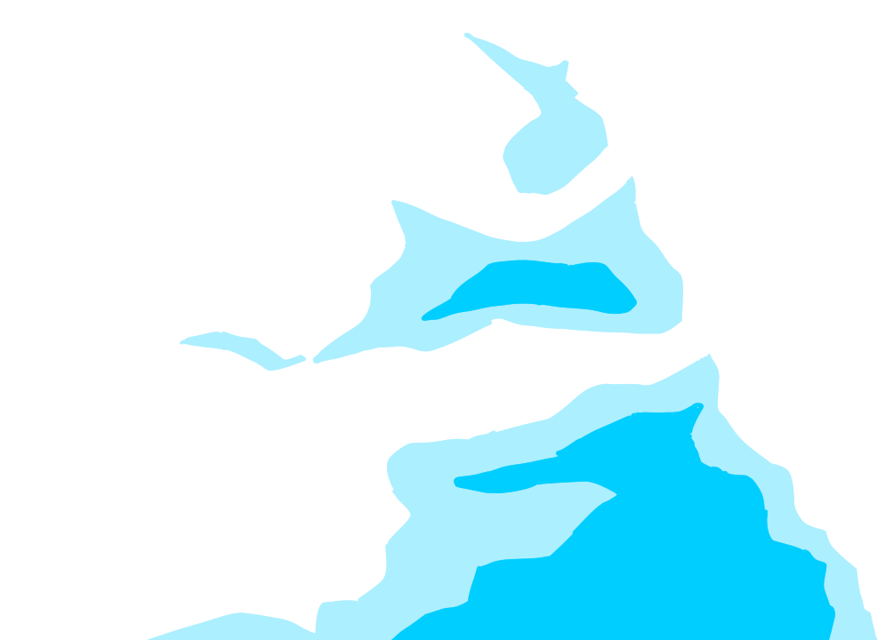
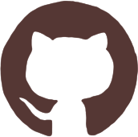
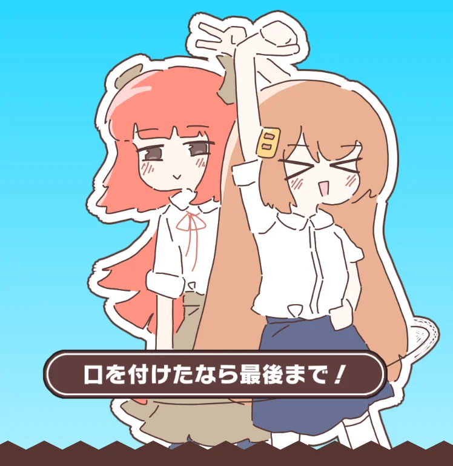
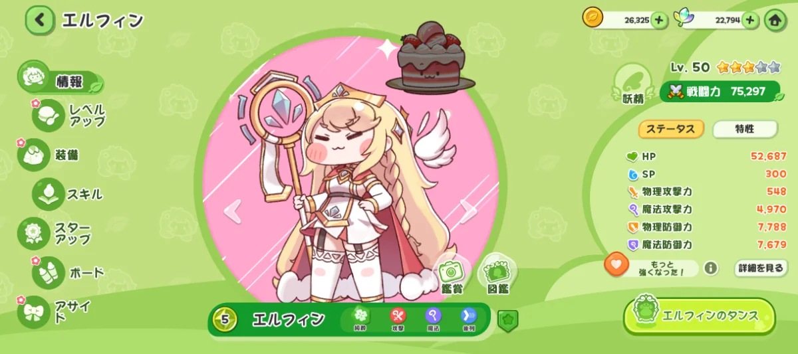

Project Path: 安部葉月ポートフォリオ

Source Tree:

```txt
安部葉月ポートフォリオ
├── audio
├── css
│   ├── color.css
│   ├── mobile
│   │   └── main.css
│   └── pc
│       ├── main.css
│       └── scene.css
├── editor
│   ├── diary_editor.html
│   ├── games_editor.html
│   ├── panel_editor.html
│   ├── title_layout_editor.html
│   ├── transition_editor.html
│   ├── works_editor.html
│   └── アニメーションエディター.html
├── img
│   ├── band.svg
│   ├── button_diary.webp
│   ├── button_hello.webp
│   ├── button_works.webp
│   ├── cloud.webp
│   ├── coffee.webp
│   ├── diary
│   │   └── 20261103-w6z4
│   │       ├── 1.webp
│   │       └── 2.webp
│   ├── games
│   │   ├── hamster
│   │   │   ├── 1.webp
│   │   │   └── thumb.webp
│   │   ├── kuchitsuke
│   │   │   ├── 1.webp
│   │   │   ├── 2.webp
│   │   │   ├── 3.webp
│   │   │   └── thumbnail.webp
│   │   ├── kuchitsuke.webp
│   │   ├── name_hamster.webp
│   │   ├── name_kuchitsuke.webp
│   │   ├── name_picros.webp
│   │   ├── name_pong.webp
│   │   ├── name_threegoma.webp
│   │   ├── picros
│   │   │   ├── 1.webp
│   │   │   ├── 2.webp
│   │   │   └── thumb.webp
│   │   ├── picros.webp
│   │   ├── pong
│   │   │   └── thumb.webp
│   │   ├── pong.webp
│   │   └── threegoma
│   │       ├── 1.webp
│   │       ├── 2.webp
│   │       └── thumb.webp
│   ├── icon
│   │   ├── back.webp
│   │   ├── discord.webp
│   │   ├── github.webp
│   │   └── twitter.webp
│   ├── illusts
│   │   ├── A2_部活16.webp
│   │   ├── c108サクカカラー.webp
│   │   ├── thumb
│   │   │   ├── A2_部活16.webp
│   │   │   ├── c108サクカカラー.webp
│   │   │   ├── カービィ.webp
│   │   │   ├── タイトル絵.webp
│   │   │   ├── ビラ1.webp
│   │   │   ├── ポスター_A2.webp
│   │   │   ├── マンチニール４.webp
│   │   │   ├── 安部菜々03.webp
│   │   │   ├── 日比さん３.webp
│   │   │   ├── 部活10.webp
│   │   │   ├── 部活11.webp
│   │   │   ├── 部活13-3.webp
│   │   │   ├── 部活18.webp
│   │   │   ├── 部活19.webp
│   │   │   ├── 部活2.webp
│   │   │   ├── 部活20.webp
│   │   │   ├── 部活4-2.webp
│   │   │   └── 部活6.webp
│   │   ├── thumbs
│   │   │   └── 新しいフォルダー
│   │   │       ├── 3.webp
│   │   │       └── thumbnail.webp
│   │   ├── カービィ.webp
│   │   ├── タイトル絵.webp
│   │   ├── ビラ1.webp
│   │   ├── ポスター_A2.webp
│   │   ├── マンチニール４.webp
│   │   ├── 安部菜々03.webp
│   │   ├── 日比さん３.webp
│   │   ├── 部活10.webp
│   │   ├── 部活11.webp
│   │   ├── 部活13-3.webp
│   │   ├── 部活18.webp
│   │   ├── 部活19.webp
│   │   ├── 部活2.webp
│   │   ├── 部活20.webp
│   │   ├── 部活4-2.webp
│   │   └── 部活6.webp
│   └── title
│       ├── author.webp
│       ├── positions.json
│       ├── イ1.webp
│       ├── イ2.webp
│       ├── ギ1.webp
│       ├── ギ2.webp
│       ├── ギ3.webp
│       ├── ス1.webp
│       ├── ス2.webp
│       ├── ツ1.webp
│       ├── ヤ1.webp
│       ├── ヤ2.webp
│       ├── ラ1.webp
│       ├── ラ2.webp
│       ├── リ1.webp
│       ├── リ2.webp
│       ├── ー1.webp
│       └── ー2.webp
├── index.html
├── js
│   ├── animation.js
│   ├── animation_dom.js
│   ├── main.js
│   ├── scenechange.js
│   ├── scenes
│   │   ├── diary.js
│   │   ├── games.js
│   │   ├── games_card.js
│   │   ├── illusts.js
│   │   ├── illusts_card.js
│   │   ├── illusts_panel.js
│   │   ├── musics.js
│   │   ├── title.js
│   │   └── works.js
│   ├── spintext.js
│   └── webgpu
│       ├── webgpu_bgframe.js
│       ├── webgpu_button.js
│       ├── webgpu_common.js
│       ├── webgpu_edge.js
│       ├── webgpu_games.js
│       ├── webgpu_hello.js
│       ├── webgpu_logo.js
│       ├── webgpu_noise.js
│       └── webgpu_noiseobject.js
├── json
│   ├── animation_logo.json
│   ├── diary.json
│   ├── games.json
│   ├── illusts.json
│   ├── musics.json
│   ├── transitions.json
│   └── works.json
└── readme.md

```

`css\color.css`:

```css
:root
{
    --white:#FFFFFF;

    --brown:#563631;
        --brown_pale:#d9b8a8;

    --blue:#00cfff;
    --blue_pale:#acefff;

    --pink:#ff21ac;
    --pink_pale:#ffa7f3;

    --red:#ff294b;
    --red_pale:#ffa7b5;

    --green:#0eff00;
    --green_pale:#adffa7;

    --orange:#ffb200;
    --orange_pale:#ffe3a4;
}
```
`css\mobile\main.css`:

```css
@import "../pc/main.css";
@import "../color.css";
```
`css\pc\main.css`:

```css
@import "./scene.css";
@import "../color.css";

/* ----------------------------------------------------------------------------
htmlの初期設定
---------------------------------------------------------------------------- */
html
{
    
    width:100%;
    height:100%;
    overflow:hidden;
}

body
{
    margin:0;
    width:100%;
    height:100%;
    overflow:hidden;
    background-color:var(--blue);   /* 背景色の置き場。シーンごとに scenechange.js が書き換える */
}


/* ----------------------------------------------------------------------------
シーンの初期設定
---------------------------------------------------------------------------- */
.scene
{
    display:none;

}

.scene.is-active
{
    display:flex;
}


/* ----------------------------------------------------------------------------
背景
---------------------------------------------------------------------------- */

#background
{
    display:contents;
}

#noise
{
    position:fixed;

    width:100%;
    height:100%;
    z-index:-99;
}

#cinemascope_top
{
    position:fixed;
    display:flex;
    overflow:hidden;
    
    z-index:100;
    margin:0;
    padding:0;
    top:0;
    width:100%;
    height:30px;

    background-image: url("../../img/band.svg");
    background-repeat: repeat-x;
    background-size: 40px 30px;

}
#cinemascope_bottom
{
    position:fixed;
    display:flex;
    overflow:hidden;
    
    z-index:100;
    margin:0;
    padding:0;
    bottom:0;
    width:100%;
    height:30px;
    transform:rotate(180deg);
    
    background-image: url("../../img/band.svg");
    background-repeat: repeat-x;
    background-size: 40px 30px;
}
```
`css\pc\scene.css`:

```css
/* ----------------------------------------------------------------------------
タイトル
---------------------------------------------------------------------------- */
#bgframe
{
    position:fixed;


    width:100%;
    height:100%;
    z-index:-90;
}

#title_cloud
{
    position:fixed;
    bottom:0;
    left:0;
    right:0;
    margin:0 auto;
    height:90vh;
    width:auto;
    z-index:-95;
}

#logo
{
    position:fixed;

    top: 3vh;
    left: 0;
    right: 0;
    margin: 0 auto;
    width: min(80vw, 1000px, calc(var(--logo-h) * 1.53));

    max-height: calc(100vh - 3vh - var(--logo-bottom, 0px) - 2vh);  /* ボタンの手前まで */
    object-fit: contain;
    height: auto;
}

.titlebutton_area
{
    /* 位置 */
    position:fixed;
    bottom:10%;
    align-items: center;
    width: 100%;

    /* 配列 */
    display:flex;
    flex-direction:row;
    gap:20px;

    flex-wrap: wrap;
    justify-content: center;
    max-width: 100%;
}

.titlebutton
{
    width: 300px;
    aspect-ratio: 860 / 190;

    /* ボタンの見た目を切る */
    appearance: none;
    -webkit-appearance: none;
    border: none;
    outline: none;
    background-color: transparent;
    background-position: center;
    background-size: cover;
    background-repeat: no-repeat;
    filter: opacity(0);

    overflow: visible;
    position: relative;     /* 中の canvas をこのボタン基準で置くため */
    --pad: 32;              /* 縁取りの余白(ボタン画像のピクセル単位) */
    --img-w: 860;           /* ボタン画像の幅 */
    --img-h: 190;           /* ボタン画像の高さ */

    --stripe: 30px;     /* 帯の周期 */
    --progress: 1;
}

.titlebutton_canvas
{
    position: absolute;
    pointer-events: none;   /* クリックやホバーはボタン本体で受ける */

    /* ボタンより、四方に --pad ぶん大きくする */
    left:   calc(var(--pad) / var(--img-w) * -100%);
    top:    calc(var(--pad) / var(--img-h) * -100%);
    width:  calc((var(--img-w) + var(--pad) * 2) / var(--img-w) * 100%);
    height: calc((var(--img-h) + var(--pad) * 2) / var(--img-h) * 100%);

    
    mask-image: repeating-linear-gradient(
        45deg,                                                   /* 斜めの角度 */
        black 0,
        black calc(var(--stripe) * var(--progress)),             /* 見える帯 */
        transparent calc(var(--stripe) * var(--progress)),
        transparent var(--stripe)                                /* 隠れる帯 */
    );

}


/* ----------------------------------------------------------------------------
自己紹介
---------------------------------------------------------------------------- */
#hello_bg
{
    position: fixed;
    inset: 0;
    width: 100%;
    height: 100%;
    z-index: -90;
}

#hello_backbutton
{
    position: fixed;
    top: 12vh;
    left: calc(50% - 36vh - 220px);
    width: 240px;
    aspect-ratio: 353 / 310;

    appearance: none;
    -webkit-appearance: none;
    border: none;
    outline: none;
    background-color: transparent;
    padding: 0;
    overflow: visible;
    
    --pad: 32;
    --img-w: 353;
    --img-h: 310;

    z-index: 10;
}

.hello_backbutton_canvas
{
    position: absolute;
    pointer-events: none;

    left:   calc(var(--pad) / var(--img-w) * -100%);
    top:    calc(var(--pad) / var(--img-h) * -100%);
    width:  calc((var(--img-w) + var(--pad) * 2) / var(--img-w) * 100%);
    height: calc((var(--img-h) + var(--pad) * 2) / var(--img-h) * 100%);
}

#hello_paper
{
    position: fixed;
    top: 12vh;
    left: 50%;
    translate: -50% 0;
    height: 100vh;                 /* 画面の高さ分あるので、下が12vhぶんはみ出る */
    aspect-ratio: 611 / 858;
    transform: translateX(-50%) rotate(-2deg);
}

#hello_paper_canvas
{
    position: absolute;
    inset: 0;
    width: 100%;
    height: 100%;
}

#hello_content
{
    position: relative;
    padding: 8% 10%;
    box-sizing: border-box;
    font-family: "Zen Old Mincho", serif;
}

#hello_name
{
    display: flex;
    align-items: center;
    gap: 16px;
    font-size: 2.4rem;
    color: var(--brown);

    /* 履歴書: 氏名欄(上にふりがなの点線、下に二重線) */
    padding: 1.8rem 0 0.5rem;
    border-bottom: 4px double var(--brown);
    background: repeating-linear-gradient(to right, var(--brown_pale) 0 3px, transparent 3px 7px) 0 1.2rem / 100% 1px no-repeat;
}

#hello_name a
{
    display: grid;
    place-items: center;
    width: 44px;
    height: 44px;
}

#hello_name a img
{
    max-width: 100%;
    max-height: 100%;
    object-fit: contain;
}

#hello_content h1
{
    font-size: 1.3rem;
    margin: 0 0 12px;
    color: var(--brown);
}

#hello_content h2
{
    font-size: 1rem;
    font-weight: normal;
    margin: 0 0 8px;
    color: var(--brown); opacity: 0.5;
}


/* 戻るボタン */
.back_button
{
    position: fixed;        /* シーンの並びに影響しない */
    top: 30px;              /* シネスコ(30px)の下 */
    left: 50px;
    z-index: 10;            /* 立ち絵などより前。カード(50)・シネスコ(100)より後ろ */

    width: 100px;
    aspect-ratio: 182 / 108;

    appearance: none;
    -webkit-appearance: none;
    border: none;
    outline: none;
    padding: 0;
    background: transparent url("../../img/icon/back.webp") center / contain no-repeat;
    cursor: pointer;
}


/* ----------------------------------------------------------------------------
作品
---------------------------------------------------------------------------- */
#works_panels
{
    --page-h:1;                 /* works.json の height が入る */
    --size:0.85;                /* 収まる最大の大きさに対する割合 */
    position:fixed;
    left:50%;
    top:50%;
    translate:-50% -50%;
    /* シネスコの帯(上下30px)の間に収める */
    width:calc(min(100vw, (100vh - 60px) / var(--page-h)) * var(--size));
    aspect-ratio:1 / var(--page-h);
    pointer-events:none;
}

.works_panel
{
    position:absolute;
    pointer-events:none;
    appearance:none;
    padding:0;
    border:none;
    background:transparent;
}

.works_panel svg
{
    display:block;
    width:100%;
    height:100%;
    overflow:visible;           /* 文字がコマからはみ出しても切らない */
}

.works_hit
{
    fill:transparent;
    pointer-events:fill;        /* クリックできるのは、コマの形の中だけ */
    cursor:pointer;
}

.works_edge
{
    display:none;
    fill:none;
    stroke-linejoin:round;
    pointer-events:none;
}

.works_panel:hover
{
    z-index:1;                  /* ホバー中のコマを隣より前に出す */
}

.works_panel:hover .works_edge
{
    display:inline;
}

.works_circle {
    position: fixed;
    inset: 0;
    margin: auto;
    transform: scale(0);

    width: 100vmax;
    height: 100vmax;

    z-index: 99;
    pointer-events: none;
    background-color: var(--blue);
    border-radius: 50%;
}


/* ----------------------------------------------------------------------------
回転文字(games / illusts / musics 共通)
---------------------------------------------------------------------------- */
#spin_text
{
    position:fixed;
    left:50%;
    top:50%;
    translate:-50% -50%;
    width:150vw;
    height:150vw;
    overflow:visible;

    z-index:101;
    pointer-events:none;
    fill:var(--pink);

    opacity:0;
    animation:spin_text 40s linear infinite;
}

#spin_text.is-active
{
    opacity:1;
}

.spin_big
{
    font-family:"Anton", sans-serif;
    font-size:80px;
}

.spin_small
{
    font-family:sans-serif;
    font-size:6px;
}

@keyframes spin_text
{
    to { rotate:360deg; }
}

/* ----------------------------------------------------------------------------
ゲーム
---------------------------------------------------------------------------- */
#games_track
{
    --u:100vh;                /* JSON の 1.0 にあたる長さ */
    position:fixed;
    inset:0;
    will-change:transform;
    pointer-events:none;
}

.game_item
{
    position:absolute;
    left:calc(var(--x) * var(--u));
    top:calc(var(--y) * var(--u));
    height:calc(var(--h) * var(--u));
    width:calc(var(--h) * var(--u) * var(--aspect));

    pointer-events:auto;
    appearance:none;
    padding:0;
    border:none;
    background:transparent;
    cursor:pointer;
}

.game_item canvas
{
    position:absolute;
    pointer-events:none;

    /* ボタンより、四方に --pad ぶん大きくする */
    left:   calc(var(--pad) / var(--img-w) * -100%);
    top:    calc(var(--pad) / var(--img-h) * -100%);
    width:  calc((var(--img-w) + var(--pad) * 2) / var(--img-w) * 100%);
    height: calc((var(--img-h) + var(--pad) * 2) / var(--img-h) * 100%);
}

.game_name
{
    position:absolute;
    left:calc(var(--x) * var(--u));
    top:calc(var(--y) * var(--u));
    height:calc(var(--h) * var(--u));
    width:calc(var(--h) * var(--u) * var(--aspect));
    z-index:1;                /* 隣の立ち絵より前に出す */
    pointer-events:none;      /* ホバーの邪魔をしない */
}

#game_card
{
    position:fixed;
    inset:0;
    z-index:50;             /* シネスコ(100)より下 */
    display:flex;
    align-items:center;
    justify-content:center;
    background:rgba(86, 54, 49, 0.6);
}

#game_card[hidden]
{
    display:none;
}

#game_card_body
{
    width:min(560px, 80vw);
    padding:32px;
    background:var(--white);
    color:var(--brown);
}

#game_card_text
{
    white-space:pre-line;
}

#game_card_images
{
    position:relative;
    margin-bottom:16px;
}

#game_card_images [hidden]
{
    display:none;
}

#game_card_image
{
    display:block;
    width:100%;
    max-height:40vh;
    object-fit:contain;
}

#game_card_prev,
#game_card_next
{
    position:absolute;
    top:50%;
    translate:0 -50%;
    width:44px;
    aspect-ratio:1 / 1;
    border-radius:50%;
    border:2px solid var(--brown);
    background-color:var(--white);
    color:var(--brown);
    cursor:pointer;
}

#game_card_prev { left:8px; }
#game_card_next { right:8px; }

#game_card_count
{
    position:absolute;
    right:8px;
    bottom:8px;
    padding:2px 8px;
    background:var(--white);
    color:var(--brown);
    font-size:0.9rem;
}


/* ----------------------------------------------------------------------------
絵
---------------------------------------------------------------------------- */
#illusts_track
{
    position:fixed;
    inset:0;
    z-index:0;
    pointer-events:none;      /* 操作を通すのは、コマの上だけ */
    will-change:transform;
}

#illusts_svg
{
    position:absolute;
    left:50%;
    top:30px;                 /* シネスコの帯の下から始める */
    width:min(400px, 100vw);  /* 縦長の質感を保つため、最大 400px */
    translate:-50% 0;
    overflow:visible;         /* 縁取りがはみ出しても切らない */
    pointer-events:none;
}

.illusts_hit
{
    fill:transparent;
    pointer-events:fill;
    cursor:pointer;
}

.illusts_edge
{
    display:none;
    fill:none;
    stroke-linejoin:round;
    pointer-events:none;
}

.illusts_edge.on
{
    display:inline;
}

.edge_brown
{
    stroke:var(--brown);
    stroke-width:8px;
    vector-effect:non-scaling-stroke;
}

.edge_white
{
    stroke:var(--white);
    stroke-width:4px;
    vector-effect:non-scaling-stroke;
}

/* 絵の詳細表示 */
#illust_card
{
    position:fixed;
    inset:0;
    z-index:50;             /* シネスコ(100)より下 */
    display:flex;
    flex-direction:column;
    align-items:center;
    justify-content:center;
    gap:18px;
    padding:60px 20px;      /* シネスコの帯にかからない余白 */
    box-sizing:border-box;
    background:rgba(86, 54, 49, 0.88);
}

#illust_card[hidden]
{
    display:none;
}

#illust_card_img
{
    /* 高さに収まる最大の大きさ。サムネから原寸に替わっても、大きさは変わらない */
    width:min(100%, calc((100vh - 220px) * var(--ar, 1)));
    aspect-ratio:var(--ar, 1);
    height:auto;
    object-fit:contain;
}

#illust_card_text
{
    width:min(640px, 100%);
    color:var(--white);
    text-align:center;
}

#illust_card_date
{
    margin:0 0 6px;
    font-size:14px;
    letter-spacing:0.15em;
    color:var(--brown_pale);
}

#illust_card_comment
{
    margin:0;
    font-size:16px;
    line-height:1.7;
    white-space:pre-wrap;   /* コメントの改行を、そのまま出す */
}

#illust_card_close
{
    position:absolute;
    top:44px;
    right:20px;
    padding:6px 14px;
    border:none;
    background:var(--white);
    color:var(--brown);
    cursor:pointer;
}


/* ----------------------------------------------------------------------------
音楽
---------------------------------------------------------------------------- */
#music_player
{
    position: fixed;
    top: 50%;
    left: 50%;
    translate: -50% -50%;
    width: min(560px, calc(100vw - 32px));
    max-height: calc(100vh - 120px);
    overflow: auto;
    box-sizing: border-box;
    padding: 32px;

    display: flex;
    flex-direction: column;
    gap: 14px;

    background: var(--white);
    border: 4px solid var(--brown);
    border-radius: 28px;
    box-shadow: 10px 10px 0 var(--brown);
    color: var(--brown);
    font-family: "Zen Kaku Gothic New", sans-serif;
}

#music_title   { margin: 0; font-size: 1.8rem; }
#music_date    { margin: 0; opacity: .55; }
#music_comment { margin: 0; line-height: 1.7; }

#music_seek
{
    display: flex;
    align-items: center;
    gap: 12px;
    font-variant-numeric: tabular-nums;
}

#music_bar
{
    flex: 1;
    height: 12px;
    border: 3px solid var(--brown);
    border-radius: 999px;
    overflow: hidden;
    cursor: pointer;
}

#music_bar i
{
    display: block;
    width: 0%;
    height: 100%;
    background: var(--green);
}

#music_controls
{
    display: flex;
    align-items: center;
    gap: 16px;
}

#music_controls button
{
    width: 52px;
    height: 52px;
    border: 3px solid var(--brown);
    border-radius: 50%;
    background: var(--white);
    color: var(--brown);
    font-size: 1.2rem;
    cursor: pointer;
}

#music_controls #music_play
{
    width: 68px;
    height: 68px;
    background: var(--green);
    font-size: 1.5rem;
}

#music_download
{
    margin-left: auto;
    padding: 10px 22px;
    border-radius: 999px;
    background: var(--brown);
    color: var(--white);
    font-weight: 700;
    text-decoration: none;
}

#music_list
{
    list-style: none;
    margin: 6px 0 0;
    padding: 0;
    border-top: 3px double var(--brown);
}

#music_list li
{
    display: flex;
    gap: 12px;
    padding: 10px 6px;
    border-bottom: 1px dashed var(--brown_pale);
    cursor: pointer;
}

#music_list li.now
{
    background: var(--green_pale);
    font-weight: 700;
}


/* ----------------------------------------------------------------------------
日記
---------------------------------------------------------------------------- */
#diary_list
{
    position: fixed;
    top: 50%;
    left: 50%;
    translate: -50% -50%;
    width: min(560px, calc(100vw - 32px));
    max-height: calc(100vh - 120px);
    overflow: auto;
    box-sizing: border-box;
    padding: 16px 32px;

    background: var(--white);
    border: 4px solid var(--pink);
    border-radius: 28px;
    box-shadow: 10px 10px 0 var(--pink);
    color: var(--brown);
    font-family: "Zen Kaku Gothic New", sans-serif;
}

.diary_item
{
    display: flex;
    gap: 16px;
    padding: 14px 4px;
    border-bottom: 1px dashed var(--pink_pale);
    cursor: pointer;
}
.diary_item:last-child  { border-bottom: none; }
.diary_item:hover       { background: var(--pink_pale); }
.diary_item_date        { opacity: .55; white-space: nowrap; }
.diary_item_title       { font-weight: 700; }

#diary_card
{
    position: fixed;
    inset: 0;
    z-index: 50;            /* シネスコ(100)より下 */
    display: flex;
    align-items: center;
    justify-content: center;
    background: rgba(86, 54, 49, 0.6);
}
#diary_card[hidden]     { display: none; }

#diary_card_body
{
    width: min(560px, 80vw);
    max-height: 80vh;
    overflow: auto;
    box-sizing: border-box;
    padding: 32px;
    background: var(--white);
    color: var(--brown);
    font-family: "Zen Kaku Gothic New", sans-serif;
}
#diary_card_date        { margin: 0; opacity: .55; }

/* 本文(マークダウン) */
#diary_card_text        { line-height: 1.8; }
#diary_card_text > :first-child { margin-top: 0; }
#diary_card_text > :last-child  { margin-bottom: 0; }
#diary_card_text h1, #diary_card_text h2, #diary_card_text h3 { margin: 1.4em 0 .5em; line-height: 1.4; }
#diary_card_text h1 { font-size: 1.4rem; }
#diary_card_text h2 { font-size: 1.2rem; }
#diary_card_text h3 { font-size: 1.05rem; }
#diary_card_text ul, #diary_card_text ol { padding-left: 1.5em; }
#diary_card_text a    { color: var(--pink); }
#diary_card_text code { padding: 0 .3em; border-radius: 4px; background: var(--pink_pale); }
#diary_card_text pre  { padding: 12px; overflow: auto; background: var(--brown); color: var(--white); }
#diary_card_text pre code { padding: 0; background: none; }
#diary_card_text blockquote { margin: 1em 0; padding-left: 1em; border-left: 4px solid var(--pink_pale); }
#diary_card_text figure     { margin: 1.2em 0; text-align: center; }
#diary_card_text figure img { max-width: 100%; }
#diary_card_text figcaption { margin-top: .4em; font-size: .9rem; opacity: .6; }
```
`editor\diary_editor.html`:

```html
<!DOCTYPE html>
<html lang="ja">
<head>
<meta charset="utf-8">
<meta name="viewport" content="width=device-width, initial-scale=1">
<title>日記エディター</title>
<link href="https://fonts.googleapis.com/css2?family=Zen+Old+Mincho:wght@500;700&display=swap" rel="stylesheet">
<style>
:root{--white:#fff;--brown:#563631;--brown_pale:#d9b8a8;--pink:#ff21ac;--pink_pale:#ffa7f3}
*{box-sizing:border-box}
html,body{margin:0;height:100%}
body{display:grid;grid-template-columns:240px minmax(0,1fr) minmax(0,1fr);grid-template-rows:auto 1fr;
  background:#fff5fd;color:var(--brown);font-family:sans-serif}
button{font:inherit;color:var(--brown);background:var(--white);border:2px solid var(--brown);
  border-radius:999px;padding:6px 16px;cursor:pointer}
button.main{background:var(--pink);color:var(--white);border-color:var(--pink);font-weight:700}
button:disabled{opacity:.4;cursor:default}

header{grid-column:1/-1;display:flex;align-items:center;gap:12px;padding:10px 16px;
  background:var(--white);border-bottom:2px solid var(--pink)}
#status{margin-left:auto;opacity:.7}

#list{overflow:auto;padding:12px;border-right:1px solid var(--brown_pale);display:flex;flex-direction:column;gap:6px}
#list .item{text-align:left;border-radius:10px;border-width:1px;padding:8px 10px}
#list .item.now{background:var(--pink_pale);border-color:var(--pink)}
#list .item small{display:block;opacity:.6}

#form{border:0;margin:0;padding:16px;min-width:0;overflow:auto;display:flex;flex-direction:column;gap:10px}
#form label{display:flex;flex-direction:column;gap:4px;font-size:.85rem}
#form input,#form textarea{font:inherit;color:var(--brown);border:2px solid var(--brown_pale);border-radius:8px;padding:8px;background:var(--white)}
#body{flex:1;min-height:300px;resize:none;line-height:1.7}
.row{display:flex;gap:8px;flex-wrap:wrap}
.hint{font-size:.8rem;opacity:.65;margin:0;line-height:1.6}

#preview{overflow:auto;padding:16px;background:rgba(86,54,49,.6)}
.card{max-width:560px;margin:0 auto;padding:32px;background:var(--white);color:var(--brown);font-family:"Zen Old Mincho",serif}
#p_date{margin:0;opacity:.55}
#p_text{line-height:1.8}
#p_text>:first-child{margin-top:0}#p_text>:last-child{margin-bottom:0}
#p_text h1,#p_text h2,#p_text h3{margin:1.4em 0 .5em;line-height:1.4}
#p_text h1{font-size:1.4rem}#p_text h2{font-size:1.2rem}#p_text h3{font-size:1.05rem}
#p_text ul,#p_text ol{padding-left:1.5em}
#p_text a{color:var(--pink)}
#p_text code{padding:0 .3em;border-radius:4px;background:var(--pink_pale)}
#p_text pre{padding:12px;overflow:auto;background:var(--brown);color:var(--white)}
#p_text pre code{padding:0;background:none}
#p_text blockquote{margin:1em 0;padding-left:1em;border-left:4px solid var(--pink_pale)}
#p_text figure{margin:1.2em 0;text-align:center}
#p_text figure img{max-width:100%}
#p_text figcaption{margin-top:.4em;font-size:.9rem;opacity:.6}
</style>
</head>
<body>
<header>
  <button id="open">サイトのフォルダを選ぶ</button>
  <button id="new" disabled>新しい記事</button>
  <button id="save" class="main" disabled>保存 (Ctrl+S)</button>
  <span id="status">最初に、サイトのフォルダ(index.html がある場所)を選んでください</span>
</header>

<nav id="list"></nav>

<fieldset id="form" disabled>
  <label>日付<input type="date" id="date"></label>
  <label>タイトル<input type="text" id="title"></label>
  <label>本文(マークダウン)<textarea id="body"></textarea></label>
  <div class="row">
    <button id="addimg" type="button">画像を挿入</button>
    <button id="del" type="button">この記事を削除</button>
    <input type="file" id="file" accept="image/*" multiple hidden>
  </div>
  <p class="hint">画像は貼り付け・ドラッグ&amp;ドロップでも入れられます。<br>
    画像は前後を空行で区切ってください。<code></code> の文字が、画像の下のキャプションになります(空なら出ません)。</p>
</fieldset>

<section id="preview">
  <div class="card">
    <p id="p_date"></p>
    <h2 id="p_title"></h2>
    <div id="p_text"></div>
  </div>
</section>

<script src="https://cdnjs.cloudflare.com/ajax/libs/marked/12.0.2/marked.min.js"></script>
<script src="https://cdnjs.cloudflare.com/ajax/libs/dompurify/3.1.6/purify.min.js"></script>
<script>
const $ = s => document.querySelector(s);
let root = null, articles = [], cur = null, dirty = false;
const urls = new Map();

// 画像1枚だけの段落を、中央揃えの <figure> + キャプションにする
// (本番の diary.js にも、同じ関数を入れる)
function RenderBody(md)
{
    const box = document.createElement('div');
    box.innerHTML = DOMPurify.sanitize(marked.parse(md, { breaks: true }));
    box.querySelectorAll('p').forEach(p =>
    {
        const img = p.querySelector(':scope > img');
        if (!img || p.children.length !== 1 || p.textContent.trim() !== '') return;

        const fig = document.createElement('figure');
        fig.append(img);
        if (img.alt)
        {
            const cap = document.createElement('figcaption');
            cap.textContent = img.alt;
            fig.append(cap);
        }
        p.replaceWith(fig);
    });
    box.querySelectorAll('a').forEach(a => { a.target = '_blank'; a.rel = 'noopener'; });
    return box;
}

// ---------------------------------------------------------------- フォルダ操作
async function Dir(path, create = false)
{
    let d = root;
    for (const n of path.split('/').filter(Boolean)) d = await d.getDirectoryHandle(n, { create });
    return d;
}

function Status(msg) { $('#status').textContent = msg; }
function Dirty(v = true) { dirty = v; if (v) Status('未保存の変更があります'); }
window.addEventListener('beforeunload', e => { if (dirty) e.preventDefault(); });

$('#open').onclick = async () =>
{
    try { root = await showDirectoryPicker({ mode: 'readwrite' }); } catch { return; }

    try
    {
        const fh = await (await Dir('json')).getFileHandle('diary.json');
        articles = JSON.parse(await (await fh.getFile()).text());
    }
    catch (e)
    {
        if (e.name !== 'NotFoundError') { alert('diary.json を読めませんでした: ' + e.message); root = null; return; }
        articles = [];
    }

    cur = null; dirty = false;
    $('#new').disabled = $('#save').disabled = false;
    $('#form').disabled = true;
    RenderList();
    Status(`${articles.length} 件の記事を読み込みました`);
};

const Sorted = () => articles.slice().sort((a, b) => b.date.localeCompare(a.date));

async function Save()
{
    if (!root) return;
    try
    {
        const fh = await (await Dir('json', true)).getFileHandle('diary.json', { create: true });
        const w = await fh.createWritable();
        await w.write(JSON.stringify(Sorted(), null, 4));
        await w.close();
        Dirty(false);
        Status('保存しました');
    }
    catch (e) { alert('保存できませんでした: ' + e.message); }
}
$('#save').onclick = Save;
window.addEventListener('keydown', e => { if ((e.ctrlKey || e.metaKey) && e.key === 's') { e.preventDefault(); Save(); } });

// ---------------------------------------------------------------- 記事一覧
function RenderList()
{
    $('#list').replaceChildren(...Sorted().map(a =>
    {
        const b = document.createElement('button');
        b.className = 'item' + (a === cur ? ' now' : '');
        b.innerHTML = '<small></small><span></span>';
        b.children[0].textContent = a.date;
        b.children[1].textContent = a.title || '(無題)';
        b.onclick = () => Select(a);
        return b;
    }));
}

function Select(a)
{
    cur = a;
    $('#form').disabled = false;
    $('#date').value = a.date.replace(/\./g, '-');
    $('#title').value = a.title;
    $('#body').value = a.body;
    RenderList();
    Preview();
}

$('#new').onclick = () =>
{
    const d = new Date();
    const date = `${d.getFullYear()}.${String(d.getMonth() + 1).padStart(2, '0')}.${String(d.getDate()).padStart(2, '0')}`;
    // id は記事の画像フォルダ名。作ったあとは変えない(日付を直しても変わらない)
    const id = date.replace(/\./g, '') + '-' + Math.random().toString(36).slice(2, 6);
    const a = { id, date, title: '', body: '' };
    articles.push(a);
    Dirty();
    Select(a);
    $('#title').focus();
};

$('#del').onclick = async () =>
{
    if (!cur || !confirm('この記事を削除します。画像フォルダも削除されます。')) return;
    const id = cur.id;
    articles = articles.filter(a => a !== cur);
    cur = null;
    $('#form').disabled = true;
    try { await (await Dir('img/diary')).removeEntry(id, { recursive: true }); } catch {}
    RenderList(); Preview();
    await Save();
};

// 入力 → 反映
$('#date').oninput  = e => { cur.date  = e.target.value.replace(/-/g, '.'); Dirty(); RenderList(); Preview(); };
$('#title').oninput = e => { cur.title = e.target.value; Dirty(); RenderList(); Preview(); };
$('#body').oninput  = e => { cur.body  = e.target.value; Dirty(); Preview(); };

// ---------------------------------------------------------------- プレビュー
function Preview()
{
    $('#p_date').textContent = cur?.date ?? '';
    $('#p_title').textContent = cur?.title ?? '';
    const box = RenderBody(cur?.body ?? '');
    $('#p_text').replaceChildren(...box.childNodes);
    $('#p_text').querySelectorAll('img').forEach(ResolveImage);
}

// ./img/... の画像は、エディターの場所から見えないので、選んだフォルダから直接読む
async function ResolveImage(img)
{
    const src = img.getAttribute('src') ?? '';
    if (!root || !src.startsWith('./img/')) return;

    let url = urls.get(src);
    if (!url)
    {
        try
        {
            const parts = src.slice(2).split('/');
            const name = parts.pop();
            const file = await (await (await Dir(parts.join('/'))).getFileHandle(name)).getFile();
            url = URL.createObjectURL(file);
            urls.set(src, url);
        }
        catch { return; }
    }
    img.src = url;
}

// ---------------------------------------------------------------- 画像の取り込み
// 最大幅1200pxに縮めて webp にする
async function ToWebp(file)
{
    const bmp = await createImageBitmap(file);
    const scale = Math.min(1, 1200 / bmp.width);
    const c = document.createElement('canvas');
    c.width = Math.round(bmp.width * scale);
    c.height = Math.round(bmp.height * scale);
    c.getContext('2d').drawImage(bmp, 0, 0, c.width, c.height);
    return new Promise(r => c.toBlob(r, 'image/webp', 0.85));
}

async function AddImages(files)
{
    if (!root || !cur) { alert('フォルダを選び、記事を選んでから入れてください'); return; }

    // 画像は img/diary/<記事id>/ に、1.webp, 2.webp ... で保存(他の記事と衝突しない)
    const dir = await Dir(`img/diary/${cur.id}`, true);
    let n = 0;
    for await (const name of dir.keys()) n = Math.max(n, parseInt(name) || 0);

    let text = '';
    for (const f of files)
    {
        if (!f.type.startsWith('image/')) continue;
        const name = `${++n}.webp`;
        const w = await (await dir.getFileHandle(name, { create: true })).createWritable();
        await w.write(await ToWebp(f));
        await w.close();
        text += `\n\n\n\n`;
    }
    if (!text) return;

    // カーソル位置に入れて、キャプション欄([ ])にカーソルを置く
    const t = $('#body');
    t.setRangeText(text, t.selectionStart, t.selectionEnd, 'end');
    const i = t.value.lastIndexOf(' + 2;
    t.setSelectionRange(i, i);
    t.focus();
    t.dispatchEvent(new Event('input'));
    Status('画像を保存しました(記事の保存も忘れずに)');
}

$('#addimg').onclick = () => $('#file').click();
$('#file').onchange = e => { AddImages([...e.target.files]); e.target.value = ''; };
$('#body').addEventListener('dragover', e => e.preventDefault());
$('#body').addEventListener('drop', e =>
{
    if (e.dataTransfer.files.length) { e.preventDefault(); AddImages([...e.dataTransfer.files]); }
});
$('#body').addEventListener('paste', e =>
{
    const files = [...e.clipboardData.files];
    if (files.length) { e.preventDefault(); AddImages(files); }
});

Preview();
</script>
</body>
</html>

```
`editor\games_editor.html`:

```html
<!DOCTYPE html>
<html lang="ja">
<head>
<meta charset="utf-8">
<title>ゲーム一覧エディター</title>
<style>
    body { margin:0; display:flex; height:100vh; font:14px sans-serif; background:#222; color:#eee; }
    #side { width:300px; padding:12px; box-sizing:border-box; overflow:auto; background:#333; flex:none; }
    #side h3 { margin:16px 0 4px; font-size:13px; color:#fa9; }
    #side label { display:block; margin-top:4px; }
    #side input[type=text], #side textarea { width:100%; box-sizing:border-box; }
    #side input[type=number] { width:64px; }
    #side button { padding:4px 8px; margin-top:4px; }
    #fields { border:none; margin:0; padding:0; min-width:0; }
    .path { font-size:12px; color:#aaa; word-break:break-all; }
    .nums { margin-top:4px; }
    .cimg { display:flex; align-items:center; gap:4px; margin-top:4px; }
    .cimg img { width:56px; height:56px; object-fit:contain; background:#444; flex:none; }
    .cimg .path { flex:1; min-width:0; }
    .cimg button { margin-top:0; padding:2px 6px; }
    #list { max-height:160px; overflow:auto; background:#2a2a2a; }
    .row { padding:3px 6px; cursor:pointer; }
    .row.on { background:#fa9; color:#222; }
    #warn { color:#f88; white-space:pre-wrap; margin-top:10px; }

    #main { flex:1; overflow:auto; padding:20px; }
    #stage { position:relative; background:#445; touch-action:none; user-select:none; }
    #guide { position:absolute; left:0; top:0; height:100%; aspect-ratio:16/9; box-sizing:border-box;
             border:1px dashed #fff6; font-size:11px; color:#fff8; padding:2px 4px; pointer-events:none; }
    #items { position:absolute; inset:0; }

    .item { position:absolute; cursor:move; }
    .item img { width:100%; height:100%; display:block; pointer-events:none; }
    .item:hover { z-index:6; }
    .item.sel { outline:2px solid #fa9; z-index:5; }
    .item.empty { background:#6668; border:1px dashed #ccc; box-sizing:border-box; font-size:12px;
                  display:flex; align-items:center; justify-content:center; }
    .nm { position:absolute; display:none; outline:1px dashed #9cf; cursor:move; }
    .nm img { width:100%; height:100%; display:block; pointer-events:none; }
    .nm.show, .item:hover .nm { display:block; }
</style>
</head>
<body>
<div id="side">
    <h3>ファイル</h3>
    <button id="save">JSONを保存</button>
    <label>JSONを読み込む <input type="file" id="load" accept=".json"></label>
    <label>画像をまとめて読み込む <input type="file" id="imgs" accept="image/*" multiple></label>

    <h3>ゲーム一覧</h3>
    <div id="list"></div>
    <div>
        <button id="add">追加</button>
        <button id="del">削除</button>
        <button id="up" data-move="-1">↑</button>
        <button id="down" data-move="1">↓</button>
    </div>

    <fieldset id="fields" disabled>
        <h3>カード</h3>
        <label>ID <input type="text" data-key="id"></label>
        <label>タイトル <input type="text" data-key="title"></label>
        <label>説明文 <textarea data-key="text" rows="5"></textarea></label>
        <label>DLリンク <input type="text" data-key="url" placeholder="https://..."></label>
        <div>紹介画像(複数可) <input type="file" data-key="card_imgs" accept="image/*" multiple></div>
        <div id="cardImgs"></div>

        <h3>立ち絵</h3>
        <div>画像 <input type="file" data-key="img" accept="image/*"> <button data-clear="img">外す</button></div>
        <div class="path" data-path="img"></div>
        <div class="nums">
            x <input type="number" data-key="x" step="0.01">
            y <input type="number" data-key="y" step="0.01">
            h <input type="number" data-key="h" step="0.01">
        </div>

        <h3>名前画像(ホバー時)</h3>
        <div>画像 <input type="file" data-key="name_img" accept="image/*"> <button data-clear="name_img">外す</button></div>
        <div class="path" data-path="name_img"></div>
        <div class="nums">
            x <input type="number" data-key="name_x" step="0.01">
            y <input type="number" data-key="name_y" step="0.01">
            h <input type="number" data-key="name_h" step="0.01">
        </div>

        <h3>表示</h3>
        <label><input type="checkbox" id="showAll"> すべての名前画像を表示</label>
    </fieldset>

    <h3>操作</h3>
    <div>
        立ち絵・名前画像: ドラッグで移動(Alt で細かく)、ホイールで大きさ<br>
        Ctrl+Z: 元に戻す<br>
        位置と大きさの単位は、画面の高さ = 1.0(ゲーム本体と同じ)<br>
        名前画像の位置は、立ち絵と同じ座標で指定します<br>
        立ち絵と名前画像は ./img/games/ に置いてください<br>
        紹介画像は ./img/games/&lt;ID&gt;/ に置いてください(IDを変えたらフォルダ名も変更)
    </div>
    <div id="warn"></div>
</div>

<div id="main">
    <div id="stage">
        <div id="guide">1画面目(16:9)</div>
        <div id="items"></div>
    </div>
</div>

<script>
const DIR = './img/games/';
const RATIO = 16 / 9;

const elMain = document.getElementById('main');
const elStage = document.getElementById('stage');
const elItems = document.getElementById('items');
const elList = document.getElementById('list');
const elFields = document.getElementById('fields');
const elCardImgs = document.getElementById('cardImgs');
const elWarn = document.getElementById('warn');

let games = [];
let sel = -1;
let U = 500;                 // 1.0 にあたる長さ(px)
let showAll = false;
let drag = null;
let lastWheel = 0;

const localUrls = {};        // パス → 読み込んだ画像のURL
const aspects = {};          // パス → 縦横比(幅 / 高さ)
const loading = {};
const undoStack = [];

// ----------------------------------------------------------------------------
// データ
// ----------------------------------------------------------------------------
function Round4(v) { return Math.round(v * 10000) / 10000; }

function Pick(v, d) { return v === undefined || v === null ? d : v; }

function Normalize(s, i) {
    const x = Pick(s.x, 0.3);
    const y = Pick(s.y, 0.1);
    const h = Pick(s.h, 0.8);
    return {
        id: Pick(s.id, 'game' + (i + 1)),
        img: Pick(s.img, ''),
        x: x, y: y, h: h,
        name_img: Pick(s.name_img, ''),
        name_x: Pick(s.name_x, x),
        name_y: Pick(s.name_y, Round4(y + h)),
        name_h: Pick(s.name_h, 0.1),
        title: Pick(s.title, ''),
        text: Pick(s.text, ''),
        url: Pick(s.url, ''),
        card_imgs: Pick(s.card_imgs, []),
    };
}

function SetGames(list) {
    games = [];
    for (let i = 0; i < list.length; i++) games.push(Normalize(list[i], i));
    sel = games.length ? 0 : -1;
    Render();
}

// ----------------------------------------------------------------------------
// 元に戻す
// ----------------------------------------------------------------------------
function Push() {
    undoStack.push(JSON.stringify({ games: games, sel: sel }));
    if (undoStack.length > 100) undoStack.shift();
}

function Undo() {
    if (!undoStack.length) return;
    const s = JSON.parse(undoStack.pop());
    games = s.games;
    sel = s.sel;
    Render();
}

// ----------------------------------------------------------------------------
// 画像
// ----------------------------------------------------------------------------
function Src(path) {
    if (localUrls[path]) return localUrls[path];
    if (path.indexOf('./') === 0) return '.' + path;
    return '../' + path;
}

function ForgetAspect(path) {
    delete aspects[path];
    delete loading[path];
}

function OnAspectLoad() {
    aspects[this.dataset.path] = this.naturalWidth / this.naturalHeight;
    RenderStage();
}

function OnAspectError() {
    aspects[this.dataset.path] = 0.6;
}

// 縦横比を返す。まだ読み込んでいなければ、読み込みを始めて仮の値を返す
function Aspect(path) {
    if (!path) return 0.6;
    if (aspects[path]) return aspects[path];
    if (!loading[path]) {
        loading[path] = true;
        const im = new Image();
        im.dataset.path = path;
        im.onload = OnAspectLoad;
        im.onerror = OnAspectError;
        im.src = Src(path);
    }
    return 0.6;
}

// ----------------------------------------------------------------------------
// 描画
// ----------------------------------------------------------------------------
function Render() {
    RenderList();
    FillFields();
    RenderCardImgs();
    RenderStage();
    Check();
}

function RenderList() {
    elList.textContent = '';
    for (let i = 0; i < games.length; i++) {
        const row = document.createElement('div');
        row.className = 'row' + (i === sel ? ' on' : '');
        row.dataset.index = i;
        row.textContent = (i + 1) + '. ' + (games[i].title || games[i].id);
        elList.append(row);
    }
}

function FillFields() {
    elFields.disabled = sel < 0;
    const g = sel < 0 ? null : games[sel];

    const inputs = elFields.querySelectorAll('[data-key]');
    for (let i = 0; i < inputs.length; i++) {
        const t = inputs[i];
        if (t.type === 'file') { t.value = ''; continue; }
        t.value = g ? g[t.dataset.key] : '';
    }

    const paths = elFields.querySelectorAll('[data-path]');
    for (let i = 0; i < paths.length; i++) {
        const p = g ? g[paths[i].dataset.path] : '';
        paths[i].textContent = p || '(なし)';
    }
}

function MakeButton(label, act, i) {
    const b = document.createElement('button');
    b.textContent = label;
    b.dataset.act = act;
    b.dataset.index = i;
    return b;
}

function RenderCardImgs() {
    elCardImgs.textContent = '';
    if (sel < 0) return;
    const list = games[sel].card_imgs;
    for (let i = 0; i < list.length; i++) {
        const row = document.createElement('div');
        row.className = 'cimg';
        const im = document.createElement('img');
        im.src = Src(list[i]);
        const p = document.createElement('div');
        p.className = 'path';
        p.textContent = list[i];
        row.append(im, p, MakeButton('↑', 'up', i), MakeButton('↓', 'down', i), MakeButton('外す', 'del', i));
        elCardImgs.append(row);
    }
}

function OnCardImgClick(e) {
    const act = e.target.dataset.act;
    if (!act || sel < 0) return;
    const i = Number(e.target.dataset.index);
    const list = games[sel].card_imgs;
    if (act === 'del') {
        Push();
        list.splice(i, 1);
    } else {
        const j = i + (act === 'up' ? -1 : 1);
        if (j < 0 || j >= list.length) return;
        Push();
        const tmp = list[i];
        list[i] = list[j];
        list[j] = tmp;
    }
    Render();
}

function StyleItem(el, g) {
    el.style.left = g.x * U + 'px';
    el.style.top = g.y * U + 'px';
    el.style.height = g.h * U + 'px';
    el.style.width = g.h * U * Aspect(g.img) + 'px';

    const nm = el.querySelector('.nm');
    if (nm) {
        nm.style.left = (g.name_x - g.x) * U + 'px';
        nm.style.top = (g.name_y - g.y) * U + 'px';
        nm.style.height = g.name_h * U + 'px';
        nm.style.width = g.name_h * U * Aspect(g.name_img) + 'px';
    }
}

function MakeItem(i) {
    const g = games[i];
    const el = document.createElement('div');
    el.className = 'item' + (g.img ? '' : ' empty');
    el.dataset.index = i;

    if (g.img) {
        const im = document.createElement('img');
        im.src = Src(g.img);
        el.append(im);
    } else {
        el.append('立ち絵なし');
    }

    if (g.name_img) {
        const nm = document.createElement('div');
        nm.className = 'nm';
        const im = document.createElement('img');
        im.src = Src(g.name_img);
        nm.append(im);
        el.append(nm);
    }

    StyleItem(el, g);
    return el;
}

function RenderStage() {
    U = Math.max(300, elMain.clientHeight - 60);

    let extent = RATIO;
    for (let i = 0; i < games.length; i++) {
        const g = games[i];
        let r = g.x + g.h * Aspect(g.img);
        if (r > extent) extent = r;
        if (g.name_img) {
            r = g.name_x + g.name_h * Aspect(g.name_img);
            if (r > extent) extent = r;
        }
    }
    elStage.style.width = (extent + 0.1) * U + 'px';
    elStage.style.height = U + 'px';

    elItems.textContent = '';
    for (let i = 0; i < games.length; i++) elItems.append(MakeItem(i));
    MarkSelected();
}

function MarkSelected() {
    const els = elItems.children;
    for (let i = 0; i < els.length; i++) {
        const idx = Number(els[i].dataset.index);
        els[i].classList.toggle('sel', idx === sel);
        const nm = els[i].querySelector('.nm');
        if (nm) nm.classList.toggle('show', showAll || idx === sel);
    }
}

function Select(i) {
    sel = i;
    RenderList();
    FillFields();
    RenderCardImgs();
    MarkSelected();
}

function Check() {
    const msgs = [];
    const seen = {};
    for (let i = 0; i < games.length; i++) {
        const g = games[i];
        if (seen[g.id]) msgs.push(g.id + ': IDが重複しています');
        seen[g.id] = true;
        if (!g.img) msgs.push(g.id + ': 立ち絵がありません');
        for (let j = 0; j < g.card_imgs.length; j++) {
            if (g.card_imgs[j].indexOf(DIR + g.id + '/') !== 0) {
                msgs.push(g.id + ': 紹介画像のパスがIDのフォルダと一致しません\n  ' + g.card_imgs[j]);
            }
        }
    }
    elWarn.textContent = msgs.join('\n');
}

// ----------------------------------------------------------------------------
// 一覧の操作
// ----------------------------------------------------------------------------
function OnListClick(e) {
    const row = e.target.closest('.row');
    if (row) Select(Number(row.dataset.index));
}

function Add() {
    Push();
    const last = games[games.length - 1];
    const x = last ? Round4(last.x + last.h * Aspect(last.img) + 0.1) : 0.3;
    games.push(Normalize({ x: x, y: 0.1, h: 0.8 }, games.length));
    sel = games.length - 1;
    Render();
}

function Remove() {
    if (sel < 0) return;
    Push();
    games.splice(sel, 1);
    sel = Math.min(sel, games.length - 1);
    Render();
}

function OnMove(e) {
    const j = sel + Number(e.currentTarget.dataset.move);
    if (sel < 0 || j < 0 || j >= games.length) return;
    Push();
    const tmp = games[sel];
    games[sel] = games[j];
    games[j] = tmp;
    sel = j;
    Render();
}

// ----------------------------------------------------------------------------
// 入力欄
// ----------------------------------------------------------------------------
function OnFieldChange(e) {
    const t = e.target;

    if (t.id === 'showAll') {
        showAll = t.checked;
        MarkSelected();
        return;
    }

    const key = t.dataset.key;
    if (!key || sel < 0) return;

    if (t.type === 'file') {
        const files = t.files;
        if (!files.length) return;
        Push();
        const g = games[sel];
        if (key === 'card_imgs') {
            for (let i = 0; i < files.length; i++) {
                const path = DIR + g.id + '/' + files[i].name;
                localUrls[path] = URL.createObjectURL(files[i]);
                if (g.card_imgs.indexOf(path) < 0) g.card_imgs.push(path);
            }
        } else {
            const path = DIR + files[0].name;
            localUrls[path] = URL.createObjectURL(files[0]);
            ForgetAspect(path);
            g[key] = path;
        }
        Render();
        return;
    }

    if (t.type === 'number') {
        const v = parseFloat(t.value);
        if (isNaN(v)) { FillFields(); return; }
        Push();
        games[sel][key] = v;
    } else {
        Push();
        games[sel][key] = t.value;
    }
    Render();
}

function OnFieldClick(e) {
    const key = e.target.dataset.clear;
    if (!key || sel < 0) return;
    Push();
    games[sel][key] = '';
    Render();
}

// ----------------------------------------------------------------------------
// ステージの操作
// ----------------------------------------------------------------------------
function OnPointerDown(e) {
    if (e.button !== 0) return;
    const hit = e.target.closest('.item');
    if (!hit) return;
    const onName = !!e.target.closest('.nm');
    const i = Number(hit.dataset.index);

    // 入力中の欄があれば確定させる(確定で描画し直されるので、その後に要素を探す)
    if (document.activeElement && document.activeElement !== document.body) document.activeElement.blur();
    const item = elItems.querySelector('.item[data-index="' + i + '"]');
    if (!item) return;

    if (i !== sel) Select(i);

    const g = games[i];
    if (onName && item.querySelector('.nm')) {
        drag = { kind: 'name', i: i, item: item, x0: e.clientX, y0: e.clientY, ox: g.name_x, oy: g.name_y, pushed: false };
    } else {
        drag = { kind: 'art', i: i, item: item, x0: e.clientX, y0: e.clientY, ox: g.x, oy: g.y, pushed: false };
    }
    elStage.setPointerCapture(e.pointerId);
    e.preventDefault();
}

function OnPointerMove(e) {
    if (!drag) return;
    if (!drag.pushed) { Push(); drag.pushed = true; }

    const k = e.altKey ? 0.1 : 1;
    const dx = (e.clientX - drag.x0) / U * k;
    const dy = (e.clientY - drag.y0) / U * k;
    const g = games[drag.i];
    if (drag.kind === 'art') {
        g.x = Round4(drag.ox + dx);
        g.y = Round4(drag.oy + dy);
    } else {
        g.name_x = Round4(drag.ox + dx);
        g.name_y = Round4(drag.oy + dy);
    }
    StyleItem(drag.item, g);
    FillFields();
}

function OnPointerUp() {
    if (!drag) return;
    drag = null;
    RenderStage();
    Check();
}

function OnWheel(e) {
    const hit = e.target.closest('.item');
    if (!hit) return;
    e.preventDefault();

    const i = Number(hit.dataset.index);
    if (i !== sel) Select(i);

    if (e.timeStamp - lastWheel > 500) Push();
    lastWheel = e.timeStamp;

    const step = e.altKey ? 1.01 : 1.04;
    const f = e.deltaY < 0 ? step : 1 / step;
    const g = games[i];
    if (e.target.closest('.nm')) g.name_h = Round4(g.name_h * f);
    else g.h = Round4(g.h * f);
    StyleItem(hit, g);
    FillFields();
}

function OnKey(e) {
    if (!(e.ctrlKey || e.metaKey) || e.key !== 'z') return;
    const tag = e.target.tagName;
    if (tag === 'TEXTAREA') return;
    if (tag === 'INPUT' && e.target.type !== 'checkbox' && e.target.type !== 'file') return;
    e.preventDefault();
    Undo();
}

// ----------------------------------------------------------------------------
// ファイル
// ----------------------------------------------------------------------------
function Save() {
    const a = document.createElement('a');
    a.href = URL.createObjectURL(new Blob([JSON.stringify(games, null, 4)], { type: 'application/json' }));
    a.download = 'games.json';
    a.click();
}

function ParseJson(text) {
    let list;
    try {
        list = JSON.parse(text);
    } catch (err) {
        alert('JSONを読めませんでした');
        return;
    }
    if (!Array.isArray(list)) {
        alert('games.json は配列である必要があります');
        return;
    }
    Push();
    SetGames(list);
}

function OnLoadJson(e) {
    const f = e.target.files[0];
    if (!f) return;
    f.text().then(ParseJson);
    e.target.value = '';
}

function OnImgs(e) {
    const files = e.target.files;
    for (let i = 0; i < files.length; i++) {
        const path = DIR + files[i].name;
        localUrls[path] = URL.createObjectURL(files[i]);
        ForgetAspect(path);
    }
    e.target.value = '';
    Render();
}

// ----------------------------------------------------------------------------
// 起動
// ----------------------------------------------------------------------------
document.getElementById('save').addEventListener('click', Save);
document.getElementById('load').addEventListener('change', OnLoadJson);
document.getElementById('imgs').addEventListener('change', OnImgs);
document.getElementById('add').addEventListener('click', Add);
document.getElementById('del').addEventListener('click', Remove);
document.getElementById('up').addEventListener('click', OnMove);
document.getElementById('down').addEventListener('click', OnMove);
elList.addEventListener('click', OnListClick);
elFields.addEventListener('change', OnFieldChange);
elFields.addEventListener('click', OnFieldClick);
elCardImgs.addEventListener('click', OnCardImgClick);

elStage.addEventListener('pointerdown', OnPointerDown);
elStage.addEventListener('pointermove', OnPointerMove);
elStage.addEventListener('pointerup', OnPointerUp);
elStage.addEventListener('pointercancel', OnPointerUp);
elStage.addEventListener('wheel', OnWheel, { passive: false });
window.addEventListener('keydown', OnKey);
window.addEventListener('resize', RenderStage);

// 開いたときに ../json/games.json を読む(file:// で開いた場合は読めないので、JSONを読み込むボタンを使う)
function ReadResponse(r) {
    if (!r.ok) throw new Error(r.status);
    return r.json();
}
function NoDefault() { Render(); }
fetch('../json/games.json').then(ReadResponse).then(SetGames).catch(NoDefault);

Render();
</script>
</body>
</html>

```
`editor\panel_editor.html`:

```html
<!DOCTYPE html>
<html lang="ja">
<head>
<meta charset="utf-8">
<title>コマ割りエディター</title>
<style>
    body { margin:0; display:flex; height:100vh; font:14px sans-serif; background:#222; color:#eee; }
    #side { width:280px; padding:12px; box-sizing:border-box; overflow:auto; background:#333; }
    #side h3 { margin:14px 0 4px; font-size:13px; color:#fa9; }
    #side > * { margin-top:3px; }
    button { padding:4px 8px; }
    button.on { background:#fa9; }
    #main { flex:1; overflow:auto; display:flex; justify-content:center; padding:20px; }
    svg { width:400px; flex:none; background:#445; touch-action:none; user-select:none; }
    #warn { color:#f88; white-space:pre-wrap; }
</style>
</head>
<body>
<div id="side">
    <h3>ファイル</h3>
    <button id="save">JSONを保存</button>
    <input type="file" id="load" accept=".json">
    <label>画像をまとめて読み込む <input type="file" id="imgs" accept="image/*" multiple></label>

    <h3>全体</h3>
    <label>高さ <input type="number" id="height" step="0.1" min="1" style="width:70px"> (幅 = 1)</label>
    <label>隙間 <input type="number" id="gap" step="0.005" min="0" value="0.02" style="width:70px"></label>
    <label><input type="checkbox" id="showOrig" checked> 元の形と点を表示(点のドラッグに必要)</label>

    <h3>コマ</h3>
    <button id="split">分割(辺の上を2回クリック)</button>
    <div id="info"></div>
    <label>画像 <input type="file" id="img" accept="image/*"></label>
    <button id="clearImg">画像を外す</button>
    <label>作成日 <input type="date" id="date"></label>
    <label>一言コメント<br><textarea id="comment" rows="3" style="width:100%;box-sizing:border-box"></textarea></label>
    <label>ズーム <input type="number" id="zoom" step="0.05" min="1" style="width:70px"></label>
    <label><input type="checkbox" id="back"> 戻るボタンにする</label>

    <h3>操作</h3>
    <div>点: ドラッグ(Alt で細かく)<br>選択中のコマ: ドラッグで見せたい位置、ホイールでズーム<br>Ctrl+Z: 元に戻す / Esc: 分割をやめる</div>

    <h3>警告</h3>
    <div id="warn"></div>
</div>
<div id="main"><svg id="svg"></svg></div>

<script>
// ============================================================================
// 幾何計算(座標は、ページの幅 = 1.0 とした単位。x は右、y は下)
// ============================================================================
function PanelPoints(data, panel) { return panel.points.map(i => data.points[i]); }

function SignedArea(pts) {
    let a = 0;
    for (let i = 0; i < pts.length; i++) {
        const [x1, y1] = pts[i];
        const [x2, y2] = pts[(i + 1) % pts.length];
        a += x1 * y2 - x2 * y1;
    }
    return a / 2;
}

function IsConvex(pts) {
    let sign = 0;
    for (let i = 0; i < pts.length; i++) {
        const [ax, ay] = pts[i];
        const [bx, by] = pts[(i + 1) % pts.length];
        const [cx, cy] = pts[(i + 2) % pts.length];
        const cross = (bx - ax) * (cy - by) - (by - ay) * (cx - bx);
        if (Math.abs(cross) < 1e-9) continue;
        const s = Math.sign(cross);
        if (sign === 0) sign = s;
        else if (s !== sign) return false;
    }
    return true;
}

function Bounds(pts) {
    const xs = pts.map(p => p[0]);
    const ys = pts.map(p => p[1]);
    return { x0: Math.min(...xs), y0: Math.min(...ys), x1: Math.max(...xs), y1: Math.max(...ys) };
}

// 各辺を gap の半分だけ内側へずらし、隣り合う辺の交点を新しい頂点にする
function ShrinkPolygon(pts, gap) {
    const n = pts.length;
    const h = gap / 2;
    const side = SignedArea(pts) > 0 ? 1 : -1;

    const lines = [];
    for (let i = 0; i < n; i++) {
        const [x1, y1] = pts[i];
        const [x2, y2] = pts[(i + 1) % n];
        const len = Math.hypot(x2 - x1, y2 - y1) || 1;
        const dx = (x2 - x1) / len;
        const dy = (y2 - y1) / len;
        lines.push({ px: x1 - dy * side * h, py: y1 + dx * side * h, dx, dy });
    }

    const out = [];
    for (let i = 0; i < n; i++) {
        const a = lines[(i + n - 1) % n];
        const b = lines[i];
        const cross = a.dx * b.dy - a.dy * b.dx;

        let x, y;
        if (Math.abs(cross) < 1e-9) {
            x = b.px; y = b.py;
        } else {
            const t = ((b.px - a.px) * b.dy - (b.py - a.py) * b.dx) / cross;
            x = a.px + a.dx * t;
            y = a.py + a.dy * t;
        }

        const [ox, oy] = pts[i];
        const dist = Math.hypot(x - ox, y - oy);
        const limit = h * 4;
        if (dist > limit) {
            x = ox + (x - ox) * limit / dist;
            y = oy + (y - oy) * limit / dist;
        }
        out.push([x, y]);
    }
    return out;
}

// コマの中に、絵を「枠を埋める」大きさで置いた位置を返す
function FitImage(box, imgW, imgH, focus = [0.5, 0.5], zoom = 1) {
    const bw = box.x1 - box.x0;
    const bh = box.y1 - box.y0;
    const scale = Math.max(bw / imgW, bh / imgH) * zoom;
    const w = imgW * scale;
    const h = imgH * scale;

    let x = (box.x0 + box.x1) / 2 - focus[0] * w;
    let y = (box.y0 + box.y1) / 2 - focus[1] * h;
    x = Math.min(Math.max(x, box.x1 - w), box.x0);
    y = Math.min(Math.max(y, box.y1 - h), box.y0);
    return { x, y, w, h };
}

function PointsAttr(pts) { return pts.map(p => `${p[0]},${p[1]}`).join(' '); }

function Validate(data) {
    const warnings = [];
    for (const panel of data.panels) {
        const pts = PanelPoints(data, panel);
        if (pts.some(p => !p)) { warnings.push(`${panel.id}: 存在しない点を使っています`); continue; }
        if (pts.length < 3) { warnings.push(`${panel.id}: 点が3つ未満です`); continue; }
        if (Math.abs(SignedArea(pts)) < 1e-6) warnings.push(`${panel.id}: つぶれています`);
        else if (!IsConvex(pts)) warnings.push(`${panel.id}: へこんだ形です`);
    }
    return warnings;
}

// ============================================================================
// エディター
// ============================================================================
const $ = (id) => document.getElementById(id);
const svg = $('svg');
const WPX = 400;                                   // 表示する幅(px)
const Clamp = (v, a, b) => Math.min(Math.max(v, a), b);
const Snap = (v, e) => e.altKey ? v : Math.round(v / 0.005) * 0.005;

let data = { height: 3, points: [[0, 0], [1, 0], [1, 3], [0, 3]], panels: [{ id: 'p1', points: [0, 1, 2, 3] }] };
let selected = null;        // 選択中のコマの id
let splitMode = false;
let picks = [];             // 分割で選んだ2か所
let history = [];
let drag = null;
const localUrls = {};       // 画像のパス → ブラウザ内の URL
const imgCache = {};

const panelOf = (id) => data.panels.find(p => p.id === id);
const gapValue = () => +$('gap').value || 0;

// ---------------------------------------------------------------- 元に戻す
function Push() { history.push(JSON.stringify(data)); if (history.length > 100) history.shift(); }
function Undo() { if (history.length) { data = JSON.parse(history.pop()); Render(); } }

// ---------------------------------------------------------------- 画像
function GetImg(path) {
    if (!imgCache[path]) {
        const el = new Image();
        const c = imgCache[path] = { el, ok: false, w: 1, h: 1 };
        el.onload = () => { c.ok = true; c.w = el.naturalWidth; c.h = el.naturalHeight; Render(); };
        el.src = localUrls[path] ?? path;
    }
    return imgCache[path];
}

// ---------------------------------------------------------------- 描画
function Render() {
    const gap = gapValue();
    const r = 6 / WPX;
    const edit = $('showOrig').checked;
    let defs = '', body = '', over = '';

    data.panels.forEach((p, i) => {
        const pts = PanelPoints(data, p);
        if (pts.length < 3 || pts.some(q => !q)) return;
        const inner = ShrinkPolygon(pts, gap);
        const box = Bounds(inner);
        const shape = PointsAttr(inner);
        defs += `<clipPath id="c${i}"><polygon points="${shape}"/></clipPath>`;

        if (p.back) {
            body += `<polygon points="${shape}" fill="#ff21ac"/>`;
            body += `<text x="${(box.x0 + box.x1) / 2}" y="${(box.y0 + box.y1) / 2}" font-size="0.06" fill="#fff" text-anchor="middle" dominant-baseline="middle">戻る</text>`;
        } else if (p.img) {
            const im = GetImg(p.img);
            if (im.ok) {
                const f = FitImage(box, im.w, im.h, p.focus ?? [0.5, 0.5], p.zoom ?? 1);
                body += `<image href="${im.el.src}" x="${f.x}" y="${f.y}" width="${f.w}" height="${f.h}" preserveAspectRatio="none" clip-path="url(#c${i})"/>`;
            } else {
                body += `<polygon points="${shape}" fill="#777"/>`;
            }
        } else {
            body += `<polygon points="${shape}" fill="#aab"/>`;
        }

        const sel = p.id === selected;
        body += `<polygon points="${shape}" fill="none" stroke="${sel ? '#fa0' : '#fff'}" stroke-width="${sel ? 3 : 1}" vector-effect="non-scaling-stroke"/>`;

        // クリックの当たり判定(元の形)
        const outline = edit ? 'stroke="#0ff" stroke-dasharray="4" vector-effect="non-scaling-stroke"' : '';
        over += `<polygon data-panel="${i}" points="${PointsAttr(pts)}" fill="transparent" ${outline}/>`;
    });

    if (edit) {
        data.points.forEach((q, i) => {
            over += `<circle data-point="${i}" cx="${q[0]}" cy="${q[1]}" r="${r}" fill="#0ff" stroke="#000" vector-effect="non-scaling-stroke"/>`;
        });
    }
    for (const pk of picks) over += `<circle cx="${pk.pos[0]}" cy="${pk.pos[1]}" r="${r * 1.3}" fill="#f0f" pointer-events="none"/>`;

    svg.setAttribute('viewBox', `0 0 1 ${data.height}`);
    svg.style.height = `${data.height * WPX}px`;
    svg.innerHTML = `<defs>${defs}</defs>${body}${over}`;
    UpdateSide();
}

function UpdateSide() {
    const p = selected && panelOf(selected);
    $('info').textContent = p ? `選択中: ${p.id}` : 'コマを選んでください';
    $('zoom').value = p?.zoom ?? 1;
    $('back').checked = !!p?.back;
    $('date').disabled = $('comment').disabled = !p || !!p.back;
    $('date').value = p?.date ?? '';
    if (document.activeElement !== $('comment')) $('comment').value = p?.comment ?? '';
    $('height').value = data.height;
    $('split').classList.toggle('on', splitMode);
    $('warn').textContent = Validate(data).join('\n');
}

// ---------------------------------------------------------------- 分割
function InsertOnEdge(u, v, pos) {
    const id = data.points.push(pos) - 1;
    for (const q of data.panels) {         // 辺を共有する全部のコマに、同じ点を入れる
        const L = q.points;
        for (let i = 0; i < L.length; i++) {
            const a = L[i], b = L[(i + 1) % L.length];
            if ((a === u && b === v) || (a === v && b === u)) { L.splice(i + 1, 0, id); break; }
        }
    }
    return id;
}

function NewId() {
    let n = data.panels.length + 1;
    while (panelOf('p' + n)) n++;
    return 'p' + n;
}

function PickSplit(m) {
    const p = panelOf(selected);
    if (!p) return;
    const L = p.points;
    let best = null;

    for (const idx of L) {                  // 点の近く(8px 以内)なら、その点
        const q = data.points[idx];
        const d = Math.hypot(q[0] - m[0], q[1] - m[1]);
        if (d < 8 / WPX && (!best || d < best.d)) best = { d, type: 'vertex', idx, pos: q };
    }
    if (!best) {                            // 違えば、いちばん近い辺の上
        for (let k = 0; k < L.length; k++) {
            const a = data.points[L[k]], b = data.points[L[(k + 1) % L.length]];
            const abx = b[0] - a[0], aby = b[1] - a[1];
            const t = Clamp(((m[0] - a[0]) * abx + (m[1] - a[1]) * aby) / (abx * abx + aby * aby), 0, 1);
            const pos = [a[0] + abx * t, a[1] + aby * t];
            const d = Math.hypot(pos[0] - m[0], pos[1] - m[1]);
            if (!best || d < best.d) best = { d, type: 'edge', a: L[k], b: L[(k + 1) % L.length], pos };
        }
    }

    picks.push(best);
    if (picks.length === 2) { DoSplit(); picks = []; splitMode = false; }
    Render();
}

function DoSplit() {
    const backup = JSON.stringify(data);
    const p = panelOf(selected);
    const ids = picks.map(pk => pk.type === 'vertex' ? pk.idx : InsertOnEdge(pk.a, pk.b, pk.pos));
    const L = p.points, n = L.length;
    const ia = L.indexOf(ids[0]), ib = L.indexOf(ids[1]);

    const Arc = (from, to) => {
        const out = [L[from]];
        for (let i = from; i !== to;) { i = (i + 1) % n; out.push(L[i]); }
        return out;
    };

    if (ia < 0 || ib < 0 || ia === ib) { data = JSON.parse(backup); alert('別の辺(または別の点)を選んでください'); return; }
    const A = Arc(ia, ib), B = Arc(ib, ia);
    if (A.length < 3 || B.length < 3) { data = JSON.parse(backup); alert('別の辺(または別の点)を選んでください'); return; }

    history.push(backup);
    p.points = A;
    data.panels.push({ id: NewId(), points: B });
}

// ---------------------------------------------------------------- マウス操作
function ToLocal(e) {
    const r = svg.getBoundingClientRect();
    return [(e.clientX - r.left) / r.width, (e.clientY - r.top) / r.width];
}

svg.addEventListener('pointerdown', (e) => {
    const m = ToLocal(e);
    if (splitMode && selected) { PickSplit(m); return; }

    const t = e.target;
    if (t.dataset.point !== undefined) {
        Push();
        drag = { kind: 'point', idx: +t.dataset.point };
        svg.setPointerCapture(e.pointerId);
    } else if (t.dataset.panel !== undefined) {
        const p = data.panels[+t.dataset.panel];
        const was = selected === p.id;
        selected = p.id;
        if (was && p.img && !p.back) {
            Push();
            drag = { kind: 'focus', p, last: m };
            svg.setPointerCapture(e.pointerId);
        }
        Render();
    }
});

svg.addEventListener('pointermove', (e) => {
    if (!drag) return;
    const m = ToLocal(e);

    if (drag.kind === 'point') {
        data.points[drag.idx] = [Clamp(Snap(m[0], e), 0, 1), Clamp(Snap(m[1], e), 0, data.height)];
    } else {
        // 画像を動かした向きと逆に、見せたい位置をずらす
        const p = drag.p, im = GetImg(p.img);
        const box = Bounds(ShrinkPolygon(PanelPoints(data, p), gapValue()));
        const fc = p.focus ?? [0.5, 0.5];
        const f = FitImage(box, im.w, im.h, fc, p.zoom ?? 1);
        p.focus = [Clamp(fc[0] - (m[0] - drag.last[0]) / f.w, 0, 1), Clamp(fc[1] - (m[1] - drag.last[1]) / f.h, 0, 1)];
        drag.last = m;
    }
    Render();
});

svg.addEventListener('pointerup', () => { drag = null; });

svg.addEventListener('wheel', (e) => {
    const t = e.target;
    if (t.dataset.panel === undefined) return;
    const p = data.panels[+t.dataset.panel];
    if (p.id !== selected || !p.img) return;
    e.preventDefault();
    p.zoom = Math.max(1, +((p.zoom ?? 1) * (e.deltaY < 0 ? 1.05 : 1 / 1.05)).toFixed(3));
    Render();
}, { passive: false });

addEventListener('keydown', (e) => {
    if ((e.ctrlKey || e.metaKey) && e.key === 'z' && !(e.target instanceof HTMLInputElement) && !(e.target instanceof HTMLTextAreaElement)) { e.preventDefault(); Undo(); }
    if (e.key === 'Escape') { splitMode = false; picks = []; Render(); }
});

// ---------------------------------------------------------------- サイドバー
$('split').onclick = () => {
    if (!selected) { alert('先にコマを選んでください'); return; }
    splitMode = !splitMode;
    picks = [];
    Render();
};

$('img').onchange = (e) => {
    const f = e.target.files[0], p = selected && panelOf(selected);
    if (!f || !p) return;
    Push();
    const path = `./img/illusts/${f.name}`;      // 画像は、このパスに置いておく
    localUrls[path] = URL.createObjectURL(f);
    delete imgCache[path];
    p.img = path; p.focus = [0.5, 0.5]; p.zoom = 1; delete p.back;
    e.target.value = '';
    Render();
};

// 保存済みの JSON を開いたあと、画像をまとめて読み込んでプレビューに出す
$('imgs').onchange = (e) => {
    for (const f of e.target.files) localUrls[`./img/illusts/${f.name}`] = URL.createObjectURL(f);
    for (const k of Object.keys(imgCache)) delete imgCache[k];
    e.target.value = '';
    Render();
};

$('clearImg').onclick = () => {
    const p = selected && panelOf(selected);
    if (!p) return;
    Push();
    delete p.img; delete p.focus; delete p.zoom;
    Render();
};

$('date').onchange = () => {
    const p = selected && panelOf(selected);
    if (!p) return;
    Push();
    if ($('date').value) p.date = $('date').value; else delete p.date;
    Render();
};

// コメントは、入力中に描き直さない。元に戻す用の記録は、入力を始めた時に1回だけ
let noteStarted = false;
$('comment').onfocus = () => { noteStarted = false; };
$('comment').oninput = () => {
    const p = selected && panelOf(selected);
    if (!p) return;
    if (!noteStarted) { Push(); noteStarted = true; }
    if ($('comment').value) p.comment = $('comment').value; else delete p.comment;
};

$('zoom').onchange = () => {
    const p = selected && panelOf(selected);
    if (!p) return;
    p.zoom = Math.max(1, +$('zoom').value || 1);
    Render();
};

$('back').onchange = (e) => {
    const p = selected && panelOf(selected);
    if (!p) return;
    Push();
    for (const q of data.panels) delete q.back;     // 戻るボタンは1つだけ
    if (e.target.checked) p.back = true;
    Render();
};

$('height').onchange = () => {
    const h = Math.max(1, +$('height').value || data.height);
    Push();
    for (const q of data.points) if (Math.abs(q[1] - data.height) < 1e-6) q[1] = h;   // 下端の点を一緒に動かす
    data.height = h;
    Render();
};

$('gap').oninput = Render;
$('showOrig').onchange = Render;

// ---------------------------------------------------------------- 保存と読み込み
$('save').onclick = () => {
    const round = (v) => Math.round(v * 10000) / 10000;
    const out = {
        height: data.height,
        gap: gapValue(),
        points: data.points.map(q => q.map(round)),
        panels: data.panels.map(p => {
            const o = { id: p.id, points: p.points };
            if (p.back) o.back = true;
            if (p.img) o.img = p.img;
            if (p.date) o.date = p.date;
            if (p.comment) o.comment = p.comment;
            if (p.img) { o.focus = (p.focus ?? [0.5, 0.5]).map(round); o.zoom = p.zoom ?? 1; }
            return o;
        }),
    };
    const a = document.createElement('a');
    a.href = URL.createObjectURL(new Blob([JSON.stringify(out, null, 4)], { type: 'application/json' }));
    a.download = 'illusts.json';
    a.click();
};

$('load').onchange = async (e) => {
    const f = e.target.files[0];
    if (!f) return;
    try {
        const loaded = JSON.parse(await f.text());
        if (!loaded.points || !loaded.panels) throw new Error('形式が違います');
        data = loaded;
        data.height = data.height ?? 3;
        if (data.gap !== undefined) $('gap').value = data.gap;
        delete data.gap;
        selected = null; splitMode = false; picks = []; history = [];
        Render();
    } catch (err) {
        alert('読み込み失敗: ' + err.message);
    }
    e.target.value = '';
};

Render();
</script>
</body>
</html>

```
`editor\title_layout_editor.html`:

```html
<!doctype html>
<html lang="ja">
<head>
<meta charset="utf-8">
<meta name="viewport" content="width=device-width, initial-scale=1">
<title>タイトル配置ツール</title>
<style>
:root{--bg:#ece7e3;--pn:#fff;--fg:#33262a;--bd:#d6cdc8;--ac:#d9437a;--stage:#fff}
@media (prefers-color-scheme:dark){:root{--bg:#1d1719;--pn:#2a2124;--fg:#eee4e4;--bd:#4a3d41;--ac:#ff6fa3}}
*{box-sizing:border-box}
html,body{height:100%;margin:0}
body{font:14px/1.5 "Hiragino Sans","Yu Gothic",Meiryo,sans-serif;background:var(--bg);color:var(--fg);display:flex;flex-direction:column}
header{display:flex;gap:10px;align-items:center;flex-wrap:wrap;padding:8px 12px;background:var(--pn);border-bottom:1px solid var(--bd)}
button,select,input{font:inherit;color:inherit}
button,select{background:var(--bg);border:1px solid var(--bd);border-radius:6px;padding:4px 10px;cursor:pointer}
button:hover{border-color:var(--ac)}
label{display:flex;gap:4px;align-items:center}
main{flex:1;display:flex;min-height:0}
#area{flex:1;overflow:auto;padding:16px;display:flex}
#wrap{margin:auto;flex:none;position:relative}
#stage{position:absolute;left:0;top:0;width:1920px;height:1080px;transform-origin:0 0;background:var(--stage);box-shadow:0 0 0 1px var(--bd);overflow:hidden;touch-action:none}
#stage.checker{background:conic-gradient(#ccc 25%,#fff 0 50%,#ccc 0 75%,#fff 0) 0 0/40px 40px}
#stage img{position:absolute;cursor:move;user-select:none;-webkit-user-drag:none}
#stage.guides img.sel{outline:3px solid var(--ac);outline-offset:0}
#stage.guides .cross{display:block}
.cross{display:none;position:absolute;pointer-events:none;background:rgba(217,67,122,.45)}
#vx{left:960px;top:0;width:2px;height:100%}
#vy{top:540px;left:0;height:2px;width:100%}
aside{width:290px;flex:none;background:var(--pn);border-left:1px solid var(--bd);display:flex;flex-direction:column;min-height:0}
#layers{flex:1;overflow:auto;list-style:none;margin:0;padding:6px}
#layers li{display:flex;align-items:center;gap:6px;padding:3px 6px;border-radius:6px;cursor:pointer}
#layers li.sel{background:var(--bg);outline:1px solid var(--ac)}
#layers img{width:34px;height:26px;object-fit:contain;background:#fff;border-radius:3px}
#layers span{flex:1;overflow:hidden;text-overflow:ellipsis;white-space:nowrap}
#layers button{padding:0 6px}
.sec{padding:8px 10px;border-top:1px solid var(--bd)}
.sec input[type=number]{width:72px;background:var(--bg);border:1px solid var(--bd);border-radius:6px;padding:2px 6px}
textarea{width:100%;height:110px;font:12px/1.4 monospace;background:var(--bg);border:1px solid var(--bd);border-radius:6px;color:inherit}
#handle{position:absolute;display:none;border-radius:50%;background:var(--ac);border:2px solid #fff;cursor:grab;z-index:99999;touch-action:none}
#empty{position:absolute;inset:0;display:grid;place-items:center;color:#888;font-size:18px;text-align:center;pointer-events:none}
</style>
</head>
<body>
<header>
  <button id="load">素材を読み込む</button>
  <input id="files" type="file" accept="image/*,.json" multiple hidden>
  <label>背景
    <select id="bg"><option value="#ffffff">白</option><option value="#222222">黒</option><option value="#8fb4d9">青</option><option value="checker">市松</option></select>
  </label>
  <label><input id="guides" type="checkbox" checked>枠と中央線を表示</label>
  <label><input id="snap" type="checkbox">中央にスナップ</label>
  <span id="hint">PNG(複数)と positions.json をまとめて選択 / ドロップ。矢印キーで移動(Shiftで10px)、[ ] で回転、赤い丸のドラッグでも回転(Shiftで15°刻み)</span>
</header>
<main>
  <div id="area"><div id="wrap"><div id="stage" class="guides"><div class="cross" id="vx"></div><div class="cross" id="vy"></div></div><div id="empty">ここに素材をドロップ</div></div></div>
  <aside>
    <ul id="layers"></ul>
    <div class="sec">
      <label>x <input id="px" type="number"></label> <label>y <input id="py" type="number"></label>
      <div style="margin-top:6px"><label>回転 <input id="pr" type="number" step="1"> °</label> <button id="r0">0°</button></div>
      <div style="margin-top:6px"><button id="up">前面へ</button> <button id="down">背面へ</button></div>
    </div>
    <div class="sec">
      <textarea id="out" readonly></textarea>
      <div style="margin-top:6px"><button id="copy">コピー</button> <button id="save">positions.json を保存</button></div>
    </div>
  </aside>
</main>
<script>
const W = 1920, H = 1080;
const $ = s => document.querySelector(s);
const stage = $('#stage'), wrap = $('#wrap'), area = $('#area');
let parts = [];      // 配列の後ろほど前面
let sel = null;
let scale = 1;

// ---- 表示倍率をウィンドウに合わせる
function fit() {
  scale = Math.min((area.clientWidth - 32) / W, (area.clientHeight - 32) / H);
  stage.style.transform = `scale(${scale})`;
  wrap.style.width = W * scale + 'px';
  wrap.style.height = H * scale + 'px';
}
addEventListener('resize', () => { fit(); placeHandle(); }); fit();

// ---- 読み込み
$('#load').onclick = () => $('#files').click();
$('#files').onchange = e => load([...e.target.files]);
// ウィンドウのどこにドロップしても受け取る(外すとブラウザがファイルを開いてしまう)
addEventListener('dragover', e => { e.preventDefault(); area.style.outline = '3px dashed var(--ac)'; });
addEventListener('dragleave', e => { if (!e.relatedTarget) area.style.outline = ''; });
addEventListener('drop', e => {
  e.preventDefault(); area.style.outline = '';
  const files = [...e.dataTransfer.files];
  if (!files.length) { $('#hint').textContent = 'ファイルを受け取れませんでした。「素材を読み込む」から選んでください'; return; }
  load(files);
});

async function load(files) {
  try { await loadInner(files); } catch (err) { alert('読み込みに失敗しました: ' + err.message); }
}
async function loadInner(files) {
  let json = null;
  for (const f of files.filter(f => f.name.endsWith('.json'))) {
    try { json = JSON.parse(await f.text()); } catch { alert('JSONを読み込めませんでした'); }
  }
  const imgs = files.filter(f => f.type.startsWith('image/') || /\.(png|webp|jpe?g|gif)$/i.test(f.name)).sort((a, b) => a.name.localeCompare(b.name));
  parts.forEach(p => p.el.remove());
  parts = [];
  let i = 0;
  for (const f of imgs) {
    const el = new Image();
    el.src = URL.createObjectURL(f);
    await el.decode();
    const saved = json && (json.parts || json)[f.name];
    parts.push({
      name: f.name, el, w: el.naturalWidth, h: el.naturalHeight,
      x: saved ? saved.x : 40 + (i % 6) * 300,
      y: saved ? saved.y : 40 + Math.floor(i / 6) * 260,
      z: saved && saved.z != null ? saved.z : i,
      rotate: saved && saved.rotate ? saved.rotate : 0,
    });
    i++;
  }
  parts.sort((a, b) => a.z - b.z);
  parts.forEach(p => { stage.appendChild(p.el); bind(p); });
  $('#empty').style.display = parts.length ? 'none' : '';
  $('#hint').textContent = `${parts.length}枚の画像を読み込みました` + (json ? '(位置を復元)' : '(位置ファイルなし:仮の格子状に並べました)');
  sel = null;
  refresh();
}

// ---- ドラッグ
function bind(p) {
  p.el.addEventListener('pointerdown', e => {
    select(p);
    p.el.setPointerCapture(e.pointerId);
    const sx = e.clientX, sy = e.clientY, ox = p.x, oy = p.y;
    const move = ev => {
      p.x = Math.round(ox + (ev.clientX - sx) / scale);
      p.y = Math.round(oy + (ev.clientY - sy) / scale);
      if ($('#snap').checked) {
        const cx = p.x + p.w / 2, cy = p.y + p.h / 2;
        if (Math.abs(cx - W / 2) < 12) p.x = Math.round(W / 2 - p.w / 2);
        if (Math.abs(cy - H / 2) < 12) p.y = Math.round(H / 2 - p.h / 2);
      }
      refresh();
    };
    const up = () => { p.el.removeEventListener('pointermove', move); p.el.removeEventListener('pointerup', up); };
    p.el.addEventListener('pointermove', move);
    p.el.addEventListener('pointerup', up);
  });
}

function select(p) { sel = p; refresh(); }

// ---- 反映
function refresh() {
  parts.forEach((p, i) => {
    p.z = i;
    Object.assign(p.el.style, { left: p.x + 'px', top: p.y + 'px', zIndex: i, rotate: p.rotate + 'deg' });
    p.el.classList.toggle('sel', p === sel);
  });
  const ul = $('#layers'); ul.innerHTML = '';
  [...parts].reverse().forEach(p => {
    const li = document.createElement('li');
    li.className = p === sel ? 'sel' : '';
    li.innerHTML = `<span>${p.name}</span>`;
    li.onclick = () => select(p);
    ul.appendChild(li);
  });
  $('#px').value = sel ? sel.x : ''; $('#py').value = sel ? sel.y : ''; $('#pr').value = sel ? sel.rotate : '';
  placeHandle();
  const data = { canvas: [W, H], parts: {} };
  parts.forEach(p => data.parts[p.name] = { x: p.x, y: p.y, w: p.w, h: p.h, z: p.z, rotate: p.rotate });
  $('#out').value = JSON.stringify(data, null, 2);
}

// ---- 操作
$('#px').oninput = e => { if (sel) { sel.x = +e.target.value; refresh(); } };
$('#py').oninput = e => { if (sel) { sel.y = +e.target.value; refresh(); } };
$('#pr').oninput = e => { if (sel) { sel.rotate = +e.target.value; refresh(); } };
$('#r0').onclick = () => { if (sel) { sel.rotate = 0; refresh(); } };

// ---- 回転ハンドル
const handle = document.createElement('div'); handle.id = 'handle'; stage.appendChild(handle);
function placeHandle() {
  if (!sel || !$('#guides').checked) { handle.style.display = 'none'; return; }
  const cx = sel.x + sel.w / 2, cy = sel.y + sel.h / 2, a = sel.rotate * Math.PI / 180;
  const r = Math.hypot(sel.w, sel.h) / 2 + 40 / scale, s = 26 / scale;
  Object.assign(handle.style, { display: 'block', width: s + 'px', height: s + 'px',
    left: cx + Math.sin(a) * r - s / 2 + 'px', top: cy - Math.cos(a) * r - s / 2 + 'px' });
}
handle.addEventListener('pointerdown', e => {
  if (!sel) return;
  const p = sel;
  handle.setPointerCapture(e.pointerId);
  const move = ev => {
    const b = stage.getBoundingClientRect();
    const mx = (ev.clientX - b.left) / scale, my = (ev.clientY - b.top) / scale;
    let deg = Math.atan2(mx - (p.x + p.w / 2), -(my - (p.y + p.h / 2))) * 180 / Math.PI;
    if (ev.shiftKey) deg = Math.round(deg / 15) * 15;
    p.rotate = Math.round(deg * 10) / 10;
    refresh();
  };
  const up = () => { handle.removeEventListener('pointermove', move); handle.removeEventListener('pointerup', up); };
  handle.addEventListener('pointermove', move);
  handle.addEventListener('pointerup', up);
});

function moveZ(d) {
  if (!sel) return;
  const i = parts.indexOf(sel), j = i + d;
  if (j < 0 || j >= parts.length) return;
  [parts[i], parts[j]] = [parts[j], parts[i]];
  refresh();
}
$('#up').onclick = () => moveZ(1);
$('#down').onclick = () => moveZ(-1);
addEventListener('keydown', e => {
  if (!sel || e.target.tagName === 'INPUT') return;
  const s = e.shiftKey ? 10 : 1;
  if (e.key === '[' || e.key === ']') { sel.rotate += (e.key === ']' ? 1 : -1) * s; refresh(); return; }
  const d = { ArrowLeft: [-s, 0], ArrowRight: [s, 0], ArrowUp: [0, -s], ArrowDown: [0, s] }[e.key];
  if (!d) return;
  e.preventDefault(); sel.x += d[0]; sel.y += d[1]; refresh();
});
$('#bg').onchange = e => {
  const v = e.target.value;
  stage.classList.toggle('checker', v === 'checker');
  stage.style.background = v === 'checker' ? '' : v;
};
$('#guides').onchange = e => { stage.classList.toggle('guides', e.target.checked); placeHandle(); };
$('#copy').onclick = async () => { await navigator.clipboard.writeText($('#out').value); $('#copy').textContent = 'コピーしました'; setTimeout(() => $('#copy').textContent = 'コピー', 1200); };
$('#save').onclick = () => {
  const a = document.createElement('a');
  a.href = URL.createObjectURL(new Blob([$('#out').value], { type: 'application/json' }));
  a.download = 'positions.json'; a.click();
};
</script>
</body>
</html>

```
`editor\transition_editor.html`:

```html
<!DOCTYPE html>
<html lang="ja">
<head>
<meta charset="utf-8">
<meta name="viewport" content="width=device-width, initial-scale=1, viewport-fit=cover">
<title>シーン遷移エディター</title>
<style>
:root{--bg:#fff;--fg:#222;--mut:#888;--line:#d8d8d8;--pan:#f3f3f3;--acc:#e0338f;color-scheme:light;box-sizing:border-box;padding-top:env(safe-area-inset-top,0px);padding-bottom:env(safe-area-inset-bottom,0px)}
@media(prefers-color-scheme:dark){:root:not([data-theme="light"]){--bg:#1c1c1e;--fg:#eee;--mut:#999;--line:#3a3a3c;--pan:#2a2a2c;color-scheme:dark}}
:root[data-theme="dark"]{--bg:#1c1c1e;--fg:#eee;--mut:#999;--line:#3a3a3c;--pan:#2a2a2c;color-scheme:dark}
html{scroll-padding-top:env(safe-area-inset-top,0px)}
body{margin:0 auto;max-width:1000px;padding:12px;background:var(--bg);color:var(--fg);font:13px/1.6 system-ui,"Hiragino Sans","Yu Gothic",sans-serif}
section{background:var(--pan);border:1px solid var(--line);border-radius:8px;padding:8px 10px;margin-bottom:10px}
input,select,button,textarea{font:inherit;color:inherit;background:var(--bg);border:1px solid var(--line);border-radius:5px;padding:3px 6px}
input[type=number]{width:70px}input[type=color]{width:34px;height:26px;padding:1px}button{cursor:pointer}
#mcw{position:relative;display:inline-block}
#mcp{position:absolute;top:30px;left:0;z-index:5;background:var(--pan);border:1px solid var(--line);border-radius:8px;padding:8px;box-shadow:0 4px 14px #0004}
#mcc{display:block;width:160px;height:160px;touch-action:none;cursor:crosshair}
.bar{display:flex;flex-wrap:wrap;align-items:center;gap:6px}
#pvw{position:relative;width:100%;overflow:hidden;border-radius:6px;background:#000}
#fr{position:absolute;left:0;top:0;width:1280px;height:720px;border:0;transform-origin:0 0;pointer-events:none;background:#fff}
#sc{flex:1;min-width:120px;padding:0}
.chips{display:flex;flex-wrap:wrap;gap:6px}
.chip.on{background:var(--acc);color:#fff;border-color:var(--acc)}
.chip small{color:inherit;opacity:.75}
.bad{outline:2px solid #d33}
.row{display:flex;align-items:center;gap:6px;margin:3px 0}.row b{width:58px;font-weight:500;color:var(--mut)}
.lane{position:relative;flex:1;height:24px;margin:0 8px;background:var(--bg);border:1px solid var(--line);border-radius:4px}
.head{position:absolute;top:0;bottom:0;width:1px;background:var(--acc);pointer-events:none}
.key{position:absolute;top:5px;width:12px;height:12px;margin-left:-6px;background:var(--mut);transform:rotate(45deg);border-radius:2px;cursor:ew-resize;touch-action:none}
.key.on{background:var(--acc)}
.cap{display:block;margin:6px 0 2px}
hr{border:0;border-top:1px solid var(--line);margin:10px 0 4px}
textarea{width:100%;height:240px;box-sizing:border-box;font:12px/1.4 ui-monospace,monospace}
small{color:var(--mut)}
</style>
</head>
<body>

<section>
<div class="bar">
 遷移 <select id="ts"></select>
 <select id="tf"></select> → <select id="tt"></select>
 <button id="tn">新規</button><button id="td">複製</button><button id="tx">削除</button>
 長さ(秒) <input id="du" type="number" step="0.1" min="0.05">
</div>
<div class="bar" style="margin-top:6px">
 プレビュー <input id="url" value="../index.html" size="22"> <button id="rl">読み込み</button> <small id="st"></small>
</div>
</section>

<section>
 <div id="pvw"><iframe id="fr" title="プレビュー"></iframe></div>
 <div class="bar" style="margin-top:6px"><button id="pl">⏯</button><input id="sc" type="range" min="0" max="1" step="0.001" value="0"><span id="tl">0.00</span></div>
</section>

<section>
 <div class="chips" id="chips"></div>
 <div class="bar" style="margin-top:6px"><button id="gn">要素を追加</button><button id="gd">複製</button><button id="gx">削除</button></div>
 <div id="gs">
  <div class="bar" style="margin-top:6px">
   セレクタ <input id="sl" size="34" list="sg" spellcheck="false"> <small id="cn"></small>
  </div>
  <div class="bar" style="margin-top:6px">
   コマ落ちfps(0=なめらか) <input id="fp" type="number" step="1" min="0">
   基準の変形(pre) <input id="pre" size="18" spellcheck="false"> 基準の回転 <input id="rt" type="number" step="1">°
   <small>(CreateDom の base と同じ)</small>
  </div>
  <div class="bar" style="margin-top:6px">
   ブラインド 枚数 <input id="bc" type="number" step="1" min="1"> 角度 <input id="ba" type="number" step="5"> <small>(0=横縞 90=縦縞 45=斜め)</small>
   単色化 色 <span id="mcw"><button id="mcb" type="button" style="width:40px;height:24px"></button><div id="mcp" hidden><canvas id="mcc" width="160" height="160"></canvas><br><input id="mch" size="9" spellcheck="false"></div></span>
  </div>
  <div class="bar" style="margin-top:6px">
   ランダム移動(±の幅) 更新fps <input id="jf" type="number" step="1" min="0"> ox <input id="jx" type="number" step="0.5"> oy <input id="jy" type="number" step="0.5"> rotAnim <input id="jr" type="number" step="0.1"> scale <input id="js" type="number" step="0.01">
  </div>
 </div>
</section>

<section>
 <small class="cap" style="margin-top:0">背景・ノイズ・格子(要素とは別に、それぞれ独立して動かせます) <span id="fxn"></span></small>
 <div id="fxlanes"></div>
 <hr>
 <small class="cap" id="gcap">要素</small>
 <div id="lanes"></div>
 <div id="kp" style="margin-top:6px"></div>
</section>

<section>
 <div class="bar" style="margin-bottom:6px"><b>JSON</b><button id="cp">コピー</button><button id="sv">transitions.json を保存</button><button id="ld">この内容を読み込む</button><label>ファイルから <input id="fl" type="file" accept=".json,application/json"></label><small id="ms"></small></div>
 <textarea id="jt" spellcheck="false"></textarea>
 <small>編集内容はこのブラウザに自動保存されます。ファイルに反映するときは「保存」で transitions.json を出力してください。</small>
</section>

<datalist id="sg"></datalist>
<datalist id="vl"></datalist>
<datalist id="nl"><option value="title"><option value="illusts"></datalist>

<script>
const $=id=>document.getElementById(id);
// blind: 1=全部見える 0=全部隠れる / mono: 0=元の色 1=単色
const PROPS=['ox','oy','scale','rotAnim','alpha','blind','mono'],DEF={ox:0,oy:0,scale:1,rotAnim:0,alpha:1,blind:1,mono:0},JP=['ox','oy','rotAnim','scale'];
const SCENES=['title','hello','works','games','illusts','musics','diary'];
const STORE='transition_editor_v3';
const clamp=(x,a,b)=>Math.min(b,Math.max(a,x)),rd=x=>Math.round(x*1000)/1000;
const EASE={linear:k=>k,step:k=>k<1?0:1,easeInCubic:k=>k**3,easeOutCubic:k=>1-(1-k)**3,
 easeInOutCubic:k=>k<.5?4*k**3:1-(-2*k+2)**3/2,
 easeInBack:k=>2.70158*k**3-1.70158*k*k,
 easeOutBack:k=>1+2.70158*(k-1)**3+1.70158*(k-1)**2,
 easeOutBounce:k=>{const n=7.5625,d=2.75;if(k<1/d)return n*k*k;if(k<2/d)return n*(k-=1.5/d)*k+.75;if(k<2.5/d)return n*(k-=2.25/d)*k+.9375;return n*(k-=2.625/d)*k+.984375}};

// ---- データ ----
// transitions["from>to"] = {
//   duration,
//   background:[{t,v}]            背景(CSS の background の値)。キーの時刻にパッと切り替わる
//   noise:[{t,v}]                 ノイズの名前('' = 非表示)。同上
//   grid:{pixel,interval,         格子の線の太さと間隔(px)
//         color:[{t,v}],          色(切り替え)
//         amount,ox,oy,pixel,interval:[{t,v,ease}]   表示(0〜1)・オフセット(px)・線の太さ(px)・間隔(px)
//   },
//   targets:[ { selector, fps, pre, rotate, blindCount, blindAngle, monoColor, jitter, tracks } ]   要素ごとの動き(名前は持たず、セレクタで区別する)
// }
const emptyTr=()=>({duration:1,background:[],noise:[],grid:{color:[],amount:[],ox:[],oy:[],pixel:[],interval:[]},targets:[]});
const fillG=c=>{
 c.selector=c.selector||'';c.fps=Math.max(0,+c.fps||0);c.pre=c.pre||'';c.rotate=+c.rotate||0;
 c.blindCount=Math.max(1,Math.round(+c.blindCount)||8);
 c.blindAngle=c.blindAngle!=null&&c.blindAngle!==''&&isFinite(+c.blindAngle)?+c.blindAngle:45;
 c.monoColor=c.monoColor||'#ffb200';c.tracks??={};c.jitter??={};return c;
};
const stepKeys=a=>(a||[]).map(k=>({t:+k.t,v:String(k.v??'')}));
const numKeys=a=>(Array.isArray(a)?a:[]).map(k=>({t:+k.t,v:+k.v,ease:k.ease||'linear'}));
function fromJSON(o){
 const r={};
 for(const [n,tr] of Object.entries(o)){
  if(!/^[a-z]+>[a-z]+$/.test(n))continue;
  const gr=tr.grid||{};
  const ts=(Array.isArray(tr.targets)?tr.targets:[]).map(g=>fillG({selector:g.selector,fps:g.fps,pre:g.pre,rotate:g.rotate,blindCount:g.blindCount,blindAngle:g.blindAngle,monoColor:g.monoColor,jitter:g.jitter||{},
    tracks:Object.fromEntries(Object.entries(g.tracks||{}).map(([p,a])=>[p,numKeys(a)]))}));
  r[n]={duration:Math.max(.05,+tr.duration||1),background:stepKeys(tr.background),noise:stepKeys(tr.noise),
   grid:{color:stepKeys(gr.color),amount:numKeys(gr.amount),ox:numKeys(gr.ox),oy:numKeys(gr.oy),pixel:numKeys(gr.pixel),interval:numKeys(gr.interval)},
   targets:ts};
 }
 return r;
}
let data={transitions:{}};
try{const s=localStorage.getItem(STORE);if(s)data.transitions=fromJSON(JSON.parse(s))}catch(e){}
if(!Object.keys(data.transitions).length)data.transitions={'title>hello':emptyTr()};

let curT=Object.keys(data.transitions)[0],curG=0;
let sel=null,t=0,playing=true,last=performance.now();
const TR=()=>data.transitions[curT],G=()=>TR()?.targets[curG];

// 要素に属さないチャンネル(背景・ノイズ・格子)。kind: step=キーの時刻にパッと切り替わる / num=間を補間する
const FX=[
 {id:'background',label:'背景',kind:'step',def:'#ffffff',keys:tr=>tr.background},
 {id:'noise',label:'ノイズ',kind:'step',def:'',keys:tr=>tr.noise},
 {id:'gcolor',label:'格子色',kind:'step',def:'#ffffff',keys:tr=>tr.grid.color},
 {id:'gamount',label:'格子表示',kind:'num',def:1,keys:tr=>tr.grid.amount},
 {id:'gx',label:'格子x',kind:'num',def:0,keys:tr=>tr.grid.ox},
 {id:'gy',label:'格子y',kind:'num',def:0,keys:tr=>tr.grid.oy},
 {id:'gpixel',label:'格子太さ',kind:'num',def:1,keys:tr=>tr.grid.pixel},
 {id:'ginterval',label:'格子間隔',kind:'num',def:100,keys:tr=>tr.grid.interval},
];
const usesFx=tr=>tr.noise.length||['color','amount','ox','oy','pixel','interval'].some(p=>tr.grid[p].length);

// 値の計算(キーは時刻順に並べ替えてから使う)
function ev(keys,tm,def){
 if(!keys||!keys.length)return def;
 const k=[...keys].sort((a,b)=>a.t-b.t);
 if(tm<=k[0].t)return k[0].v;
 const L=k[k.length-1];if(tm>=L.t)return L.v;
 let i=0;while(k[i+1].t<=tm)i++;
 const a=k[i],b=k[i+1];
 return a.v+(b.v-a.v)*EASE[a.ease||'linear']((tm-a.t)/(b.t-a.t));
}
// step: 最後に過ぎたキーの値。最初のキーより前は、最初のキーの値
function evStep(keys,tm){
 if(!keys||!keys.length)return undefined;
 const k=[...keys].sort((a,b)=>a.t-b.t);let v=k[0].v;
 for(const x of k){if(x.t<=tm+1e-9)v=x.v;else break}
 return v;
}

// ---- プレビュー(iframe の中の本物のページを動かす) ----
const idoc=()=>{try{return $('fr').contentDocument}catch(e){return null}};
const cache=new Map();   // 要素(target) → { els, svg, matrix, id }  (JSONには入れない)
let fid=0;

function clear(e){
 e.style.transform='';e.style.opacity='';e.style.maskImage='';e.style.maskClip='';e.style.filter='';
 const cv=e.querySelector(':scope > canvas');if(cv)cv.style.maskImage='';
}
function release(g){
 const c=cache.get(g);if(!c)return;
 c.els.forEach(clear);if(c.svg)c.svg.remove();cache.delete(g);
}
function resolve(g){
 release(g);
 const d=idoc();let els=[];
 if(d&&g.selector){try{els=[...d.querySelectorAll(g.selector)]}catch(e){}}
 cache.set(g,{els,svg:null,matrix:null,id:''});
 return els.length;
}
const resolveAll=()=>{const tr=TR();if(tr)Object.values(tr.targets).forEach(resolve)};
const releaseAll=tr=>Object.values(tr.targets).forEach(release);
const count=g=>{const c=cache.get(g);return c?c.els.length:0};

// 遷移に関わる2つのシーンだけを表示する(本番の遷移中と同じ状態)
function showScenes(){
 const d=idoc();if(!d)return;
 const ids=curT.split('>');
 d.querySelectorAll('.scene').forEach(s=>s.classList.toggle('is-active',ids.includes(s.id)));
}
let VARS=[],varSig='';
function cssVars(d){
 const s=new Set();
 const walk=rules=>{
  for(const r of rules){
   if(r.styleSheet){try{walk(r.styleSheet.cssRules)}catch(e){}}   // @import(color.css など)
   else if(r.cssRules&&!r.selectorText)walk(r.cssRules);            // @media など
   else if(r.selectorText&&/(^|,)\s*(:root|html)\s*(,|$)/.test(r.selectorText))
    for(const p of r.style)if(p.startsWith('--'))s.add(p);
  }
 };
 for(const sh of d.styleSheets){try{walk(sh.cssRules)}catch(e){}}
 return [...s];
}
// 変数の候補(@import は読み込みが遅れることがあるので、定期的に見直す)
function suggestVars(){
 const d=idoc();if(!d)return;
 const v=cssVars(d),sig=v.join();
 if(sig===varSig)return;
 varSig=sig;VARS=v;
 $('vl').innerHTML=v.map(p=>`<option value="var(${p})">`).join('');
 if(sel&&sel.kind==='step')panel();
}
function suggest(){
 const d=idoc(),set=new Set();
 if(d){
  d.querySelectorAll('[id]').forEach(e=>{if(!e.id.startsWith('ed_'))set.add('#'+e.id)});
  d.querySelectorAll('[class]').forEach(e=>e.classList.forEach(c=>set.add('.'+c)));
  suggestVars();
 }
 $('sg').innerHTML=[...set].map(s=>`<option value="${s}">`).join('');
}
function load(){$('st').textContent='読み込み中…';$('fr').src=$('url').value}
$('rl').onclick=load;
$('fr').onload=()=>{
 const d=idoc();
 if(!d){$('st').textContent='読み込めません。ローカルサーバー(http://)経由で開いてください';return}
 $('st').textContent='読み込みました';
 cache.clear();resetFx(false);loadFx();suggest();showScenes();resolveAll();refresh();
 setTimeout(suggest,1500);
};
function fit(){const s=$('pvw').clientWidth/1280;$('fr').style.transform=`scale(${s})`;$('pvw').style.height=720*s+'px'}
addEventListener('resize',fit);

// 単色化のSVGフィルタは、要素(target)ごとに1つ作る
function monoFilter(c,d){
 if(c.svg)return;
 const ns='http://www.w3.org/2000/svg';
 c.svg=d.createElementNS(ns,'svg');c.svg.setAttribute('width','0');c.svg.setAttribute('height','0');c.svg.style.position='absolute';
 const f=d.createElementNS(ns,'filter');c.id='ed_mono_'+(fid++);f.id=c.id;f.setAttribute('color-interpolation-filters','sRGB');
 c.matrix=d.createElementNS(ns,'feColorMatrix');c.matrix.setAttribute('type','matrix');
 f.append(c.matrix);c.svg.append(f);d.body.append(c.svg);
}
// animation_dom.js の ApplyDom と同じ計算で、要素に値を掛ける
function apply(g,v){
 const c=cache.get(g);if(!c||!c.els.length)return;
 const d=c.els[0].ownerDocument,w=d.defaultView;
 const tf=`translate(${v.ox}px, ${v.oy}px) ${g.pre} rotate(${g.rotate+v.rotAnim}deg) scale(${v.scale})`;
 let fv='none';
 if(v.mono>0){
  monoFilter(c,d);
  const m=Math.min(v.mono,1),n=parseInt(g.monoColor.slice(1),16),r=(n>>16)/255,gg=((n>>8)&255)/255,b=(n&255)/255;
  c.matrix.setAttribute('values',`${1-m} 0 0 0 ${m*r}  0 ${1-m} 0 0 ${m*gg}  0 0 ${1-m} 0 ${m*b}  0 0 0 1 0`);
  fv=`url(#${c.id})`;
 }
 for(const e of c.els){
  e.style.transform=tf;e.style.opacity=v.alpha;
  const cv=w.getComputedStyle(e).getPropertyValue('--pad').trim()?e.querySelector(':scope > canvas'):null;
  const m=cv??e;
  if(v.blind>=1)m.style.maskImage='';
  else{
   const a=g.blindAngle*Math.PI/180,length=Math.abs(m.offsetWidth*Math.sin(a))+Math.abs(m.offsetHeight*Math.cos(a));
   const pitch=length/g.blindCount,open=Math.max(v.blind,0)*pitch;
   if(m===e)e.style.maskClip='no-clip';
   m.style.maskImage=`repeating-linear-gradient(${g.blindAngle+180}deg, #000 0px, #000 ${open}px, transparent ${open}px, transparent ${pitch}px)`;
  }
  e.style.filter=fv;
 }
}

// ---- 背景・ノイズ・格子(要素とは独立) ----
// ページと同じモジュールを、iframe の中で読み込んで直接呼ぶ(index 側の変更は要らない)
const FXMOD={noise:'js/webgpu/webgpu_noiseobject.js',grid:'js/webgpu/webgpu_bgframe.js'};   // index.html からの相対パス
let fx=null,fxErr='';   // fx = { SetNoise, ChangeBGFrame }
async function loadFx(){
 fx=null;fxErr='';
 const d=idoc();if(!d)return;
 const w=d.defaultView,imp=p=>w.eval(`import(${JSON.stringify(new URL(p,d.baseURI).href)})`);
 try{
  const [n,g]=await Promise.all([imp(FXMOD.noise),imp(FXMOD.grid)]);
  fx={SetNoise:n.SetNoise,ChangeBGFrame:g.ChangeBGFrame};
 }catch(e){fxErr='⚠ ノイズ・格子のモジュールを読み込めません('+e.message+')。FXMOD のパスを確認してください'}
}
const fxState={};   // 直前に反映した値
let fxOrigBg='';
// 背景を掛ける要素: #background が箱として塗っているならそれ、display:contents なら body
function bgEl(d){
 const e=d.querySelector('#background');
 return e&&d.defaultView.getComputedStyle(e).display!=='contents'?e:d.body;
}
function resetFx(restore){
 const d=idoc();
 if(restore&&d&&fxState.bgEl&&fxState.bgEl.isConnected)fxState.bgEl.style.background=fxOrigBg;
 for(const k of Object.keys(fxState))delete fxState[k];
}
const cc=document.createElement('canvas');cc.width=cc.height=1;
const cg=cc.getContext('2d',{willReadFrequently:true});
function colorOf(s){   // CSS の色(#rrggbb / rgb() / var(--x))を [r,g,b,a](0〜1)にする
 let str=String(s).trim();
 const m=/^var\((--[\w-]+)\)$/.exec(str),d=idoc();
 if(m&&d)str=d.defaultView.getComputedStyle(d.documentElement).getPropertyValue(m[1]).trim()||str;
 cg.clearRect(0,0,1,1);cg.fillStyle='#000';cg.fillStyle=str;cg.fillRect(0,0,1,1);
 const p=cg.getImageData(0,0,1,1).data;
 return [p[0]/255,p[1]/255,p[2]/255,p[3]/255];
}
function applyFx(tr,tc){
 const d=idoc();if(!d)return;
 let noiseChanged=false;
 if(fx){
  // ノイズ: 名前が変わった瞬間に切り替える。空なら止めて、canvas も隠す(止めただけだと最後の絵が残る)
  const nz=evStep(tr.noise,tc);
  if(nz!==undefined){
   if(nz!==fxState.noise){
    fxState.noise=nz;noiseChanged=true;
    try{fx.SetNoise(nz||null);fxErr=''}catch(e){fxErr='⚠ ノイズ "'+nz+'" を開始できません('+e.message+')'}
   }
   const nc=d.querySelector('#noise');if(nc)nc.style.display=nz?'':'none';
  }
  // 格子
  const g=tr.grid,col=evStep(g.color,tc),am=ev(g.amount,tc),ox=ev(g.ox,tc),oy=ev(g.oy,tc),px=ev(g.pixel,tc),iv=ev(g.interval,tc);
  if([col,am,ox,oy,px,iv].some(x=>x!==undefined))
   fx.ChangeBGFrame(colorOf(col??'#ffffff'),Math.max(0,px??1),am??1,Math.max(1,iv??100),[ox??0,oy??0]);
 }
 // 背景: SetNoise が #background の色を書き換えるので、必ず最後に掛ける
 const bg=evStep(tr.background,tc),el=bgEl(d);
 if(bg!==undefined&&(bg!==fxState.bg||noiseChanged||el!==fxState.bgEl)){
  if(fxState.bgEl!==el){if(fxState.bgEl&&fxState.bgEl.isConnected)fxState.bgEl.style.background=fxOrigBg;fxOrigBg=el.style.background;fxState.bgEl=el}
  el.style.background=bg;fxState.bg=bg;
 }
}

// 乱数(コマ番号と項目名から決まるので、スクラブしても同じ結果になる)
function hash(f,p){let h=Math.imul(f+1,374761393)^Math.imul([...p].reduce((a,c)=>a*31+c.charCodeAt(0)|0,7),668265263);h=Math.imul(h^(h>>>13),1274126177);return((h^(h>>>16))>>>0)/4294967296}
function draw(){
 const tr=TR();if(!tr)return;
 const tc=Math.min(t,tr.duration);
 applyFx(tr,tc);
 for(const g of Object.values(tr.targets)){
  const tq=g.fps>0?Math.floor(tc*g.fps+1e-6)/g.fps:tc,v={};
  for(const p of PROPS)v[p]=ev(g.tracks[p],tq,DEF[p]);
  const j=g.jitter||{};   // ランダム移動: j.fps ごとに、±幅の範囲でずらす
  if(j.fps>0){const f=Math.floor(t*j.fps+1e-6);for(const p of JP)if(j[p])v[p]+=(hash(f,p)*2-1)*j[p]}
  apply(g,v);
 }
 $('sc').value=t;$('tl').textContent=t.toFixed(2)+' / '+tr.duration;$('pl').textContent=playing?'⏸':'▶';
 const x=clamp(t/tr.duration,0,1)*100+'%';document.querySelectorAll('.head').forEach(h=>h.style.left=x);
}
function tick(now){
 requestAnimationFrame(tick);
 const tr=TR();if(!tr)return;
 const dt=Math.min((now-last)/1000,.1);last=now;
 if(playing){t+=dt;if(t>=tr.duration){t=tr.duration;playing=false}}
 draw();
}
// 本番のページは、あとから要素が作られる(作品のコマなど)ので、一致しない要素は定期的に探し直す
setInterval(()=>{
 const d=idoc(),tr=TR();if(!d||!tr)return;
 for(const g of Object.values(tr.targets)){const c=cache.get(g);if(!c||!c.els.length||!c.els[0].isConnected)resolve(g)}
 chips();suggestVars();const g=G();if(g)showCount(g);
 const bf=d.querySelector('#bgframe'),gridHidden=tr.grid.amount.length&&bf&&!bf.getClientRects().length;
 $('fxn').textContent=fxErr||(usesFx(tr)&&!fx?'ノイズ・格子のモジュールを読み込み中…':gridHidden?'⚠ 格子の canvas(#bgframe)が表示されていません(所属シーンが非表示)':'');
},1000);

// ---- 画面の組み立て ----
const JM={jf:'fps',jx:'ox',jy:'oy',jr:'rotAnim',js:'scale'};
function showCount(g){
 $('cn').textContent=count(g)+'個に一致';
 $('sl').classList.toggle('bad',!!g.selector&&!count(g));
}
let chipSig='';
function chips(){
 const tr=TR(),sig=tr.targets.map(g=>g.selector+':'+count(g)).join('|')+'#'+curG;
 if(sig===chipSig)return;
 chipSig=sig;
 const box=$('chips');box.innerHTML='';
 tr.targets.forEach((g,n)=>{
  const b=document.createElement('button'),k=count(g);
  b.className='chip'+(n===curG?' on':'')+(k?'':' bad');
  b.append((g.selector||'(未設定)')+' ');const s=document.createElement('small');s.textContent=k;b.append(s);
  b.onclick=()=>{curG=n;sel=null;refresh()};
  box.append(b);
 });
}
function refresh(){
 const tr=TR(),g=G();
 $('ts').innerHTML=Object.keys(data.transitions).map(n=>`<option${n===curT?' selected':''}>${n}</option>`).join('');
 const [f,to]=curT.split('>'),opt=v=>SCENES.map(s=>`<option${s===v?' selected':''}>${s}</option>`).join('');
 $('tf').innerHTML=opt(f);$('tt').innerHTML=opt(to);
 $('du').value=tr.duration;$('sc').max=tr.duration;
 chipSig='';chips();
 $('gs').hidden=!g;
 if(g){
  $('sl').value=g.selector;$('fp').value=g.fps;$('pre').value=g.pre;$('rt').value=g.rotate;
  $('bc').value=g.blindCount;$('ba').value=g.blindAngle;setPicker(g.monoColor);
  for(const [id,p] of Object.entries(JM))$(id).value=(g.jitter||{})[p]||0;
  showCount(g);
 }
 lanes();panel();json();
}

// 1本のレーン。arr はキーの配列そのもの(編集は直接そこに入る)
function laneRow(box,label,arr,kind,def){
 const D=TR().duration;
 const row=document.createElement('div');row.className='row';row.innerHTML=`<b>${label}</b>`;
 const lane=document.createElement('div');lane.className='lane';
 const head=document.createElement('div');head.className='head';lane.append(head);
 const at=e=>{const r=lane.getBoundingClientRect();return Math.round(clamp((e.clientX-r.left)/r.width,0,1)*D*100)/100};
 arr.forEach(k=>{
  const m=document.createElement('div');m.className='key'+(sel&&sel.k===k?' on':'');
  m.style.left=k.t/D*100+'%';
  m.onpointerdown=e=>{
   e.stopPropagation();sel={a:arr,k,kind,label};m.setPointerCapture(e.pointerId);
   document.querySelectorAll('.key.on').forEach(x=>x.classList.remove('on'));m.classList.add('on');panel();
   m.onpointermove=ev2=>{k.t=at(ev2);m.style.left=k.t/D*100+'%';panel();json()};
   m.onpointerup=()=>{m.onpointermove=m.onpointerup=null;arr.sort((a,b)=>a.t-b.t);refresh()};
  };
  lane.append(m);
 });
 lane.onpointerdown=e=>{if(e.target===lane){playing=false;t=at(e)}};   // クリックで時刻へ移動
 lane.ondblclick=e=>{                                                  // ダブルクリックでキー追加
  const tt=at(e);
  const k=kind==='step'?{t:tt,v:evStep(arr,tt)??def}:{t:tt,v:rd(ev(arr,tt,def)),ease:'linear'};
  arr.push(k);arr.sort((a,b)=>a.t-b.t);sel={a:arr,k,kind,label};refresh();
 };
 row.append(lane);box.append(row);
}
function lanes(){
 const tr=TR(),g=G(),fb=$('fxlanes'),box=$('lanes');fb.innerHTML='';box.innerHTML='';
 for(const c of FX)laneRow(fb,c.label,c.keys(tr),c.kind,c.def);
 $('gcap').textContent=g?`要素: ${g.selector||'(未設定)'}`:'要素';
 if(!g){box.innerHTML='<small>要素がありません。「要素を追加」を押してください</small>';return}
 for(const p of PROPS)laneRow(box,p,g.tracks[p]??=[],'num',DEF[p]);
}
const stepOf=l=>({blind:.05,mono:.05,scale:.05,alpha:.05,'格子表示':.05,'格子太さ':.5,'格子間隔':10})[l]??1;
function panel(){
 const el=$('kp');
 if(!sel){el.innerHTML='<small>ひし形をクリックで選択・ドラッグで時刻移動 / レーンをダブルクリックでキー追加 / レーンをクリックで時刻移動</small>';return}
 const {a,k,kind,label}=sel;
 if(kind==='num'){
  el.innerHTML=`<b>${label}</b> 時刻 <input id="kt" type="number" step="0.01" value="${k.t}"> 値 <input id="kv" type="number" step="${stepOf(label)}" value="${k.v}"> 次のキーまでの曲線 <select id="ke">${Object.keys(EASE).map(n=>`<option${n===(k.ease||'linear')?' selected':''}>${n}</option>`).join('')}</select> <button id="kd">キーを削除</button>`;
  $('kv').onchange=e=>{k.v=+e.target.value||0;json()};
  $('ke').onchange=e=>{k.ease=e.target.value;json()};
 }else{
  const colorful=label==='背景'||label==='格子色',hexOk=/^#[0-9a-f]{6}$/i.test(k.v);
  const vsel=colorful&&VARS.length?` <select id="kvs"><option value="">変数を選ぶ</option>${VARS.map(p=>`<option value="var(${p})">${p}</option>`).join('')}</select>`:'';
  el.innerHTML=`<b>${label}</b> 時刻 <input id="kt" type="number" step="0.01" value="${k.t}"> 値 <input id="kv" size="40" spellcheck="false" list="${label==='ノイズ'?'nl':'vl'}">${vsel}${colorful?` <input id="kc" type="color" value="${hexOk?k.v:'#ffffff'}">`:''} <button id="kd">キーを削除</button> <small>${label==='ノイズ'?'空 = 非表示':'この時刻にパッと切り替わります'}</small>`;
  $('kv').value=k.v;
  $('kv').onchange=e=>{k.v=e.target.value.trim();refresh()};
  if($('kvs'))$('kvs').onchange=e=>{if(e.target.value){k.v=e.target.value;refresh()}};
  if(colorful)$('kc').oninput=e=>{k.v=e.target.value;$('kv').value=k.v;json()};
 }
 $('kt').onchange=e=>{k.t=Math.max(0,+e.target.value||0);a.sort((x,y)=>x.t-y.t);refresh()};
 $('kd').onclick=delKey;
}
function delKey(){if(!sel)return;sel.a.splice(sel.a.indexOf(sel.k),1);sel=null;refresh()}
addEventListener('keydown',e=>{if(e.key==='Delete'&&!/INPUT|SELECT|TEXTAREA/.test(e.target.tagName))delKey()});

// ---- JSON ----
const byT=a=>[...a].sort((x,y)=>x.t-y.t);
const stepOut=a=>byT(a).map(k=>({t:k.t,v:k.v}));
const numOut=a=>byT(a).map(k=>k.ease&&k.ease!=='linear'?{t:k.t,v:k.v,ease:k.ease}:{t:k.t,v:k.v});
function out(){
 const o={};
 for(const [n,tr] of Object.entries(data.transitions)){
  const ts=[],e={duration:tr.duration};
  if(tr.background.length)e.background=stepOut(tr.background);
  if(tr.noise.length)e.noise=stepOut(tr.noise);
  const gr=tr.grid,gk={};
  if(gr.color.length)gk.color=stepOut(gr.color);
  for(const [name,arr] of [['amount',gr.amount],['ox',gr.ox],['oy',gr.oy],['pixel',gr.pixel],['interval',gr.interval]])if(arr.length)gk[name]=numOut(arr);
  if(Object.keys(gk).length)e.grid=gk;
  for(const g of tr.targets){
   const tracks={},used=p=>g.tracks[p]&&g.tracks[p].length;
   for(const p of PROPS)if(used(p))tracks[p]=numOut(g.tracks[p]);
   const x={selector:g.selector};
   if(g.pre)x.pre=g.pre;
   if(g.rotate)x.rotate=g.rotate;
   x.fps=g.fps;
   if(used('blind')){x.blindCount=g.blindCount;x.blindAngle=g.blindAngle}   // ブラインドを使うときだけ出力
   if(used('mono'))x.monoColor=g.monoColor;                                  // 単色化を使うときだけ出力
   x.tracks=tracks;
   const j=g.jitter||{};
   if(JP.some(p=>j[p]))x.jitter={fps:j.fps||0,...Object.fromEntries(JP.filter(p=>j[p]).map(p=>[p,j[p]]))};
   ts.push(x);
  }
  e.targets=ts;
  o[n]=e;
 }
 return o;
}
// キーの配列は、キー1つにつき1行で出す
function fmt(v,ind=''){
 if(v===null||typeof v!=='object')return JSON.stringify(v);
 const n=ind+' ';
 const flat=k=>k===null||typeof k!=='object'||('t' in k&&'v' in k);   // キー({t,v})は1行、要素は展開
 if(Array.isArray(v))return v.length?'[\n'+v.map(k=>n+(flat(k)?JSON.stringify(k):fmt(k,n))).join(',\n')+'\n'+ind+']':'[]';
 const ks=Object.keys(v);
 return ks.length?'{\n'+ks.map(k=>n+JSON.stringify(k)+': '+fmt(v[k],n)).join(',\n')+'\n'+ind+'}':'{}';
}
function json(){
 const s=fmt(out());
 $('jt').value=s;
 try{localStorage.setItem(STORE,s)}catch(e){}
}
function setData(o){
 const tr=fromJSON(o);
 if(!Object.keys(tr).length)throw 0;
 releaseAll(TR());cache.clear();resetFx(true);
 data.transitions=tr;curT=Object.keys(tr)[0];curG=0;
 sel=null;t=0;playing=true;showScenes();resolveAll();refresh();
}
$('ld').onclick=()=>{try{setData(JSON.parse($('jt').value));$('ms').textContent='読み込みました'}catch(e){$('ms').textContent='JSONを読み込めませんでした'}};
$('cp').onclick=async()=>{
 try{await navigator.clipboard.writeText($('jt').value);$('ms').textContent='コピーしました'}
 catch(e){$('jt').select();$('ms').textContent='選択しました。Ctrl+C でコピーしてください'}
};
$('sv').onclick=()=>{
 const a=document.createElement('a');a.href=URL.createObjectURL(new Blob([$('jt').value],{type:'application/json'}));
 a.download='transitions.json';a.click();URL.revokeObjectURL(a.href);
};
$('fl').onchange=async e=>{
 const f=e.target.files[0];if(!f)return;
 $('jt').value=await f.text();$('ld').click();e.target.value='';
};

// ---- 遷移の操作 ----
const freePair=()=>{
 const f0=curT.split('>')[0];
 for(const f of [f0,...SCENES])for(const to of SCENES)if(f!==to&&!data.transitions[f+'>'+to])return f+'>'+to;
 return null;
};
function goto(n){
 releaseAll(TR());resetFx(true);curT=n;curG=0;
 sel=null;t=0;playing=true;showScenes();resolveAll();refresh();
}
$('ts').onchange=e=>goto(e.target.value);
function renamePair(){
 const n=$('tf').value+'>'+$('tt').value;
 if(n===curT)return;
 if($('tf').value===$('tt').value||data.transitions[n]){$('st').textContent='その組み合わせは使えません';refresh();return}
 data.transitions=Object.fromEntries(Object.entries(data.transitions).map(([k,v])=>[k===curT?n:k,v]));
 curT=n;showScenes();refresh();
}
$('tf').onchange=$('tt').onchange=renamePair;
$('tn').onclick=()=>{
 const n=freePair();if(!n){$('st').textContent='すべての組み合わせがあります';return}
 data.transitions[n]=emptyTr();goto(n);
};
$('td').onclick=()=>{
 const n=freePair();if(!n){$('st').textContent='すべての組み合わせがあります';return}
 data.transitions[n]=structuredClone(TR());goto(n);
};
$('tx').onclick=()=>{
 if(Object.keys(data.transitions).length<2)return;
 releaseAll(TR());delete data.transitions[curT];goto(Object.keys(data.transitions)[0]);
};
$('du').onchange=e=>{TR().duration=Math.max(.05,+e.target.value||1);refresh()};

// ---- 要素(target)の操作 ----
$('gn').onclick=()=>{const ts=TR().targets;ts.push(fillG({}));curG=ts.length-1;sel=null;resolve(G());refresh()};
$('gd').onclick=()=>{
 if(!G())return;
 const ts=TR().targets;ts.splice(curG+1,0,structuredClone(G()));curG++;sel=null;resolve(G());refresh();
};
$('gx').onclick=()=>{
 if(!G())return;
 const ts=TR().targets;release(G());ts.splice(curG,1);curG=Math.max(0,Math.min(curG,ts.length-1));sel=null;refresh();
};
$('sl').onchange=e=>{G().selector=e.target.value.trim();resolve(G());chipSig='';chips();showCount(G());$('gcap').textContent=`要素: ${G().selector||'(未設定)'}`;json()};
$('fp').onchange=e=>{G().fps=Math.max(0,+e.target.value||0);json()};
$('pre').onchange=e=>{G().pre=e.target.value.trim();json()};
$('rt').onchange=e=>{G().rotate=+e.target.value||0;json()};
$('bc').onchange=e=>{G().blindCount=Math.max(1,Math.round(+e.target.value)||8);e.target.value=G().blindCount;json()};
$('ba').onchange=e=>{G().blindAngle=+e.target.value||0;e.target.value=G().blindAngle;json()};
for(const [id,p] of Object.entries(JM))$(id).onchange=e=>{(G().jitter??={})[p]=+e.target.value||0;json()};

// ---- 単色化の色: 色相環と三角形(クリスタ風) ----
// 三角形は色相に合わせて回る。頂点は 純色 / 白 / 黒
const pc=$('mcc'),pg=pc.getContext('2d'),N=160,CX=80,R=76,RI=58,RT=54;
let ph=0,ps=1,pv=1,pm=null;   // 色相・彩度・明度(0〜1)
function hsv2rgb(h,s,v){const f=n=>{const k=(n+h*6)%6;return v-v*s*Math.max(0,Math.min(k,4-k,1))};return [f(5),f(3),f(1)].map(x=>Math.round(x*255))}
function rgb2hsv(r,g,b){r/=255;g/=255;b/=255;const mx=Math.max(r,g,b),mn=Math.min(r,g,b),d=mx-mn;let h=0;if(d){if(mx===r)h=((g-b)/d+6)%6;else if(mx===g)h=(b-r)/d+2;else h=(r-g)/d+4;h/=6}return [h,mx?d/mx:0,mx]}
const hex=(r,g,b)=>'#'+[r,g,b].map(x=>x.toString(16).padStart(2,'0')).join('');
const tri=()=>[0,4.18879,2.0944].map(a=>[CX+RT*Math.cos(a),CX+RT*Math.sin(a)]);   // [純色(右),白(左上),黒(左下)] 常に右向き
function weights(p,[A,B,K]){   // 三角形の中での、各頂点の重み
 const den=(B[1]-K[1])*(A[0]-K[0])+(K[0]-B[0])*(A[1]-K[1]);
 const a=((B[1]-K[1])*(p[0]-K[0])+(K[0]-B[0])*(p[1]-K[1]))/den;
 const b=((K[1]-A[1])*(p[0]-K[0])+(A[0]-K[0])*(p[1]-K[1]))/den;
 return [a,b,1-a-b];
}
function paintPicker(){
 const id=pg.createImageData(N,N),d=id.data,T=tri(),H=hsv2rgb(ph,1,1);
 for(let y=0;y<N;y++)for(let x=0;x<N;x++){
  const px=x+.5,py=y+.5,dx=px-CX,dy=py-CX,r=Math.hypot(dx,dy);let c=null;
  if(r<=R&&r>=RI)c=hsv2rgb(((Math.atan2(dy,dx)/(2*Math.PI))+1)%1,1,1);
  else{const [a,b,k]=weights([px,py],T);if(a>=0&&b>=0&&k>=0)c=[0,1,2].map(i=>Math.round(H[i]*a+255*b))}
  if(c){const o=(y*N+x)*4;d[o]=c[0];d[o+1]=c[1];d[o+2]=c[2];d[o+3]=255}
 }
 pg.putImageData(id,0,0);
 const a=ph*2*Math.PI,rm=(R+RI)/2,wa=ps*pv,wb=(1-ps)*pv,wk=1-pv;
 const mk=(x,y)=>{pg.beginPath();pg.arc(x,y,6,0,7);pg.lineWidth=3;pg.strokeStyle='#fff';pg.stroke();pg.lineWidth=1;pg.strokeStyle='#000';pg.stroke()};
 mk(CX+rm*Math.cos(a),CX+rm*Math.sin(a));
 mk(wa*T[0][0]+wb*T[1][0]+wk*T[2][0],wa*T[0][1]+wb*T[1][1]+wk*T[2][1]);
}
function pickerApply(){const h=hex(...hsv2rgb(ph,ps,pv));G().monoColor=h;$('mcb').style.background=h;$('mch').value=h;paintPicker();json()}
function setPicker(h){   // 要素を切り替えたとき・JSONを読み込んだときに呼ぶ
 const m=/^#?([0-9a-f]{6})$/i.exec(h);if(!m)return;
 const n=parseInt(m[1],16);[ph,ps,pv]=rgb2hsv(n>>16,n>>8&255,n&255);
 $('mcb').style.background='#'+m[1];$('mch').value='#'+m[1];paintPicker();
}
function pickerMove(e){
 const r=pc.getBoundingClientRect(),p=[(e.clientX-r.left)*N/r.width,(e.clientY-r.top)*N/r.height];
 if(pm==='ring')ph=((Math.atan2(p[1]-CX,p[0]-CX)/(2*Math.PI))+1)%1;
 else{   // 三角形の外に出たら、いちばん近い内側に寄せる
  let [a,b,k]=weights(p,tri());a=Math.max(0,a);b=Math.max(0,b);k=Math.max(0,k);
  const s=a+b+k;a/=s;b/=s;pv=a+b;ps=pv>1e-6?a/pv:ps;
 }
 pickerApply();
}
pc.onpointerdown=e=>{const r=pc.getBoundingClientRect();pm=Math.hypot((e.clientX-r.left)*N/r.width-CX,(e.clientY-r.top)*N/r.height-CX)>=RI?'ring':'tri';pc.setPointerCapture(e.pointerId);pickerMove(e)};
pc.onpointermove=e=>{if(pm)pickerMove(e)};
pc.onpointerup=()=>{pm=null};
$('mch').onchange=e=>{const m=/^#?([0-9a-f]{6})$/i.exec(e.target.value);if(m){G().monoColor='#'+m[1].toLowerCase();setPicker(G().monoColor);json()}};
$('mcb').onclick=()=>{$('mcp').hidden=!$('mcp').hidden};
addEventListener('pointerdown',e=>{if(!e.target.closest('#mcw'))$('mcp').hidden=true});

// ---- 再生 ----
$('pl').onclick=()=>{const tr=TR();if(!playing&&t>=tr.duration)t=0;playing=!playing};
$('sc').oninput=e=>{playing=false;t=+e.target.value};

fit();load();refresh();requestAnimationFrame(tick);
</script>
</body>
</html>

```
`editor\works_editor.html`:

```html
<!DOCTYPE html>
<html lang="ja">
<head>
<meta charset="utf-8">
<title>作品シーンエディター</title>
<link rel="preconnect" href="https://fonts.googleapis.com">
<link rel="preconnect" href="https://fonts.gstatic.com" crossorigin>
<link href="https://fonts.googleapis.com/css2?family=Anton&display=swap" rel="stylesheet">
<style>
    body { margin:0; display:flex; height:100vh; font:14px sans-serif; background:#222; color:#eee; }
    #side { width:300px; padding:12px; box-sizing:border-box; overflow:auto; background:#333; flex:none; }
    #side h3 { margin:16px 0 4px; font-size:13px; color:#fa9; }
    #side label { display:block; margin-top:4px; }
    #side input[type=text], #side select { width:100%; box-sizing:border-box; }
    #side input[type=number] { width:64px; }
    #side input[type=color] { vertical-align:middle; }
    #side button { padding:4px 8px; margin-top:4px; }
    #side button.on { background:#fa9; }
    fieldset { border:none; margin:0; padding:0; min-width:0; }
    .nums { margin-top:4px; }
    .path { font-size:12px; color:#aaa; word-break:break-all; }
    #list { max-height:160px; overflow:auto; background:#2a2a2a; }
    .row { padding:3px 6px; cursor:pointer; }
    .row.on { background:#fa9; color:#222; }
    #warn { color:#f88; white-space:pre-wrap; margin-top:10px; }

    #main { flex:1; overflow:auto; padding:20px; }
    #svg { display:block; touch-action:none; user-select:none;
           background:repeating-conic-gradient(#3c3c3c 0% 25%, #2e2e2e 0% 50%) 50% / 24px 24px; }
</style>
</head>
<body>
<div id="side">
    <h3>ファイル</h3>
    <button id="save">JSONを保存</button>
    <label>JSONを読み込む <input type="file" id="load" accept=".json"></label>
    <label>画像をまとめて読み込む <input type="file" id="imgs" accept="image/*" multiple></label>

    <h3>ページ</h3>
    <label>高さ <input type="number" data-page="height" step="0.05" min="0.2"> (幅 = 1)</label>
    <label>隙間 <input type="number" data-page="gap" step="0.005" min="0"></label>
    <label><input type="checkbox" id="showOrig" checked> 元の形と点を表示(点のドラッグに必要)</label>
    <label><input type="checkbox" id="showIds" checked> コマの名前を表示</label>

    <h3>編集するもの</h3>
    <label><input type="radio" name="mode" value="panel" checked> コマ(形・画像)</label>
    <label><input type="radio" name="mode" value="label"> 文字</label>

    <div id="panelBox">
        <h3>コマ</h3>
        <div id="info"></div>
        <button id="split">分割(辺や点を2回クリック)</button>
        <label>画像のフォルダ <input type="text" id="imgDir" value="./img/works/"></label>
        <fieldset id="pfields" disabled>
            <label>名前 <input type="text" data-pk="id"></label>
            <div>画像 <input type="file" id="img" accept="image/*"> <button id="clearImg">外す</button></div>
            <div class="path" id="imgPath"></div>
            <label>ズーム <input type="number" data-pk="zoom" step="0.05" min="1"></label>
            <div>背景色 <input type="color" data-pk="color"> <button id="clearColor">なし</button> <span id="colorNote"></span></div>
        </fieldset>
    </div>

    <div id="labelBox" hidden>
        <h3>文字一覧</h3>
        <div id="list"></div>
        <div>
            <button id="add">追加</button>
            <button id="del">削除</button>
        </div>
        <fieldset id="fields" disabled>
            <h3>文字</h3>
            <label>文字 <input type="text" data-key="text"></label>
            <label>どのコマに付けるか <select id="panelSel" data-key="panel"></select></label>
            <label>基準点 <select data-key="anchor">
                <option value="top-left">左上</option>
                <option value="top">上</option>
                <option value="top-right">右上</option>
                <option value="left">左</option>
                <option value="center">中央</option>
                <option value="right">右</option>
                <option value="bottom-left">左下</option>
                <option value="bottom">下</option>
                <option value="bottom-right">右下</option>
            </select></label>
            <label>色 <input type="color" data-key="color"></label>
            <div class="nums">
                x <input type="number" data-key="x" step="0.01">
                y <input type="number" data-key="y" step="0.01">
            </div>
            <div class="nums">
                大きさ <input type="number" data-key="size" step="0.01" min="0.01">
                回転 <input type="number" data-key="rotate" step="1">
            </div>
        </fieldset>
    </div>

    <h3>操作</h3>
    <div>
        <b>コマ</b>: 点をドラッグ(Alt で細かく)<br>
        選択中のコマ: ドラッグで画像の見せたい位置、ホイールでズーム<br>
        <b>文字</b>: ドラッグで移動、ホイールで大きさ、Shift+ホイールで回転<br>
        Ctrl+Z: 元に戻す / Esc: 分割をやめる<br>
        画像は、「画像のフォルダ」に置いたものを使います。すでにある画像は、そのフォルダを指定すれば使い回せます<br>
        コマの間とコマの外は透明です(市松模様)。背景色は、コマの絵の下に敷く色です<br>
        位置と大きさの単位は、ページの幅 = 1.0 です<br>
        文字の位置は、選んだ基準点の位置です(回転もそこが中心)。フォントは Anton(Google Fonts)です
    </div>

    <h3>警告</h3>
    <div id="warn"></div>
</div>

<div id="main">
    <svg id="svg" xmlns="http://www.w3.org/2000/svg"></svg>
</div>

<script>
const NS = 'http://www.w3.org/2000/svg';
const FONT = 'Anton';

const elMain = document.getElementById('main');
const elSide = document.getElementById('side');
const elSvg = document.getElementById('svg');
const elList = document.getElementById('list');
const elFields = document.getElementById('fields');
const elPFields = document.getElementById('pfields');
const elPanelBox = document.getElementById('panelBox');
const elLabelBox = document.getElementById('labelBox');
const elPanelSel = document.getElementById('panelSel');
const elInfo = document.getElementById('info');
const elImgPath = document.getElementById('imgPath');
const elImgDir = document.getElementById('imgDir');
const elColorNote = document.getElementById('colorNote');
const elSplit = document.getElementById('split');
const elShowOrig = document.getElementById('showOrig');
const elShowIds = document.getElementById('showIds');
const elWarn = document.getElementById('warn');

let data = NewData();
let labels = [];
let mode = 'panel';          // 'panel': コマを編集 / 'label': 文字を編集
let selPanel = null;         // 選択中のコマの名前
let sel = -1;                // 選択中の文字の番号
let splitMode = false;
let picks = [];
let drag = null;
let scale = 500;             // ページ幅 1.0 にあたる長さ(px)
let lastWheel = 0;
let lastInput = 0;

const localUrls = {};        // ファイル名 → 読み込んだ画像のURL
const sizes = {};            // パス → 画像のピクセルサイズ
const loading = {};
const undoStack = [];

// ----------------------------------------------------------------------------
// 小さな道具
// ----------------------------------------------------------------------------
function Round4(v) { return Math.round(v * 10000) / 10000; }

function Round1(v) { return Math.round(v * 10) / 10; }

function Pick(v, d) { return v === undefined || v === null ? d : v; }

function Clamp(v, a, b) { return Math.min(Math.max(v, a), b); }

function Snap(v, e) { return e.altKey ? v : Math.round(v / 0.005) * 0.005; }

function El(tag, attrs, parent) {
    const el = document.createElementNS(NS, tag);
    const keys = Object.keys(attrs);
    for (let i = 0; i < keys.length; i++) el.setAttribute(keys[i], attrs[keys[i]]);
    if (parent) parent.append(el);
    return el;
}

function BlurActive() {
    if (document.activeElement && document.activeElement !== document.body) document.activeElement.blur();
}

function NewData() {
    const h = 0.5625;
    return {
        height: h,
        gap: 0.02,
        points: [[0, 0], [1, 0], [1, h], [0, h]],
        panels: [{ id: 'p1', points: [0, 1, 2, 3] }],
    };
}

function PanelOf(id) {
    for (let i = 0; i < data.panels.length; i++) {
        if (data.panels[i].id === id) return data.panels[i];
    }
    return null;
}

// ----------------------------------------------------------------------------
// 幾何計算(座標は、ページの幅 = 1.0 とした単位。x は右、y は下)
// ----------------------------------------------------------------------------
function PanelPoints(d, panel) {
    const out = [];
    if (!panel.points) return out;
    for (let i = 0; i < panel.points.length; i++) out.push(d.points[panel.points[i]]);
    return out;
}

function HasMissing(pts) {
    for (let i = 0; i < pts.length; i++) if (!pts[i]) return true;
    return false;
}

function SignedArea(pts) {
    let a = 0;
    for (let i = 0; i < pts.length; i++) {
        const p = pts[i];
        const q = pts[(i + 1) % pts.length];
        a += p[0] * q[1] - q[0] * p[1];
    }
    return a / 2;
}

function IsConvex(pts) {
    let sign = 0;
    for (let i = 0; i < pts.length; i++) {
        const a = pts[i];
        const b = pts[(i + 1) % pts.length];
        const c = pts[(i + 2) % pts.length];
        const cross = (b[0] - a[0]) * (c[1] - b[1]) - (b[1] - a[1]) * (c[0] - b[0]);
        if (Math.abs(cross) < 1e-9) continue;
        const s = Math.sign(cross);
        if (sign === 0) sign = s;
        else if (s !== sign) return false;
    }
    return true;
}

function Bounds(pts) {
    let x0 = Infinity, y0 = Infinity, x1 = -Infinity, y1 = -Infinity;
    for (let i = 0; i < pts.length; i++) {
        if (pts[i][0] < x0) x0 = pts[i][0];
        if (pts[i][0] > x1) x1 = pts[i][0];
        if (pts[i][1] < y0) y0 = pts[i][1];
        if (pts[i][1] > y1) y1 = pts[i][1];
    }
    return { x0: x0, y0: y0, x1: x1, y1: y1 };
}

// 各辺を gap の半分だけ内側へずらし、隣り合う辺の交点を新しい頂点にする
function ShrinkPolygon(pts, gap) {
    const n = pts.length;
    const h = gap / 2;
    const side = SignedArea(pts) > 0 ? 1 : -1;

    const lines = [];
    for (let i = 0; i < n; i++) {
        const x1 = pts[i][0], y1 = pts[i][1];
        const x2 = pts[(i + 1) % n][0], y2 = pts[(i + 1) % n][1];
        const len = Math.hypot(x2 - x1, y2 - y1) || 1;
        const dx = (x2 - x1) / len;
        const dy = (y2 - y1) / len;
        lines.push({ px: x1 - dy * side * h, py: y1 + dx * side * h, dx: dx, dy: dy });
    }

    const out = [];
    for (let i = 0; i < n; i++) {
        const a = lines[(i + n - 1) % n];
        const b = lines[i];
        const cross = a.dx * b.dy - a.dy * b.dx;

        let x, y;
        if (Math.abs(cross) < 1e-9) {
            x = b.px;
            y = b.py;
        } else {
            const t = ((b.px - a.px) * b.dy - (b.py - a.py) * b.dx) / cross;
            x = a.px + a.dx * t;
            y = a.py + a.dy * t;
        }

        const ox = pts[i][0], oy = pts[i][1];
        const dist = Math.hypot(x - ox, y - oy);
        const limit = h * 4;
        if (dist > limit) {
            x = ox + (x - ox) * limit / dist;
            y = oy + (y - oy) * limit / dist;
        }
        out.push([x, y]);
    }
    return out;
}

// コマの中に、絵を「枠を埋める」大きさで置いた位置を返す
function FitImage(box, imgW, imgH, focus, zoom) {
    const bw = box.x1 - box.x0;
    const bh = box.y1 - box.y0;
    const sc = Math.max(bw / imgW, bh / imgH) * zoom;
    const w = imgW * sc;
    const h = imgH * sc;

    let x = (box.x0 + box.x1) / 2 - focus[0] * w;
    let y = (box.y0 + box.y1) / 2 - focus[1] * h;
    x = Math.min(Math.max(x, box.x1 - w), box.x0);
    y = Math.min(Math.max(y, box.y1 - h), box.y0);
    return { x: x, y: y, w: w, h: h };
}

function PointsAttr(pts) {
    const out = [];
    for (let i = 0; i < pts.length; i++) out.push(pts[i][0] + ',' + pts[i][1]);
    return out.join(' ');
}

// コマの点検。問題があれば、メッセージの配列で返す
function Validate() {
    const w = [];
    for (let i = 0; i < data.panels.length; i++) {
        const p = data.panels[i];
        const pts = PanelPoints(data, p);
        if (HasMissing(pts)) { w.push(p.id + ': 存在しない点を使っています'); continue; }
        if (pts.length < 3) { w.push(p.id + ': 点が3つ未満です'); continue; }
        if (Math.abs(SignedArea(pts)) < 1e-6) w.push(p.id + ': つぶれています');
        else if (!IsConvex(pts)) w.push(p.id + ': へこんだ形です');
    }
    return w;
}

// ----------------------------------------------------------------------------
// 画像
// ----------------------------------------------------------------------------
function Base(path) {
    const k = path.lastIndexOf('/');
    return k < 0 ? path : path.slice(k + 1);
}

// 読み込んだファイル名が合えばそれを、なければエディターの1つ上のフォルダからの相対パスで探す
function Src(path) {
    const b = Base(path);
    if (localUrls[b]) return localUrls[b];
    if (path.indexOf('./') === 0) return '.' + path;
    return '../' + path;
}

function OnSizeLoad() {
    sizes[this.dataset.path] = { w: this.naturalWidth, h: this.naturalHeight };
    RenderStage();
}

function OnSizeError() {
    sizes[this.dataset.path] = { w: 0, h: 0 };
}

function GetSize(path) {
    if (sizes[path]) return sizes[path];
    if (!loading[path]) {
        loading[path] = true;
        const im = new Image();
        im.dataset.path = path;
        im.onload = OnSizeLoad;
        im.onerror = OnSizeError;
        im.src = Src(path);
    }
    return null;
}

function ForgetSizes(name) {
    const keys = Object.keys(sizes);
    for (let i = 0; i < keys.length; i++) {
        if (Base(keys[i]) === name) delete sizes[keys[i]];
    }
    const keys2 = Object.keys(loading);
    for (let i = 0; i < keys2.length; i++) {
        if (Base(keys2[i]) === name) delete loading[keys2[i]];
    }
}

// ----------------------------------------------------------------------------
// 元に戻す
// ----------------------------------------------------------------------------
function Snapshot() {
    return JSON.stringify({ data: data, labels: labels, selPanel: selPanel, sel: sel });
}

function PushRaw(s) {
    undoStack.push(s);
    if (undoStack.length > 100) undoStack.shift();
}

function Push() { PushRaw(Snapshot()); }

function Undo() {
    if (!undoStack.length) return;
    const s = JSON.parse(undoStack.pop());
    data = s.data;
    labels = s.labels;
    selPanel = s.selPanel;
    sel = s.sel;
    splitMode = false;
    picks = [];
    Render();
}

// ----------------------------------------------------------------------------
// 文字のデータ
// ----------------------------------------------------------------------------

// 文字の基準点(h: SVG の text-anchor、v: SVG の dominant-baseline)
const ANCHORS = {
    'top-left':     { h: 'start',  v: 'text-before-edge' },
    'top':          { h: 'middle', v: 'text-before-edge' },
    'top-right':    { h: 'end',    v: 'text-before-edge' },
    'left':         { h: 'start',  v: 'middle' },
    'center':       { h: 'middle', v: 'middle' },
    'right':        { h: 'end',    v: 'middle' },
    'bottom-left':  { h: 'start',  v: 'text-after-edge' },
    'bottom':       { h: 'middle', v: 'text-after-edge' },
    'bottom-right': { h: 'end',    v: 'text-after-edge' },
};

function NormalizeLabel(s) {
    return {
        text: Pick(s.text, 'TEXT'),
        panel: Pick(s.panel, ''),
        x: Pick(s.x, 0.5),
        y: Pick(s.y, Round4(data.height / 2)),
        anchor: Pick(s.anchor, 'center'),
        size: Pick(s.size, 0.1),
        rotate: Pick(s.rotate, 0),
        color: Pick(s.color, '#ffffff'),
    };
}

// ----------------------------------------------------------------------------
// 描画
// ----------------------------------------------------------------------------
function Render() {
    ApplyMode();
    RenderList();
    FillFields();
    FillPanelFields();
    FillPageFields();
    RenderStage();
    Check();
}

function ApplyMode() {
    elPanelBox.hidden = mode !== 'panel';
    elLabelBox.hidden = mode !== 'label';
    const radios = elSide.querySelectorAll('input[name="mode"]');
    for (let i = 0; i < radios.length; i++) radios[i].checked = radios[i].value === mode;
}

function RenderList() {
    elList.textContent = '';
    for (let i = 0; i < labels.length; i++) {
        const row = document.createElement('div');
        row.className = 'row' + (i === sel ? ' on' : '');
        row.dataset.index = i;
        row.textContent = (i + 1) + '. ' + labels[i].text;
        elList.append(row);
    }
}

function FillPageFields() {
    const inputs = elSide.querySelectorAll('[data-page]');
    for (let i = 0; i < inputs.length; i++) inputs[i].value = data[inputs[i].dataset.page];
}

function FillPanelFields() {
    const p = selPanel ? PanelOf(selPanel) : null;
    elPFields.disabled = !p;
    elInfo.textContent = p ? '選択中: ' + p.id : 'コマをクリックして選んでください';

    const inputs = elPFields.querySelectorAll('[data-pk]');
    for (let i = 0; i < inputs.length; i++) {
        const key = inputs[i].dataset.pk;
        if (!p) inputs[i].value = key === 'color' ? '#ffffff' : '';
        else if (key === 'zoom') inputs[i].value = Pick(p.zoom, 1);
        else if (key === 'color') inputs[i].value = p.color || '#ffffff';
        else inputs[i].value = p[key];
    }
    elColorNote.textContent = p && !p.color ? '(なし)' : '';
    elImgPath.textContent = p && p.img ? p.img : '(画像なし)';
    elSplit.classList.toggle('on', splitMode);
}

function FillPanelSelect(current) {
    elPanelSel.textContent = '';
    const none = document.createElement('option');
    none.value = '';
    none.textContent = '(なし)';
    elPanelSel.append(none);

    let found = current === '';
    for (let i = 0; i < data.panels.length; i++) {
        const op = document.createElement('option');
        op.value = data.panels[i].id;
        op.textContent = data.panels[i].id;
        elPanelSel.append(op);
        if (data.panels[i].id === current) found = true;
    }
    if (!found) {
        const op = document.createElement('option');
        op.value = current;
        op.textContent = current + '(存在しません)';
        elPanelSel.append(op);
    }
}

function FillFields() {
    elFields.disabled = sel < 0;
    const g = sel < 0 ? null : labels[sel];

    FillPanelSelect(g ? g.panel : '');

    const inputs = elFields.querySelectorAll('[data-key]');
    for (let i = 0; i < inputs.length; i++) {
        const t = inputs[i];
        if (g) t.value = g[t.dataset.key];
        else t.value = t.type === 'color' ? '#ffffff' : '';
    }
}

function DrawPanels(defs) {
    const edit = mode === 'panel';
    const showIds = elShowIds.checked;

    for (let i = 0; i < data.panels.length; i++) {
        const p = data.panels[i];
        const pts = PanelPoints(data, p);
        if (pts.length < 3 || HasMissing(pts)) continue;

        const inner = ShrinkPolygon(pts, data.gap);
        const shape = PointsAttr(inner);
        const box = Bounds(inner);

        const size = p.img ? GetSize(p.img) : null;
        const loaded = size && size.w > 0;

        if (p.color) {
            El('polygon', { points: shape, fill: p.color }, elSvg);
        } else if (p.img && !loaded) {
            El('polygon', { points: shape, fill: '#777' }, elSvg);              // 画像の読み込み中
        } else if (!p.img) {
            El('polygon', { points: shape, fill: '#aabbcc', 'fill-opacity': 0.3 }, elSvg);   // 形を見るための目印(保存されない)
        }

        if (p.img) {
            if (loaded) {
                const clip = El('clipPath', { id: 'clip' + i }, defs);
                El('polygon', { points: shape }, clip);
                const f = FitImage(box, size.w, size.h, p.focus || [0.5, 0.5], Pick(p.zoom, 1));
                El('image', {
                    href: Src(p.img), x: f.x, y: f.y, width: f.w, height: f.h,
                    'clip-path': 'url(#clip' + i + ')', preserveAspectRatio: 'none',
                }, elSvg);
            }
        }

        if (edit) {
            const on = p.id === selPanel;
            El('polygon', {
                points: shape, fill: 'none', stroke: on ? '#ffaa00' : '#ffffff',
                'stroke-width': on ? 3 : 1, 'vector-effect': 'non-scaling-stroke', 'pointer-events': 'none',
            }, elSvg);
        }

        if (showIds) {
            const t = El('text', {
                x: (box.x0 + box.x1) / 2, y: (box.y0 + box.y1) / 2,
                'font-size': 0.03, fill: '#ffffff', 'fill-opacity': 0.7,
                'text-anchor': 'middle', 'dominant-baseline': 'middle',
                'font-family': 'sans-serif', 'pointer-events': 'none',
            }, elSvg);
            t.textContent = p.id;
        }
    }
}

// コマを編集するときの、クリック判定・点・分割の目印
function DrawOverlay() {
    const showOrig = elShowOrig.checked;
    const r = 6 / scale;

    for (let i = 0; i < data.panels.length; i++) {
        const pts = PanelPoints(data, data.panels[i]);
        if (pts.length < 3 || HasMissing(pts)) continue;
        const attrs = { 'data-panel': i, points: PointsAttr(pts), fill: 'transparent' };
        if (showOrig) {
            attrs.stroke = '#00ffff';
            attrs['stroke-dasharray'] = '4';
            attrs['vector-effect'] = 'non-scaling-stroke';
        }
        El('polygon', attrs, elSvg);
    }

    if (showOrig) {
        for (let i = 0; i < data.points.length; i++) {
            El('circle', {
                'data-point': i, cx: data.points[i][0], cy: data.points[i][1], r: r,
                fill: '#00ffff', stroke: '#000000', 'vector-effect': 'non-scaling-stroke',
            }, elSvg);
        }
    }

    for (let i = 0; i < picks.length; i++) {
        El('circle', {
            cx: picks[i].pos[0], cy: picks[i].pos[1], r: r * 1.3,
            fill: '#ff00ff', 'pointer-events': 'none',
        }, elSvg);
    }
}

// 文字1つぶんの見た目を、データに合わせる(描き直さずに更新できる)
function StyleLabel(group, l, selected) {
    const text = group.querySelector('text');
    text.setAttribute('x', l.x);
    text.setAttribute('y', l.y);
    text.setAttribute('font-size', l.size);
    text.setAttribute('fill', l.color);
    const a = ANCHORS[l.anchor] || ANCHORS.center;
    text.setAttribute('text-anchor', a.h);
    text.setAttribute('dominant-baseline', a.v);
    text.textContent = l.text;
    group.setAttribute('transform', 'rotate(' + l.rotate + ' ' + l.x + ' ' + l.y + ')');

    const frame = group.querySelector('rect');
    if (selected) {
        const b = text.getBBox();
        frame.setAttribute('x', b.x);
        frame.setAttribute('y', b.y);
        frame.setAttribute('width', b.width);
        frame.setAttribute('height', b.height);
        frame.setAttribute('display', 'inline');
    } else {
        frame.setAttribute('display', 'none');
    }
}

function MakeLabel(i) {
    const group = El('g', {
        'data-label': i,
        'pointer-events': mode === 'label' ? 'auto' : 'none',
    }, elSvg);
    El('text', {
        'font-family': FONT + ', sans-serif', style: 'cursor:move',
    }, group);
    El('rect', {
        fill: 'none', stroke: '#ffaa99', 'stroke-width': 0.003,
        'stroke-dasharray': '0.01 0.01', 'pointer-events': 'none', display: 'none',
    }, group);
    StyleLabel(group, labels[i], mode === 'label' && i === sel);
}

function RenderStage() {
    const availW = elMain.clientWidth - 40;
    const availH = elMain.clientHeight - 40;
    scale = Math.max(100, Math.min(availW, availH / data.height));

    elSvg.setAttribute('viewBox', '0 0 1 ' + data.height);
    elSvg.setAttribute('width', scale);
    elSvg.setAttribute('height', scale * data.height);
    elSvg.textContent = '';

    const defs = El('defs', {}, elSvg);
    DrawPanels(defs);
    for (let i = 0; i < labels.length; i++) MakeLabel(i);
    if (mode === 'panel') DrawOverlay();
}

function MarkSelected() {
    const groups = elSvg.querySelectorAll('g[data-label]');
    for (let i = 0; i < groups.length; i++) {
        const idx = Number(groups[i].getAttribute('data-label'));
        StyleLabel(groups[i], labels[idx], mode === 'label' && idx === sel);
    }
}

function Select(i) {
    sel = i;
    RenderList();
    FillFields();
    MarkSelected();
}

function Check() {
    const msgs = Validate();
    for (let i = 0; i < labels.length; i++) {
        const name = labels[i].panel;
        if (name && !PanelOf(name)) msgs.push('文字「' + labels[i].text + '」: コマ ' + name + ' がありません');
    }
    elWarn.textContent = msgs.join('\n');
}

function SetMode(m) {
    mode = m;
    splitMode = false;
    picks = [];
    Render();
}

// ----------------------------------------------------------------------------
// コマの分割
// ----------------------------------------------------------------------------
function InsertOnEdge(u, v, pos) {
    const id = data.points.push(pos) - 1;
    for (let k = 0; k < data.panels.length; k++) {      // 辺を共有する全部のコマに、同じ点を入れる
        const L = data.panels[k].points;
        for (let i = 0; i < L.length; i++) {
            const a = L[i];
            const b = L[(i + 1) % L.length];
            if ((a === u && b === v) || (a === v && b === u)) {
                L.splice(i + 1, 0, id);
                break;
            }
        }
    }
    return id;
}

function NewId() {
    let n = data.panels.length + 1;
    while (PanelOf('p' + n)) n++;
    return 'p' + n;
}

function PickSplit(m) {
    const p = PanelOf(selPanel);
    if (!p) return;
    const L = p.points;
    let best = null;

    for (let k = 0; k < L.length; k++) {                // 点の近く(8px 以内)なら、その点
        const q = data.points[L[k]];
        const d = Math.hypot(q[0] - m[0], q[1] - m[1]);
        if (d < 8 / scale && (!best || d < best.d)) best = { d: d, type: 'vertex', idx: L[k], pos: q };
    }
    if (!best) {                                        // 違えば、いちばん近い辺の上
        for (let k = 0; k < L.length; k++) {
            const a = data.points[L[k]];
            const b = data.points[L[(k + 1) % L.length]];
            const abx = b[0] - a[0];
            const aby = b[1] - a[1];
            const t = Clamp(((m[0] - a[0]) * abx + (m[1] - a[1]) * aby) / (abx * abx + aby * aby), 0, 1);
            const pos = [a[0] + abx * t, a[1] + aby * t];
            const d = Math.hypot(pos[0] - m[0], pos[1] - m[1]);
            if (!best || d < best.d) best = { d: d, type: 'edge', a: L[k], b: L[(k + 1) % L.length], pos: pos };
        }
    }

    picks.push(best);
    if (picks.length === 2) {
        DoSplit();
        picks = [];
        splitMode = false;
    }
    Render();
}

function Arc(L, from, to) {
    const out = [L[from]];
    let i = from;
    while (i !== to) {
        i = (i + 1) % L.length;
        out.push(L[i]);
    }
    return out;
}

function DoSplit() {
    const before = Snapshot();
    const backup = JSON.stringify(data);
    const p = PanelOf(selPanel);

    const ids = [];
    for (let k = 0; k < 2; k++) {
        const pk = picks[k];
        ids.push(pk.type === 'vertex' ? pk.idx : InsertOnEdge(pk.a, pk.b, pk.pos));
    }
    const L = p.points;
    const ia = L.indexOf(ids[0]);
    const ib = L.indexOf(ids[1]);

    if (ia < 0 || ib < 0 || ia === ib) {
        data = JSON.parse(backup);
        alert('別の辺(または別の点)を選んでください');
        return;
    }
    const A = Arc(L, ia, ib);
    const B = Arc(L, ib, ia);
    if (A.length < 3 || B.length < 3) {
        data = JSON.parse(backup);
        alert('別の辺(または別の点)を選んでください');
        return;
    }

    PushRaw(before);
    p.points = A;
    data.panels.push({ id: NewId(), points: B });
}

function ToggleSplit() {
    if (!selPanel) return;
    splitMode = !splitMode;
    picks = [];
    Render();
}

// ----------------------------------------------------------------------------
// 入力欄
// ----------------------------------------------------------------------------
function SetHeight(t) {
    const h = Math.max(0.2, parseFloat(t.value) || data.height);
    Push();
    for (let i = 0; i < data.points.length; i++) {      // 下端の点を一緒に動かす
        if (Math.abs(data.points[i][1] - data.height) < 1e-6) data.points[i][1] = h;
    }
    data.height = h;
    Render();
}

// 隙間とコマの背景色は、入力のたびに描き直す(元に戻す記録は、続けて動かしている間は1回だけ)
function OnSideInput(e) {
    const t = e.target;

    if (t.dataset.page === 'gap') {
        const v = parseFloat(t.value);
        if (isNaN(v) || v < 0) return;
        if (e.timeStamp - lastInput > 500) Push();
        lastInput = e.timeStamp;
        data.gap = v;
        RenderStage();
    } else if (t.dataset.pk === 'color') {
        const p = selPanel ? PanelOf(selPanel) : null;
        if (!p) return;
        if (e.timeStamp - lastInput > 500) Push();
        lastInput = e.timeStamp;
        p.color = t.value;
        RenderStage();
    }
}

function RenamePanel(p, name) {
    for (let i = 0; i < labels.length; i++) {
        if (labels[i].panel === p.id) labels[i].panel = name;
    }
    p.id = name;
    selPanel = name;
}

function OnPanelField(t) {
    const p = selPanel ? PanelOf(selPanel) : null;
    if (!p) return;
    const key = t.dataset.pk;

    if (key === 'id') {
        const name = t.value.trim();
        if (!name || (name !== p.id && PanelOf(name))) { FillPanelFields(); return; }
        Push();
        RenamePanel(p, name);
    } else if (key === 'zoom') {
        const v = parseFloat(t.value);
        if (isNaN(v)) { FillPanelFields(); return; }
        Push();
        p.zoom = Math.max(1, v);
    } else if (key === 'color') {
        p.color = t.value;        // 元に戻す用の記録は、入力中(OnSideInput)に済んでいる
    }
    Render();
}

function OnLabelField(t) {
    const key = t.dataset.key;
    if (sel < 0) return;

    if (t.type === 'number') {
        const v = parseFloat(t.value);
        if (isNaN(v) || (key === 'size' && v <= 0)) { FillFields(); return; }
        Push();
        labels[sel][key] = v;
    } else {
        Push();
        labels[sel][key] = t.value;
    }
    Render();
}

function OnSideChange(e) {
    const t = e.target;
    if (t.id === 'showOrig' || t.id === 'showIds') { RenderStage(); return; }
    if (t.name === 'mode') { SetMode(t.value); return; }
    if (t.dataset.page === 'height') { SetHeight(t); return; }
    if (t.dataset.pk) { OnPanelField(t); return; }
    if (t.dataset.key) { OnLabelField(t); return; }
}

// 画像を選んだときに JSON へ書くフォルダ(末尾は / にそろえる)
function ImgDir() {
    let d = elImgDir.value.trim().replace(/\\/g, '/');
    if (!d) d = './img/works/';
    if (d.charAt(d.length - 1) !== '/') d += '/';
    return d;
}

function OnPanelImg(e) {
    const f = e.target.files[0];
    const p = selPanel ? PanelOf(selPanel) : null;
    if (!f || !p) return;
    Push();
    localUrls[f.name] = URL.createObjectURL(f);
    ForgetSizes(f.name);
    p.img = ImgDir() + f.name;
    p.focus = [0.5, 0.5];
    p.zoom = 1;
    e.target.value = '';
    Render();
}

function ClearColor() {
    const p = selPanel ? PanelOf(selPanel) : null;
    if (!p || !p.color) return;
    Push();
    delete p.color;
    Render();
}

function ClearImg() {
    const p = selPanel ? PanelOf(selPanel) : null;
    if (!p) return;
    Push();
    delete p.img;
    delete p.focus;
    delete p.zoom;
    Render();
}

function OnListClick(e) {
    const row = e.target.closest('.row');
    if (row) Select(Number(row.dataset.index));
}

function AddLabel() {
    Push();
    labels.push(NormalizeLabel({}));
    sel = labels.length - 1;
    Render();
}

function RemoveLabel() {
    if (sel < 0) return;
    Push();
    labels.splice(sel, 1);
    sel = Math.min(sel, labels.length - 1);
    Render();
}

// ----------------------------------------------------------------------------
// ステージの操作
// ----------------------------------------------------------------------------
function ToLocal(e) {
    const r = elSvg.getBoundingClientRect();
    return [(e.clientX - r.left) / r.width, (e.clientY - r.top) / r.width];
}

function DownPanel(e) {
    const m = ToLocal(e);
    const pointAttr = e.target.getAttribute('data-point');
    const panelAttr = e.target.getAttribute('data-panel');
    BlurActive();

    if (splitMode && selPanel) {
        PickSplit(m);
        return;
    }

    if (pointAttr !== null) {
        drag = { kind: 'point', idx: Number(pointAttr), pushed: false };
        elSvg.setPointerCapture(e.pointerId);
    } else if (panelAttr !== null) {
        const p = data.panels[Number(panelAttr)];
        const was = selPanel === p.id;
        selPanel = p.id;
        if (was && p.img) {
            drag = { kind: 'focus', p: p, last: m, pushed: false };
            elSvg.setPointerCapture(e.pointerId);
        }
        Render();
    }
}

function DownLabel(e) {
    const hit = e.target.closest('g[data-label]');
    if (!hit) return;
    const i = Number(hit.getAttribute('data-label'));

    // 入力中の欄があれば確定させる(確定で描き直されるので、その後に要素を探す)
    BlurActive();
    const group = elSvg.querySelector('g[data-label="' + i + '"]');
    if (!group) return;

    if (i !== sel) Select(i);

    const l = labels[i];
    drag = { kind: 'label', i: i, group: group, x0: e.clientX, y0: e.clientY, ox: l.x, oy: l.y, pushed: false };
    elSvg.setPointerCapture(e.pointerId);
    e.preventDefault();
}

function OnPointerDown(e) {
    if (e.button !== 0) return;
    if (mode === 'label') DownLabel(e);
    else DownPanel(e);
}

function MovePoint(e) {
    const m = ToLocal(e);
    data.points[drag.idx] = [Round4(Clamp(Snap(m[0], e), 0, 1)), Round4(Clamp(Snap(m[1], e), 0, data.height))];
    RenderStage();
}

// 画像を動かした向きと逆に、見せたい位置をずらす
function MoveFocus(e) {
    const m = ToLocal(e);
    const p = drag.p;
    const size = GetSize(p.img);
    if (!size || size.w <= 0) return;

    const box = Bounds(ShrinkPolygon(PanelPoints(data, p), data.gap));
    const fc = p.focus || [0.5, 0.5];
    const f = FitImage(box, size.w, size.h, fc, Pick(p.zoom, 1));
    p.focus = [
        Round4(Clamp(fc[0] - (m[0] - drag.last[0]) / f.w, 0, 1)),
        Round4(Clamp(fc[1] - (m[1] - drag.last[1]) / f.h, 0, 1)),
    ];
    drag.last = m;
    RenderStage();
}

function MoveLabel(e) {
    const k = e.altKey ? 0.1 : 1;
    const l = labels[drag.i];
    l.x = Round4(drag.ox + (e.clientX - drag.x0) / scale * k);
    l.y = Round4(drag.oy + (e.clientY - drag.y0) / scale * k);
    StyleLabel(drag.group, l, true);
    FillFields();
}

function OnPointerMove(e) {
    if (!drag) return;
    if (!drag.pushed) { Push(); drag.pushed = true; }
    if (drag.kind === 'point') MovePoint(e);
    else if (drag.kind === 'focus') MoveFocus(e);
    else MoveLabel(e);
}

function OnPointerUp() {
    if (!drag) return;
    drag = null;
    Render();
}

function WheelPanel(e) {
    const attr = e.target.getAttribute('data-panel');
    if (attr === null) return;
    const p = data.panels[Number(attr)];
    if (p.id !== selPanel || !p.img) return;
    e.preventDefault();

    if (e.timeStamp - lastWheel > 500) Push();
    lastWheel = e.timeStamp;
    p.zoom = Math.max(1, Round4(Pick(p.zoom, 1) * (e.deltaY < 0 ? 1.05 : 1 / 1.05)));
    RenderStage();
    FillPanelFields();
}

function WheelLabel(e) {
    const hit = e.target.closest('g[data-label]');
    if (!hit) return;
    e.preventDefault();

    const i = Number(hit.getAttribute('data-label'));
    if (i !== sel) Select(i);

    if (e.timeStamp - lastWheel > 500) Push();
    lastWheel = e.timeStamp;

    const d = e.deltaY || e.deltaX;
    const l = labels[i];
    if (e.shiftKey) {
        const step = e.altKey ? 0.5 : 2;
        l.rotate = Round1(l.rotate + (d < 0 ? -step : step));
    } else {
        const step = e.altKey ? 1.01 : 1.04;
        l.size = Round4(l.size * (d < 0 ? step : 1 / step));
    }
    StyleLabel(hit, l, true);
    FillFields();
}

function OnWheel(e) {
    if (mode === 'label') WheelLabel(e);
    else WheelPanel(e);
}

function OnKey(e) {
    if (e.key === 'Escape') {
        splitMode = false;
        picks = [];
        Render();
        return;
    }
    if (!(e.ctrlKey || e.metaKey) || e.key !== 'z') return;
    const tag = e.target.tagName;
    if (tag === 'TEXTAREA' || tag === 'SELECT') return;
    if (tag === 'INPUT' && e.target.type !== 'checkbox' && e.target.type !== 'file' && e.target.type !== 'radio') return;
    e.preventDefault();
    Undo();
}

// ----------------------------------------------------------------------------
// 保存と読み込み
// ----------------------------------------------------------------------------
function BuildOutput() {
    const points = [];
    for (let i = 0; i < data.points.length; i++) {
        points.push([Round4(data.points[i][0]), Round4(data.points[i][1])]);
    }
    const panels = [];
    for (let i = 0; i < data.panels.length; i++) {
        const p = data.panels[i];
        const o = { id: p.id, points: p.points };
        if (p.color) o.color = p.color;
        if (p.img) {
            o.img = p.img;
            const fc = p.focus || [0.5, 0.5];
            o.focus = [Round4(fc[0]), Round4(fc[1])];
            o.zoom = Pick(p.zoom, 1);
        }
        panels.push(o);
    }
    return {
        height: data.height,
        gap: data.gap,
        points: points,
        panels: panels,
        font: FONT,
        labels: labels,
    };
}

function Save() {
    const a = document.createElement('a');
    a.href = URL.createObjectURL(new Blob([JSON.stringify(BuildOutput(), null, 4)], { type: 'application/json' }));
    a.download = 'works.json';
    a.click();
}

function SetData(obj) {
    if (!obj || !Array.isArray(obj.points) || !Array.isArray(obj.panels)) {
        alert('形式が違います(points と panels が必要です)');
        return;
    }
    const panels = [];
    for (let i = 0; i < obj.panels.length; i++) {
        const s = obj.panels[i];
        const p = { id: s.id, points: s.points };
        if (s.color) p.color = s.color;
        if (s.img) {
            p.img = s.img;
            p.focus = Pick(s.focus, [0.5, 0.5]);
            p.zoom = Pick(s.zoom, 1);
        }
        panels.push(p);
    }
    data = {
        height: Pick(obj.height, 0.5625),
        gap: Pick(obj.gap, 0.02),
        points: obj.points,
        panels: panels,
    };

    labels = [];
    const list = Array.isArray(obj.labels) ? obj.labels : [];
    for (let i = 0; i < list.length; i++) labels.push(NormalizeLabel(list[i]));

    selPanel = null;
    sel = labels.length ? 0 : -1;
    splitMode = false;
    picks = [];
    Render();
}

function ParseLoad(text) {
    let obj;
    try {
        obj = JSON.parse(text);
    } catch (err) {
        alert('JSONを読めませんでした');
        return;
    }
    Push();
    SetData(obj);
}

function OnLoad(e) {
    const f = e.target.files[0];
    if (!f) return;
    f.text().then(ParseLoad);
    e.target.value = '';
}

// 保存済みのJSONを開いたあと、画像をまとめて読み込んでプレビューに出す(ファイル名で合わせる)
function OnImgs(e) {
    const files = e.target.files;
    for (let i = 0; i < files.length; i++) {
        localUrls[files[i].name] = URL.createObjectURL(files[i]);
        ForgetSizes(files[i].name);
    }
    e.target.value = '';
    Render();
}

// ----------------------------------------------------------------------------
// 起動
// ----------------------------------------------------------------------------
document.getElementById('save').addEventListener('click', Save);
document.getElementById('load').addEventListener('change', OnLoad);
document.getElementById('imgs').addEventListener('change', OnImgs);
document.getElementById('img').addEventListener('change', OnPanelImg);
document.getElementById('clearImg').addEventListener('click', ClearImg);
document.getElementById('clearColor').addEventListener('click', ClearColor);
document.getElementById('split').addEventListener('click', ToggleSplit);
document.getElementById('add').addEventListener('click', AddLabel);
document.getElementById('del').addEventListener('click', RemoveLabel);
elList.addEventListener('click', OnListClick);
elSide.addEventListener('change', OnSideChange);
elSide.addEventListener('input', OnSideInput);

elSvg.addEventListener('pointerdown', OnPointerDown);
elSvg.addEventListener('pointermove', OnPointerMove);
elSvg.addEventListener('pointerup', OnPointerUp);
elSvg.addEventListener('pointercancel', OnPointerUp);
elSvg.addEventListener('wheel', OnWheel, { passive: false });
window.addEventListener('keydown', OnKey);
window.addEventListener('resize', RenderStage);

// 開いたときに ../json/works.json を読む(file:// で開いた場合は、ブラウザに止められるので読まない。JSONを読み込むボタンを使う)
function ReadResponse(r) {
    if (!r.ok) throw new Error(r.status);
    return r.json();
}
function Ignore() {}
if (location.protocol !== 'file:') {
    fetch('../json/works.json').then(ReadResponse).then(SetData).catch(Ignore);
}

// Anton を読み込んでから描き直す(文字の枠の大きさが変わるため)
document.fonts.load('1em ' + FONT).then(RenderStage);

Render();
</script>
</body>
</html>

```
`editor\アニメーションエディター.html`:

```html
<!DOCTYPE html>
<html lang="ja">
<head>
<meta charset="utf-8">
<meta name="viewport" content="width=device-width, initial-scale=1, viewport-fit=cover">
<title>アニメーションエディター</title>
<style>
:root{--bg:#fff;--fg:#222;--mut:#888;--line:#d8d8d8;--pan:#f3f3f3;--acc:#e0338f;color-scheme:light;box-sizing:border-box;padding-top:env(safe-area-inset-top,0px);padding-bottom:env(safe-area-inset-bottom,0px)}
@media(prefers-color-scheme:dark){:root:not([data-theme="light"]){--bg:#1c1c1e;--fg:#eee;--mut:#999;--line:#3a3a3c;--pan:#2a2a2c;color-scheme:dark}}
:root[data-theme="dark"]{--bg:#1c1c1e;--fg:#eee;--mut:#999;--line:#3a3a3c;--pan:#2a2a2c;color-scheme:dark}
html{scroll-padding-top:env(safe-area-inset-top,0px)}
body{margin:0 auto;max-width:900px;padding:12px;background:var(--bg);color:var(--fg);font:13px/1.6 system-ui,"Hiragino Sans","Yu Gothic",sans-serif}
section{background:var(--pan);border:1px solid var(--line);border-radius:8px;padding:8px 10px;margin-bottom:10px}
input,select,button,textarea{font:inherit;color:inherit;background:var(--bg);border:1px solid var(--line);border-radius:5px;padding:3px 6px}
input[type=number]{width:70px}button{cursor:pointer}
.bar{display:flex;flex-wrap:wrap;align-items:center;gap:6px}
canvas{display:block;width:100%;max-width:840px;border-radius:6px;background:repeating-conic-gradient(#8883 0 25%,#0000 0 50%) 0 0/16px 16px}
#sc{flex:1;min-width:120px;padding:0}
.row{display:flex;align-items:center;gap:6px;margin:3px 0}.row b{width:58px;font-weight:500;color:var(--mut)}
.lane{position:relative;flex:1;height:24px;margin:0 8px;background:var(--bg);border:1px solid var(--line);border-radius:4px}
.head{position:absolute;top:0;bottom:0;width:1px;background:var(--acc);pointer-events:none}
.key{position:absolute;top:5px;width:12px;height:12px;margin-left:-6px;background:var(--mut);transform:rotate(45deg);border-radius:2px;cursor:ew-resize;touch-action:none}
.key.on{background:var(--acc)}
textarea{width:100%;height:240px;box-sizing:border-box;font:12px/1.4 ui-monospace,monospace}
small{color:var(--mut)}
</style>
</head>
<body>
<section><div class="bar">
 クリップ <select id="cs"></select> 名前 <input id="nm" size="10">
 <button id="bn">新規</button><button id="bd">複製</button><button id="bx">削除</button>
</div><div class="bar" style="margin-top:6px">
 長さ(秒) <input id="du" type="number" step="0.1" min="0.05"> コマ落ちfps(0=なめらか) <input id="fp" type="number" step="1" min="0"> <label><input id="lp" type="checkbox"> ループ</label>
</div><div class="bar" style="margin-top:6px">
 ランダム移動(±の幅) 更新fps <input id="jf" type="number" step="1" min="0"> ox <input id="jx" type="number" step="0.5"> oy <input id="jy" type="number" step="0.5"> rotAnim <input id="jr" type="number" step="0.1"> scale <input id="js" type="number" step="0.01">
</div></section>

<section>
 <canvas id="cv" width="840" height="360"></canvas>
 <div class="bar" style="margin-top:6px"><button id="pl">⏯</button><input id="sc" type="range" min="0" max="1" step="0.001" value="0"><span id="tl">0.00</span><label>画像 <input id="im" type="file" accept="image/*"></label> <label>表示倍率 <input id="zm" type="number" step="0.05" min="0.05" value="0.25"></label></div>
</section>

<section><div id="lanes"></div><div id="kp" style="margin-top:6px"></div></section>

<section>
 <div class="bar" style="margin-bottom:6px"><b>JSON</b><button id="cp">コピー</button><button id="ld">この内容を読み込む</button><small id="ms"></small></div>
 <textarea id="jt" spellcheck="false"></textarea>
</section>

<script>
const $=id=>document.getElementById(id);
const PROPS=['ox','oy','scale','rotAnim','alpha'],DEF={ox:0,oy:0,scale:1,rotAnim:0,alpha:1};
const clamp=(x,a,b)=>Math.min(b,Math.max(a,x)),rd=x=>Math.round(x*1000)/1000;
const EASE={linear:k=>k,step:k=>k<1?0:1,easeInCubic:k=>k**3,easeOutCubic:k=>1-(1-k)**3,
 easeInOutCubic:k=>k<.5?4*k**3:1-(-2*k+2)**3/2,
 easeInBack:k=>2.70158*k**3-1.70158*k*k,
 easeOutBack:k=>1+2.70158*(k-1)**3+1.70158*(k-1)**2,
 easeOutBounce:k=>{const n=7.5625,d=2.75;if(k<1/d)return n*k*k;if(k<2/d)return n*(k-=1.5/d)*k+.75;if(k<2.5/d)return n*(k-=2.25/d)*k+.9375;return n*(k-=2.625/d)*k+.984375}};

let data={clips:{
 intro:{duration:.7,loop:false,fps:0,tracks:{scale:[{t:0,v:0,ease:'easeOutBack'},{t:.7,v:1}],alpha:[{t:0,v:0},{t:.15,v:1}]}},
 idle:{duration:1,loop:true,fps:8,jitter:{fps:8,ox:2,oy:2,rotAnim:0.5},tracks:{oy:[{t:0,v:0,ease:'easeInOutCubic'},{t:.5,v:-6,ease:'easeInOutCubic'},{t:1,v:0}],rotAnim:[{t:0,v:-1},{t:.5,v:1},{t:1,v:-1}]}}}};
let cur='intro',sel=null,t=0,playing=true,img=null,last=performance.now();
const C=()=>data.clips[cur];

// 値の計算(キーは時刻順に並べ替えてから使う)
function ev(keys,tm,def){
 if(!keys||!keys.length)return def;
 const k=[...keys].sort((a,b)=>a.t-b.t);
 if(tm<=k[0].t)return k[0].v;
 const L=k[k.length-1];if(tm>=L.t)return L.v;
 let i=0;while(k[i+1].t<=tm)i++;
 const a=k[i],b=k[i+1];
 return a.v+(b.v-a.v)*EASE[a.ease||'linear']((tm-a.t)/(b.t-a.t));
}

// ---- 画面の組み立て ----
function refresh(){
 const c=C();
 $('cs').innerHTML=Object.keys(data.clips).map(n=>`<option${n===cur?' selected':''}>${n}</option>`).join('');
 $('nm').value=cur;$('du').value=c.duration;$('fp').value=c.fps;$('lp').checked=c.loop;for(const [id,p] of Object.entries(JM))$(id).value=(c.jitter||{})[p]||0;$('sc').max=c.duration;
 lanes();panel();json();
}
function lanes(){
 const c=C(),box=$('lanes');box.innerHTML='';
 for(const p of PROPS){
  const row=document.createElement('div');row.className='row';row.innerHTML=`<b>${p}</b>`;
  const lane=document.createElement('div');lane.className='lane';
  const head=document.createElement('div');head.className='head';lane.append(head);
  const at=e=>{const r=lane.getBoundingClientRect();return Math.round(clamp((e.clientX-r.left)/r.width,0,1)*c.duration*100)/100};
  (c.tracks[p]||[]).forEach(k=>{
   const m=document.createElement('div');m.className='key'+(sel&&sel.k===k?' on':'');
   m.style.left=k.t/c.duration*100+'%';
   m.onpointerdown=e=>{
    e.stopPropagation();sel={p,k};m.setPointerCapture(e.pointerId);
    document.querySelectorAll('.key.on').forEach(x=>x.classList.remove('on'));m.classList.add('on');panel();
    m.onpointermove=ev2=>{k.t=at(ev2);m.style.left=k.t/c.duration*100+'%';panel();json()};
    m.onpointerup=()=>{m.onpointermove=m.onpointerup=null;c.tracks[p].sort((a,b)=>a.t-b.t);refresh()};
   };
   lane.append(m);
  });
  lane.onpointerdown=e=>{if(e.target===lane){playing=false;t=at(e)}};   // クリックで時刻へ移動
  lane.ondblclick=e=>{                                                  // ダブルクリックでキー追加
   const tt=at(e),arr=c.tracks[p]??=[],k={t:tt,v:rd(ev(arr,tt,DEF[p])),ease:'linear'};
   arr.push(k);arr.sort((a,b)=>a.t-b.t);sel={p,k};refresh();
  };
  row.append(lane);box.append(row);
 }
}
function panel(){
 const el=$('kp');
 if(!sel){el.innerHTML='<small>ひし形をクリックで選択・ドラッグで時刻移動 / レーンをダブルクリックでキー追加 / レーンをクリックで時刻移動</small>';return}
 const {p,k}=sel;
 el.innerHTML=`<b>${p}</b> 時刻 <input id="kt" type="number" step="0.01" value="${k.t}"> 値 <input id="kv" type="number" step="0.05" value="${k.v}"> 次のキーまでの曲線 <select id="ke">${Object.keys(EASE).map(n=>`<option${n===(k.ease||'linear')?' selected':''}>${n}</option>`).join('')}</select> <button id="kd">削除</button>`;
 $('kt').onchange=e=>{k.t=Math.max(0,+e.target.value||0);C().tracks[p].sort((a,b)=>a.t-b.t);refresh()};
 $('kv').onchange=e=>{k.v=+e.target.value||0;json()};
 $('ke').onchange=e=>{k.ease=e.target.value;json()};
 $('kd').onclick=delKey;
}
function delKey(){if(!sel)return;const a=C().tracks[sel.p];a.splice(a.indexOf(sel.k),1);sel=null;refresh()}
addEventListener('keydown',e=>{if(e.key==='Delete'&&!/INPUT|SELECT|TEXTAREA/.test(e.target.tagName))delKey()});

// ---- JSON ----
function out(){
 const o={};
 for(const [n,c] of Object.entries(data.clips)){
  const tr={};
  for(const p of PROPS)if(c.tracks[p]&&c.tracks[p].length)
   tr[p]=[...c.tracks[p]].sort((a,b)=>a.t-b.t).map(k=>k.ease&&k.ease!=='linear'?{t:k.t,v:k.v,ease:k.ease}:{t:k.t,v:k.v});
  o[n]={duration:c.duration,loop:c.loop,fps:c.fps,tracks:tr};
  const j=c.jitter||{},JP=['ox','oy','rotAnim','scale'];
  if(JP.some(p=>j[p]))o[n].jitter={fps:j.fps||0,...Object.fromEntries(JP.filter(p=>j[p]).map(p=>[p,j[p]]))};
 }
 return o;
}
function json(){$('jt').value=JSON.stringify(out(),null,1).replace(/\n\s+(\{"t")/g,' $1')}
$('ld').onclick=()=>{
 try{
  const o=JSON.parse($('jt').value),cl={};
  for(const [n,c] of Object.entries(o))cl[n]={duration:+c.duration||1,loop:!!c.loop,fps:+c.fps||0,jitter:c.jitter||{},tracks:Object.fromEntries(Object.entries(c.tracks||{}).map(([p,a])=>[p,a.map(k=>({t:+k.t,v:+k.v,ease:k.ease||'linear'}))]))};
  if(!Object.keys(cl).length)throw 0;
  data.clips=cl;cur=Object.keys(cl)[0];sel=null;t=0;refresh();$('ms').textContent='読み込みました';
 }catch(e){$('ms').textContent='JSONを読み込めませんでした'}
};
$('cp').onclick=async()=>{
 try{await navigator.clipboard.writeText($('jt').value);$('ms').textContent='コピーしました'}
 catch(e){$('jt').select();$('ms').textContent='選択しました。Ctrl+C でコピーしてください'}
};

// ---- クリップの操作 ----
$('cs').onchange=e=>{cur=e.target.value;sel=null;t=0;playing=true;refresh()};
$('nm').onchange=e=>{
 const n=e.target.value.trim();if(!n||data.clips[n]){e.target.value=cur;return}
 data.clips=Object.fromEntries(Object.entries(data.clips).map(([k,v])=>[k===cur?n:k,v]));cur=n;refresh();
};
const uniq=b=>{let i=1;while(data.clips[b+i])i++;return b+i};
$('bn').onclick=()=>{const n=uniq('clip');data.clips[n]={duration:1,loop:false,fps:0,tracks:{}};cur=n;sel=null;t=0;refresh()};
$('bd').onclick=()=>{const n=uniq(cur+'_');data.clips[n]=structuredClone(C());cur=n;sel=null;refresh()};
$('bx').onclick=()=>{if(Object.keys(data.clips).length<2)return;delete data.clips[cur];cur=Object.keys(data.clips)[0];sel=null;t=0;refresh()};
$('du').onchange=e=>{C().duration=Math.max(.05,+e.target.value||1);refresh()};
$('fp').onchange=e=>{C().fps=Math.max(0,+e.target.value||0);json()};
$('lp').onchange=e=>{C().loop=e.target.checked;json()};
const JM={jf:'fps',jx:'ox',jy:'oy',jr:'rotAnim',js:'scale'};
for(const [id,p] of Object.entries(JM))$(id).onchange=e=>{(C().jitter??={})[p]=+e.target.value||0;json()};

// ---- プレビュー ----
$('pl').onclick=()=>{const c=C();if(!playing&&t>=c.duration&&!c.loop)t=0;playing=!playing};
$('sc').oninput=e=>{playing=false;t=+e.target.value};
$('im').onchange=e=>{
 const f=e.target.files[0];if(!f)return;
 const r=new FileReader();r.onload=()=>{const i=new Image();i.onload=()=>{img=i};i.src=r.result};r.readAsDataURL(f);
};
const cx=$('cv').getContext('2d');
// 乱数(コマ番号と項目名から決まるので、スクラブしても同じ結果になる)
function hash(f,p){let h=Math.imul(f+1,374761393)^Math.imul([...p].reduce((a,c)=>a*31+c.charCodeAt(0)|0,7),668265263);h=Math.imul(h^(h>>>13),1274126177);return((h^(h>>>16))>>>0)/4294967296}
function draw(){
 const c=C(),tq=c.fps>0?Math.floor(t*c.fps+1e-6)/c.fps:t,v={};
 for(const p of PROPS)v[p]=ev(c.tracks[p],tq,DEF[p]);
 const j=c.jitter||{};   // ランダム移動: j.fps ごとに、±幅の範囲でずらす
 if(j.fps>0){const f=Math.floor(t*j.fps+1e-6);for(const p of ['ox','oy','rotAnim','scale'])if(j[p])v[p]+=(hash(f,p)*2-1)*j[p]}
 const BW=688,W=img?BW*(+$('zm').value||.25):BW,H=img?W*img.height/img.width:152,k=BW/860;   // ox/oy は 幅860pxのボタン画像での px
 cx.clearRect(0,0,840,360);cx.save();
 cx.translate(420+v.ox*k,180+v.oy*k);cx.rotate(v.rotAnim*Math.PI/180);cx.scale(v.scale,v.scale);cx.globalAlpha=clamp(v.alpha,0,1);
 if(img)cx.drawImage(img,-W/2,-H/2,W,H);
 else{cx.fillStyle='#ff7ab8';cx.strokeStyle='#563631';cx.lineWidth=8;cx.beginPath();cx.roundRect(-W/2,-H/2,W,H,28);cx.fill();cx.stroke();
  cx.fillStyle='#fff';cx.font='bold 56px system-ui';cx.textAlign='center';cx.textBaseline='middle';cx.fillText('BUTTON',0,4)}
 cx.restore();
 $('sc').value=t;$('tl').textContent=t.toFixed(2)+' / '+c.duration;$('pl').textContent=playing?'⏸':'▶';
 const x=clamp(t/c.duration,0,1)*100+'%';document.querySelectorAll('.head').forEach(h=>h.style.left=x);
}
function tick(now){
 requestAnimationFrame(tick);
 const c=C(),dt=Math.min((now-last)/1000,.1);last=now;
 if(playing){t+=dt;if(t>=c.duration){if(c.loop)t%=c.duration;else{t=c.duration;playing=false}}}
 draw();
}
refresh();requestAnimationFrame(tick);
</script>
</body>
</html>

```
`img\band.svg`:

```svg
<svg xmlns="http://www.w3.org/2000/svg" width="40" height="30" viewBox="0 0 40 30">
  <polygon points="0,0 40,0 40,20 20,30 0,20 0,0" fill="#563631" stroke-width="0" />
</svg>
```
`img\title\positions.json`:

```json
{
  "canvas": [
    1920,
    1080
  ],
  "parts": {
    "ー1.webp": {
      "x": 945,
      "y": 381,
      "w": 270,
      "h": 110,
      "z": 0,
      "rotate": 0
    },
    "ー2.webp": {
      "x": 1324,
      "y": 645,
      "w": 178,
      "h": 136,
      "z": 1,
      "rotate": -8.8
    },
    "イ1.webp": {
      "x": 829,
      "y": 361,
      "w": 58,
      "h": 165,
      "z": 2,
      "rotate": 0
    },
    "イ2.webp": {
      "x": 737,
      "y": 254,
      "w": 245,
      "h": 196,
      "z": 3,
      "rotate": 0
    },
    "ギ1.webp": {
      "x": 449,
      "y": 534,
      "w": 254,
      "h": 265,
      "z": 4,
      "rotate": -7.8
    },
    "ギ2.webp": {
      "x": 458,
      "y": 564,
      "w": 199,
      "h": 78,
      "z": 5,
      "rotate": -7
    },
    "ギ3.webp": {
      "x": 618,
      "y": 525,
      "w": 86,
      "h": 64,
      "z": 6,
      "rotate": 0
    },
    "ス1.webp": {
      "x": 602,
      "y": 400,
      "w": 119,
      "h": 108,
      "z": 7,
      "rotate": 0
    },
    "ス2.webp": {
      "x": 473,
      "y": 284,
      "w": 206,
      "h": 224,
      "z": 8,
      "rotate": 0
    },
    "ツ1.webp": {
      "x": 1219,
      "y": 331,
      "w": 256,
      "h": 228,
      "z": 9,
      "rotate": 14.8
    },
    "ヤ1.webp": {
      "x": 679,
      "y": 685,
      "w": 203,
      "h": 109,
      "z": 10,
      "rotate": 17
    },
    "ヤ2.webp": {
      "x": 712,
      "y": 666,
      "w": 88,
      "h": 187,
      "z": 11,
      "rotate": 16.6
    },
    "ラ1.webp": {
      "x": 893,
      "y": 565,
      "w": 157,
      "h": 52,
      "z": 12,
      "rotate": 0
    },
    "ラ2.webp": {
      "x": 865,
      "y": 630,
      "w": 225,
      "h": 195,
      "z": 13,
      "rotate": 0
    },
    "リ1.webp": {
      "x": 1115,
      "y": 603,
      "w": 67,
      "h": 114,
      "z": 14,
      "rotate": -11.1
    },
    "リ2.webp": {
      "x": 1177,
      "y": 580,
      "w": 124,
      "h": 256,
      "z": 15,
      "rotate": -9.9
    },
    "author.webp": {
      "x": 819,
      "y": 866,
      "w": 318,
      "h": 56,
      "z": 16,
      "rotate": 0
    }
  }
}
```
`index.html`:

```html
<!DOCTYPE html>
<html lang="ja">
    <head>
        <meta charset="utf-8">
        <meta name="viewport" content="width=device-width, initial-scale=1">
        <title>安部葉月の城</title>

        <!-- フォントのインクルード -->
        <link rel="preconnect" href="https://fonts.googleapis.com">
        <link rel="preconnect" href="https://fonts.gstatic.com" crossorigin>
        <link href="https://fonts.googleapis.com/css2?family=Anton&family=Zen+Kaku+Gothic+New:wght@400;700&display=swap" rel="stylesheet">


        <!-- cssのインクルード -->
        <link rel="stylesheet" href="./css/mobile/main.css" media="(max-width: 767px)">
        <link rel="stylesheet" href="./css/pc/main.css" media="(min-width: 768px)">

    </head>
    <body>


        <!-- 背景 -->
        <div id="background">
            <canvas id="noise"></canvas>
            <canvas id="bgframe"></canvas>
        </div>
        <div id="cinemascope_top"></div>
        <div id="cinemascope_bottom"></div>
        

        <!---------------------------------------------------------------------
         タイトル
         --------------------------------------------------------------------->
        <div class="scene" id="title">
            
            

            <div class="titlebutton_area">
                <button class="titlebutton" id="button_hello" data-scene="hello">
                    <canvas class="titlebutton_canvas"></canvas>
                </button>
                <button class="titlebutton" id="button_works" data-scene="works">
                    <canvas class="titlebutton_canvas"></canvas>
                </button>
                <button class="titlebutton" id="button_diary" data-scene="diary">
                    <canvas class="titlebutton_canvas"></canvas>
                </button>
                <svg width="0" height="0">
                    <filter id="flash_orange">
                        <feFlood flood-color="#ffb200" result="c"/>
                        <feComposite in="c" in2="SourceAlpha" operator="in"/>
                    </filter>
                </svg>
            </div>
            
            <canvas id="logo"></canvas>
        </div>
        
        <!---------------------------------------------------------------------
         自己紹介
         --------------------------------------------------------------------->
        <div class="scene" id="hello">

            <canvas id="hello_bg"></canvas>
            <button id="hello_backbutton" data-scene="title">
                <canvas class="hello_backbutton_canvas"></canvas>
            </button>
        
            <div id="hello_paper">
                <canvas id="hello_paper_canvas"></canvas>
                <div id="hello_content">
                    <div id="hello_name">
                        安部葉月
                        <a id="twitter" href="https://twitter.com/abhz27" target="_blank" rel="noopener noreferrer" aria-label="Twitter">
                            
                        </a>
                        <a id="discord" href="https://discord.com/users/1239606591171330101" target="_blank" rel="noopener noreferrer" aria-label="Discord">
                            
                        </a>
                        <a id="github" href="https://github.com/Akane-Minori" target="_blank" rel="noopener noreferrer" aria-label="GitHub">
                            
                        </a>
                    </div>
                    <br>
                    <div>
                        <h2>東京工科大クリエイティブスタッフ27年度サークル長</h2>
                        <h2>早稲田コンピューターエンターテイメント16期部員</h2>
                        <br>
                        <h1>ゲームとか映像とかをいろいろつくっています</h1>
                        <h1>よろしくおねがいします！</h1>
                        <br>
                        <h2>2025年：活動開始</h2>
                        <h2>2025年：クリエイティブスタッフ入部</h2>
                        <h2>2026年：WCE入部</h2>
                    </div>
                </div>
            </div>
        </div>
        
        <!---------------------------------------------------------------------
         作品
         --------------------------------------------------------------------->
        <div class="scene" id="works">
            <div class="works_circle"></div>
            <div id="works_panels"></div>
            <button class="back_button" id="works_back" data-scene="title" aria-label="戻る"></button>
        </div>

        <!---------------------------------------------------------------------
         回転テキスト
         --------------------------------------------------------------------->
        <svg id="spin_text" viewBox="-350 -350 700 700" aria-hidden="true">
            <defs>
                <path id="spin_path_big" d="M -200,0 a 200,200 0 1,1 400,0 a 200,200 0 1,1 -400,0"/>
                <path id="spin_path_small" d="M -190,0 a 190,190 0 1,1 380,0 a 190,190 0 1,1 -380,0"/>
            </defs>
            <text class="spin_big">
                <textPath id="spin_big_text" href="#spin_path_big" textLength="1256" lengthAdjust="spacing"></textPath>
            </text>
            <text class="spin_small">
                <textPath href="#spin_path_small" textLength="1194" lengthAdjust="spacing">REPLACE THIS SMALL TEXT WITH YOUR OWN SENTENCE.</textPath>
            </text>
        </svg>
         
        <!---------------------------------------------------------------------
         ゲーム
         --------------------------------------------------------------------->
        <div class="scene" id="games">
            <button class="back_button" data-scene="works" aria-label="戻る"></button>

            <div id="games_track"></div>
            <div id="game_card" hidden>
                <div id="game_card_body">
                    <div id="game_card_images" hidden>
                        
                        <button id="game_card_prev" data-step="-1">‹</button>
                        <button id="game_card_next" data-step="1">›</button>
                        <span id="game_card_count"></span>
                    </div>
                    <h2 id="game_card_title"></h2>
                    <p id="game_card_text"></p>
                    <a id="game_card_link" target="_blank" rel="noopener">遊ぶ</a>
                </div>
            </div>
        </div>

        
        <!---------------------------------------------------------------------
         イラスト
         --------------------------------------------------------------------->
        <div class="scene" id="illusts">
            <div id="illusts_track">
                <svg id="illusts_svg"></svg>
            </div>
            <div id="illust_card" hidden>
                
                <div id="illust_card_text">
                    <p id="illust_card_date"></p>
                    <p id="illust_card_comment"></p>
                </div>
            </div>
        </div>
            
        
        <!---------------------------------------------------------------------
         音楽
         --------------------------------------------------------------------->
        <div class="scene" id="musics">
            <button class="back_button" data-scene="works" aria-label="戻る"></button>

            <div id="music_player">
                <h1 id="music_title"></h1>
                <p id="music_date"></p>
                <p id="music_comment"></p>
            
                <div id="music_seek">
                    <span id="music_current">0:00</span>
                    <div id="music_bar"><i></i></div>
                    <span id="music_duration">0:00</span>
                </div>
            
                <div id="music_controls">
                    <button id="music_prev" aria-label="前の曲">⏮</button>
                    <button id="music_play" aria-label="再生">▶</button>
                    <button id="music_next" aria-label="次の曲">⏭</button>
                    <a id="music_download" download>ダウンロード</a>
                </div>
            
                <ul id="music_list"></ul>
            </div>
        </div>


        <!---------------------------------------------------------------------
         日記
         --------------------------------------------------------------------->
        <div class="scene" id="diary">
            <button class="back_button" data-scene="title" aria-label="戻る"></button>

            <div id="diary_list"></div>

            <div id="diary_card" hidden>
                <div id="diary_card_body">
                    <p id="diary_card_date"></p>
                    <h2 id="diary_card_title"></h2>
                    <div id="diary_card_text"></div>
                </div>
            </div>
        </div>


        <!-- javascriptの読み込み -->
        <script type="module" src="./js/main.js"></script>
        <script type="module" src="./js/scenes/title.js"></script>
        <script type="module" src="./js/scenechange.js"></script>
        <script type="module" src="./js/webgpu/webgpu_noiseobject.js"></script>
        <script type="module" src="./js/webgpu/webgpu_bgframe.js"></script>
        <script type="module" src="./js/webgpu/webgpu_logo.js"></script>
        <script type="module" src="./js/webgpu/webgpu_button.js"></script>
        <script type="module" src="./js/webgpu/webgpu_hello.js"></script>

        <script src="https://cdnjs.cloudflare.com/ajax/libs/marked/12.0.2/marked.min.js"></script>
        <script src="https://cdnjs.cloudflare.com/ajax/libs/dompurify/3.1.6/purify.min.js"></script>
    </body>
</html>
```
`js\animation.js`:

```js
// アニメーションクリップの再生計算
// エディターで作った JSON のクリップと時刻 t から、item の値を書き換える


function EaseLinear(k)
{
    return k;
}
export function EaseStep(k)
{
    if (k < 1) return 0;
    return 1;
}
export function EaseInCubic(k)
{
    return k ** 3;
}
export function EaseOutCubic(k)
{
    return 1 - (1 - k) ** 3;
}
export function EaseInOutCubic(k)
{
    if (k < 0.5) return 4 * k ** 3;
    return 1 - (-2 * k + 2) ** 3 / 2;
}
export function EaseInBack(k)
{
    return 2.70158 * k ** 3 - 1.70158 * k * k;
}
export function EaseOutBack(k)
{
    return 1 + 2.70158 * (k - 1) ** 3 + 1.70158 * (k - 1) ** 2;
}
export function EaseOutBounce(k)
{
        const n = 7.5625, d = 2.75;
        if (k < 1 / d) return n * k * k;
        if (k < 2 / d) return n * (k -= 1.5 / d) * k + 0.75;
        if (k < 2.5 / d) return n * (k -= 2.25 / d) * k + 0.9375;
        return n * (k -= 2.625 / d) * k + 0.984375;
}

const EASE = {
    linear: EaseLinear,
    step: EaseStep,
    easeInCubic: EaseInCubic,
    easeOutCubic: EaseOutCubic,
    easeInOutCubic: EaseInOutCubic,
    easeInBack: EaseInBack,
    easeOutBack: EaseOutBack,
    easeOutBounce: EaseOutBounce,
};

export function Ease(name, k) {
    const f = EASE[name];
    if (!f) throw new Error(`イージング名が違います: ${name}`);
    return f(k);
}

// トラックを持たない項目の値
const DEFAULT = { ox: 0, oy: 0, scale: 1, rotAnim: 0, alpha: 1, blind: 1, mono: 0 };

// ----------------------------------------------------------------------------
// キー配列(時刻順)から、時刻 t の値を求める
// ----------------------------------------------------------------------------
function EvalTrack(keys, t, def) {
    if (!keys || keys.length === 0) return def;
    if (t <= keys[0].t) return keys[0].v;
    const last = keys[keys.length - 1];
    if (t >= last.t) return last.v;
    let i = 0;
    while (keys[i + 1].t <= t) i++;
    const a = keys[i], b = keys[i + 1];
    const k = (t - a.t) / (b.t - a.t);
    return a.v + (b.v - a.v) * EASE[a.ease || 'linear'](k);
}

// ----------------------------------------------------------------------------
// clip の t 秒目の状態を item に書き込む
// ----------------------------------------------------------------------------
export function ApplyClip(item, clip, t) {
    if (clip.loop) t %= clip.duration;
    else t = Math.min(t, clip.duration);
    if (clip.fps > 0) t = Math.floor(t * clip.fps + 1e-6) / clip.fps;

    let changed = false;
    for (const p in DEFAULT) {
        const v = EvalTrack(clip.tracks[p], t, DEFAULT[p]);
        if (item[p] !== v) { item[p] = v; changed = true; }
    }
    return changed;
}

// ----------------------------------------------------------------------------
// alpha トラックで、最初に値が変わる時刻(秒)を返す。クリップが無い・変化が無いときは 0
// step は次のキーの時刻で変わり、それ以外は前のキーから変わり始める
// ----------------------------------------------------------------------------
export function AlphaSwitchTime(clip)
{
    const keys = clip?.tracks?.alpha;
    if (!keys) return 0;

    for (let i = 1; i < keys.length; i++)
    {
        if (keys[i].v === keys[i - 1].v) continue;
        return (keys[i - 1].ease === 'step') ? keys[i].t : keys[i - 1].t;
    }
    return 0;
}
```
`js\animation_dom.js`:

```js
import * as Animation from './animation.js';

let dom_count = 0;

// ----------------------------------------------------------------------------
// element : 動かすHTML要素
// base    : CSSで元から付いている変形。pre = 先頭の変形、rotate = 元の回転(deg)
// ----------------------------------------------------------------------------
export function CreateDom(element, base = {})
{
    // 単色化に使うSVGフィルタを、要素ごとに1つ作る
    const ns = "http://www.w3.org/2000/svg";
    const svg = document.createElementNS(ns, "svg");
    svg.setAttribute("width", "0");
    svg.setAttribute("height", "0");
    svg.style.position = "absolute";

    const filter = document.createElementNS(ns, "filter");
    filter.id = `dom_mono_${dom_count++}`;
    filter.setAttribute("color-interpolation-filters", "sRGB");

    const matrix = document.createElementNS(ns, "feColorMatrix");
    matrix.setAttribute("type", "matrix");

    filter.append(matrix);
    svg.append(filter);
    document.body.append(svg);

    return {
        element: element,
        pre: base.pre ?? "",
        rotate: base.rotate ?? 0,
        item: {},
        filter: filter,
        matrix: matrix,
    };
}

// ----------------------------------------------------------------------------
// dom.item の値を、要素の見た目に反映する
// ----------------------------------------------------------------------------
function ApplyDom(dom, clip)
{
    const e = dom.element;
    const v = dom.item;

    // 変形が何も無いときは transform を付けない
    // (付けると、中の position:fixed の子の基準が、画面からこの要素に変わってしまう)
    const identity = v.ox === 0 && v.oy === 0 && v.scale === 1 && dom.rotate + v.rotAnim === 0 && dom.pre === "";
    e.style.transform = identity ? "" : `translate(${v.ox}px, ${v.oy}px) ${dom.pre} rotate(${dom.rotate + v.rotAnim}deg) scale(${v.scale})`;
    e.style.opacity = v.alpha;

    // ブラインド(縁取りcanvasがある要素は、canvasの方にマスクを掛ける)
    const cv = getComputedStyle(e).getPropertyValue("--pad").trim() ? e.querySelector(":scope > canvas") : null;
    const m = cv ?? e;

    if (v.blind >= 1)
    {
        m.style.maskImage = "";
    }
    else
    {
        const n = clip.blindCount ?? 8;
        const angle = clip.blindAngle ?? 45;
        const a = angle * Math.PI / 180;
        const length = Math.abs(m.offsetWidth * Math.sin(a)) + Math.abs(m.offsetHeight * Math.cos(a));
        const pitch = length / n;
        const open = Math.max(v.blind, 0) * pitch;

        if (m === e) e.style.maskClip = "no-clip";   // 要素の外にはみ出した部分も切らない
        m.style.maskImage = `repeating-linear-gradient(${angle + 180}deg, #000 0px, #000 ${open}px, transparent ${open}px, transparent ${pitch}px)`;
    }

    // 単色化
    if (v.mono > 0)
    {
        const m = Math.min(v.mono, 1);
        const n = parseInt((clip.monoColor ?? "#ffb200").slice(1), 16);
        const r = (n >> 16) / 255;
        const g = ((n >> 8) & 255) / 255;
        const b = (n & 255) / 255;

        dom.matrix.setAttribute("values",
            `${1 - m} 0 0 0 ${m * r}  0 ${1 - m} 0 0 ${m * g}  0 0 ${1 - m} 0 ${m * b}  0 0 0 1 0`);
        e.style.filter = `url(#${dom.filter.id})`;
    }
    else
    {
        e.style.filter = "none";
    }
}

// ----------------------------------------------------------------------------
// 同じクリップを、doms の全部に再生する。終わったら ondone を呼ぶ
// ----------------------------------------------------------------------------
export function PlayClip(doms, clip, start_time, ondone)
{
    function Tick(now)
    {
        const time = (now - start_time) / 1000.0;

        for (const dom of doms)
        {
            Animation.ApplyClip(dom.item, clip, time);
            ApplyDom(dom, clip);
        }

        if (time < clip.duration) requestAnimationFrame(Tick);
        else if (ondone) ondone();
    }

    Tick(start_time);   // 最初の1フレームは、描画される前に反映する
}

// ----------------------------------------------------------------------------
// 要素に付けた値を消して、CSSの元の状態に戻す
// ----------------------------------------------------------------------------
export function ResetDom(dom)
{
    const e = dom.element;
    e.style.transform = "";
    e.style.opacity = "";
    e.style.maskImage = "";
    e.style.maskClip = "";
    e.style.filter = "";

    const cv = e.querySelector(":scope > canvas");
    if (cv) cv.style.maskImage = "";
}
```
`js\main.js`:

```js


const scene_title = document.querySelector("#title");

// 関数宣言
async function InitPage()
{
    // シーンのアクティブ化
    scene_title.classList.add("is-active");

    // もどるボタンにイベントを挿入
    const backbuttons = document.getElementsByClassName("back-title");
    for (let i = 0; i < backbuttons.length; i++)
    {

        backbuttons[i].addEventListener("click", BackTitle);
    }

}


// 初期化
{

    InitPage();
}

```
`js\scenechange.js`:

```js
import * as Works from './scenes/works.js';
import * as Games from './scenes/games.js';
import * as Illusts from './scenes/illusts.js';
import * as Musics from './scenes/musics.js';
import * as Diary from './scenes/diary.js';
import { SetNoise } from './webgpu/webgpu_noiseobject.js';
import { ChangeBGFrame } from './webgpu/webgpu_bgframe.js';
import { PlayLogo } from './webgpu/webgpu_logo.js';
import { Ease } from './animation.js';
import { CreateDom, PlayClip, ResetDom } from './animation_dom.js';

const transitions = await (await fetch('./json/transitions.json')).json();

const background = document.body;
const grid = document.querySelector('#bgframe');

let current_scene = "title";
let playing = false;

// enter : シーンに入るときの初期化(アニメは含めない)
// exit  : シーンを出た後の後始末(アニメは含めない)
// noise : 動く模様の名前(無ければ模様は隠れる)
// grid  : 格子を使うか
// bg    : 背景の CSS (background の一括指定)
// noise / grid / bg は、遷移が終わった時の最終状態。遷移の途中は JSON のキーが動かす
// title の最初の登場アニメは title.js が読み込み時に自分で再生する(戻ってきたときのロゴは enter の PlayLogo)
const scenes =
{
    title:
    {
        enter: PlayLogo,
        noise: "title",
        grid: true,
        bg: "var(--blue)"
    },
    hello:
    {
        grid: false,
        bg: "var(--orange)"
    },
    works:
    {
        enter: Works.EnterWorks,
        grid: true,
        bg: "var(--pink_pale)"
    },
    games:
    {
        enter: Games.EnterGames,
        exit: Games.ExitGames,
        grid: false,
        bg: "linear-gradient(to bottom, var(--blue), var(--blue_pale))"
    },
    illusts:
    {
        enter: Illusts.EnterIllusts,
        exit: Illusts.ExitIllusts,
        noise: "illusts",
        grid: false,
        bg: "var(--brown)"
    },
    musics:
    {
        enter: Musics.EnterMusics,
        exit: Musics.ExitMusics,
        grid: false,
        bg: "linear-gradient(to bottom, var(--green), var(--green_pale))"
    },
    diary:
    {
        enter: Diary.EnterDiary,
        exit: Diary.ExitDiary,
        grid: false,
        bg: "var(--pink_pale)"
    },
};

// 格子の今の値。JSON に無い項目は、前の値を引き継ぐ(最初は title の格子)
const grid_state = { color: [0.67, 0.93, 1.0, 1], pixel: 3, amount: 1, interval: 250, ox: 0, oy: 0 };

// ----------------------------------------------------------------------------
// キー配列の評価
// ----------------------------------------------------------------------------

// 数値: キーの間を補間する
function EvalNum(keys, t)
{
    if (!keys || keys.length === 0) return undefined;
    if (t <= keys[0].t) return keys[0].v;
    const last = keys[keys.length - 1];
    if (t >= last.t) return last.v;
    let i = 0;
    while (keys[i + 1].t <= t) i++;
    const a = keys[i], b = keys[i + 1];
    return a.v + (b.v - a.v) * Ease(a.ease || 'linear', (t - a.t) / (b.t - a.t));
}

// 文字列: 最後に過ぎたキーの値に、パッと切り替わる
function EvalStep(keys, t)
{
    if (!keys || keys.length === 0) return undefined;
    let v = keys[0].v;
    for (const k of keys)
    {
        if (k.t <= t + 1e-9) v = k.v;
        else break;
    }
    return v;
}

// CSS の色(#rrggbb / rgb() / var(--x))を [r,g,b,a](0〜1)にする
const color_ctx = document.createElement('canvas').getContext('2d', { willReadFrequently: true });
color_ctx.canvas.width = color_ctx.canvas.height = 1;
const color_cache = new Map();
function ColorOf(s)
{
    if (color_cache.has(s)) return color_cache.get(s);

    let str = String(s).trim();
    const m = /^var\((--[\w-]+)\)$/.exec(str);
    if (m) str = getComputedStyle(document.documentElement).getPropertyValue(m[1]).trim() || str;

    color_ctx.clearRect(0, 0, 1, 1);
    color_ctx.fillStyle = '#000';
    color_ctx.fillStyle = str;
    color_ctx.fillRect(0, 0, 1, 1);
    const p = color_ctx.getImageData(0, 0, 1, 1).data;

    const c = [p[0] / 255, p[1] / 255, p[2] / 255, p[3] / 255];
    color_cache.set(s, c);
    return c;
}

// ----------------------------------------------------------------------------
// 背景・ノイズ・格子の、時刻 t の状態を反映する
// ----------------------------------------------------------------------------
let last_noise = scenes.title.noise;
let last_bg = scenes.title.bg;

function ApplyFx(tr, t)
{
    // ノイズ(名前が変わった瞬間だけ切り替える)
    const noise = EvalStep(tr.noise, t);
    const noise_changed = noise !== undefined && noise !== last_noise;
    if (noise_changed)
    {
        last_noise = noise;
        SetNoise(noise || null);
    }

    // 格子
    const g = tr.grid;
    if (g)
    {
        const color = EvalStep(g.color, t);
        const s = grid_state;
        if (color !== undefined) s.color = ColorOf(color);
        s.amount   = EvalNum(g.amount, t)   ?? s.amount;
        s.pixel    = EvalNum(g.pixel, t)    ?? s.pixel;
        s.interval = EvalNum(g.interval, t) ?? s.interval;
        s.ox       = EvalNum(g.ox, t)       ?? s.ox;
        s.oy       = EvalNum(g.oy, t)       ?? s.oy;

        ChangeBGFrame(s.color, Math.max(0, s.pixel), s.amount, Math.max(1, s.interval), [s.ox, s.oy]);
    }

    // 背景(SetNoise が背景を書き換えるので、必ず最後に掛ける)
    const bg = EvalStep(tr.background, t);
    if (bg !== undefined && (bg !== last_bg || noise_changed))
    {
        last_bg = bg;
        background.style.background = bg;
    }
}

// ----------------------------------------------------------------------------
// 要素ごとの動きの再生
// ----------------------------------------------------------------------------
const doms = new Map();     // 要素 → CreateDom の結果(SVGフィルタが増えないよう使い回す)

function GetDom(element, target)
{
    let dom = doms.get(element);
    if (!dom) doms.set(element, dom = CreateDom(element));
    dom.pre = target.pre ?? "";
    dom.rotate = target.rotate ?? 0;
    return dom;
}

// 遷移 tr の全 target を再生し、使った dom を返す
function PlayTargets(tr, start_time)
{
    const used = [];
    for (const target of tr.targets ?? [])
    {
        const list = [...document.querySelectorAll(target.selector)].map(e => GetDom(e, target));
        if (list.length === 0) continue;

        PlayClip(list, { ...target, duration: tr.duration }, start_time);
        used.push(...list);
    }
    return used;
}

// 背景・ノイズ・格子を、終わるまで毎フレーム反映する
function PlayFx(tr, start_time, ondone)
{
    function Tick(now)
    {
        const t = Math.min((now - start_time) / 1000.0, tr.duration);
        ApplyFx(tr, t);

        if (t < tr.duration) requestAnimationFrame(Tick);
        else ondone();
    }
    Tick(start_time);
}

// ----------------------------------------------------------------------------
// シーンの最終状態を、scenes テーブルの値で確定する
// ----------------------------------------------------------------------------
function ApplyNoise(id)
{
    const noise = scenes[id].noise ?? "";
    if (noise === last_noise) return;

    last_noise = noise;
    SetNoise(noise || null);
}

// SetNoise が背景を書き換えるので、ApplyNoise の後に呼ぶ
function ApplyBackground(id)
{
    last_bg = scenes[id].bg;
    background.style.background = scenes[id].bg;
}

function ApplyGrid(id)
{
    grid.style.display = scenes[id].grid ? '' : 'none';
}

// ----------------------------------------------------------------------------
// シーン遷移
// ----------------------------------------------------------------------------
export function ChangeScene(id)
{
    if (playing || id === current_scene) return;    // 遷移中の連打は無視する
    playing = true;

    const from = current_scene;
    const tr = transitions[`${from}>${id}`];
    current_scene = id;

    const from_element = document.getElementById(from);
    const to_element = document.getElementById(id);

    to_element.classList.add('is-active');

    // 格子を使う遷移・シーンでは、再生の前に出しておく
    // (非表示のままだと canvas の大きさが0になり、描画が壊れる)
    const uses_grid = !!tr?.grid && Object.values(tr.grid).some(k => k.length > 0);
    if (uses_grid || scenes[id].grid) grid.style.display = '';

    // JSON が背景・ノイズのキーを持たないなら、最初にテーブルの値へ切り替える
    if (!tr?.noise?.length) ApplyNoise(id);
    if (!tr?.background?.length) ApplyBackground(id);

    scenes[id].enter?.();

    function Finish(used)
    {
        // 退場したシーンの要素は、CSS の元の状態に戻す(次に入るときのため)
        for (const dom of used)
        {
            if (from_element.contains(dom.element) && !to_element.contains(dom.element)) ResetDom(dom);
        }
        from_element.classList.remove('is-active');

        // 最終状態は、JSON の内容に関わらずテーブルの値にそろえる
        ApplyNoise(id);
        ApplyBackground(id);
        ApplyGrid(id);

        scenes[from].exit?.();
        playing = false;
    }

    // JSON に無いペアは、アニメなしで即時に切り替える
    if (!tr)
    {
        Finish([]);
        return;
    }

    const start_time = performance.now();
    const used = PlayTargets(tr, start_time);
    PlayFx(tr, start_time, () => Finish(used));
}

const buttons = document.querySelectorAll('[data-scene]');
for (let i = 0; i < buttons.length; i++) {
    buttons[i].addEventListener('click', ChangeScene.bind(null, buttons[i].dataset.scene));
}
```
`js\scenes\diary.js`:

```js
const list  = document.querySelector('#diary_list');
const card  = document.querySelector('#diary_card');
const body  = document.querySelector('#diary_card_body');
const date  = document.querySelector('#diary_card_date');
const title = document.querySelector('#diary_card_title');
const text  = document.querySelector('#diary_card_text');

let loaded = false;

// マークダウンを安全な HTML にする。画像1枚だけの段落は、中央揃えの図 + キャプションにする
function RenderBody(md)
{
    const box = document.createElement('div');
    box.innerHTML = DOMPurify.sanitize(marked.parse(md, { breaks: true }));

    box.querySelectorAll('p').forEach(p =>
    {
        const img = p.querySelector(':scope > img');
        if (!img || p.children.length !== 1 || p.textContent.trim() !== '') return;

        const fig = document.createElement('figure');
        fig.append(img);
        if (img.alt)
        {
            const cap = document.createElement('figcaption');
            cap.textContent = img.alt;
            fig.append(cap);
        }
        p.replaceWith(fig);
    });

    box.querySelectorAll('a').forEach(a => { a.target = '_blank'; a.rel = 'noopener'; });
    return box;
}

function OpenCard(a)
{
    date.textContent = a.date ?? '';
    title.textContent = a.title ?? '';
    text.replaceChildren(...RenderBody(a.body ?? '').childNodes);
    body.scrollTop = 0;
    card.hidden = false;
}

export function CloseCard()
{
    card.hidden = true;
}

async function Load()
{
    if (loaded) return;

    let articles;
    try { articles = await (await fetch('./json/diary.json')).json(); }
    catch { list.textContent = '記事を読み込めませんでした'; return; }

    if (articles.length === 0) { list.textContent = 'まだ記事がありません'; loaded = true; return; }

    articles.sort((a, b) => b.date.localeCompare(a.date));      // 新しい順
    for (const a of articles)
    {
        const row = document.createElement('div');
        row.className = 'diary_item';
        row.innerHTML = '<span class="diary_item_date"></span><span class="diary_item_title"></span>';
        row.children[0].textContent = a.date;
        row.children[1].textContent = a.title;
        row.addEventListener('click', () => OpenCard(a));
        list.append(row);
    }
    loaded = true;
}

// 閉じる操作:カードの外側、Esc
card.addEventListener('click', (e) => { if (e.target === card) CloseCard(); });
window.addEventListener('keydown', (e) => { if (e.key === 'Escape') CloseCard(); });

export async function EnterDiary()
{
    await Load();
}

export function ExitDiary()
{
    CloseCard();
}
```
`js\scenes\games.js`:

```js
import { SetSpin } from '../spintext.js';
import { StartGames, StopGames } from '../webgpu/webgpu_games.js';
import { CloseCard } from './games_card.js';

// ----------------------------------------------------------------------------
// ブラインド(帯状のマスク + 単色化)
// 立ち絵が画面の右端にいるうちは単色ブラインドで、右 1/5 に来るまでに解除される
// ----------------------------------------------------------------------------
const BLIND_START = 0.8;                // 画面の幅に対する位置。これより右はブラインド
const BLIND_MIN = 0.3;                  // 右端での帯の開き具合(0: 全部閉じて見えない、1: 全部開く)
const BLIND_COUNT = 8;                  // 帯の数
const BLIND_ANGLE = 45;                 // 帯の角度
const BLIND_COLOR = [1.0, 0.129, 0.675]; // 単色の色(--pink)

let items = [];             // 立ち絵ごとの { element, canvas, filter, matrix, last }
let filter_count = 0;
let frame = 0;
let active = false;

// 立ち絵1枚ぶんの、単色化用の SVG フィルターを作る
function CreateBlind(element)
{
    const ns = "http://www.w3.org/2000/svg";
    const svg = document.createElementNS(ns, "svg");
    svg.setAttribute("width", "0");
    svg.setAttribute("height", "0");
    svg.style.position = "absolute";

    const filter = document.createElementNS(ns, "filter");
    filter.id = `games_mono_${filter_count++}`;
    filter.setAttribute("color-interpolation-filters", "sRGB");

    const matrix = document.createElementNS(ns, "feColorMatrix");
    matrix.setAttribute("type", "matrix");

    filter.append(matrix);
    svg.append(filter);
    document.body.append(svg);

    return { element, canvas: element.querySelector("canvas"), filter, matrix, last: -1 };
}

// t: ブラインドの強さ(0: なし、1: 右端)
function SetBlind(item, t)
{
    const canvas = item.canvas;

    if (t === 0)
    {
        canvas.style.maskImage = "";
        item.element.style.filter = "";
        return;
    }

    // 帯のマスク(縁取り用の余白があるので、canvas に掛ける)
    const open = BLIND_MIN + (1 - BLIND_MIN) * (1 - t);
    const a = BLIND_ANGLE * Math.PI / 180;
    const length = Math.abs(canvas.offsetWidth * Math.sin(a)) + Math.abs(canvas.offsetHeight * Math.cos(a));
    const pitch = length / BLIND_COUNT;
    const opened = open * pitch;
    canvas.style.maskImage = `repeating-linear-gradient(${BLIND_ANGLE + 180}deg, #000 0px, #000 ${opened}px, transparent ${opened}px, transparent ${pitch}px)`;

    // 単色化
    const [r, g, b] = BLIND_COLOR;
    item.matrix.setAttribute("values",
        `${1 - t} 0 0 0 ${t * r}  0 ${1 - t} 0 0 ${t * g}  0 0 ${1 - t} 0 ${t * b}  0 0 0 1 0`);
    item.element.style.filter = `url(#${item.filter.id})`;
}

function Tick()
{
    const W = window.innerWidth;

    for (const item of items)
    {
        // 画面上の位置からブラインドの強さを決める
        const rect = item.element.getBoundingClientRect();
        const center = rect.left + rect.width / 2;
        const t = Math.min(Math.max((center / W - BLIND_START) / (1 - BLIND_START), 0), 1);

        const key = Math.round(t * 50);     // 細かい変化では更新しない
        if (key === item.last) continue;
        item.last = key;

        SetBlind(item, key / 50);
    }

    frame = requestAnimationFrame(Tick);
}

// ----------------------------------------------------------------------------
// 入場時の初期化
// ----------------------------------------------------------------------------
export async function EnterGames()
{
    SetSpin("GAMES", 5);

    active = true;
    await StartGames();     // 立ち絵の読み込みを待つ
    if (!active) return;

    if (items.length === 0) items = [...document.querySelectorAll(".game_item")].map(CreateBlind);
    for (const item of items) item.last = -1;   // 戻ってきたとき、反映し直す
    frame = requestAnimationFrame(Tick);
}


// ----------------------------------------------------------------------------
// 退場後の後始末
// ----------------------------------------------------------------------------
export function ExitGames()
{
    CloseCard();
    SetSpin();
    StopGames();

    active = false;
    cancelAnimationFrame(frame);
}

```
`js\scenes\games_card.js`:

```js
// ゲーム詳細カード
const card = document.querySelector('#game_card');
const title = document.querySelector('#game_card_title');
const text = document.querySelector('#game_card_text');
const link = document.querySelector('#game_card_link');

const images = document.querySelector('#game_card_images');
const image = document.querySelector('#game_card_image');
const prev = document.querySelector('#game_card_prev');
const next = document.querySelector('#game_card_next');
const count = document.querySelector('#game_card_count');

let list = [];      // 紹介画像のパス
let index = 0;      // いま表示している番号

function ShowImage()
{
    image.src = list[index];
    count.textContent = (index + 1) + ' / ' + list.length;
}

// 左右ボタン(data-step の値だけ動かして、端まで行ったら反対側へ)
function OnStep(e)
{
    index = (index + Number(e.currentTarget.dataset.step) + list.length) % list.length;
    ShowImage();
}

// data: games.json の1件分
export function OpenCard(data)
{
    title.textContent = data.title ?? '';
    text.textContent = data.text ?? '';
    link.hidden = !data.url;
    if (data.url) link.href = data.url;

    list = data.card_imgs ?? [];
    index = 0;
    const single = list.length < 2;
    images.hidden = list.length === 0;
    prev.hidden = single;
    next.hidden = single;
    count.hidden = single;
    if (list.length) ShowImage();

    card.hidden = false;
}

export function CloseCard()
{
    card.hidden = true;
}

export function IsCardOpen()
{
    return !card.hidden;
}

prev.addEventListener('click', OnStep);
next.addEventListener('click', OnStep);

// 閉じる操作:カードの外側、Esc
card.addEventListener('click', (e) => { if (e.target === card) CloseCard(); });
window.addEventListener('keydown', (e) => { if (e.key === 'Escape') CloseCard(); });
```
`js\scenes\illusts.js`:

```js
import { SetSpin } from '../spintext.js';
import { PanelPoints, ShrinkPolygon, Bounds, FitImage, PointsAttr } from './illusts_panel.js';
import { OpenIllustCard, CloseIllustCard, IsIllustCardOpen, ThumbPath } from './illusts_card.js';
import { ChangeScene } from '../scenechange.js';

const NS = 'http://www.w3.org/2000/svg';
const MAX_WIDTH = 400;      // ページの最大幅(px)
const BAR = 30;             // シネスコの帯の高さ(px)
const FOLLOW = 0.12;        // スクロールの追従の速さ(大きいほど速い)

const track = document.querySelector('#illusts_track');
const svg = document.querySelector('#illusts_svg');

let page_height = 0;        // ページの高さ(幅 = 1.0)
let scroll = 0, target = 0;
let frame = 0, running = false;

// ----------------------------------------------------------------------------
// コマ割りの組み立て(json/illusts.json は、コマ割りエディターで作る)
// ----------------------------------------------------------------------------
function El(name, attrs, parent)
{
    const e = document.createElementNS(NS, name);
    for (const [key, value] of Object.entries(attrs)) e.setAttribute(key, value);
    if (parent) parent.append(e);
    return e;
}

async function GetImageSize(url)
{
    const img = new Image();
    img.src = url;
    await img.decode();
    return { w: img.naturalWidth, h: img.naturalHeight };
}

function ClearEdges()
{
    for (const e of svg.querySelectorAll('.illusts_edge.on')) e.classList.remove('on');
}

// ratio: 絵の 幅÷高さ
function OnPanelClick(panel, ratio)
{
    if (IsIllustCardOpen()) return;
    if (panel.back)
    {
        ChangeScene('works');
        return;
    }
    if (!panel.img) return;     // 絵のないコマは、何も開かない
    ClearEdges();
    OpenIllustCard(panel, ratio);
}

async function Build()
{
    try
    {
        const data = await (await fetch('./json/illusts.json')).json();
        const gap = data.gap ?? 0.02;
        page_height = data.height;

        svg.setAttribute('viewBox', `0 0 1 ${data.height}`);
        svg.style.aspectRatio = `1 / ${data.height}`;

        const defs = El('defs', {}, svg);
        const art = El('g', {}, svg);       // 絵
        const edges = El('g', {}, svg);     // ホバーの縁取り(絵より手前)
        const hits = El('g', {}, svg);      // 当たり判定(いちばん手前)

        const jobs = data.panels.map(async (panel, i) =>
        {
            const inner = ShrinkPolygon(PanelPoints(data, panel), gap);
            const shape = PointsAttr(inner);
            const box = Bounds(inner);
            const slot = El('g', {}, art);  // 描く順番を保つため、先に場所だけ取る
            const src = panel.img ? ThumbPath(panel.img) : null;   // 一覧に使う絵は、原寸と同名のサムネ
            let ratio = 1;                          // 絵の 幅÷高さ(読み込み後に決まる)

            // 縁取り
            const edge = El('g', { class: 'illusts_edge' }, edges);
            El('polygon', { points: shape, class: 'edge_brown' }, edge);
            El('polygon', { points: shape, class: 'edge_white' }, edge);

            // 当たり判定
            const hit = El('polygon', { points: shape, class: 'illusts_hit' }, hits);
            hit.addEventListener('mouseenter', () => edge.classList.add('on'));
            hit.addEventListener('mouseleave', () => edge.classList.remove('on'));
            hit.addEventListener('click', () => OnPanelClick(panel, ratio));

            // 中身
            if (panel.back)
            {
                El('polygon', { points: shape, fill: '#ff21ac' }, slot);
                const label = El('text', {
                    x: (box.x0 + box.x1) / 2, y: (box.y0 + box.y1) / 2,
                    'font-size': 0.08, fill: '#fff', 'font-family': 'Anton, sans-serif',
                    'text-anchor': 'middle', 'dominant-baseline': 'middle',
                }, slot);
                label.textContent = 'BACK';
            }
            else if (src)
            {
                try
                {
                    const size = await GetImageSize(src);
                    ratio = size.w / size.h;
                    const f = FitImage(box, size.w, size.h, panel.focus, panel.zoom);
                    const clip = El('clipPath', { id: `illusts_clip_${i}` }, defs);
                    El('polygon', { points: shape }, clip);
                    El('image', {
                        href: src, x: f.x, y: f.y, width: f.w, height: f.h,
                        preserveAspectRatio: 'none', 'clip-path': `url(#illusts_clip_${i})`,
                    }, slot);
                }
                catch (e)
                {
                    console.error(`illusts: ${src} の読み込み失敗`, e);
                    El('polygon', { points: shape, fill: '#777' }, slot);
                }
            }
            else
            {
                El('polygon', { points: shape, fill: '#aab' }, slot);
            }
        });
        await Promise.all(jobs);
    }
    catch (e)
    {
        console.error('illusts: 読み込み失敗', e);
    }
}
let ready = null;

export function PreloadIllusts()
{
    if (!ready) ready = Build();
    return ready;
}

// ----------------------------------------------------------------------------
// 縦スクロール
// ----------------------------------------------------------------------------
function ScrollMax()
{
    const w = Math.min(MAX_WIDTH, window.innerWidth);
    return Math.max(0, page_height * w + BAR * 2 - window.innerHeight);
}

function OnWheel(e)
{
    if (IsIllustCardOpen()) return;     // 詳細表示中は、後ろをスクロールさせない
    target = Math.min(Math.max(target + e.deltaY, 0), ScrollMax());
}

function Tick()
{
    scroll += (target - scroll) * FOLLOW;
    track.style.transform = `translate3d(0, ${-scroll}px, 0)`;
    frame = requestAnimationFrame(Tick);
}

// ----------------------------------------------------------------------------
// 入場時の初期化
// ----------------------------------------------------------------------------
export async function EnterIllusts()
{
    SetSpin("ILLUSTS", 4);

    running = true;
    await PreloadIllusts();
    if (!running) return;

    scroll = target = 0;
    track.style.transform = '';
    window.addEventListener('wheel', OnWheel);
    frame = requestAnimationFrame(Tick);
}


// ----------------------------------------------------------------------------
// 退場後の後始末
// ----------------------------------------------------------------------------
export function ExitIllusts()
{

    SetSpin();

    running = false;
    cancelAnimationFrame(frame);
    window.removeEventListener('wheel', OnWheel);
    ClearEdges();
    CloseIllustCard();
}

```
`js\scenes\illusts_card.js`:

```js
// イラスト詳細表示
const card = document.querySelector('#illust_card');
const img = document.querySelector('#illust_card_img');
const date = document.querySelector('#illust_card_date');
const comment = document.querySelector('#illust_card_comment');

let token = 0;      // 開くたびに増やす番号。閉じたあとに届いた画像を捨てるために使う

// サムネは、原寸と同じ名前で thumbs フォルダに置く
//   ./img/illusts/a.png → ./img/illusts/thumbs/a.png
const THUMB_DIR = 'thumb';
export function ThumbPath(img)
{
    return img.replace(/[^/]+$/, (name) => `${THUMB_DIR}/${name}`);
}

// data: illusts.json の1コマ分 / ratio: 絵の 幅÷高さ(開いた瞬間に大きさを決めるため)
export function OpenIllustCard(data, ratio = 1)
{
    const my = ++token;

    img.style.setProperty('--ar', ratio);
    img.alt = data.comment ?? '';

    // 先にサムネを出す(一覧で読み込み済みなので、通信は増えない)
    if (data.img) img.src = ThumbPath(data.img);
    else img.removeAttribute('src');

    // 原寸は、ここで初めて読む。読み終わったら差し替える
    if (data.img)
    {
        const full = new Image();
        full.src = data.img;
        full.decode().then(() => { if (my === token) img.src = data.img; }).catch(() => {});
    }

    date.textContent = (data.date ?? '').replaceAll('-', '.');
    date.hidden = !data.date;
    comment.textContent = data.comment ?? '';
    comment.hidden = !data.comment;

    card.hidden = false;
}

export function CloseIllustCard()
{
    token++;
    card.hidden = true;
    img.removeAttribute('src');     // 大きい画像のメモリを手放す
}

export function IsIllustCardOpen()
{
    return !card.hidden;
}

// 閉じる操作:カードの外側、Esc
card.addEventListener('click', (e) => { if (e.target === card) CloseIllustCard(); });
window.addEventListener('keydown', (e) => { if (e.key === 'Escape') CloseIllustCard(); });
```
`js\scenes\illusts_panel.js`:

```js
// コマ割りの幾何計算(エディターとサイトで共有する。DOM には触らない)
// 座標は、ページの幅 W = 1.0 とした単位。x は右、y は下

// コマの点の番号の並びから、座標の並びを作る
export function PanelPoints(data, panel)
{
    return panel.points.map(i => data.points[i]);
}

// 符号付き面積(0 に近いと、つぶれたコマ)
export function SignedArea(pts)
{
    let a = 0;
    for (let i = 0; i < pts.length; i++)
    {
        const [x1, y1] = pts[i];
        const [x2, y2] = pts[(i + 1) % pts.length];
        a += x1 * y2 - x2 * y1;
    }
    return a / 2;
}

// へこんでいない形かどうか
export function IsConvex(pts)
{
    let sign = 0;
    for (let i = 0; i < pts.length; i++)
    {
        const [ax, ay] = pts[i];
        const [bx, by] = pts[(i + 1) % pts.length];
        const [cx, cy] = pts[(i + 2) % pts.length];
        const cross = (bx - ax) * (cy - by) - (by - ay) * (cx - bx);
        if (Math.abs(cross) < 1e-9) continue;
        const s = Math.sign(cross);
        if (sign === 0) sign = s;
        else if (s !== sign) return false;
    }
    return true;
}

// 外接する四角形
export function Bounds(pts)
{
    const xs = pts.map(p => p[0]);
    const ys = pts.map(p => p[1]);
    return { x0: Math.min(...xs), y0: Math.min(...ys), x1: Math.max(...xs), y1: Math.max(...ys) };
}

// 各辺を gap の半分だけ内側へずらして、隣り合う辺の交点を新しい頂点にする
// 隣のコマも同じだけ縮むので、隙間の幅が全体で gap になる
export function ShrinkPolygon(pts, gap)
{
    const n = pts.length;
    const h = gap / 2;
    const side = SignedArea(pts) > 0 ? 1 : -1;   // 内側が、進行方向の左か右か

    // 各辺を内側へ h ずらした直線(通る点 p、向き d、内向きの法線 n)
    const lines = [];
    for (let i = 0; i < n; i++)
    {
        const [x1, y1] = pts[i];
        const [x2, y2] = pts[(i + 1) % n];
        const len = Math.hypot(x2 - x1, y2 - y1) || 1;
        const dx = (x2 - x1) / len;
        const dy = (y2 - y1) / len;
        const nx = -dy * side;
        const ny = dx * side;
        lines.push({ px: x1 + nx * h, py: y1 + ny * h, dx, dy });
    }

    const out = [];
    for (let i = 0; i < n; i++)
    {
        const a = lines[(i + n - 1) % n];   // 頂点 i に入ってくる辺
        const b = lines[i];                 // 頂点 i から出ていく辺
        const cross = a.dx * b.dy - a.dy * b.dx;

        let x, y;
        if (Math.abs(cross) < 1e-9)
        {
            x = b.px;                       // 平行なら、ずらした辺の始点
            y = b.py;
        }
        else
        {
            const t = ((b.px - a.px) * b.dy - (b.py - a.py) * b.dx) / cross;
            x = a.px + a.dx * t;
            y = a.py + a.dy * t;
        }

        // 鋭角で頂点が遠くへ飛ばないように、元の頂点からの距離を抑える
        const [ox, oy] = pts[i];
        const dist = Math.hypot(x - ox, y - oy);
        const limit = h * 4;
        if (dist > limit)
        {
            x = ox + (x - ox) * limit / dist;
            y = oy + (y - oy) * limit / dist;
        }

        out.push([x, y]);
    }
    return out;
}

// コマの中に、絵を「枠を埋める」大きさで置いた位置を返す
//   box   : Bounds の結果(縮めた後の形で測る)
//   focus : 絵の中で見せたい位置(0〜1)。枠の中心に来るように置く
//   zoom  : 枠を埋める大きさから、さらに拡大する倍率(1 以上)
export function FitImage(box, imgW, imgH, focus = [0.5, 0.5], zoom = 1)
{
    const bw = box.x1 - box.x0;
    const bh = box.y1 - box.y0;
    const scale = Math.max(bw / imgW, bh / imgH) * zoom;
    const w = imgW * scale;
    const h = imgH * scale;

    let x = (box.x0 + box.x1) / 2 - focus[0] * w;
    let y = (box.y0 + box.y1) / 2 - focus[1] * h;
    x = Math.min(Math.max(x, box.x1 - w), box.x0);   // 枠からはみ出さない範囲に収める
    y = Math.min(Math.max(y, box.y1 - h), box.y0);
    return { x, y, w, h };
}

// SVG の points 属性の文字列にする
export function PointsAttr(pts)
{
    return pts.map(p => `${p[0]},${p[1]}`).join(' ');
}

// データの点検。問題があれば、メッセージの配列で返す
export function Validate(data)
{
    const warnings = [];
    for (const panel of data.panels)
    {
        const pts = PanelPoints(data, panel);
        if (pts.some(p => !p)) { warnings.push(`${panel.id}: 存在しない点を使っています`); continue; }
        if (pts.length < 3) { warnings.push(`${panel.id}: 点が3つ未満です`); continue; }
        if (Math.abs(SignedArea(pts)) < 1e-6) warnings.push(`${panel.id}: つぶれています`);
        else if (!IsConvex(pts)) warnings.push(`${panel.id}: へこんだ形です`);
    }
    return warnings;
}
```
`js\scenes\musics.js`:

```js
import { SetSpin } from '../spintext.js';

const audio = new Audio();
const $ = (id) => document.getElementById(id);
const ui = {
    title: $('music_title'), date: $('music_date'), comment: $('music_comment'),
    current: $('music_current'), duration: $('music_duration'),
    bar: $('music_bar'), fill: $('music_bar').querySelector('i'),
    play: $('music_play'), prev: $('music_prev'), next: $('music_next'),
    download: $('music_download'), list: $('music_list'),
};

let tracks = [];
let index = 0;

function Format(sec)
{
    if (!isFinite(sec)) return '0:00';
    return `${Math.floor(sec / 60)}:${String(Math.floor(sec % 60)).padStart(2, '0')}`;
}

// 曲を選ぶ(play が true なら、そのまま再生する)
function Select(i, play)
{
    index = (i + tracks.length) % tracks.length;
    const t = tracks[index];

    audio.src = t.file;
    ui.title.textContent = t.title;
    ui.date.textContent = t.date ?? '';
    ui.comment.textContent = t.comment ?? '';
    ui.download.href = t.file;
    ui.current.textContent = ui.duration.textContent = '0:00';
    ui.fill.style.width = '0%';
    [...ui.list.children].forEach((li, n) => li.classList.toggle('now', n === index));

    if (play) audio.play();
}

async function Load()
{
    if (tracks.length > 0) return;
    tracks = await (await fetch('./json/musics.json')).json();

    tracks.forEach((t, n) =>
    {
        const li = document.createElement('li');
        li.textContent = `${n + 1}. ${t.title}`;
        li.addEventListener('click', () => Select(n, true));
        ui.list.append(li);
    });
    Select(0, false);
}

audio.addEventListener('loadedmetadata', () => ui.duration.textContent = Format(audio.duration));
audio.addEventListener('timeupdate', () =>
{
    ui.current.textContent = Format(audio.currentTime);
    ui.fill.style.width = `${(audio.currentTime / audio.duration || 0) * 100}%`;
});
audio.addEventListener('play',  () => ui.play.textContent = '⏸');
audio.addEventListener('pause', () => ui.play.textContent = '▶');
audio.addEventListener('ended', () => Select(index + 1, index + 1 < tracks.length));

ui.play.addEventListener('click', () => audio.paused ? audio.play() : audio.pause());
ui.prev.addEventListener('click', () => Select(index - 1, !audio.paused));
ui.next.addEventListener('click', () => Select(index + 1, !audio.paused));
ui.bar.addEventListener('click', (e) =>
{
    if (!isFinite(audio.duration)) return;
    const r = ui.bar.getBoundingClientRect();
    audio.currentTime = audio.duration * (e.clientX - r.left) / r.width;
});

export async function EnterMusics()
{
    SetSpin("MUSICS", 4);
    await Load();
}

export function ExitMusics()
{
    audio.pause();
    audio.currentTime = 0;
    SetSpin();
}
```
`js\scenes\title.js`:

```js
import { ChangeBGFrame } from '../webgpu/webgpu_bgframe.js';
import * as Animation from '../animation.js'
import { CreateDom, ResetDom } from '../animation_dom.js';
import { PlayLogo } from '../webgpu/webgpu_logo.js';
import { PreloadWorks } from './works.js'

let start_time;

const logoarea = document.querySelector("#logo");
const cloudarea = document.querySelector("#title_cloud");
const button_hello = document.querySelector("#button_hello");
const button_works = document.querySelector("#button_works");
const button_diary = document.querySelector("#button_diary");

const logoshrink = 
{
    start: 1.25,
    end: 1.0,
    starttime: 0.6,
    time: 0.5
}

const bgframe_edge =
{
    start:
    {
        px: 120,
        interval: 1000,
        amount: 0.0,
    },
    end:
    {
        px: 3,
        interval:250,
        amount: 1.0,
    },
    color: [0.67, 0.93, 1.0, 1], 
    time: 1.0
}

const enter_button =
{
    interval: 0.06,
    color: [1.0, 0.7, 0.0, 1.0],
    time: 0.42,
}

const dom_logo = CreateDom(logoarea);
const dom_buttons = [button_hello, button_works, button_diary].map(b => CreateDom(b));
const dom_bgframe = CreateDom(document.querySelector("#bgframe"));
const dom_cloud = CreateDom(cloudarea);
PreloadWorks();


// ----------------------------------------------------------------------------
// イントロ処理
// ----------------------------------------------------------------------------
export function EnterTitle()
{
    ResetDom(dom_logo);
    ResetDom(dom_cloud);
    ResetDom(dom_bgframe);
    dom_buttons.forEach(ResetDom);

    logoarea.style.opacity = 1.0;
    cloudarea.style.opacity = 1.0;
    cloudarea.style.transform = "";
    start_time = performance.now();

    requestAnimationFrame(Enter_TickLogo)
    requestAnimationFrame(Enter_TickFrame);
    requestAnimationFrame(Enter_TickButton);

    PlayLogo();
}

function Enter_TickLogo(now)
{
    const time = (now - start_time) / 1000.0;
    let k = (time - logoshrink.starttime) / logoshrink.time;
    if (k < 0.0) k = 0.0;
    const progress = Animation.EaseInOutCubic(k);

    const logoscale = progress * (logoshrink.end - logoshrink.start) + logoshrink.start;

    logoarea.style.transform = `scale(${logoscale})`
    if ( k < 1.0) requestAnimationFrame(Enter_TickLogo);
}
function Enter_TickFrame(now)
{
    const time = (now - start_time) / 1000.0;
    const k = time / bgframe_edge.time;
    const progress = Animation.EaseOutCubic(k);

    const px = progress * (bgframe_edge.end.px - bgframe_edge.start.px) + bgframe_edge.start.px;
    const interval = progress * (bgframe_edge.end.interval - bgframe_edge.start.interval) + bgframe_edge.start.interval;
    const amount = progress * (bgframe_edge.end.amount - bgframe_edge.start.amount) + bgframe_edge.start.amount;

    ChangeBGFrame(bgframe_edge.color, px, amount, interval);
    if ( k < 1.0) requestAnimationFrame(Enter_TickFrame);
}

function Enter_TickButton(now)
{
    const time = (now - start_time) / 1000.0;
    const n = Math.floor(time / enter_button.interval);

    const k = time / enter_button.time;

    if (n % 2 === 0)
    {
        button_hello.style.filter = "url(#flash_orange)";
        button_works.style.filter = "url(#flash_orange)";
        button_diary.style.filter = "url(#flash_orange)";

    }
    else
    {
        button_hello.style.filter = "opacity(0)";
        button_works.style.filter = "opacity(0)";
        button_diary.style.filter = "opacity(0)";
    }

    if ( k < 1.0) requestAnimationFrame(Enter_TickButton);
    else
    {
        button_hello.style.filter = "none";
        button_works.style.filter = "none";
        button_diary.style.filter = "none";
    }
}

EnterTitle();


```
`js\scenes\works.js`:

```js
import { ChangeScene } from '../scenechange.js';
import { PreloadIllusts } from './illusts.js';
import { PreloadGames } from '../webgpu/webgpu_games.js';
import { PanelPoints, ShrinkPolygon, Bounds, FitImage, PointsAttr } from './illusts_panel.js';

const NS = 'http://www.w3.org/2000/svg';
const stage = document.querySelector('#works_panels');

// コマの名前(works.json の panels の id) → 移動先のシーン
// works_editor でコマの名前を変えたら、ここも合わせる
const TARGETS = {
    p1: { scene: 'games' },
    p2: { scene: 'musics' },
    p3: { scene: 'illusts' },
};

// 文字の基準点(works_editor と同じ。SVG の text-anchor / dominant-baseline の値)
const ANCHORS = {
    'top-left':     { h: 'start',  v: 'text-before-edge' },
    'top':          { h: 'middle', v: 'text-before-edge' },
    'top-right':    { h: 'end',    v: 'text-before-edge' },
    'left':         { h: 'start',  v: 'middle' },
    'center':       { h: 'middle', v: 'middle' },
    'right':        { h: 'end',    v: 'middle' },
    'bottom-left':  { h: 'start',  v: 'text-after-edge' },
    'bottom':       { h: 'middle', v: 'text-after-edge' },
    'bottom-right': { h: 'end',    v: 'text-after-edge' },
};

let ready = null;

// ----------------------------------------------------------------------------
// 読み込み
// ----------------------------------------------------------------------------
function El(tag, attrs, parent)
{
    const el = document.createElementNS(NS, tag);
    const keys = Object.keys(attrs);
    for (let i = 0; i < keys.length; i++) el.setAttribute(keys[i], attrs[keys[i]]);
    if (parent) parent.append(el);
    return el;
}

async function GetImageSize(url)
{
    const img = new Image();
    img.src = url;
    await img.decode();
    return { w: img.naturalWidth, h: img.naturalHeight };
}

// 文字を1つ、コマの SVG の中に置く(座標は works.json と同じ、ページの幅 = 1.0 の単位)
function AppendLabel(svg, label, font)
{
    const a = ANCHORS[label.anchor] ?? ANCHORS.center;
    const text = El('text', {
        x: label.x,
        y: label.y,
        'font-size': label.size,
        fill: label.color,
        'text-anchor': a.h,
        'dominant-baseline': a.v,
        'font-family': `${font}, sans-serif`,
        transform: `rotate(${label.rotate} ${label.x} ${label.y})`,
        'pointer-events': 'none',
    }, svg);
    text.textContent = label.text;
}

// コマ1つぶんのボタンを作る(画像・背景色・文字は、ボタンの中の SVG に入れる)
async function BuildPanel(data, panel, index)
{
    const pts = PanelPoints(data, panel);
    if (pts.length < 3 || pts.includes(undefined)) return null;

    const inner = ShrinkPolygon(pts, data.gap ?? 0.02);
    const box = Bounds(inner);
    const shape = PointsAttr(inner);
    const w = box.x1 - box.x0;
    const h = box.y1 - box.y0;

    const svg = El('svg', { viewBox: `${box.x0} ${box.y0} ${w} ${h}` });

    if (panel.color) El('polygon', { points: shape, fill: panel.color }, svg);

    if (panel.img)
    {
        try
        {
            const size = await GetImageSize(panel.img);
            const clip = El('clipPath', { id: `works_clip_${index}` }, svg);
            El('polygon', { points: shape }, clip);
            const f = FitImage(box, size.w, size.h, panel.focus ?? [0.5, 0.5], panel.zoom ?? 1);
            El('image', {
                href: panel.img,
                x: f.x, y: f.y, width: f.w, height: f.h,
                'clip-path': `url(#works_clip_${index})`,
                preserveAspectRatio: 'none',
            }, svg);
        }
        catch (e)
        {
            console.error(`works: ${panel.id} の画像を読み込めません`, e);
        }
    }

    // 縁取り(ホバー時だけ表示。表示切り替えはCSS側)
    const edge = El('g', { class: 'works_edge' }, svg);
    El('polygon', { points: shape, class: 'edge_brown' }, edge);
    El('polygon', { points: shape, class: 'edge_white' }, edge);
    const names = [];
    const labels = data.labels ?? [];
    for (let i = 0; i < labels.length; i++)
    {
        if (labels[i].panel !== panel.id) continue;
        AppendLabel(svg, labels[i], data.font ?? 'Anton');
        names.push(labels[i].text);
    }

    // クリックの当たり判定(コマの形。文字より前に置く)
    El('polygon', { points: shape, class: 'works_hit' }, svg);

    // ボタンの位置と大きさは、ページ全体(works_panels)に対する割合
    const button = document.createElement('button');
    button.className = 'works_panel';
    button.style.left = `${box.x0 * 100}%`;
    button.style.top = `${box.y0 / data.height * 100}%`;
    button.style.width = `${w * 100}%`;
    button.style.height = `${h / data.height * 100}%`;
    if (names.length) button.setAttribute('aria-label', names.join(' '));
    button.append(svg);

    const target = TARGETS[panel.id];
    if (target)
    {
        button.id = `works_${target.scene}`;
        button.addEventListener('click', ChangeScene.bind(null, target.scene));
    }
    else console.warn(`works: ${panel.id} の移動先が TARGETS にありません`);

    return { button, target };
}

async function Build()
{
    try
    {
        const data = await (await fetch('./json/works.json')).json();
        stage.style.setProperty('--page-h', data.height);

        const jobs = [];
        for (let i = 0; i < data.panels.length; i++) jobs.push(BuildPanel(data, data.panels[i], i));
        const built = await Promise.all(jobs);

        for (let i = 0; i < built.length; i++)
        {
            if (!built[i]) continue;
            stage.append(built[i].button);
        }
    }
    catch (e)
    {
        console.error('works: 読み込み失敗', e);
    }
}

// 最初に呼ばれたときだけ読み込みを始める(タイトルから先に呼んでおくと、入ったときの待ちが減る)
export function PreloadWorks()
{
    if (!ready) ready = Build();
    return ready;
}

// ----------------------------------------------------------------------------
// 入場時の初期化
// ----------------------------------------------------------------------------
export async function EnterWorks()
{
    // 先読み(完了は待たない。各シーンに入るときに待つ)
    PreloadIllusts();
    PreloadGames();

    await PreloadWorks();
}


```
`js\spintext.js`:

```js
// 回転文字。games / illusts / musics で共通に使う
const spin_svg = document.querySelector('#spin_text');
const spin_text = document.querySelector('#spin_big_text');

// word を渡すと回転文字を表示、渡さないと消す
export function SetSpin(word, repeat)
{
    if (!word)
    {
        spin_svg.classList.remove('is-active');
        return;
    }
    spin_text.textContent = (word + '\u00A0').repeat(repeat);
    spin_svg.classList.add('is-active');
}
```
`js\webgpu\webgpu_bgframe.js`:

```js
// タイトルのボタンを、縁取りつきで canvas に描く
import { device, format, SetupCanvas,} from './webgpu_common.js';


// ----------------------------------------------------------------------------
// 初期化
// ----------------------------------------------------------------------------
let frame_interval = 170;
let frame_offset = [0, 0];
let brown = { px: 8, color: [0.34, 0.22, 0.20, 1], amount: 1 };


const canvas = document.querySelector('#bgframe');
const context = SetupCanvas(canvas);

const module = device.createShaderModule({ code: /* wgsl */`
    struct Uniform
    {
        color : vec4f,
        size : vec2f, pixel : f32, amount : f32,
        interval : f32, offset : vec2f
    };
    @group(0) @binding(0) var<uniform> o : Uniform;
    struct VSOut { @builtin(position) pos : vec4f, @location(0) uv : vec2f };

    @vertex fn vs(@builtin(vertex_index) i : u32) -> VSOut {
        var p = array<vec2f, 3>(vec2f(-1,-1), vec2f(3,-1), vec2f(-1,3));   // 画面全体を覆う三角形
        var v : VSOut;
        v.pos = vec4f(p[i], 0.0, 1.0);
        v.uv = vec2f(p[i].x * 0.5 + 0.5, 0.5 - p[i].y * 0.5);
        return v;
    }

    @fragment fn fs(in : VSOut) -> @location(0) vec4f {
        var p = (in.uv - vec2f(0.5)) * o.size + o.offset;
        p = abs(p - o.interval * round(p / o.interval));
        let a =
            (1.0 - smoothstep(o.pixel * 0.5 - 0.005, o.pixel * 0.5 + 0.005, min(p.x, p.y))) *
            clamp(o.pixel * 2.0, 0.0, 1.0);
        return o.color * o.amount * a;
    }
`});

const one = { srcFactor: 'one', dstFactor: 'one-minus-src-alpha' };
const pipeline = device.createRenderPipeline({
    layout: 'auto',
    vertex:   { module, entryPoint: 'vs' },
    fragment: { module, entryPoint: 'fs', targets: [{ format, blend: { color: one, alpha: one } }] },
});

const buffer = device.createBuffer(
    { size: 48, usage: GPUBufferUsage.UNIFORM | GPUBufferUsage.COPY_DST });
const bindGroup = device.createBindGroup({
    layout: pipeline.getBindGroupLayout(0),
    entries: [
        { binding: 0, resource: { buffer } },
    ],
});


// ----------------------------------------------------------------------------
// 描画
// ----------------------------------------------------------------------------
function Render() {
    const enc = device.createCommandEncoder();

    const pass = enc.beginRenderPass({ colorAttachments: [{
            view: context.getCurrentTexture().createView(),
            clearValue: [0, 0, 0, 0], loadOp: 'clear', storeOp: 'store',
        }]});
        pass.setPipeline(pipeline);

        device.queue.writeBuffer(buffer, 0, new Float32Array([
            ...brown.color,
            canvas.clientWidth, canvas.clientHeight,
            brown.px, brown.amount, frame_interval, 0,
            ...frame_offset,
        ]));
        pass.setBindGroup(0, bindGroup);
        pass.draw(3);
        pass.end();

    device.queue.submit([enc.finish()]);
}

function ResizeCheck()
{
    canvas.width = canvas.clientWidth;
    canvas.height = canvas.clientHeight;
    Render();
}

addEventListener('resize', ResizeCheck);


// ----------------------------------------------------------------------------
// 値の変更
// ----------------------------------------------------------------------------
export function ChangeBGFrame(color, pixel, amount, interval, offset = [0, 0])
{
    const notchanged =
        brown.px === pixel &&
        frame_offset[0] === offset[0] &&
        frame_offset[1] === offset[1] &&
        brown.amount === amount &&
        frame_interval === interval &&
        brown.color.every((v, i) => v === color[i]);
    if (notchanged) return;

    brown.px = pixel;
    brown.amount = amount;
    brown.color = color;
    frame_interval = interval;
    frame_offset = offset;

    Render();
}
```
`js\webgpu\webgpu_button.js`:

```js
// タイトルのボタンを、縁取りつきで canvas に描く
import { device, format, SetupCanvas, LoadSprite, DrawSprites } from './webgpu_common.js';
import { SetEdge } from './webgpu_edge.js';

// ボタン画像のサイズと余白(title.css の --img-w / --img-h / --pad と同じ値にする)
const IMG_W = 860, IMG_H = 190, PAD = 32;
const W = IMG_W + PAD * 2;
const H = IMG_H + PAD * 2;

// 縁取りの設定
const white = { px: 18, color: [1.0, 1.0, 1.0, 1], amount: 1 };
const brown = { px: 2, color: [0.34, 0.22, 0.20, 1], amount: 1 };

// button の中の canvas に、url の画像を縁取りつきで描く
async function SetupButton(button, url) {
    const canvas = button.querySelector('canvas');
    const context = SetupCanvas(canvas, W, H);

    const sprite = await LoadSprite(url);
    const item = {
        x: PAD, y: PAD, w: IMG_W, h: IMG_H,
        rotate: 0, ox: 0, oy: 0, scale: 1, rotAnim: 0, alpha: 1,
        ...sprite,
    };

    // 縁取りなしの絵を置くテクスチャ
    const sceneTexture = device.createTexture({
        size: [W, H], format,
        usage: GPUTextureUsage.RENDER_ATTACHMENT | GPUTextureUsage.TEXTURE_BINDING,
    });
    const whiteTexture = device.createTexture({
        size: [W, H], format,
        usage: GPUTextureUsage.RENDER_ATTACHMENT | GPUTextureUsage.TEXTURE_BINDING,
    });

    let edge = 0;   // 縁の濃さ。0: 縁なし、1: 縁あり

    function Render() {
        const enc = device.createCommandEncoder();
        DrawSprites(enc, [item], sceneTexture);
        SetEdge(enc, white.color, white.px, edge, sceneTexture, whiteTexture);
        SetEdge(enc, brown.color, brown.px, edge, whiteTexture, context.getCurrentTexture());
        device.queue.submit([enc.finish()]);
    }

    button.addEventListener('mouseenter', () => { edge = 1; Render(); });
    button.addEventListener('mouseleave', () => { edge = 0; Render(); });

    Render();
}

SetupButton(document.querySelector('#button_hello'), './img/button_hello.webp');
SetupButton(document.querySelector('#button_works'), './img/button_works.webp');
SetupButton(document.querySelector('#button_diary'), './img/button_diary.webp');
```
`js\webgpu\webgpu_common.js`:

```js
// デバイスの取得と、canvasの初期設定だけを担当する
export const format = navigator.gpu.getPreferredCanvasFormat();

const adapter = await navigator.gpu?.requestAdapter();
export const device = await adapter?.requestDevice();
if (!device) throw new Error('WebGPU対応ブラウザが必要です');

export function SetupCanvas(canvas, width, height) {
    const context = canvas.getContext('webgpu');
    canvas.width = width ?? canvas.clientWidth;
    canvas.height = height ?? canvas.clientHeight;
    context.configure({ device, format, alphaMode: 'premultiplied' });
    return context;
}

// ----------------------------------------------------------------------------
// 画像(スプライト)の読み込みと、テクスチャへの描画を担当する
// ----------------------------------------------------------------------------
const sampler = device.createSampler({ magFilter: 'linear', minFilter: 'linear' });
const one = { srcFactor: 'one', dstFactor: 'one-minus-src-alpha' };

const spriteModule = device.createShaderModule({ code: /* wgsl */`
    struct U { canvas : vec2f, center : vec2f, size : vec2f, rot : f32, alpha : f32 };
    @group(0) @binding(0) var<uniform> u : U;
    @group(0) @binding(1) var tex : texture_2d<f32>;
    @group(0) @binding(2) var samp : sampler;
    struct VSOut { @builtin(position) pos : vec4f, @location(0) uv : vec2f };

    @vertex fn vs(@builtin(vertex_index) i : u32) -> VSOut {
        var c = array<vec2f, 6>(
            vec2f(-1,-1), vec2f(1,-1), vec2f(-1,1),
            vec2f(-1,1), vec2f(1,-1), vec2f(1,1)
        );
        let k = c[i];
        let l = k * u.size * 0.5;
        let cs = cos(u.rot); let sn = sin(u.rot);
        let p = u.center + vec2f(l.x*cs - l.y*sn, l.x*sn + l.y*cs);   // 中心を軸に回転
        var o : VSOut;
        o.pos = vec4f(p.x / u.canvas.x * 2.0 - 1.0, 1.0 - p.y / u.canvas.y * 2.0, 0.0, 1.0);
        o.uv = k * 0.5 + 0.5;
        return o;
    }
    @fragment fn fs(in : VSOut) -> @location(0) vec4f {
        return textureSampleLevel(tex, samp, in.uv, 0.0) * u.alpha;
    }
`});

const spritePipeline = device.createRenderPipeline({
    layout: 'auto',
    vertex:   { module: spriteModule, entryPoint: 'vs' },
    fragment: { module: spriteModule, entryPoint: 'fs', targets: [{ format, blend: { color: one, alpha: one } }] },
});

// 画像1枚分のテクスチャ・uniform・bindGroup
export async function LoadSprite(url) {
    const bmp = await createImageBitmap(await (await fetch(url)).blob());
    const texture = device.createTexture({
        size: [bmp.width, bmp.height], format: 'rgba8unorm',
        usage: GPUTextureUsage.TEXTURE_BINDING | GPUTextureUsage.COPY_DST | GPUTextureUsage.RENDER_ATTACHMENT,
    });
    device.queue.copyExternalImageToTexture(
        { source: bmp }, { texture, premultipliedAlpha: true }, [bmp.width, bmp.height]);
    const buffer = device.createBuffer({ size: 32, usage: GPUBufferUsage.UNIFORM | GPUBufferUsage.COPY_DST });
    const bindGroup = device.createBindGroup({
        layout: spritePipeline.getBindGroupLayout(0),
        entries: [
            { binding: 0, resource: { buffer } },
            { binding: 1, resource: texture.createView() },
            { binding: 2, resource: sampler },
        ],
    });
    return { buffer, bindGroup };
}

// ----------------------------------------------------------------------------
// items の画像を、target テクスチャに描く
//   items  : 各要素が { x, y, w, h, rotate, ox, oy, scale, rotAnim, buffer, bindGroup } を持つ配列
//            (描く順番に並べておく)
//   target : 描き込み先のテクスチャ
// ----------------------------------------------------------------------------
export function DrawSprites(enc, items, target) {
    const W = target.width, H = target.height;
    const pass = enc.beginRenderPass({ colorAttachments: [{
        view: target.createView(),
        clearValue: [0, 0, 0, 0], loadOp: 'clear', storeOp: 'store',
    }]});
    pass.setPipeline(spritePipeline);
    for (const it of items) {
        device.queue.writeBuffer(it.buffer, 0, new Float32Array([
            W, H,
            it.x + it.w / 2 + it.ox, it.y + it.h / 2 + it.oy,
            it.w * it.scale, it.h * it.scale,
            ((it.rotate || 0) + it.rotAnim) * Math.PI / 180, it.alpha ?? 1,
        ]));
        pass.setBindGroup(0, it.bindGroup);
        pass.draw(6);
    }
    pass.end();
}
```
`js\webgpu\webgpu_edge.js`:

```js
// 縁取り処理を担当する
// edge(enc, 色, 大きさ, 濃さ, 元テクスチャ, 出力先テクスチャ, ずらし) を呼ぶと、
// 元テクスチャの絵に縁取りをつけて、出力先に描く
import { device, format } from './webgpu_common.js';

const sampler = device.createSampler({ magFilter: 'linear', minFilter: 'linear' });
const one = { srcFactor: 'one', dstFactor: 'one-minus-src-alpha' };

const module = device.createShaderModule({ code: /* wgsl */`
    struct O { texel : vec2f, r : f32, amount : f32, color : vec4f, offset : vec2f, _p : vec2f };
    @group(0) @binding(0) var<uniform> o : O;
    @group(0) @binding(1) var scene : texture_2d<f32>;
    @group(0) @binding(2) var samp : sampler;
    struct VSOut { @builtin(position) pos : vec4f, @location(0) uv : vec2f };

    @vertex fn vs(@builtin(vertex_index) i : u32) -> VSOut {
        var p = array<vec2f, 3>(vec2f(-1,-1), vec2f(3,-1), vec2f(-1,3));   // 画面全体を覆う三角形
        var v : VSOut;
        v.pos = vec4f(p[i], 0.0, 1.0);
        v.uv = vec2f(p[i].x * 0.5 + 0.5, 0.5 - p[i].y * 0.5);
        return v;
    }
    fn a_at(uv : vec2f) -> f32 {
        if (any(uv < vec2f(0.0)) || any(uv > vec2f(1.0))) { return 0.0; }
        return textureSampleLevel(scene, samp, uv, 0.0).a;
    }
    // 絵を r だけ太らせたシルエット
    fn dilated(uv : vec2f) -> f32 {
        var e = a_at(uv);
        for (var ring = 0; ring < 2; ring++) {            // 内側と外側の2周で隙間を埋める
            let rad = o.r * (1.0 - 0.5 * f32(ring));
            for (var i = 0; i < 16; i++) {
                let t = f32(i) * 0.392699 + f32(ring) * 0.19635;
                e = max(e, a_at(uv + vec2f(cos(t), sin(t)) * rad * o.texel));
            }
        }
        return e;
    }
    @fragment fn fs(in : VSOut) -> @location(0) vec4f {
        let c = textureSampleLevel(scene, samp, in.uv, 0.0);
        var s = dilated(in.uv);                                       // 縁取り
        if (o.offset.x != 0.0 || o.offset.y != 0.0) {
            s = max(s, dilated(in.uv - o.offset * o.texel));            // ずらした影
        }
        s = s * o.amount;
        // 絵の後ろに色を敷く(premultiplied)
        return vec4f(c.rgb + o.color.rgb * s * (1.0 - c.a), c.a + s * (1.0 - c.a));
    }
`});

const pipeline = device.createRenderPipeline({
    layout: 'auto',
    vertex:   { module, entryPoint: 'vs' },
    fragment: { module, entryPoint: 'fs', targets: [{ format, blend: { color: one, alpha: one } }] },
});

// 元テクスチャごとの uniform と bindGroup(最初に使ったとき1回だけ作って使い回す)
const cache = new WeakMap();
function getStage(src) {
    let stage = cache.get(src);
    if (!stage) {
        const buffer = device.createBuffer({ size: 48, usage: GPUBufferUsage.UNIFORM | GPUBufferUsage.COPY_DST });
        const bindGroup = device.createBindGroup({
            layout: pipeline.getBindGroupLayout(0),
            entries: [
                { binding: 0, resource: { buffer } },
                { binding: 1, resource: src.createView() },
                { binding: 2, resource: sampler },
            ],
        });
        stage = { buffer, bindGroup };
        cache.set(src, stage);
    }
    return stage;
}

// ----------------------------------------------------------------------------
// 縁取り
//   enc    : commandEncoder
//   color  : [r, g, b, a]  縁の色(0〜1)
//   px     : 縁の大きさ(ピクセル)
//   amount : 濃さ(0〜1)
//   src    : 元のテクスチャ(縁取りなしの絵)
//   dst    : 出力先のテクスチャ(キャンバスなら context.getCurrentTexture())
//   offset : [x, y] 縁をずらす量(影にしたいとき)。省略すると [0, 0]
// ----------------------------------------------------------------------------
export function SetEdge(enc, color, px, amount, src, dst, offset = [0, 0]) {
    const stage = getStage(src);
    device.queue.writeBuffer(stage.buffer, 0, new Float32Array([
        1 / src.width, 1 / src.height, px, amount, ...color, ...offset, 0, 0,
    ]));
    const pass = enc.beginRenderPass({ colorAttachments: [{
        view: dst.createView(), clearValue: [0, 0, 0, 0], loadOp: 'clear', storeOp: 'store',
    }]});
    pass.setPipeline(pipeline);
    pass.setBindGroup(0, stage.bindGroup);
    pass.draw(3);
    pass.end();
}
```
`js\webgpu\webgpu_games.js`:

```js
// ゲーム一覧の立ち絵を、1枚ずつ小さな canvas に描き、全体を横スクロールする
import { device, format, SetupCanvas, LoadSprite, DrawSprites } from './webgpu_common.js';
import { SetEdge } from './webgpu_edge.js';
import { OpenCard, IsCardOpen } from '../scenes/games_card.js';

const PAD = 32;         // 縁取り用の余白(画像のピクセル)
const MARGIN = 0.1;     // 最後の立ち絵の右の余白(画面の高さ = 1.0)
const FOLLOW = 0.12;    // スクロールの追従の速さ(大きいほど速い)

// 縁取りの設定(PAD より小さい合計にする)
const white = { px: 18, color: [1.0, 1.0, 1.0, 1] };
const brown = { px: 4, color: [0.34, 0.22, 0.20, 1] };

const track = document.querySelector('#games_track');

let extent = 0;         // 一番右の立ち絵の右端(画面の高さ = 1.0)
let scroll = 0, target = 0;
let frame = 0, running = false;

// 画像のピクセルサイズを取る(読み込みはブラウザにキャッシュされる)
async function GetImageSize(url) {
    const img = new Image();
    img.src = url;
    await img.decode();
    return { imgW: img.naturalWidth, imgH: img.naturalHeight };
}

// 立ち絵1枚ぶんの button と canvas を作る
async function SetupItem(data) {
    const sprite = await LoadSprite(data.img);
    const { imgW, imgH } = await GetImageSize(data.img);
    const aspect = imgW / imgH;
    const W = imgW + PAD * 2;
    const H = imgH + PAD * 2;

    const button = document.createElement('button');
    button.className = 'game_item';
    const vars = {
        '--x': data.x, '--y': data.y, '--h': data.h, '--aspect': aspect,
        '--pad': PAD, '--img-w': imgW, '--img-h': imgH,
    };
    for (const [key, value] of Object.entries(vars)) button.style.setProperty(key, value);

    const canvas = document.createElement('canvas');
    button.append(canvas);
    track.append(button);

        // ホバー時に出す名前画像(位置は立ち絵と同じ座標系)
    let name = null;
    if (data.name_img) {
        const size = await GetImageSize(data.name_img);
        name = document.createElement('img');
        name.className = 'game_name';
        name.src = data.name_img;
        name.hidden = true;
        name.style.setProperty('--x', data.name_x);
        name.style.setProperty('--y', data.name_y);
        name.style.setProperty('--h', data.name_h);
        name.style.setProperty('--aspect', size.imgW / size.imgH);
        track.append(name);
    }

    const context = SetupCanvas(canvas, W, H);

    // 縁取りなしの絵を、1回だけ描いておく
    const textureUsage = GPUTextureUsage.RENDER_ATTACHMENT | GPUTextureUsage.TEXTURE_BINDING;
    const sceneTexture = device.createTexture({ size: [W, H], format, usage: textureUsage });
    const whiteTexture = device.createTexture({ size: [W, H], format, usage: textureUsage });
    const item = {
        x: PAD, y: PAD, w: imgW, h: imgH,
        rotate: 0, ox: 0, oy: 0, scale: 1, rotAnim: 0, alpha: 1,
        ...sprite,
    };
    const first = device.createCommandEncoder();
    DrawSprites(first, [item], sceneTexture);
    device.queue.submit([first.finish()]);

    // edge: 縁の濃さ(0: なし、1: あり)
    function Render(edge) {
        const enc = device.createCommandEncoder();
        SetEdge(enc, white.color, white.px, edge, sceneTexture, whiteTexture);
        SetEdge(enc, brown.color, brown.px, edge, whiteTexture, context.getCurrentTexture());
        device.queue.submit([enc.finish()]);
    }

    button.addEventListener('mouseenter', () => { Render(1); if (name) name.hidden = false; });
    button.addEventListener('mouseleave', () => { Render(0); if (name) name.hidden = true; });
    button.addEventListener('click', () => OpenCard(data));
    Render(0);

    extent = Math.max(extent, data.x + data.h * aspect);
}

async function Load() {
    try {
        const list = await (await fetch('./json/games.json')).json();
        for (const data of list) await SetupItem(data);
    } catch (e) {
        console.error('games: 読み込み失敗', e);
    }
}
let ready = null;

export function PreloadGames() {
    if (!ready) ready = Load();
    return ready;
}

function OnWheel(e) {
    if (IsCardOpen()) return;
    const max = Math.max(0, (extent + MARGIN) * window.innerHeight - window.innerWidth);
    target = Math.min(Math.max(target + e.deltaY + e.deltaX, 0), max);
}

function Tick() {
    scroll += (target - scroll) * FOLLOW;
    track.style.transform = `translate3d(${-scroll}px, 0, 0)`;
    frame = requestAnimationFrame(Tick);
}

// 立ち絵の読み込みが終わってから、スクロールを始める
export async function StartGames() {
    running = true;
    await PreloadGames();
    if (!running) return;

    scroll = target = 0;
    window.addEventListener('wheel', OnWheel);
    frame = requestAnimationFrame(Tick);
}

export function StopGames() {
    running = false;
    cancelAnimationFrame(frame);
    window.removeEventListener('wheel', OnWheel);
}
```
`js\webgpu\webgpu_hello.js`:

```js
import { device, format, SetupCanvas, LoadSprite, DrawSprites } from './webgpu_common.js';
import { SetEdge } from './webgpu_edge.js';

const IMG_W = 353, IMG_H = 310, PAD = 32;
const W = IMG_W + PAD * 2;
const H = IMG_H + PAD * 2;

const white = { px: 18, color: [1.0, 1.0, 1.0, 1], amount: 1 };
const brown = { px: 8, color: [0.34, 0.22, 0.20, 1], amount: 1 };

async function SetupBackButton(button, url) {
    const canvas = button.querySelector('canvas');
    const context = SetupCanvas(canvas, W, H);

    const sprite = await LoadSprite(url);
    const item = {
        x: PAD, y: PAD, w: IMG_W, h: IMG_H,
        rotate: 0, ox: 0, oy: 0, scale: 1, rotAnim: 0, alpha: 1,
        ...sprite,
    };

    const sceneTexture = device.createTexture({
        size: [W, H], format,
        usage: GPUTextureUsage.RENDER_ATTACHMENT | GPUTextureUsage.TEXTURE_BINDING,
    });
    const whiteTexture = device.createTexture({
        size: [W, H], format,
        usage: GPUTextureUsage.RENDER_ATTACHMENT | GPUTextureUsage.TEXTURE_BINDING,
    });

    let edge = 0;

    function Render() {
        const enc = device.createCommandEncoder();
        DrawSprites(enc, [item], sceneTexture);
        SetEdge(enc, white.color, white.px, edge, sceneTexture, whiteTexture);
        SetEdge(enc, brown.color, brown.px, edge, whiteTexture, context.getCurrentTexture());
        device.queue.submit([enc.finish()]);
    }

    button.addEventListener('mouseenter', () => { edge = 1; Render(); });
    button.addEventListener('mouseleave', () => { edge = 0; Render(); });

    Render();
}

SetupBackButton(document.querySelector('#hello_backbutton'), './img/coffee.webp');

// ----------------------------------------------------------------------------
// 自己紹介の白エリア
// ----------------------------------------------------------------------------
const PAPER_W = 595, PAPER_H = 842, PAPER_PAD = 8;   // A4（72dpi）
const PW = PAPER_W + PAPER_PAD * 2;   // 611
const PH = PAPER_H + PAPER_PAD * 2;   // 858

async function SetupPaper(canvas) {
    const context = SetupCanvas(canvas, PW, PH);

    // 白い1ピクセルの画像を作る
    const c = new OffscreenCanvas(1, 1);
    const g = c.getContext('2d');
    g.fillStyle = '#ffffff';
    g.fillRect(0, 0, 1, 1);
    const url = URL.createObjectURL(await c.convertToBlob());

    const sprite = await LoadSprite(url);
    const item = {
        x: PAPER_PAD, y: PAPER_PAD, w: PAPER_W, h: PAPER_H,
        rotate: 0, ox: 0, oy: 0, scale: 1, rotAnim: 0, alpha: 1,
        ...sprite,
    };

    const sceneTexture = device.createTexture({
        size: [PW, PH], format,
        usage: GPUTextureUsage.RENDER_ATTACHMENT | GPUTextureUsage.TEXTURE_BINDING,
    });

    const enc = device.createCommandEncoder();
    DrawSprites(enc, [item], sceneTexture);
    SetEdge(enc, brown.color, 4, 1, sceneTexture, context.getCurrentTexture());
    device.queue.submit([enc.finish()]);
}

SetupPaper(document.querySelector('#hello_paper_canvas'));
```
`js\webgpu\webgpu_logo.js`:

```js
import { device, format, SetupCanvas, LoadSprite, DrawSprites } from './webgpu_common.js';
import { SetEdge } from './webgpu_edge.js';
import { ApplyClip } from '../animation.js';

const BASE = './img/title/';   // 画像と positions.json の場所(HTMLからの相対パス)

const canvas = document.querySelector('#logo');
const { parts } = await (await fetch(BASE + 'positions.json')).json();
const clips = await (await fetch('./json/animation_logo.json')).json();

// ----------------------------------------------------------------------------
// 設定
// ----------------------------------------------------------------------------
// 白い縁取り + 右下の白い影(offset = 右, 下)
const white = { px: 8, offset: [12, 12], color: [1, 1, 1, 1], amount: 1 };
// その外側の茶色の縁取り
const brown = { px: 4, offset: [0, 0], color: [0.34, 0.22, 0.20, 1], amount: 1 };

// 縁取りと影で外側に広がる分の余白(白8 + 影12 + 茶6 = 26px 以上)
const PAD = 100;

let minX = Infinity, minY = Infinity, maxX = -Infinity, maxY = -Infinity;
for (const p of Object.values(parts)) {
    const cx = p.x + p.w / 2, cy = p.y + p.h / 2, a = (p.rotate || 0) * Math.PI / 180;
    const hw = (Math.abs(p.w * Math.cos(a)) + Math.abs(p.h * Math.sin(a))) / 2;
    const hh = (Math.abs(p.w * Math.sin(a)) + Math.abs(p.h * Math.cos(a))) / 2;
    minX = Math.min(minX, cx - hw); maxX = Math.max(maxX, cx + hw);
    minY = Math.min(minY, cy - hh); maxY = Math.max(maxY, cy + hh);
}
minX = Math.floor(minX - PAD); minY = Math.floor(minY - PAD);
const W = Math.ceil(maxX + PAD) - minX;
const H = Math.ceil(maxY + PAD) - minY;

const context = SetupCanvas(canvas, W, H);
canvas.style.aspectRatio = `${W} / ${H}`;

// 各パーツの座標を、左上が原点になるようずらす
for (const p of Object.values(parts)) { p.x -= minX; p.y -= minY; }

// 元絵
const sceneTexture = device.createTexture({
    size: [W, H], format,
    usage: GPUTextureUsage.RENDER_ATTACHMENT | GPUTextureUsage.TEXTURE_BINDING,
});

// 縁取り後
const whiteTexture = device.createTexture({
    size: [W, H], format,
    usage: GPUTextureUsage.RENDER_ATTACHMENT | GPUTextureUsage.TEXTURE_BINDING,
});


// ----------------------------------------------------------------------------
// 描画
// ----------------------------------------------------------------------------
function render(items) {
    const enc = device.createCommandEncoder();

    DrawSprites(enc, items, sceneTexture);

    SetEdge(enc, white.color, white.px, white.amount, sceneTexture, whiteTexture, white.offset);
    SetEdge(enc, brown.color, brown.px, brown.amount, whiteTexture, context.getCurrentTexture(), brown.offset);

    device.queue.submit([enc.finish()]);
}

// positions.json から配置(parts はすでに座標をずらした後のもの)
const items = await Promise.all(Object.entries(parts).map(async ([name, p]) =>
    ({ ...p, ...await LoadSprite(BASE + name),
       name, ox: 0, oy: 0, scale: 1, rotAnim: 0, alpha: 1 })));
items.sort((a, b) => a.z - b.z);

// ----------------------------------------------------------------------------
// 描画の更新処理
// ----------------------------------------------------------------------------
const endTime = Math.max(...Object.values(clips).map(c => c.duration));
let startTime = 0, running = false;

export function PlayLogo() {
    startTime = performance.now();
    if (!running) { running = true; requestAnimationFrame(frame); }
}

function frame(now) {
    const t = (now - startTime) / 1000;
    let dirty = true;                       // 最初の1回は必ず描く
    for (const it of items) {
        const clip = clips[it.name];
        if (clip && ApplyClip(it, clip, t)) dirty = true;
    }
    if (dirty) render(items);
    if (t < endTime) requestAnimationFrame(frame);
    else running = false;                   // 終わったら完全に止める
}
PlayLogo();

// ----------------------------------------------------------------------------
// ロゴの高さを、ボタンの手前までに制限するための測定(CSSの --logo-bottom に渡す)
// ----------------------------------------------------------------------------
const buttons = document.querySelector('.titlebutton_area');
function fitLogo() {
    document.documentElement.style.setProperty(
        '--logo-bottom', innerHeight - buttons.getBoundingClientRect().top + 'px');
}
new ResizeObserver(fitLogo).observe(buttons);
addEventListener('resize', fitLogo);
fitLogo();

```
`js\webgpu\webgpu_noise.js`:

```js
// ノイズの描き方だけを担当する。色と時間は、使う側から渡す
import { device, format } from './webgpu_common.js';

const vertices = new Float32Array([
    -1.0,  1.0,   // 0: 左上
    -1.0, -1.0,   // 1: 左下
     1.0, -1.0,   // 2: 右下
     1.0,  1.0,   // 3: 右上
]);
const indices = new Uint16Array([0, 1, 2, 0, 2, 3]);

const vertex_buffer = device.createBuffer({
    size: vertices.byteLength,
    usage: GPUBufferUsage.VERTEX | GPUBufferUsage.COPY_DST,
});
device.queue.writeBuffer(vertex_buffer, 0, vertices);

const index_buffer = device.createBuffer({
    size: indices.byteLength,
    usage: GPUBufferUsage.INDEX | GPUBufferUsage.COPY_DST,
});
device.queue.writeBuffer(index_buffer, 0, indices);

const module = device.createShaderModule({
    code: /* wgsl */ `

    struct Uniforms
    {
        tint : vec3f,
        time : f32,
        scale : vec2f,
        threshold : f32,
    };
    @group(0) @binding(0) var<uniform> u_data : Uniforms;

    struct VSOut {
        @builtin(position) position : vec4f,
        @location(0) uv : vec2f,
    };

    @vertex fn vs(
        @location(0) position : vec2f
    ) -> VSOut {
        var out : VSOut;
        out.position = vec4f(position, 0.0, 1.0);
        out.uv = position;
        return out;
    }

    fn pre_hash3(p : vec3f) -> f32 {
        var q = fract(p * vec3f(123.34, 456.21, 789.53));
        q += dot(q, q.yzx + 45.32);
        return fract((q.x + q.y) * q.z);
    }

    fn hash3(p : vec3f) -> vec3f {
        let a = pre_hash3(p);
        let b = pre_hash3(p + vec3f(37.0, 91.0, 17.0));
        let c = pre_hash3(p + vec3f(71.0, 13.0, 53.0));
        return vec3f(a, b, c) * 2.0 - 1.0;
    }

    fn noise3(p : vec3f) -> f32 {
        let i = floor(p);
        let f = fract(p);

        let g000 = hash3(i + vec3f(0.0, 0.0, 0.0));
        let g100 = hash3(i + vec3f(1.0, 0.0, 0.0));
        let g010 = hash3(i + vec3f(0.0, 1.0, 0.0));
        let g110 = hash3(i + vec3f(1.0, 1.0, 0.0));
        let g001 = hash3(i + vec3f(0.0, 0.0, 1.0));
        let g101 = hash3(i + vec3f(1.0, 0.0, 1.0));
        let g011 = hash3(i + vec3f(0.0, 1.0, 1.0));
        let g111 = hash3(i + vec3f(1.0, 1.0, 1.0));

        let v000 = dot(g000, f - vec3f(0.0, 0.0, 0.0));
        let v100 = dot(g100, f - vec3f(1.0, 0.0, 0.0));
        let v010 = dot(g010, f - vec3f(0.0, 1.0, 0.0));
        let v110 = dot(g110, f - vec3f(1.0, 1.0, 0.0));
        let v001 = dot(g001, f - vec3f(0.0, 0.0, 1.0));
        let v101 = dot(g101, f - vec3f(1.0, 0.0, 1.0));
        let v011 = dot(g011, f - vec3f(0.0, 1.0, 1.0));
        let v111 = dot(g111, f - vec3f(1.0, 1.0, 1.0));

        let u = f * f * (3.0 - 2.0 * f);

        let x00 = mix(v000, v100, u.x);
        let x10 = mix(v010, v110, u.x);
        let x01 = mix(v001, v101, u.x);
        let x11 = mix(v011, v111, u.x);

        let y0 = mix(x00, x10, u.y);
        let y1 = mix(x01, x11, u.y);

        return mix(y0, y1, u.z);
    }

    @fragment fn fs(input : VSOut) -> @location(0) vec4f
    {
        let uv = input.uv * u_data.scale;
        let flow = u_data.time * 0.02;     // 流れる速さ
        let morph = u_data.time * 0.002;   // 形が変わる速さ

        let wave = sin(uv.x * 2.7 + noise3(vec3f(uv.x * 0.8, 0.0, morph)) * 3.0) * 1.2;

        let base = vec3f(uv.x, uv.y, morph);
        let w = vec2f(
            noise3(base),
            noise3(base + vec3f(5.2, 1.3, 0.0))
        );

        let q = vec3f(uv.x * 0.3 + flow + w.x * 0.2, uv.y * 0.45 + wave + w.y, morph);
        let n = noise3(q);

        let m = smoothstep(u_data.threshold - 0.0002, u_data.threshold + 0.0002, n);
        return vec4f(u_data.tint * m, m);
    }
`,
});

const pipeline = device.createRenderPipeline({
    layout: 'auto',
    vertex: {
        module,
        entryPoint: 'vs',
        buffers: [{
            arrayStride: 8,
            attributes: [{ shaderLocation: 0, offset: 0, format: 'float32x2' }],
        }],
    },
    fragment: { module, entryPoint: 'fs', targets: [{ format }] },
});

// ----------------------------------------------------------------------------
// tint : 模様の色 [r, g, b](0〜1)
// 戻り値 : Render(context, time)  context のcanvasに、time 秒ぶんのノイズを描く
// ----------------------------------------------------------------------------
export function CreateNoise(tint, threshold = -0.043, scale = [1.0, 4.0])
{
    const uniform_buffer = device.createBuffer({
        size: 32,
        usage: GPUBufferUsage.UNIFORM | GPUBufferUsage.COPY_DST,
    });
    const bind_group = device.createBindGroup({
        layout: pipeline.getBindGroupLayout(0),
        entries: [{ binding: 0, resource: { buffer: uniform_buffer } }],
    });

    return function Render(context, time) {
        device.queue.writeBuffer
        (
            uniform_buffer, 0,
            new Float32Array([...tint, time, ...scale, threshold])
        );

        const encoder = device.createCommandEncoder();
        const pass = encoder.beginRenderPass({
            colorAttachments: [{
                view: context.getCurrentTexture().createView(),
                clearValue: [0, 0, 0, 0],
                loadOp: 'clear',
                storeOp: 'store',
            }],
        });
        pass.setPipeline(pipeline);
        pass.setBindGroup(0, bind_group);
        pass.setVertexBuffer(0, vertex_buffer);
        pass.setIndexBuffer(index_buffer, 'uint16');
        pass.drawIndexed(6);
        pass.end();
        device.queue.submit([encoder.finish()]);
    };
}
```
`js\webgpu\webgpu_noiseobject.js`:

```js
// 動く背景(ノイズ)。シーンごとに、色・閾値・速さ・背景色を持つ
import { SetupCanvas } from './webgpu_common.js';
import { CreateNoise } from './webgpu_noise.js';

const context_latte = SetupCanvas(document.querySelector('#noise'));

const noises =
{
    // 閾値は大きいほど模様が減る。speed は時間の倍率
    title:
    {
        render: CreateNoise([1.0, 1.0, 1.0], 0.25),
        speed: 1.0,
    },
    illusts:
    {
        render: CreateNoise([0.851, 0.722, 0.659], 0.25),   // #d9b8a8 (--brown_pale)
        speed: 0.1,
    },
};
let current = noises.title;

const INTERVAL = 1000 / 24;   // 24fps
let last = 0;

let active = true;     // ノイズを動かすか
let running = false;   // ループが回っているか

function loop(time) {
    if (!active) {
        running = false;
        return;
    }
    if (time - last >= INTERVAL) {
        last = time;
        current.render(context_latte, time * 0.001 * current.speed);
    }
    requestAnimationFrame(loop);
}
running = true;
requestAnimationFrame(loop);

const noise_canvas = document.querySelector('#noise');

// name: noises のキー。null で止める
export function SetNoise(name) {
    if (!name) {
        active = false;
        noise_canvas.style.display = 'none';
        return;
    }
    noise_canvas.style.display = '';
    current = noises[name];
    active = true;
    if (!running) {   // すでに回っているときは、二重に始めない
        running = true;
        requestAnimationFrame(loop);
    }
}

export function SetNoiseActive(on) {
    active = on;
    if (on && !running) {   // すでに回っているときは、二重に始めない
        running = true;
        requestAnimationFrame(loop);
    }
}

// 自己紹介の、動かない背景(透明と --white の2色。透明の所は body の背景色 --pink_pale が見える)
// 非表示のシーンは clientWidth が0なので、画面サイズを渡す
const context_table = SetupCanvas(document.querySelector('#hello_bg'), window.innerWidth, window.innerHeight);

const RenderTable = CreateNoise([1.0, 0.890, 0.643], 0.3, [10.0, 100.0]);
RenderTable(context_table, 100);   // 100 = 模様の選び方。数字を変えると柄が変わる
```
`json\animation_logo.json`:

```json
{
 "ス1.webp": {
  "duration": 1,
  "loop": false,
  "fps": 24,
  "tracks": {
   "ox": [
    {
     "t": 0.2,
     "v": 400,
     "ease": "easeOutBack"
    },
    {
     "t": 0.5,
     "v": 0,
     "ease": "easeInCubic"
    }
   ],
   "alpha": [
    {
     "t": 0,
     "v": 0,
     "ease": "step"
    },
    {
     "t": 0.2,
     "v": 1
    }
   ]
  }
 },
 "ス2.webp": {
  "duration": 1,
  "loop": false,
  "fps": 24,
  "tracks": {
   "oy": [
    {
     "t": 0,
     "v": -400,
     "ease": "easeOutBack"
    },
    {
     "t": 0.4,
     "v": 0
    }
   ]
  }
 },
 "イ1.webp": {
  "duration": 1,
  "loop": false,
  "fps": 24,
  "tracks": {
   "oy": [
    {
     "t": 0.1,
     "v": -400,
     "ease": "easeOutBack"
    },
    {
     "t": 0.5,
     "v": 0
    }
   ],
   "alpha": [
    {
     "t": 0,
     "v": 0,
     "ease": "step"
    },
    {
     "t": 0.1,
     "v": 1
    }
   ]
  }
 },
 "イ2.webp": {
  "duration": 1,
  "loop": false,
  "fps": 24,
  "tracks": {
   "scale": [
    {
     "t": 0.1,
     "v": 0,
     "ease": "easeOutBack"
    },
    {
     "t": 0.4,
     "v": 1
    }
   ],
   "rotAnim": [
    {
     "t": 0.1,
     "v": -360,
     "ease": "easeOutBack"
    },
    {
     "t": 0.4,
     "v": 0
    }
   ],
   "alpha": [
    {
     "t": 0,
     "v": 0,
     "ease": "step"
    },
    {
     "t": 0.1,
     "v": 1
    }
   ]
  }
 },
 "ー1.webp": {
  "duration": 1,
  "loop": false,
  "fps": 24,
  "tracks": {
   "ox": [
    {
     "t": 0.4,
     "v": 400,
     "ease": "easeOutBack"
    },
    {
     "t": 0.8,
     "v": 0
    }
   ],
   "rotAnim": [
    {
     "t": 0.4,
     "v": 45,
     "ease": "easeOutBack"
    },
    {
     "t": 0.8,
     "v": 0
    }
   ],
   "alpha": [
    {
     "t": 0,
     "v": 0,
     "ease": "step"
    },
    {
     "t": 0.4,
     "v": 1
    }
   ]
  }
 },
 "ツ1.webp": {
  "duration": 1,
  "loop": false,
  "fps": 24,
  "tracks": {
   "oy": [
    {
     "t": 0.3,
     "v": 400,
     "ease": "easeOutBack"
    },
    {
     "t": 0.6,
     "v": 0
    }
   ],
   "rotAnim": [
    {
     "t": 0.3,
     "v": -90,
     "ease": "easeOutBack"
    },
    {
     "t": 0.6,
     "v": 0
    }
   ],
   "alpha": [
    {
     "t": 0,
     "v": 0,
     "ease": "step"
    },
    {
     "t": 0.3,
     "v": 1
    }
   ]
  }
 },
 "ギ1.webp": {
  "duration": 1,
  "loop": false,
  "fps": 24,
  "tracks": {
   "scale": [
    {
     "t": 0.2,
     "v": 0,
     "ease": "easeOutBack"
    },
    {
     "t": 0.5,
     "v": 1
    }
   ],
   "rotAnim": [
    {
     "t": 0.2,
     "v": 360,
     "ease": "easeOutBack"
    },
    {
     "t": 0.5,
     "v": 0
    }
   ],
   "alpha": [
    {
     "t": 0,
     "v": 0,
     "ease": "step"
    },
    {
     "t": 0.2,
     "v": 1
    }
   ]
  }
 },
 "ギ2.webp": {
  "duration": 1,
  "loop": false,
  "fps": 24,
  "tracks": {
   "ox": [
    {
     "t": 0.5,
     "v": -100,
     "ease": "easeOutBack"
    },
    {
     "t": 0.8,
     "v": 0
    }
   ],
   "rotAnim": [
    {
     "t": 0.5,
     "v": -90,
     "ease": "easeOutBack"
    },
    {
     "t": 0.8,
     "v": 0
    }
   ],
   "alpha": [
    {
     "t": 0,
     "v": 0,
     "ease": "step"
    },
    {
     "t": 0.5,
     "v": 1
    }
   ]
  }
 },
 "ギ3.webp": {
  "duration": 1.5,
  "loop": false,
  "fps": 24,
  "tracks": {
   "rotAnim": [
    {
     "t": 0.1,
     "v": 720,
     "ease": "easeOutCubic"
    },
    {
     "t": 1.5,
     "v": 0,
     "ease": "easeOutCubic"
    }
   ],
   "alpha": [
    {
     "t": 0,
     "v": 0,
     "ease": "step"
    },
    {
     "t": 0.1,
     "v": 1
    }
   ]
  }
 },
 "ヤ1.webp": {
  "duration": 1,
  "loop": false,
  "fps": 24,
  "tracks": {
   "oy": [
    {
     "t": 0.3,
     "v": 200,
     "ease": "easeOutBack"
    },
    {
     "t": 0.6,
     "v": 0
    }
   ],
   "alpha": [
    {
     "t": 0,
     "v": 0,
     "ease": "step"
    },
    {
     "t": 0.3,
     "v": 1
    }
   ]
  }
 },
 "ヤ2.webp": {
  "duration": 1,
  "loop": false,
  "fps": 24,
  "tracks": {
   "ox": [
    {
     "t": 0.4,
     "v": 400,
     "ease": "easeOutBack"
    },
    {
     "t": 0.7,
     "v": 0
    }
   ],
   "alpha": [
    {
     "t": 0,
     "v": 0,
     "ease": "step"
    },
    {
     "t": 0.4,
     "v": 1
    }
   ]
  }
 },
 "ラ1.webp": {
  "duration": 1,
  "loop": false,
  "fps": 24,
  "tracks": {
   "oy": [
    {
     "t": 0,
     "v": 500,
     "ease": "easeOutBack"
    },
    {
     "t": 0.3,
     "v": 0
    }
   ]
  }
 },
 "ラ2.webp": {
  "duration": 1,
  "loop": false,
  "fps": 24,
  "tracks": {
   "oy": [
    {
     "t": 0.4,
     "v": -400,
     "ease": "easeOutBack"
    },
    {
     "t": 0.7,
     "v": 0
    }
   ],
   "alpha": [
    {
     "t": 0,
     "v": 0,
     "ease": "step"
    },
    {
     "t": 0.4,
     "v": 1
    }
   ]
  }
 },
 "リ1.webp": {
  "duration": 1,
  "loop": false,
  "fps": 24,
  "tracks": {
   "ox": [
    {
     "t": 0.3,
     "v": 300,
     "ease": "easeOutBack"
    },
    {
     "t": 0.6,
     "v": 0
    }
   ],
   "rotAnim": [
    {
     "t": 0.3,
     "v": 90,
     "ease": "easeOutBack"
    },
    {
     "t": 0.6,
     "v": 0
    }
   ],
   "alpha": [
    {
     "t": 0,
     "v": 0,
     "ease": "step"
    },
    {
     "t": 0.3,
     "v": 1
    }
   ]
  }
 },
 "リ2.webp": {
  "duration": 1,
  "loop": false,
  "fps": 24,
  "tracks": {
   "oy": [
    {
     "t": 0.5,
     "v": 100,
     "ease": "easeOutBack"
    },
    {
     "t": 0.8,
     "v": 0
    }
   ],
   "alpha": [
    {
     "t": 0,
     "v": 0,
     "ease": "step"
    },
    {
     "t": 0.5,
     "v": 1,
     "ease": "step"
    }
   ]
  }
 },
 "ー2.webp": {
  "duration": 1,
  "loop": false,
  "fps": 24,
  "tracks": {
   "rotAnim": [
    {
     "t": 0.4,
     "v": 360,
     "ease": "easeOutCubic"
    },
    {
     "t": 0.9,
     "v": 0
    }
   ],
   "alpha": [
    {
     "t": 0,
     "v": 0,
     "ease": "step"
    },
    {
     "t": 0.4,
     "v": 1
    }
   ]
  }
 },
 "author.webp": {
  "duration": 1,
  "loop": false,
  "fps": 24,
  "tracks": {
   "oy": [
    {
     "t": 0.5,
     "v": -500,
     "ease": "easeOutBounce"
    },
    {
     "t": 0.9,
     "v": 0,
     "ease": "easeOutBounce"
    }
   ],
   "alpha": [
    {
     "t": 0,
     "v": 0,
     "ease": "step"
    },
    {
     "t": 0.5,
     "v": 1
    }
   ]
  }
 }
}
```
`json\diary.json`:

```json
[
    {
        "id": "20261103-w6z4",
        "date": "2026.11.03",
        "title": "サイト開設しました！",
        "body": "# 祝！\nウオオオオ\nびよんびよーん\nもちもちもちもち\n\n\n\n\n# 自己紹介\nはじめまして！\n安部葉月です\n好きなものはフリゲーです\nがんばります\n\n\n\n\n\nみんなもやろうよ"
    }
]
```
`json\games.json`:

```json
[
    {
        "id": "pong",
        "img": "./img/games/pong.webp",
        "x": 0.6201,
        "y": 0.2092,
        "h": 0.8,
        "name_img": "./img/games/name_pong.webp",
        "name_x": 0.4347,
        "name_y": 0.6958,
        "name_h": 0.08,
        "title": "PONG+",
        "text": "エアホッケーです。",
        "url": "https://cs-launcher-api.akane-minori-cslauncher.workers.dev/games/pong_plus/PONG+ ver.2.zip",
        "card_imgs": [
            "./img/games/pong/thumb.webp"
        ]
    },
    {
        "id": "picros",
        "img": "./img/games/picros.webp",
        "x": 1.1471,
        "y": 0.6938,
        "h": 0.2,
        "name_img": "./img/games/name_picros.webp",
        "name_x": 1.1184,
        "name_y": 0.5909,
        "name_h": 0.08,
        "title": "FKピクロス",
        "text": "なんと、ピクロスです",
        "url": "https://cs-launcher-api.akane-minori-cslauncher.workers.dev/games/fk_picros/FKピクロス.zip",
        "card_imgs": [
            "./img/games/picros/thumb.webp",
            "./img/games/picros/1.webp",
            "./img/games/picros/2.webp"
        ]
    },
    {
        "id": "kuchitsuke",
        "img": "./img/games/kuchitsuke.webp",
        "x": 1.5274,
        "y": 0.2744,
        "h": 0.7304,
        "name_img": "./img/games/name_kuchitsuke.webp",
        "name_x": 1.4424,
        "name_y": 0.8084,
        "name_h": 0.08,
        "title": "口を付けたなら最後まで！",
        "text": "音楽：RGB氏（WCE）\nそれ以外：安部葉月\n\n【広島大GSD主催・第１回１週間ゲームジャム参加作品】\nちょっとふしぎなノベルゲーム。",
        "url": "https://cs-launcher-api.akane-minori-cslauncher.workers.dev/games/kuchitsuke/口を付けたなら最後まで！.zip",
        "card_imgs": [
            "./img/games/kuchitsuke/thumbnail.webp",
            "./img/games/kuchitsuke/1.webp",
            "./img/games/kuchitsuke/2.webp",
            "./img/games/kuchitsuke/3.webp"
        ]
    },
    {
        "id": "hamster",
        "img": "./img/games/picros.webp",
        "x": 2.1173,
        "y": 0.2258,
        "h": 0.6,
        "name_img": "./img/games/name_hamster.webp",
        "name_x": 2.1857,
        "name_y": 0.3669,
        "name_h": 0.08,
        "title": "ダッシュしろ！ハムスター",
        "text": "ディレクター：イナダハル氏（WCE）\n絵：ヤマザキコサメ氏、Hantem氏（ムサビゲームラボ）\n音：安部葉月\n\n【ムサビゲームラボ×WCE１週間ゲームジャム参加作品】\nハムスターをゴールまで導くパズルゲームです！\nプレイヤーが設置した標識に沿って、ハムスターは進んでいきます。\nしかしパズルをクリアしていくにつれて、だんだんハムスターは疲れていくようで……？",
        "url": "https://unityroom.com/games/dash_hamster",
        "card_imgs": [
            "./img/games/hamster/thumb.webp",
            "./img/games/hamster/1.webp"
        ]
    },
    {
        "id": "threegoma",
        "img": "./img/games/picros.webp",
        "x": 2.8849,
        "y": 0.2148,
        "h": 0.8,
        "name_img": "./img/games/name_threegoma.webp",
        "name_x": 3.0946,
        "name_y": 0.8823,
        "name_h": 0.08,
        "title": "すりごま行進隊",
        "text": "3つのウィンドウと3つのキャラを使うアクションゲームです",
        "url": "https://cs-launcher-api.akane-minori-cslauncher.workers.dev/games/threegoma/すりごま行進隊.zip",
        "card_imgs": [
            "./img/games/threegoma/thumb.webp",
            "./img/games/threegoma/1.webp",
            "./img/games/threegoma/2.webp"
        ]
    }
]
```
`json\illusts.json`:

```json
{
    "height": 4.3,
    "gap": 0.02,
    "points": [
        [
            0,
            0
        ],
        [
            1,
            0
        ],
        [
            1,
            4.3
        ],
        [
            0,
            4.3
        ],
        [
            0,
            0.8025
        ],
        [
            1,
            0.5008
        ],
        [
            0.5206,
            0.6455
        ],
        [
            0.52,
            0
        ],
        [
            0,
            1.1642
        ],
        [
            1,
            1.155
        ],
        [
            0,
            1.7742
        ],
        [
            1,
            1.5825
        ],
        [
            0.3828,
            1.7008
        ],
        [
            0.38,
            1.16
        ],
        [
            0.2271,
            0.734
        ],
        [
            0.2243,
            1.1617
        ],
        [
            0,
            2.02
        ],
        [
            1,
            2
        ],
        [
            0,
            2.3692
        ],
        [
            1,
            2.365
        ],
        [
            0.2909,
            2.368
        ],
        [
            0.29,
            2.015
        ],
        [
            0.6542,
            2.3664
        ],
        [
            0.655,
            2.01
        ],
        [
            0,
            2.945
        ],
        [
            1,
            3.1725
        ],
        [
            0.295,
            3.01
        ],
        [
            0,
            3.3825
        ],
        [
            1,
            3.4908
        ],
        [
            0.8245,
            3.1321
        ],
        [
            0.9251,
            3.4827
        ],
        [
            0.685,
            3.1
        ],
        [
            0.845,
            3.475
        ],
        [
            1,
            3.7475
        ],
        [
            0,
            3.7825
        ],
        [
            0.926,
            3.7501
        ],
        [
            0.335,
            3.42
        ],
        [
            0.295,
            3.77
        ]
    ],
    "panels": [
        {
            "id": "p1",
            "points": [
                6,
                14,
                4,
                0,
                7
            ],
            "back": true
        },
        {
            "id": "p2",
            "points": [
                14,
                6,
                5,
                9,
                13,
                15
            ],
            "img": "./img/illusts/A2_部活16.webp",
            "date": "2026-08-27",
            "comment": "理工展2026　キャラはWCEちゃんです",
            "focus": [
                0.5,
                0.5
            ],
            "zoom": 1
        },
        {
            "id": "p3",
            "points": [
                7,
                1,
                5,
                6
            ],
            "img": "./img/illusts/部活20.webp",
            "date": "2026-10-12",
            "comment": "授業用につかいました",
            "focus": [
                0.5,
                0.5
            ],
            "zoom": 1
        },
        {
            "id": "p4",
            "points": [
                12,
                10,
                8,
                15,
                13
            ],
            "img": "./img/illusts/部活18.webp",
            "date": "2026-10-05",
            "comment": "１時間です。",
            "focus": [
                0.5,
                0.5
            ],
            "zoom": 1.4
        },
        {
            "id": "p5",
            "points": [
                16,
                10,
                12,
                11,
                17,
                23,
                21
            ],
            "img": "./img/illusts/部活11.webp",
            "date": "2026-07-02",
            "comment": "わたあめー",
            "focus": [
                0.5,
                0.5
            ],
            "zoom": 1
        },
        {
            "id": "p6",
            "points": [
                13,
                9,
                11,
                12
            ],
            "img": "./img/illusts/部活13-3.webp",
            "date": "2026-07-09",
            "comment": "OC　もっちもっち",
            "focus": [
                0.5,
                0.5
            ],
            "zoom": 1.2
        },
        {
            "id": "p7",
            "points": [
                15,
                8,
                4,
                14
            ],
            "img": "./img/illusts/部活19.webp",
            "date": "2026-10-07",
            "comment": "とあるひとのOCです",
            "focus": [
                0.5,
                0.5
            ],
            "zoom": 1.5
        },
        {
            "id": "p8",
            "points": [
                20,
                18,
                16,
                21
            ],
            "img": "./img/illusts/部活10.webp",
            "date": "2026-06-06",
            "comment": "わるなぎスタイル！",
            "focus": [
                0.5,
                0.5
            ],
            "zoom": 1.6
        },
        {
            "id": "p9",
            "points": [
                26,
                24,
                18,
                20
            ],
            "img": "./img/illusts/安部菜々03.webp",
            "date": "2026-04-20",
            "comment": "菜々ちゃん！",
            "focus": [
                0.5,
                0.5
            ],
            "zoom": 1
        },
        {
            "id": "p10",
            "points": [
                22,
                20,
                21,
                23
            ],
            "img": "./img/illusts/部活6.webp",
            "date": "2026-04-22",
            "comment": "みらいちゃの絵文字",
            "focus": [
                0.5,
                0.5
            ],
            "zoom": 1
        },
        {
            "id": "p11",
            "points": [
                23,
                17,
                19,
                22
            ],
            "img": "./img/illusts/カービィ.webp",
            "date": "2026-04-27",
            "comment": "カービィさん。",
            "focus": [
                0.5,
                0.5
            ],
            "zoom": 1
        },
        {
            "id": "p12",
            "points": [
                29,
                25,
                28,
                30
            ],
            "img": "./img/illusts/日比さん３.webp",
            "date": "2026-03-04",
            "comment": "口を付けたなら最後まで！（１）",
            "focus": [
                0.5,
                0.5
            ],
            "zoom": 1
        },
        {
            "id": "p13",
            "points": [
                20,
                22,
                19,
                25,
                29,
                31,
                26
            ],
            "img": "./img/illusts/ポスター_A2.webp",
            "date": "2026-04-14",
            "comment": "入部歓迎！クリエちゃんです",
            "focus": [
                0.5,
                0.5
            ],
            "zoom": 1
        },
        {
            "id": "p14",
            "points": [
                33,
                2,
                3,
                34,
                37,
                35
            ],
            "img": "./img/illusts/ビラ1.webp",
            "date": "2026-01-15",
            "comment": "ビラです　入部歓迎！",
            "focus": [
                0.5,
                0.5
            ],
            "zoom": 1
        },
        {
            "id": "p15",
            "points": [
                31,
                29,
                30,
                32
            ],
            "img": "./img/illusts/マンチニール４.webp",
            "date": "2026-03-04",
            "comment": "口を付けたなら最後まで！（２）",
            "focus": [
                0.5,
                0.5
            ],
            "zoom": 1
        },
        {
            "id": "p16",
            "points": [
                32,
                36,
                27,
                24,
                26,
                31
            ],
            "img": "./img/illusts/タイトル絵.webp",
            "date": "2026-03-06",
            "comment": "口を付けたなら最後まで！（３）",
            "focus": [
                0.5,
                0.5
            ],
            "zoom": 1
        },
        {
            "id": "p17",
            "points": [
                32,
                30,
                28,
                33,
                35
            ],
            "img": "./img/illusts/部活4-2.webp",
            "date": "2026-03-11",
            "comment": "クリエちゃんアクスタに使った画像",
            "focus": [
                0.5,
                0.5
            ],
            "zoom": 1
        },
        {
            "id": "p18",
            "points": [
                36,
                32,
                35,
                37
            ],
            "img": "./img/illusts/c108サクカカラー.webp",
            "date": "2026-02-03",
            "comment": "C107サクカ。クリエちゃんです",
            "focus": [
                0.5,
                0.5
            ],
            "zoom": 1
        },
        {
            "id": "p19",
            "points": [
                37,
                34,
                27,
                36
            ],
            "img": "./img/illusts/部活2.webp",
            "date": "2026-02-19",
            "comment": "WCEちゃん",
            "focus": [
                0.5,
                0.5
            ],
            "zoom": 1
        }
    ]
}
```
`json\musics.json`:

```json
[
    {
        "title": "曲名A",
        "file": "./audio/a.mp3",
        "date": "2025.08.01",
        "comment": "ひとこと"
    }
]
```
`json\transitions.json`:

```json
{
 "title>hello": {
  "duration": 1,
  "background": [
   {"t":0,"v":"var(--blue)"},
   {"t":0.5,"v":"var(--orange)"}
  ],
  "noise": [
   {"t":0,"v":"title"},
   {"t":0.5,"v":""}
  ],
  "grid": {
   "amount": [
    {"t":0,"v":1,"ease":"step"},
    {"t":0.5,"v":0}
   ],
   "oy": [
    {"t":0,"v":0,"ease":"easeInCubic"},
    {"t":0.5,"v":400}
   ],
   "pixel": [
    {"t":0,"v":3}
   ],
   "interval": [
    {"t":0,"v":250}
   ]
  },
  "targets": [
   {
    "selector": ".titlebutton",
    "fps": 24,
    "blindCount": 8,
    "blindAngle": 45,
    "monoColor": "#ffb200",
    "tracks": {
     "oy": [
      {"t":0,"v":0,"ease":"easeInCubic"},
      {"t":0.5,"v":-400}
     ],
     "alpha": [
      {"t":0,"v":1,"ease":"step"},
      {"t":0.5,"v":0}
     ],
     "blind": [
      {"t":0.3,"v":1,"ease":"easeOutCubic"},
      {"t":0.5,"v":0}
     ],
     "mono": [
      {"t":0,"v":0,"ease":"step"},
      {"t":0.4,"v":1}
     ]
    }
   },
   {
    "selector": "#logo",
    "fps": 24,
    "monoColor": "#ffb200",
    "tracks": {
     "oy": [
      {"t":0,"v":0,"ease":"easeInCubic"},
      {"t":0.5,"v":-400}
     ],
     "alpha": [
      {"t":0,"v":1,"ease":"step"},
      {"t":0.5,"v":0}
     ],
     "mono": [
      {"t":0,"v":0,"ease":"step"},
      {"t":0.4,"v":1}
     ]
    }
   },
   {
    "selector": "#hello_bg",
    "fps": 0,
    "tracks": {
     "alpha": [
      {"t":0,"v":0,"ease":"step"},
      {"t":0.5,"v":1}
     ]
    }
   },
   {
    "selector": "#hello_backbutton",
    "fps": 0,
    "monoColor": "#ffb200",
    "tracks": {
     "oy": [
      {"t":0.5,"v":400,"ease":"easeOutCubic"},
      {"t":1,"v":0}
     ],
     "rotAnim": [
      {"t":0.5,"v":135,"ease":"easeOutCubic"},
      {"t":1,"v":0}
     ],
     "alpha": [
      {"t":0,"v":0,"ease":"step"},
      {"t":0.5,"v":1}
     ],
     "mono": [
      {"t":0.5,"v":1,"ease":"step"},
      {"t":0.6,"v":0}
     ]
    }
   },
   {
    "selector": "#hello_paper",
    "fps": 0,
    "monoColor": "#ffb200",
    "tracks": {
     "oy": [
      {"t":0.5,"v":400,"ease":"easeOutCubic"},
      {"t":1,"v":0}
     ],
     "rotAnim": [
      {"t":0.5,"v":-45,"ease":"easeOutCubic"},
      {"t":1,"v":2}
     ],
     "alpha": [
      {"t":0,"v":0,"ease":"step"},
      {"t":0.5,"v":1}
     ],
     "mono": [
      {"t":0.5,"v":1,"ease":"step"},
      {"t":0.59,"v":0}
     ]
    }
   },
   {
    "selector": "#title_cloud",
    "fps": 0,
    "tracks": {
     "alpha": [
      {"t":0,"v":1,"ease":"step"},
      {"t":0.5,"v":0}
     ]
    }
   }
  ]
 },
 "works>games": {
  "duration": 1,
  "background": [
   {"t":0,"v":"var(--pink_pale)"},
   {"t":0.5,"v":"linear-gradient(to bottom, var(--blue), var(--blue_pale))"}
  ],
  "noise": [
   {"t":0,"v":""}
  ],
  "grid": {
   "amount": [
    {"t":0,"v":1,"ease":"step"},
    {"t":0.5,"v":0}
   ]
  },
  "targets": [
   {
    "selector": ".works_circle",
    "fps": 0,
    "tracks": {
     "scale": [
      {"t":0,"v":0,"ease":"easeInCubic"},
      {"t":0.5,"v":1.5}
     ],
     "alpha": [
      {"t":0.5,"v":1},
      {"t":1,"v":0}
     ]
    }
   },
   {
    "selector": "#works_panels",
    "fps": 0,
    "tracks": {
     "alpha": [
      {"t":0,"v":1,"ease":"step"},
      {"t":0.5,"v":0}
     ]
    }
   },
   {
    "selector": "#works_back",
    "fps": 0,
    "tracks": {
     "alpha": [
      {"t":0,"v":1,"ease":"step"},
      {"t":0.5,"v":0}
     ]
    }
   },
   {
    "selector": "#games",
    "fps": 0,
    "tracks": {
     "alpha": [
      {"t":0,"v":0,"ease":"step"},
      {"t":0.5,"v":1}
     ]
    }
   },
   {
    "selector": "#works_musics",
    "fps": 0,
    "monoColor": "#ffb200",
    "tracks": {
     "alpha": [
      {"t":0,"v":1,"ease":"step"},
      {"t":0.05,"v":0,"ease":"step"},
      {"t":0.1,"v":1,"ease":"step"},
      {"t":0.15,"v":0}
     ],
     "mono": [
      {"t":0,"v":1,"ease":"step"}
     ]
    }
   },
   {
    "selector": "#works_illusts",
    "fps": 0,
    "blindCount": 8,
    "blindAngle": 45,
    "monoColor": "#ffb200",
    "tracks": {
     "blind": [
      {"t":0,"v":1,"ease":"step"},
      {"t":0.1,"v":0,"ease":"step"},
      {"t":0.15,"v":1,"ease":"step"},
      {"t":0.2,"v":0}
     ],
     "mono": [
      {"t":0,"v":0,"ease":"step"},
      {"t":0.05,"v":1}
     ]
    }
   },
   {
    "selector": "#spin_text",
    "fps": 0,
    "tracks": {
     "alpha": [
      {"t":0,"v":0,"ease":"step"},
      {"t":0.5,"v":1}
     ]
    }
   }
  ]
 },
 "title>works": {
  "duration": 1,
  "background": [
   {"t":0,"v":"var(--blue)"},
   {"t":0.5,"v":"var(--pink_pale)"}
  ],
  "noise": [
   {"t":0,"v":"title"},
   {"t":0.5,"v":""}
  ],
  "grid": {
   "color": [
    {"t":0,"v":"var(--blue_pale)"},
    {"t":0.5,"v":"var(--white)"}
   ],
   "ox": [
    {"t":0,"v":0,"ease":"easeInCubic"},
    {"t":0.5,"v":300,"ease":"easeOutCubic"},
    {"t":1,"v":600}
   ],
   "pixel": [
    {"t":0,"v":3,"ease":"step"},
    {"t":0.5,"v":2}
   ],
   "interval": [
    {"t":0,"v":250,"ease":"step"},
    {"t":0.5,"v":150}
   ]
  },
  "targets": [
   {
    "selector": ".titlebutton",
    "fps": 24,
    "monoColor": "#ffb200",
    "tracks": {
     "ox": [
      {"t":0,"v":0,"ease":"easeInCubic"},
      {"t":0.5,"v":-600,"ease":"easeOutCubic"}
     ],
     "alpha": [
      {"t":0,"v":1,"ease":"step"},
      {"t":0.5,"v":0}
     ],
     "mono": [
      {"t":0,"v":0,"ease":"step"},
      {"t":0.4,"v":1}
     ]
    }
   },
   {
    "selector": "#logo",
    "fps": 24,
    "tracks": {
     "ox": [
      {"t":0,"v":0,"ease":"easeInCubic"},
      {"t":0.5,"v":-600,"ease":"easeOutCubic"}
     ],
     "alpha": [
      {"t":0,"v":1,"ease":"step"},
      {"t":0.5,"v":0}
     ]
    }
   },
   {
    "selector": "#title_cloud",
    "fps": 24,
    "tracks": {
     "ox": [
      {"t":0,"v":0,"ease":"easeInCubic"},
      {"t":0.5,"v":-300}
     ],
     "alpha": [
      {"t":0,"v":1,"ease":"step"},
      {"t":0.5,"v":0}
     ]
    }
   },
   {
    "selector": "#works_back",
    "fps": 24,
    "monoColor": "#ffb200",
    "tracks": {
     "ox": [
      {"t":0.5,"v":600,"ease":"easeOutBack"},
      {"t":1,"v":0}
     ],
     "alpha": [
      {"t":0,"v":0,"ease":"step"},
      {"t":0.5,"v":1}
     ],
     "mono": [
      {"t":0.5,"v":1,"ease":"step"},
      {"t":0.6,"v":0}
     ]
    }
   },
   {
    "selector": "#works_games",
    "fps": 24,
    "monoColor": "#ffb200",
    "tracks": {
     "ox": [
      {"t":0.5,"v":400,"ease":"easeOutCubic"},
      {"t":1,"v":0}
     ],
     "oy": [
      {"t":0.5,"v":-600,"ease":"easeOutBack"},
      {"t":1,"v":0}
     ],
     "alpha": [
      {"t":0,"v":0,"ease":"step"},
      {"t":0.5,"v":1}
     ],
     "mono": [
      {"t":0.5,"v":1,"ease":"step"},
      {"t":0.6,"v":0}
     ]
    }
   },
   {
    "selector": "#works_illusts",
    "fps": 24,
    "monoColor": "#ffb200",
    "tracks": {
     "ox": [
      {"t":0.5,"v":600,"ease":"easeOutBack"},
      {"t":1,"v":0}
     ],
     "oy": [
      {"t":0.5,"v":300,"ease":"easeOutBack"},
      {"t":1,"v":0}
     ],
     "alpha": [
      {"t":0,"v":0,"ease":"step"},
      {"t":0.6,"v":1}
     ],
     "mono": [
      {"t":0.5,"v":1,"ease":"step"},
      {"t":0.7,"v":0}
     ]
    }
   },
   {
    "selector": "#works_musics",
    "fps": 24,
    "monoColor": "#ffb200",
    "tracks": {
     "ox": [
      {"t":0.5,"v":600,"ease":"easeOutBack"},
      {"t":1,"v":0}
     ],
     "alpha": [
      {"t":0,"v":0,"ease":"step"},
      {"t":0.71,"v":1}
     ],
     "mono": [
      {"t":0.5,"v":1,"ease":"step"},
      {"t":0.8,"v":0}
     ]
    }
   }
  ]
 },
 "works>illusts": {
  "duration": 0.45,
  "background": [
   {"t":0,"v":"var(--pink_pale)"},
   {"t":0.2,"v":"var(--brown)"}
  ],
  "noise": [
   {"t":0,"v":""},
   {"t":0.2,"v":"illusts"}
  ],
  "grid": {
   "amount": [
    {"t":0,"v":1,"ease":"step"},
    {"t":0.2,"v":0}
   ],
   "pixel": [
    {"t":0,"v":2}
   ],
   "interval": [
    {"t":0,"v":150}
   ]
  },
  "targets": [
   {
    "selector": "#works_games",
    "fps": 0,
    "blindCount": 8,
    "blindAngle": 45,
    "monoColor": "#ffb200",
    "tracks": {
     "blind": [
      {"t":0,"v":1,"ease":"step"},
      {"t":0.05,"v":0,"ease":"step"},
      {"t":0.1,"v":1,"ease":"step"},
      {"t":0.15,"v":0}
     ],
     "mono": [
      {"t":0,"v":1}
     ]
    }
   },
   {
    "selector": "#works_musics",
    "fps": 0,
    "monoColor": "#ffb200",
    "tracks": {
     "alpha": [
      {"t":0,"v":1,"ease":"step"},
      {"t":0.1,"v":0,"ease":"step"},
      {"t":0.15,"v":1,"ease":"step"},
      {"t":0.2,"v":0}
     ],
     "mono": [
      {"t":0,"v":0,"ease":"step"},
      {"t":0.05,"v":1}
     ]
    }
   },
   {
    "selector": "#works_illusts",
    "fps": 0,
    "monoColor": "#ffb200",
    "tracks": {
     "alpha": [
      {"t":0,"v":1,"ease":"step"},
      {"t":0.2,"v":0}
     ],
     "mono": [
      {"t":0,"v":0,"ease":"step"},
      {"t":0.1,"v":1}
     ]
    }
   },
   {
    "selector": "#works_back",
    "fps": 0,
    "monoColor": "#ffb200",
    "tracks": {
     "alpha": [
      {"t":0,"v":1,"ease":"step"},
      {"t":0.1,"v":0,"ease":"step"},
      {"t":0.15,"v":1,"ease":"step"},
      {"t":0.2,"v":0}
     ],
     "mono": [
      {"t":0,"v":0,"ease":"step"},
      {"t":0.15,"v":1}
     ]
    }
   },
   {
    "selector": "#spin_text",
    "fps": 24,
    "monoColor": "#ffb200",
    "tracks": {
     "alpha": [
      {"t":0,"v":0,"ease":"step"},
      {"t":0.2,"v":1,"ease":"step"},
      {"t":0.25,"v":0,"ease":"step"},
      {"t":0.3,"v":1,"ease":"step"},
      {"t":0.35,"v":0,"ease":"step"},
      {"t":0.4,"v":1}
     ],
     "mono": [
      {"t":0,"v":0,"ease":"step"},
      {"t":0.2,"v":1},
      {"t":0.4,"v":0,"ease":"step"}
     ]
    }
   },
   {
    "selector": "#illusts",
    "fps": 24,
    "monoColor": "#ffb200",
    "tracks": {
     "alpha": [
      {"t":0,"v":0,"ease":"step"},
      {"t":0.2,"v":1}
     ],
     "mono": [
      {"t":0,"v":1,"ease":"step"},
      {"t":0.3,"v":0}
     ]
    }
   }
  ]
 },
 "hello>title": {
  "duration": 0.2,
  "background": [
   {"t":0,"v":"var(--orange)"},
   {"t":0.15,"v":"var(--blue)"}
  ],
  "noise": [
   {"t":0,"v":""},
   {"t":0.15,"v":"title"}
  ],
  "grid": {
   "color": [
    {"t":0,"v":"var(--blue_pale)"}
   ],
   "amount": [
    {"t":0,"v":0,"ease":"step"},
    {"t":0.15,"v":1}
   ],
   "oy": [
    {"t":0,"v":0}
   ],
   "pixel": [
    {"t":0,"v":3}
   ],
   "interval": [
    {"t":0,"v":250}
   ]
  },
  "targets": [
   {
    "selector": "#hello_bg",
    "fps": 0,
    "monoColor": "#ffb200",
    "tracks": {
     "alpha": [
      {"t":0,"v":1,"ease":"step"},
      {"t":0.05,"v":0,"ease":"step"},
      {"t":0.1,"v":1,"ease":"step"},
      {"t":0.15,"v":0}
     ],
     "mono": [
      {"t":0,"v":1,"ease":"step"}
     ]
    }
   },
   {
    "selector": "#hello_backbutton",
    "fps": 0,
    "monoColor": "#ffb200",
    "tracks": {
     "alpha": [
      {"t":0,"v":1,"ease":"step"},
      {"t":0.05,"v":0,"ease":"step"},
      {"t":0.1,"v":1,"ease":"step"},
      {"t":0.15,"v":0}
     ],
     "mono": [
      {"t":0,"v":1}
     ]
    }
   },
   {
    "selector": "#hello_paper",
    "fps": 0,
    "monoColor": "#ffb200",
    "tracks": {
     "alpha": [
      {"t":0,"v":1,"ease":"step"},
      {"t":0.05,"v":0,"ease":"step"},
      {"t":0.1,"v":1,"ease":"step"},
      {"t":0.15,"v":0}
     ],
     "mono": [
      {"t":0,"v":1}
     ]
    }
   },
   {
    "selector": ".titlebutton",
    "fps": 0,
    "tracks": {
     "alpha": [
      {"t":0,"v":0,"ease":"step"},
      {"t":0.15,"v":1}
     ]
    }
   },
   {
    "selector": "#logo",
    "fps": 0,
    "tracks": {
     "alpha": [
      {"t":0,"v":0,"ease":"step"},
      {"t":0.15,"v":1}
     ]
    }
   },
   {
    "selector": "#title_cloud",
    "fps": 0,
    "tracks": {
     "alpha": [
      {"t":0,"v":0,"ease":"step"},
      {"t":0.15,"v":1}
     ]
    }
   }
  ]
 },
 "illusts>works": {
  "duration": 0.3,
  "background": [
   {"t":0,"v":"var(--brown)"},
   {"t":0.15,"v":"var(--pink_pale)"}
  ],
  "noise": [
   {"t":0,"v":"illusts"},
   {"t":0.15,"v":""}
  ],
  "grid": {
   "color": [
    {"t":0,"v":"#ffffff"}
   ],
   "amount": [
    {"t":0,"v":0,"ease":"step"},
    {"t":0.15,"v":1}
   ],
   "pixel": [
    {"t":0,"v":2}
   ],
   "interval": [
    {"t":0,"v":150}
   ]
  },
  "targets": [
   {
    "selector": "#spin_text",
    "fps": 0,
    "monoColor": "#ffb200",
    "tracks": {
     "alpha": [
      {"t":0,"v":1,"ease":"step"},
      {"t":0.05,"v":0,"ease":"step"},
      {"t":0.1,"v":1,"ease":"step"},
      {"t":0.15,"v":0}
     ],
     "mono": [
      {"t":0,"v":1}
     ]
    }
   },
   {
    "selector": "#illusts",
    "fps": 0,
    "monoColor": "#ffb200",
    "tracks": {
     "alpha": [
      {"t":0,"v":1,"ease":"step"},
      {"t":0.05,"v":0,"ease":"step"},
      {"t":0.1,"v":1,"ease":"step"},
      {"t":0.15,"v":0}
     ],
     "mono": [
      {"t":0,"v":1}
     ]
    }
   },
   {
    "selector": "#works",
    "fps": 0,
    "monoColor": "#ffb200",
    "tracks": {
     "alpha": [
      {"t":0,"v":0,"ease":"step"},
      {"t":0.15,"v":1,"ease":"step"}
     ],
     "mono": [
      {"t":0,"v":1},
      {"t":0.25,"v":0}
     ]
    }
   }
  ]
 },
 "games>works": {
  "duration": 0.25,
  "background": [
   {"t":0.1,"v":"var(--pink_pale)"}
  ],
  "noise": [
   {"t":0,"v":""}
  ],
  "grid": {
   "color": [
    {"t":0,"v":"#ffffff"}
   ],
   "amount": [
    {"t":0,"v":0},
    {"t":0.1,"v":1}
   ],
   "pixel": [
    {"t":0,"v":2}
   ],
   "interval": [
    {"t":0,"v":150}
   ]
  },
  "targets": [
   {
    "selector": "#spin_text",
    "fps": 0,
    "monoColor": "#ffb200",
    "tracks": {
     "alpha": [
      {"t":0,"v":1,"ease":"step"},
      {"t":0.1,"v":0}
     ],
     "mono": [
      {"t":0,"v":1,"ease":"step"}
     ]
    }
   },
   {
    "selector": "#games",
    "fps": 0,
    "monoColor": "#ffb200",
    "tracks": {
     "alpha": [
      {"t":0,"v":1,"ease":"step"},
      {"t":0.1,"v":0,"ease":"step"}
     ],
     "mono": [
      {"t":0,"v":1}
     ]
    }
   },
   {
    "selector": "#works",
    "fps": 0,
    "monoColor": "#ffb200",
    "tracks": {
     "alpha": [
      {"t":0,"v":0,"ease":"step"},
      {"t":0.1,"v":1}
     ],
     "mono": [
      {"t":0,"v":1,"ease":"step"},
      {"t":0.2,"v":0}
     ]
    }
   }
  ]
 },
 "works>title": {
  "duration": 1,
  "grid": {
   "ox": [
    {"t":0,"v":0}
   ],
   "oy": [
    {"t":0,"v":0}
   ]
  },
  "targets": []
 }
}
```
`json\works.json`:

```json
{
    "height": 1,
    "gap": 0.02,
    "points": [
        [
            0,
            0
        ],
        [
            1,
            0
        ],
        [
            1,
            1
        ],
        [
            0,
            1
        ],
        [
            0,
            0.49
        ],
        [
            1,
            0.61
        ],
        [
            0.6074,
            0.5629
        ],
        [
            0.605,
            1
        ]
    ],
    "panels": [
        {
            "id": "p1",
            "points": [
                4,
                0,
                1,
                5,
                6
            ],
            "color": "#42c6ff",
            "img": "./img/games/kuchitsuke.webp",
            "focus": [
                0.4795,
                0.4408
            ],
            "zoom": 1
        },
        {
            "id": "p2",
            "points": [
                6,
                5,
                2,
                7
            ],
            "img": "./img/illusts/thumb/部活13-3.webp",
            "focus": [
                0.5,
                0.5
            ],
            "zoom": 1
        },
        {
            "id": "p3",
            "points": [
                7,
                3,
                4,
                6
            ],
            "img": "./img/illusts/thumb/A2_部活16.webp",
            "focus": [
                0.5,
                0.5
            ],
            "zoom": 1
        }
    ],
    "font": "Anton",
    "labels": [
        {
            "text": "GAMES",
            "panel": "p1",
            "x": 0.6304,
            "y": 0.404,
            "anchor": "center",
            "size": 0.28,
            "rotate": 0,
            "color": "#ff1a94"
        },
        {
            "text": "ILLUSTS",
            "panel": "p3",
            "x": 0.2956,
            "y": 0.9079,
            "anchor": "center",
            "size": 0.2,
            "rotate": 0,
            "color": "#fe39ac"
        },
        {
            "text": "MUSICS",
            "panel": "p2",
            "x": 0.8015,
            "y": 0.9361,
            "anchor": "center",
            "size": 0.13,
            "rotate": 0,
            "color": "#ff1a94"
        }
    ]
}
```
`readme.md`:

```md
# 概要
　安部葉月のポートフォリオ用サイトをつくります  
　映像作品っぽいレイアウトにしたい
　シングルページにします


# 残りシーン
## 作品一覧

配置するもの
- コマ割り風の各ボタン
- フォトリアルな二値化花
- 戻る標識

```